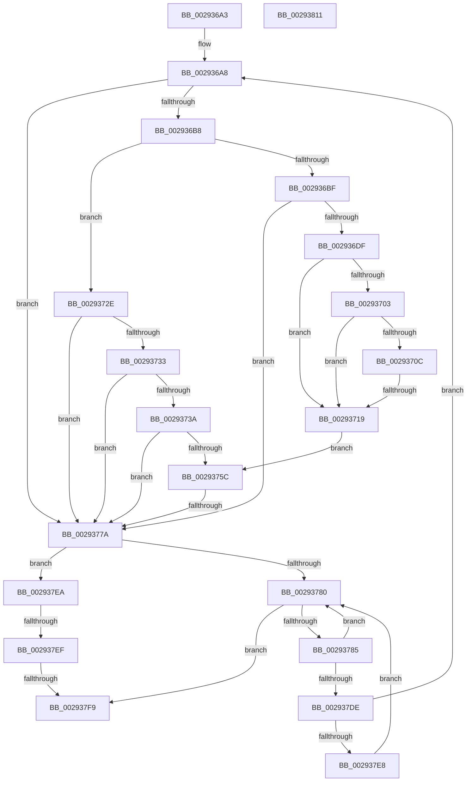

# sub_002936A3

- RVA: `0x002936A3`–`0x00293812` (길이 `367` bytes)
- VA: `0x00000001402936A3`
- 실행 섹션: `.text`
- PDB 이름 있음: `아니요`; PDB Function 태그: `아니요`
- unwind 정보 RVA: `0x0006769C`
- 디코드: `101`개 명령, `367/367` bytes 표시
- 미해석 바이트: `0` (있으면 어셈블리에 `.byte`로 보존)

> 이 문서는 커널 이미지의 기계어와 PDB 기호를 분석해 생성했습니다. 4번과 5번은 함수 원형과 자료형을 바이너리 사용 방식에서 추정한 C 해석이며 원본 소스 복구 결과는 아닙니다.

## 1. Dependencies

- 직접 호출 지점: **0**; 고유 호출 대상: **0**
- 직접 호출자로 확인된 함수: **0**
- RIP 상대 이미지 참조: **0**

### Outgoing calls
- 직접 디코드된 call 명령이 없습니다.

### Direct callers
- 이 함수 시작 RVA로 연결되는 직접 call은 확인되지 않았습니다. 간접 호출은 완전히 역산할 수 없습니다.

### Static image references
- 디코드된 RIP-relative 메모리 참조가 없습니다.

## 2. Other-region calls and transfers

- 다른 실행 섹션으로 향하는 call: **0**
- call이 아닌 외부 분기/꼬리 이동: **4**
  - `0x00293713` → [sub_0029384E + 0x75](Unknown_function_0029384E.md) (`tail-transfer`)
  - `0x00293774` → [sub_0029384E + 0x32](Unknown_function_0029384E.md) (`tail-transfer`)
  - `0x002937ED` → [sub_0029384E](Unknown_function_0029384E.md) (`tail-transfer`)
  - `0x002937F3` → [sub_0029384E + 0x96](Unknown_function_0029384E.md) (`tail-transfer`)

## 3. Assembly (complete function range)

```asm
002936A3  4C 89 7C 24 40                  mov qword ptr [rsp + 0x40], r15
002936A8  45 33 D2                        xor r10d, r10d
002936AB  44 8B 4B 1C                     mov r9d, dword ptr [rbx + 0x1c]
002936AF  45 85 C9                        test r9d, r9d
002936B2  0F 84 C2 00 00 00               je 0x14029377a
002936B8  8B 43 10                        mov eax, dword ptr [rbx + 0x10]
002936BB  A8 02                           test al, 2
002936BD  75 6F                           jne 0x14029372e
002936BF  41 8D 41 FF                     lea eax, [r9 - 1]
002936C3  4C 8D 1C C3                     lea r11, [rbx + rax*8]
002936C7  48 8B 44 C3 28                  mov rax, qword ptr [rbx + rax*8 + 0x28]
002936CC  48 8B D0                        mov rdx, rax
002936CF  48 C1 EA 0A                     shr rdx, 0xa
002936D3  83 E2 03                        and edx, 3
002936D6  48 3B D6                        cmp rdx, rsi
002936D9  0F 85 9B 00 00 00               jne 0x14029377a
002936DF  4C 8B C0                        mov r8, rax
002936E2  48 8B C8                        mov rcx, rax
002936E5  41 81 E0 FF 03 00 00            and r8d, 0x3ff
002936EC  48 81 E1 00 F0 FF FF            and rcx, 0xfffffffffffff000
002936F3  49 8D 50 01                     lea rdx, [r8 + 1]
002936F7  48 0F AF D7                     imul rdx, rdi
002936FB  48 03 D1                        add rdx, rcx
002936FE  49 3B D6                        cmp rdx, r14
00293701  75 16                           jne 0x140293719
00293703  49 8D 0C 28                     lea rcx, [r8 + rbp]
00293707  49 3B C8                        cmp rcx, r8
0029370A  76 0D                           jbe 0x140293719
0029370C  48 81 F9 FF 03 00 00            cmp rcx, 0x3ff
00293713  0F 86 AA 01 00 00               jbe 0x1402938c3
00293719  41 8D 49 FF                     lea ecx, [r9 - 1]
0029371D  48 8D 49 05                     lea rcx, [rcx + 5]
00293721  48 8B 04 CB                     mov rax, qword ptr [rbx + rcx*8]
00293725  4C 8D 1C CB                     lea r11, [rbx + rcx*8]
00293729  48 8B C8                        mov rcx, rax
0029372C  EB 2E                           jmp 0x14029375c
0029372E  45 85 C9                        test r9d, r9d
00293731  74 47                           je 0x14029377a
00293733  8B 43 10                        mov eax, dword ptr [rbx + 0x10]
00293736  A8 02                           test al, 2
00293738  75 40                           jne 0x14029377a
0029373A  41 8D 49 FF                     lea ecx, [r9 - 1]
0029373E  48 8D 49 05                     lea rcx, [rcx + 5]
00293742  48 8B 04 CB                     mov rax, qword ptr [rbx + rcx*8]
00293746  4C 8D 1C CB                     lea r11, [rbx + rcx*8]
0029374A  48 8B D0                        mov rdx, rax
0029374D  48 8B C8                        mov rcx, rax
00293750  48 C1 EA 0A                     shr rdx, 0xa
00293754  83 E2 03                        and edx, 3
00293757  48 3B D6                        cmp rdx, rsi
0029375A  75 1E                           jne 0x14029377a
0029375C  4C 8B FF                        mov r15, rdi
0029375F  48 8B D1                        mov rdx, rcx
00293762  4C 0F AF FD                     imul r15, rbp
00293766  48 81 E2 00 F0 FF FF            and rdx, 0xfffffffffffff000
0029376D  4F 8D 04 37                     lea r8, [r15 + r14]
00293771  49 3B D0                        cmp rdx, r8
00293774  0F 84 06 01 00 00               je 0x140293880
0029377A  44 3B 4B 0C                     cmp r9d, dword ptr [rbx + 0xc]
0029377E  74 6A                           je 0x1402937ea
00293780  48 85 ED                        test rbp, rbp
00293783  74 74                           je 0x1402937f9
00293785  48 8D 45 FF                     lea rax, [rbp - 1]
00293789  BA 00 04 00 00                  mov edx, 0x400
0029378E  48 3D FF 03 00 00               cmp rax, 0x3ff
00293794  8B C6                           mov eax, esi
00293796  48 0F 46 D5                     cmovbe rdx, rbp
0029379A  83 E0 03                        and eax, 3
0029379D  48 C1 E0 0A                     shl rax, 0xa
002937A1  48 8D 4A FF                     lea rcx, [rdx - 1]
002937A5  81 E1 FF 03 00 00               and ecx, 0x3ff
002937AB  48 0B C1                        or rax, rcx
002937AE  49 8B CE                        mov rcx, r14
002937B1  48 81 E1 00 F0 FF FF            and rcx, 0xfffffffffffff000
002937B8  48 0B C1                        or rax, rcx
002937BB  48 8B CF                        mov rcx, rdi
002937BE  4A 89 44 CB 28                  mov qword ptr [rbx + r9*8 + 0x28], rax
002937C3  44 8B 4B 1C                     mov r9d, dword ptr [rbx + 0x1c]
002937C7  48 01 53 20                     add qword ptr [rbx + 0x20], rdx
002937CB  41 FF C1                        inc r9d
002937CE  48 0F AF CA                     imul rcx, rdx
002937D2  44 89 4B 1C                     mov dword ptr [rbx + 0x1c], r9d
002937D6  4C 03 F1                        add r14, rcx
002937D9  48 2B EA                        sub rbp, rdx
002937DC  74 A2                           je 0x140293780
002937DE  44 3B 4B 0C                     cmp r9d, dword ptr [rbx + 0xc]
002937E2  0F 84 C0 FE FF FF               je 0x1402936a8
002937E8  EB 96                           jmp 0x140293780
002937EA  45 85 D2                        test r10d, r10d
002937ED  74 5F                           je 0x14029384e
002937EF  80 7B 19 00                     cmp byte ptr [rbx + 0x19], 0
002937F3  0F 84 EB 00 00 00               je 0x1402938e4
002937F9  4C 8B 7C 24 40                  mov r15, qword ptr [rsp + 0x40]
002937FE  48 8B 5C 24 48                  mov rbx, qword ptr [rsp + 0x48]
00293803  48 8B 6C 24 50                  mov rbp, qword ptr [rsp + 0x50]
00293808  48 83 C4 20                     add rsp, 0x20
0029380C  41 5E                           pop r14
0029380E  5F                              pop rdi
0029380F  5E                              pop rsi
00293810  C3                              ret
00293811  CC                              int3
```

## 4. C-style interpretation (structured pseudocode)

```c
__int64 __fastcall sub_002936A3(__int64 a1, __int64 a2, __int64 a3, __int64 a4, __int64 a5, __int64 a6, __int64 a7, __int64 a8, __int64 a9, __int64 a10)
{
    __int64 result;
    __int64 v_r10;
    __int64 v_r14;
    __int64 v_r15;
    __int64 v_rbp;
    __int64 v_rsp;
    unsigned __int64 v_stack_p40;

    v_stack_p40 = v_r15;
loc_002936A8:
    v_r10 = 0;
    if ((unsigned int)((unsigned int)(*(unsigned int *)(v_rbx + 28))) == 0) goto loc_0029377A;
    if ((((unsigned __int8)((unsigned int)(*(unsigned int *)(v_rbx + 16)))) & (2)) != 0) goto loc_0029372E;
    a2 = (*(unsigned __int64 *)(v_rbx + (unsigned int)(*(unsigned int *)(v_rbx + 28)) - 1 * 8 + 40)) >> (10);
    a2 = (unsigned int)((a2) & (3));
    if (a2 != v_rsi) goto loc_0029377A;
    a3 = (unsigned int)((*(unsigned __int64 *)(v_rbx + (unsigned int)(*(unsigned int *)(v_rbx + 28)) - 1 * 8 + 40)) & (0x3FFULL));
    a1 = (*(unsigned __int64 *)(v_rbx + (unsigned int)(*(unsigned int *)(v_rbx + 28)) - 1 * 8 + 40)) & (0xFFFFFFFFFFFFF000ULL);
    a2 = (a3 + 1) * (v_rdi);
    a2 = (a2) + (a1);
    if (a2 != v_r14) goto loc_00293719;
    if ((a3 + v_rbp * 1) <= a3) goto loc_00293719;
loc_00293719:
    goto loc_0029375C;
loc_0029372E:
    if ((unsigned int)((unsigned int)(*(unsigned int *)(v_rbx + 28))) == 0) goto loc_0029377A;
    if ((((unsigned __int8)((unsigned int)(*(unsigned int *)(v_rbx + 16)))) & (2)) != 0) goto loc_0029377A;
    a2 = (*(unsigned __int64 *)(v_rbx + (unsigned int)(*(unsigned int *)(v_rbx + 28)) - 1 + 5 * 8)) >> (10);
    a2 = (unsigned int)((a2) & (3));
    if (a2 != v_rsi) goto loc_0029377A;
loc_0029375C:
    v_r15 = (v_rdi) * (v_rbp);
    a2 = (*(unsigned __int64 *)(v_rbx + (unsigned int)(*(unsigned int *)(v_rbx + 28)) - 1 + 5 * 8)) & (0xFFFFFFFFFFFFF000ULL);
loc_0029377A:
    if (((unsigned int)((unsigned int)(*(unsigned int *)(v_rbx + 28)))) == (*(unsigned int *)(v_rbx + 12))) goto loc_002937EA;
loc_00293780:
    if (v_rbp == 0) goto loc_002937F9;
    a2 = (unsigned int)(0x400ULL);
    if ((v_rbp - 1) <= 0x3FFULL) { a2 = v_rbp; }
    result = (unsigned int)(((unsigned int)((unsigned int)(v_rsi))) & (3));
    result = (result) << (10);
    a1 = (unsigned int)((a2 - 1) & (0x3FFULL));
    result = (result) | (a1);
    a1 = (v_r14) & (0xFFFFFFFFFFFFF000ULL);
    result = (result) | (a1);
    *(unsigned __int64 *)(v_rbx + (unsigned int)(*(unsigned int *)(v_rbx + 28)) * 8 + 40) = result;
    a4 = (unsigned int)(((unsigned int)(*(unsigned int *)(v_rbx + 28))) + 1);
    a1 = (v_rdi) * (a2);
    *(unsigned int *)(v_rbx + 28) = (unsigned int)(a4);
    v_r14 = (v_r14) + (a1);
    v_rbp = (v_rbp) - (a2);
    if (condition_is_equal) goto loc_00293780;
    if (((unsigned int)(a4)) == (*(unsigned int *)(v_rbx + 12))) goto loc_002936A8;
    goto loc_00293780;
loc_002937EA:
loc_002937F9:
    v_rsp = (v_rsp) + (32);
    return result;
}
```

## 5. (Beta) C Style

```c
int64_t sub_002936A3(int64_t Arg1, int64_t Arg2, int64_t Arg3, int64_t Arg4, uint64_t Arg5, uint64_t Arg6, uint64_t Arg7, int64_t Arg8, int64_t Arg9, int64_t Arg10)
{
    int64_t result;
    int64_t local_r10;
    int64_t local_r14;
    int64_t local_r15;
    int64_t local_rbp;
    int64_t local_rsp;
    uint64_t v_stack_p40;

    v_stack_p40 = local_r15;
loc_002936A8:
    local_r10 = 0;
    if ((uint32_t)((uint32_t)(*(uint32_t *)(local_rbx + 0x1C))) == 0) goto loc_0029377A;
    if ((((uint8_t)((uint32_t)(*(uint32_t *)(local_rbx + 0x10)))) & (2)) != 0) goto loc_0029372E;
    Arg2 = (*(uint64_t *)(local_rbx + (uint32_t)(*(uint32_t *)(local_rbx + 0x1C)) - 0x1 * 8 + 0x28)) >> (10);
    Arg2 = (uint32_t)((Arg2) & (3));
    if (Arg2 != local_rsi) goto loc_0029377A;
    Arg3 = (uint32_t)((*(uint64_t *)(local_rbx + (uint32_t)(*(uint32_t *)(local_rbx + 0x1C)) - 0x1 * 8 + 0x28)) & (0x3FFULL));
    Arg1 = (*(uint64_t *)(local_rbx + (uint32_t)(*(uint32_t *)(local_rbx + 0x1C)) - 0x1 * 8 + 0x28)) & (0xFFFFFFFFFFFFF000ULL);
    Arg2 = (Arg3 + 1) * (local_rdi);
    Arg2 = (Arg2) + (Arg1);
    if (Arg2 != local_r14) goto loc_00293719;
    if ((Arg3 + local_rbp * 1) <= Arg3) goto loc_00293719;
loc_00293719:
    goto loc_0029375C;
loc_0029372E:
    if ((uint32_t)((uint32_t)(*(uint32_t *)(local_rbx + 0x1C))) == 0) goto loc_0029377A;
    if ((((uint8_t)((uint32_t)(*(uint32_t *)(local_rbx + 0x10)))) & (2)) != 0) goto loc_0029377A;
    Arg2 = (*(uint64_t *)(local_rbx + (uint32_t)(*(uint32_t *)(local_rbx + 0x1C)) - 0x1 + 0x5 * 8)) >> (10);
    Arg2 = (uint32_t)((Arg2) & (3));
    if (Arg2 != local_rsi) goto loc_0029377A;
loc_0029375C:
    local_r15 = (local_rdi) * (local_rbp);
    Arg2 = (*(uint64_t *)(local_rbx + (uint32_t)(*(uint32_t *)(local_rbx + 0x1C)) - 0x1 + 0x5 * 8)) & (0xFFFFFFFFFFFFF000ULL);
loc_0029377A:
    if (((uint32_t)((uint32_t)(*(uint32_t *)(local_rbx + 0x1C)))) == (*(uint32_t *)(local_rbx + 0xC))) goto loc_002937EA;
loc_00293780:
    if (local_rbp == 0) goto loc_002937F9;
    Arg2 = (uint32_t)(0x400ULL);
    if ((local_rbp - 1) <= 0x3FFULL) { Arg2 = local_rbp; }
    result = (uint32_t)(((uint32_t)((uint32_t)(local_rsi))) & (3));
    result = (result) << (10);
    Arg1 = (uint32_t)((Arg2 - 1) & (0x3FFULL));
    result = (result) | (Arg1);
    Arg1 = (local_r14) & (0xFFFFFFFFFFFFF000ULL);
    result = (result) | (Arg1);
    *(uint64_t *)(local_rbx + (uint32_t)(*(uint32_t *)(local_rbx + 0x1C)) * 8 + 0x28) = result;
    Arg4 = (uint32_t)(((uint32_t)(*(uint32_t *)(local_rbx + 0x1C))) + 1);
    Arg1 = (local_rdi) * (Arg2);
    *(uint32_t *)(local_rbx + 0x1C) = (uint32_t)(Arg4);
    local_r14 = (local_r14) + (Arg1);
    local_rbp = (local_rbp) - (Arg2);
    if (condition_is_equal) goto loc_00293780;
    if (((uint32_t)(Arg4)) == (*(uint32_t *)(local_rbx + 0xC))) goto loc_002936A8;
    goto loc_00293780;
loc_002937EA:
loc_002937F9:
    local_rsp = (local_rsp) + (32);
    return result;
}
```

## 6. Execution-region graph

[열기: 2D/3D 그래프와 함수 탐색 컨트롤 패널](../../../control-panel.html?section=text&rva=0x002936A3&view=graph)

- 2D 그래프는 위에서 아래로 흐르고, 3D 그래프는 빈 공간을 드래그해 회전합니다. Shift+드래그는 이동, 휠은 확대·축소, 함수 노드 선택은 대상 보고서 이동입니다.

### Static fallback


