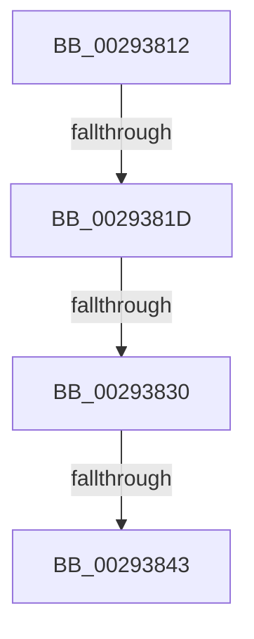

# sub_00293812

- RVA: `0x00293812`–`0x0029384E` (길이 `60` bytes)
- VA: `0x0000000140293812`
- 실행 섹션: `.text`
- PDB 이름 있음: `아니요`; PDB Function 태그: `아니요`
- unwind 정보 RVA: `0x000676B4`
- 디코드: `12`개 명령, `60/60` bytes 표시
- 미해석 바이트: `0` (있으면 어셈블리에 `.byte`로 보존)

> 이 문서는 커널 이미지의 기계어와 PDB 기호를 분석해 생성했습니다. 4번과 5번은 함수 원형과 자료형을 바이너리 사용 방식에서 추정한 C 해석이며 원본 소스 복구 결과는 아닙니다.

## 1. Dependencies

- 직접 호출 지점: **0**; 고유 호출 대상: **0**
- 직접 호출자로 확인된 함수: **0**
- RIP 상대 이미지 참조: **0**

### Outgoing calls
- 직접 디코드된 call 명령이 없습니다.

### Direct callers
- 이 함수 시작 RVA로 연결되는 직접 call은 확인되지 않았습니다. 간접 호출은 완전히 역산할 수 없습니다.

### Static image references
- 디코드된 RIP-relative 메모리 참조가 없습니다.

## 2. Other-region calls and transfers

- 다른 실행 섹션으로 향하는 call: **0**
- call이 아닌 외부 분기/꼬리 이동: **4**
  - `0x00293817` → [sub_002936A3](Unknown_function_002936A3.md) (`tail-transfer`)
  - `0x0029382A` → [sub_002936A3](Unknown_function_002936A3.md) (`tail-transfer`)
  - `0x0029383D` → [sub_002936A3](Unknown_function_002936A3.md) (`tail-transfer`)
  - `0x00293849` → [sub_002936A3](Unknown_function_002936A3.md) (`tail-transfer`)

## 3. Assembly (complete function range)

```asm
00293812  8B 43 10                        mov eax, dword ptr [rbx + 0x10]
00293815  A8 04                           test al, 4
00293817  0F 85 86 FE FF FF               jne 0x1402936a3
0029381D  48 B9 00 00 00 00 80 F6 FF FF   movabs rcx, 0xfffff68000000000
00293827  48 3B D1                        cmp rdx, rcx
0029382A  0F 82 73 FE FF FF               jb 0x1402936a3
00293830  48 B9 FF FF FF FF FF F6 FF FF   movabs rcx, 0xfffff6ffffffffff
0029383A  48 3B D1                        cmp rdx, rcx
0029383D  0F 87 60 FE FF FF               ja 0x1402936a3
00293843  83 C8 04                        or eax, 4
00293846  89 43 10                        mov dword ptr [rbx + 0x10], eax
00293849  E9 55 FE FF FF                  jmp 0x1402936a3
```

## 4. C-style interpretation (structured pseudocode)

```c
__int64 __fastcall sub_00293812(__int64 a1, __int64 a2)
{
    __int64 result;

    result = (unsigned int)(((unsigned int)(*(unsigned int *)(v_rbx + 16))) | (4));
    *(unsigned int *)(v_rbx + 16) = (unsigned int)(result);
}
```

## 5. (Beta) C Style

```c
int64_t sub_00293812(int64_t Arg1, int64_t Arg2)
{
    int64_t result;

    result = (uint32_t)(((uint32_t)(*(uint32_t *)(local_rbx + 0x10))) | (4));
    *(uint32_t *)(local_rbx + 0x10) = (uint32_t)(result);
}
```

## 6. Execution-region graph

[열기: 2D/3D 그래프와 함수 탐색 컨트롤 패널](../../../control-panel.html?section=text&rva=0x00293812&view=graph)

- 2D 그래프는 위에서 아래로 흐르고, 3D 그래프는 빈 공간을 드래그해 회전합니다. Shift+드래그는 이동, 휠은 확대·축소, 함수 노드 선택은 대상 보고서 이동입니다.

### Static fallback


