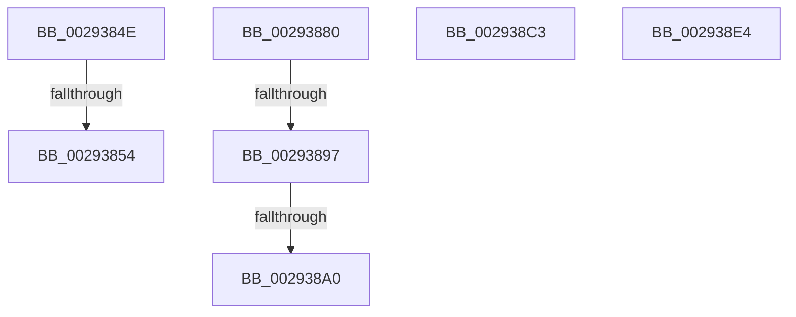

# sub_0029384E

- RVA: `0x0029384E`–`0x002938ED` (길이 `159` bytes)
- VA: `0x000000014029384E`
- 실행 섹션: `.text`
- PDB 이름 있음: `아니요`; PDB Function 태그: `아니요`
- unwind 정보 RVA: `0x000676C4`
- 디코드: `36`개 명령, `159/159` bytes 표시
- 미해석 바이트: `0` (있으면 어셈블리에 `.byte`로 보존)

> 이 문서는 커널 이미지의 기계어와 PDB 기호를 분석해 생성했습니다. 4번과 5번은 함수 원형과 자료형을 바이너리 사용 방식에서 추정한 C 해석이며 원본 소스 복구 결과는 아닙니다.

## 1. Dependencies

- 직접 호출 지점: **2**; 고유 호출 대상: **2**
- 직접 호출자로 확인된 함수: **0**
- RIP 상대 이미지 참조: **1**

### Outgoing calls
- `0x00293868` → [qsort](../50/qsort_function_005009F0.md) (function, `0x005009F0`)
- `0x00293870` → [MiCompressTbFlushList](../2A/MiCompressTbFlushList_function_002A93A8.md) (function, `0x002A93A8`)

### Direct callers
- 이 함수 시작 RVA로 연결되는 직접 call은 확인되지 않았습니다. 간접 호출은 완전히 역산할 수 없습니다.

### Static image references
- `0x0029385B` → RVA `0x00695890` (`MiTbFlushSort`; read)

## 2. Other-region calls and transfers

- 다른 실행 섹션으로 향하는 call: **0**
- call이 아닌 외부 분기/꼬리 이동: **7**
  - `0x00293852` → [sub_002936A3 + 0x156](Unknown_function_002936A3.md) (`tail-transfer`)
  - `0x0029387B` → [sub_002936A3 + 0x8](Unknown_function_002936A3.md) (`tail-transfer`)
  - `0x00293891` → [sub_002936A3 + 0xD7](Unknown_function_002936A3.md) (`tail-transfer`)
  - `0x0029389A` → [sub_002936A3 + 0xD7](Unknown_function_002936A3.md) (`tail-transfer`)
  - `0x002938BE` → [sub_002936A3 + 0x156](Unknown_function_002936A3.md) (`tail-transfer`)
  - `0x002938DF` → [sub_002936A3 + 0x156](Unknown_function_002936A3.md) (`tail-transfer`)
  - `0x002938E8` → [sub_002936A3 + 0x156](Unknown_function_002936A3.md) (`tail-transfer`)

## 3. Assembly (complete function range)

```asm
0029384E  80 7B 19 00                     cmp byte ptr [rbx + 0x19], 0
00293852  75 A5                           jne 0x1402937f9
00293854  49 8B D1                        mov rdx, r9
00293857  48 8D 4B 28                     lea rcx, [rbx + 0x28]
0029385B  4C 8D 0D 2E 20 40 00            lea r9, [rip + 0x40202e]
00293862  41 B8 08 00 00 00               mov r8d, 8
00293868  E8 83 D1 26 00                  call 0x1405009f0
0029386D  48 8B CB                        mov rcx, rbx
00293870  E8 33 5B 01 00                  call 0x1402a93a8
00293875  41 BA 01 00 00 00               mov r10d, 1
0029387B  E9 2B FE FF FF                  jmp 0x1402936ab
00293880  81 E1 FF 03 00 00               and ecx, 0x3ff
00293886  48 8D 14 29                     lea rdx, [rcx + rbp]
0029388A  48 81 FA FF 03 00 00            cmp rdx, 0x3ff
00293891  0F 87 E3 FE FF FF               ja 0x14029377a
00293897  48 3B D1                        cmp rdx, rcx
0029389A  0F 86 DA FE FF FF               jbe 0x14029377a
002938A0  48 01 6B 20                     add qword ptr [rbx + 0x20], rbp
002938A4  49 2B C7                        sub rax, r15
002938A7  48 8D 0C 28                     lea rcx, [rax + rbp]
002938AB  48 8B D1                        mov rdx, rcx
002938AE  48 33 D0                        xor rdx, rax
002938B1  48 81 E2 00 FC FF FF            and rdx, 0xfffffffffffffc00
002938B8  48 33 D1                        xor rdx, rcx
002938BB  49 89 13                        mov qword ptr [r11], rdx
002938BE  E9 36 FF FF FF                  jmp 0x1402937f9
002938C3  48 01 6B 20                     add qword ptr [rbx + 0x20], rbp
002938C7  48 8D 0C 28                     lea rcx, [rax + rbp]
002938CB  48 8B D1                        mov rdx, rcx
002938CE  48 33 D0                        xor rdx, rax
002938D1  48 81 E2 00 FC FF FF            and rdx, 0xfffffffffffffc00
002938D8  48 33 D1                        xor rdx, rcx
002938DB  49 89 53 28                     mov qword ptr [r11 + 0x28], rdx
002938DF  E9 15 FF FF FF                  jmp 0x1402937f9
002938E4  C6 43 19 01                     mov byte ptr [rbx + 0x19], 1
002938E8  E9 0C FF FF FF                  jmp 0x1402937f9
```

## 4. C-style interpretation (structured pseudocode)

```c
__int64 __fastcall sub_0029384E(__int64 a1, __int64 a2, __int64 a3, __int64 a4)
{
    __int64 result;

    result = qsort(v_rbx + 40, a4, 8, v_rip + 4202542);
    result = MiCompressTbFlushList(v_rbx, a4, 8, v_rip + 4202542);
}
```

## 5. (Beta) C Style

```c
int64_t sub_0029384E(int64_t Arg1, int64_t Arg2, int64_t Arg3, int64_t Arg4)
{
    int64_t result;

    result = qsort(local_rbx + 40, Arg4, 8, v_rip + 4202542);
    result = MiCompressTbFlushList(local_rbx, Arg4, 8, v_rip + 4202542);
}
```

## 6. Execution-region graph

[열기: 2D/3D 그래프와 함수 탐색 컨트롤 패널](../../../control-panel.html?section=text&rva=0x0029384E&view=graph)

- 2D 그래프는 위에서 아래로 흐르고, 3D 그래프는 빈 공간을 드래그해 회전합니다. Shift+드래그는 이동, 휠은 확대·축소, 함수 노드 선택은 대상 보고서 이동입니다.

### Static fallback


