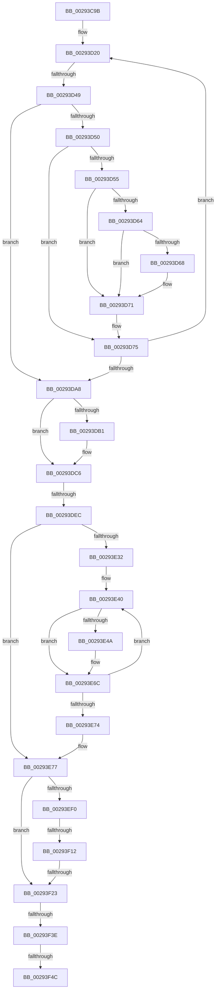

# sub_00293C9B

- RVA: `0x00293C9B`–`0x00293F75` (길이 `730` bytes)
- VA: `0x0000000140293C9B`
- 실행 섹션: `.text`
- PDB 이름 있음: `아니요`; PDB Function 태그: `아니요`
- unwind 정보 RVA: `0x00067708`
- 디코드: `158`개 명령, `730/730` bytes 표시
- 미해석 바이트: `0` (있으면 어셈블리에 `.byte`로 보존)

> 이 문서는 커널 이미지의 기계어와 PDB 기호를 분석해 생성했습니다. 4번과 5번은 함수 원형과 자료형을 바이너리 사용 방식에서 추정한 C 해석이며 원본 소스 복구 결과는 아닙니다.

## 1. Dependencies

- 직접 호출 지점: **13**; 고유 호출 대상: **13**
- 직접 호출자로 확인된 함수: **0**
- RIP 상대 이미지 참조: **2**

### Outgoing calls
- `0x00293CB4` → [MiLockWorkingSetOptimal](../23/MiLockWorkingSetOptimal_function_00238FC0.md) (function, `0x00238FC0`)
- `0x00293CC4` → [MiGetContainingPageTable](../34/MiGetContainingPageTable_function_003467F0.md) (function, `0x003467F0`)
- `0x00293CE6` → [MiGetProcessorFlushList](../24/MiGetProcessorFlushList_function_00242C90.md) (function, `0x00242C90`)
- `0x00293DB7` → [MiRemoveWsleList](MiRemoveWsleList_function_00292160.md) (function, `0x00292160`)
- `0x00293E67` → [MiAddPageToInsertList](../24/MiAddPageToInsertList_function_0024A950.md) (function, `0x0024A950`)
- `0x00293E85` → [MiReleaseProcessorFlushList](../31/MiReleaseProcessorFlushList_function_00313C70.md) (function, `0x00313C70`)
- `0x00293E94` → [MiInsertPagesInList](../33/MiInsertPagesInList_function_0033E270.md) (function, `0x0033E270`)
- `0x00293EB0` → [MiUnlockWorkingSetOptimal](../23/MiUnlockWorkingSetOptimal_function_00238DFC.md) (function, `0x00238DFC`)
- `0x00293EC8` → [MiManageSubsectionView](../2E/MiManageSubsectionView_function_002E2570.md) (function, `0x002E2570`)
- `0x00293EE6` → [ExAcquireSpinLockExclusive](../24/ExAcquireSpinLockExclusive_function_00248690.md) (function, `0x00248690`)
- `0x00293EFD` → [MiRemoveViewsFromSection](MiRemoveViewsFromSection_function_00298960.md) (function, `0x00298960`)
- `0x00293F30` → [MiCheckControlArea](../28/MiCheckControlArea_function_002861B0.md) (function, `0x002861B0`)
- `0x00293F56` → [MiReleaseSystemCacheView](MiReleaseSystemCacheView_function_00294CE0.md) (function, `0x00294CE0`)

### Direct callers
- 이 함수 시작 RVA로 연결되는 직접 call은 확인되지 않았습니다. 간접 호출은 완전히 역산할 수 없습니다.

### Static image references
- `0x00293D55` → RVA `0x00E2DC80` (`.data`; read)
- `0x00293D75` → RVA `0x00010880` (`.rdata`; read)

## 2. Other-region calls and transfers

- 다른 실행 섹션으로 향하는 call: **0**
- call이 아닌 외부 분기/꼬리 이동: **6**
  - `0x00293D43` → [sub_00293F76](Unknown_function_00293F76.md) (`tail-transfer`)
  - `0x00293DE6` → [sub_00293F76 + 0x22F](Unknown_function_00293F76.md) (`tail-transfer`)
  - `0x00293F0C` → [sub_0029430C + 0x10](Unknown_function_0029430C.md) (`tail-transfer`)
  - `0x00293F1D` → [sub_0029430C + 0x10](Unknown_function_0029430C.md) (`tail-transfer`)
  - `0x00293F38` → [sub_0029430C + 0xD1](Unknown_function_0029430C.md) (`tail-transfer`)
  - `0x00293F46` → [sub_00293F76 + 0x330](Unknown_function_00293F76.md) (`tail-transfer`)

## 3. Assembly (complete function range)

```asm
00293C9B  4C 89 A4 24 28 01 00 00         mov qword ptr [rsp + 0x128], r12
00293CA3  4C 8D 84 24 88 01 00 00         lea r8, [rsp + 0x188]
00293CAB  49 8B D6                        mov rdx, r14
00293CAE  49 8B CD                        mov rcx, r13
00293CB1  45 33 E4                        xor r12d, r12d
00293CB4  E8 07 53 FA FF                  call 0x140238fc0
00293CB9  49 8B CE                        mov rcx, r14
00293CBC  48 89 84 24 80 00 00 00         mov qword ptr [rsp + 0x80], rax
00293CC4  E8 27 2B 0B 00                  call 0x1403467f0
00293CC9  48 B9 00 00 00 00 00 DE FF FF   movabs rcx, 0xffffde0000000000
00293CD3  48 8D 04 40                     lea rax, [rax + rax*2]
00293CD7  48 C1 E0 04                     shl rax, 4
00293CDB  48 8B C9                        mov rcx, rcx
00293CDE  48 03 C1                        add rax, rcx
00293CE1  48 89 44 24 78                  mov qword ptr [rsp + 0x78], rax
00293CE6  E8 A5 EF FA FF                  call 0x140242c90
00293CEB  48 8B 54 24 50                  mov rdx, qword ptr [rsp + 0x50]
00293CF0  48 8B E8                        mov rbp, rax
00293CF3  48 89 7C 24 38                  mov qword ptr [rsp + 0x38], rdi
00293CF8  49 B8 FF FF FF FF FF 00 00 00   movabs r8, 0xffffffffff
00293D02  49 B9 FF FF FF FF FF FF FF 3F   movabs r9, 0x3fffffffffffffff
00293D0C  48 89 B8 60 40 00 00            mov qword ptr [rax + 0x4060], rdi
00293D13  0F 1F 40 00                     nop dword ptr [rax]
00293D17  66 0F 1F 84 00 00 00 00 00      nop word ptr [rax + rax]
00293D20  49 8B 06                        mov rax, qword ptr [r14]
00293D23  48 89 44 24 48                  mov qword ptr [rsp + 0x48], rax
00293D28  8B 8D 58 30 00 00               mov ecx, dword ptr [rbp + 0x3058]
00293D2E  48 89 84 CD 60 30 00 00         mov qword ptr [rbp + rcx*8 + 0x3060], rax
00293D36  FF 85 58 30 00 00               inc dword ptr [rbp + 0x3058]
00293D3C  48 8B 44 24 48                  mov rax, qword ptr [rsp + 0x48]
00293D41  A8 01                           test al, 1
00293D43  0F 85 2D 02 00 00               jne 0x140293f76
00293D49  48 0F BA E0 0A                  bt rax, 0xa
00293D4E  73 58                           jae 0x140293da8
00293D50  48 85 D2                        test rdx, rdx
00293D53  74 20                           je 0x140293d75
00293D55  48 8B 0D 24 9F B9 00            mov rcx, qword ptr [rip + 0xb99f24]
00293D5C  4C 8B F8                        mov r15, rax
00293D5F  48 85 C9                        test rcx, rcx
00293D62  74 0D                           je 0x140293d71
00293D64  A8 10                           test al, 0x10
00293D66  75 09                           jne 0x140293d71
00293D68  4C 8B F9                        mov r15, rcx
00293D6B  49 F7 D7                        not r15
00293D6E  4C 23 F8                        and r15, rax
00293D71  49 C1 FF 10                     sar r15, 0x10
00293D75  48 8B 05 04 CB D7 FF            mov rax, qword ptr [rip - 0x2834fc]
00293D7C  FF C6                           inc esi
00293D7E  49 89 06                        mov qword ptr [r14], rax
00293D81  48 81 C7 00 10 00 00            add rdi, 0x1000
00293D88  89 74 24 34                     mov dword ptr [rsp + 0x34], esi
00293D8C  B8 01 00 00 00                  mov eax, 1
00293D91  48 89 7C 24 38                  mov qword ptr [rsp + 0x38], rdi
00293D96  44 03 E0                        add r12d, eax
00293D99  49 83 C6 08                     add r14, 8
00293D9D  4C 3B 74 24 68                  cmp r14, qword ptr [rsp + 0x68]
00293DA2  0F 82 78 FF FF FF               jb 0x140293d20
00293DA8  4C 8B 6C 24 40                  mov r13, qword ptr [rsp + 0x40]
00293DAD  85 DB                           test ebx, ebx
00293DAF  74 15                           je 0x140293dc6
00293DB1  48 8B D5                        mov rdx, rbp
00293DB4  49 8B CD                        mov rcx, r13
00293DB7  E8 A4 E3 FF FF                  call 0x140292160
00293DBC  49 B9 FF FF FF FF FF FF FF 3F   movabs r9, 0x3fffffffffffffff
00293DC6  4C 8B 74 24 70                  mov r14, qword ptr [rsp + 0x70]
00293DCB  48 B9 00 00 00 00 00 00 00 80   movabs rcx, 0x8000000000000000
00293DD5  49 8B 46 20                     mov rax, qword ptr [r14 + 0x20]
00293DD9  49 23 C1                        and rax, r9
00293DDC  48 0B C1                        or rax, rcx
00293DDF  49 89 46 20                     mov qword ptr [r14 + 0x20], rax
00293DE3  45 85 E4                        test r12d, r12d
00293DE6  0F 85 B9 03 00 00               jne 0x1402941a5
00293DEC  48 63 7C 24 34                  movsxd rdi, dword ptr [rsp + 0x34]
00293DF1  48 8D B5 60 30 00 00            lea rsi, [rbp + 0x3060]
00293DF8  45 33 E4                        xor r12d, r12d
00293DFB  48 B8 FF FF FF FF 3F 00 00 00   movabs rax, 0x3fffffffff
00293E05  48 89 84 24 C0 00 00 00         mov qword ptr [rsp + 0xc0], rax
00293E0D  48 89 84 24 C8 00 00 00         mov qword ptr [rsp + 0xc8], rax
00293E15  44 89 A4 24 D0 00 00 00         mov dword ptr [rsp + 0xd0], r12d
00293E1D  44 89 A4 24 10 01 00 00         mov dword ptr [rsp + 0x110], r12d
00293E25  4C 89 A4 24 08 01 00 00         mov qword ptr [rsp + 0x108], r12
00293E2D  48 85 FF                        test rdi, rdi
00293E30  7E 45                           jle 0x140293e77
00293E32  41 8B DC                        mov ebx, r12d
00293E35  49 BC FF FF FF FF FF 00 00 00   movabs r12, 0xffffffffff
00293E3F  90                              nop
00293E40  4C 8B 04 DE                     mov r8, qword ptr [rsi + rbx*8]
00293E44  41 F6 C0 01                     test r8b, 1
00293E48  74 22                           je 0x140293e6c
00293E4A  41 F6 C0 42                     test r8b, 0x42
00293E4E  48 8D 54 24 30                  lea rdx, [rsp + 0x30]
00293E53  48 8D 8C 24 B0 00 00 00         lea rcx, [rsp + 0xb0]
00293E5B  0F 95 44 24 30                  setne byte ptr [rsp + 0x30]
00293E60  49 C1 E8 0C                     shr r8, 0xc
00293E64  4D 23 C4                        and r8, r12
00293E67  E8 E4 6A FB FF                  call 0x14024a950
00293E6C  48 FF C3                        inc rbx
00293E6F  48 3B DF                        cmp rbx, rdi
00293E72  7C CC                           jl 0x140293e40
00293E74  45 33 E4                        xor r12d, r12d
00293E77  44 89 A5 58 30 00 00            mov dword ptr [rbp + 0x3058], r12d
00293E7E  44 89 A5 68 40 00 00            mov dword ptr [rbp + 0x4068], r12d
00293E85  E8 E6 FD 07 00                  call 0x140313c70
00293E8A  33 D2                           xor edx, edx
00293E8C  48 8D 8C 24 B0 00 00 00         lea rcx, [rsp + 0xb0]
00293E94  E8 D7 A3 0A 00                  call 0x14033e270
00293E99  0F B6 9C 24 88 01 00 00         movzx ebx, byte ptr [rsp + 0x188]
00293EA1  49 8B CD                        mov rcx, r13
00293EA4  48 8B 94 24 80 00 00 00         mov rdx, qword ptr [rsp + 0x80]
00293EAC  44 0F B6 C3                     movzx r8d, bl
00293EB0  E8 47 4F FA FF                  call 0x140238dfc
00293EB5  44 8B 44 24 5C                  mov r8d, dword ptr [rsp + 0x5c]
00293EBA  49 8B D6                        mov rdx, r14
00293EBD  4C 8B B4 24 88 00 00 00         mov r14, qword ptr [rsp + 0x88]
00293EC5  49 8B CE                        mov rcx, r14
00293EC8  E8 A3 E6 04 00                  call 0x1402e2570
00293ECD  48 8B AC 24 90 00 00 00         mov rbp, qword ptr [rsp + 0x90]
00293ED5  49 8B FC                        mov rdi, r12
00293ED8  48 83 7C 24 50 00               cmp qword ptr [rsp + 0x50], 0
00293EDE  4D 0F 44 F4                     cmove r14, r12
00293EE2  48 8D 4D 48                     lea rcx, [rbp + 0x48]
00293EE6  E8 A5 47 FB FF                  call 0x140248690
00293EEB  4D 85 F6                        test r14, r14
00293EEE  74 33                           je 0x140293f23
00293EF0  41 8B 56 2C                     mov edx, dword ptr [r14 + 0x2c]
00293EF4  41 B8 04 00 00 00               mov r8d, 4
00293EFA  49 8B CE                        mov rcx, r14
00293EFD  E8 5E 4A 00 00                  call 0x140298960
00293F02  49 8B 4E 08                     mov rcx, qword ptr [r14 + 8]
00293F06  48 03 F8                        add rdi, rax
00293F09  4C 3B F9                        cmp r15, rcx
00293F0C  0F 82 0A 04 00 00               jb 0x14029431c
00293F12  41 8B 46 2C                     mov eax, dword ptr [r14 + 0x2c]
00293F16  48 8D 0C C1                     lea rcx, [rcx + rax*8]
00293F1A  4C 3B F9                        cmp r15, rcx
00293F1D  0F 83 F9 03 00 00               jae 0x14029431c
00293F23  48 FF 4D 28                     dec qword ptr [rbp + 0x28]
00293F27  0F B6 D3                        movzx edx, bl
00293F2A  FF 4D 58                        dec dword ptr [rbp + 0x58]
00293F2D  48 8B CD                        mov rcx, rbp
00293F30  E8 7B 22 FF FF                  call 0x1402861b0
00293F35  48 85 FF                        test rdi, rdi
00293F38  0F 85 9F 04 00 00               jne 0x1402943dd
00293F3E  F6 84 24 80 01 00 00 02         test byte ptr [rsp + 0x180], 2
00293F46  0F 85 5A 03 00 00               jne 0x1402942a6
00293F4C  48 8B 94 24 70 01 00 00         mov rdx, qword ptr [rsp + 0x170]
00293F54  33 C9                           xor ecx, ecx
00293F56  E8 85 0D 00 00                  call 0x140294ce0
00293F5B  4C 8B A4 24 28 01 00 00         mov r12, qword ptr [rsp + 0x128]
00293F63  48 81 C4 30 01 00 00            add rsp, 0x130
00293F6A  41 5F                           pop r15
00293F6C  41 5E                           pop r14
00293F6E  41 5D                           pop r13
00293F70  5F                              pop rdi
00293F71  5E                              pop rsi
00293F72  5D                              pop rbp
00293F73  5B                              pop rbx
00293F74  C3                              ret
```

## 4. C-style interpretation (structured pseudocode)

```c
__int64 __fastcall sub_00293C9B(__int64 a1, __int64 a2, __int64 a3, __int64 a4, __int64 a5, __int64 a6, __int64 a7, __int64 a8, __int64 a9, __int64 a10, __int64 a11, __int64 a12, __int64 a13, __int64 a14, __int64 a15, __int64 a16, __int64 a17, __int64 a18, __int64 a19, __int64 a20, __int64 a21, __int64 a22, __int64 a23, __int64 a24, __int64 a25, __int64 a26, __int64 a27, __int64 a28, __int64 a29, __int64 a30, __int64 a31, __int64 a32, __int64 a33, __int64 a34, __int64 a35, __int64 a36, __int64 a37, __int64 a38, __int64 a39, __int64 a40, __int64 a41, __int64 a42, __int64 a43, __int64 a44, __int64 a45, __int64 a46, __int64 a47, unsigned __int8 a48, unsigned __int8 a49)
{
    __int64 result;
    __int64 v_r12;
    __int64 v_r14;
    __int64 v_r15;
    __int64 v_rbx;
    __int64 v_rdi;
    __int64 v_rsi;
    __int64 v_rsp;
    unsigned __int64 v_stack_p108;
    unsigned int v_stack_p110;
    unsigned __int64 v_stack_p128;
    unsigned __int8 v_stack_p30;
    unsigned int v_stack_p34;
    unsigned __int64 v_stack_p38;
    unsigned __int64 v_stack_p48;
    unsigned int v_stack_p5C;
    unsigned __int64 v_stack_p78;
    unsigned __int64 v_stack_p80;
    unsigned __int64 v_stack_pC0;
    unsigned __int64 v_stack_pC8;
    unsigned int v_stack_pD0;

    v_stack_p128 = v_r12;
    v_r12 = 0;
    result = MiLockWorkingSetOptimal(v_r13, v_r14, a49, a4);
    v_stack_p80 = result;
    result = MiGetContainingPageTable(v_r14, v_r14, a49, a4);
    result = (result + result * 2) << (4);
    result = (result) + (v_r14);
    v_stack_p78 = result;
    result = MiGetProcessorFlushList(v_r14, v_r14, a49, a4);
    v_stack_p38 = v_rdi;
    *(unsigned __int64 *)(result + 16480) = v_rdi;
loc_00293D20:
    v_stack_p48 = *(unsigned __int64 *)(v_r14);
    *(unsigned __int64 *)(result + (unsigned int)(*(unsigned int *)(result + 12376)) * 8 + 12384) = *(unsigned __int64 *)(v_r14);
    if (condition_is_above_or_equal) goto loc_00293DA8;
    if (a10 == 0) goto loc_00293D75;
    if (*(unsigned __int64 *)(v_rip + 12164900) == 0) goto loc_00293D71;
    v_r15 = a9;
    if ((((unsigned __int8)(a9)) & (16)) == 0) {
        v_r15 = *(unsigned __int64 *)(v_rip + 12164900);
        v_r15 = ~(v_r15);
        v_r15 = (v_r15) & (a9);
    }
    v_r15 = (v_r15) >> (16);
loc_00293D75:
    v_rsi = (unsigned int)((v_rsi) + 1);
    *(unsigned __int64 *)(v_r14) = *(unsigned __int64 *)(v_rip - 2635004);
    v_rdi = (v_rdi) + (0x1000ULL);
    v_stack_p34 = (unsigned int)(v_rsi);
    v_stack_p38 = v_rdi;
    v_r12 = (unsigned int)((v_r12) + (1));
    v_r14 = (v_r14) + (8);
    if (v_r14 < a13) goto loc_00293D20;
loc_00293DA8:
    result = 1;
    if ((unsigned int)(v_rbx) != 0) {
        a2 = result;
        a1 = a8;
        result = MiRemoveWsleList(a1, a2, a49, a4);
    }
    result = (*(unsigned __int64 *)(a14 + 32)) & (a4);
    result = (result) | (a1);
    *(unsigned __int64 *)(a14 + 32) = result;
    v_r12 = 0;
    v_stack_pC0 = result;
    v_stack_pC8 = result;
    v_stack_pD0 = 0;
    v_stack_p110 = 0;
    v_stack_p108 = 0;
    if (condition_is_less_or_equal) goto loc_00293E77;
loc_00293E40:
    if ((((unsigned __int8)(*(unsigned __int64 *)(result + 12384 + 0 * 8))) & (1)) != 0) {
        a2 = a6;
        a1 = a22;
        a3 = (*(unsigned __int64 *)(result + 12384 + 0 * 8)) >> (12);
        a3 = (a3) & (0);
        result = MiAddPageToInsertList(a1, a2, a3, a4);
    }
    v_rbx = (0) + 1;
    if (v_rbx < ((int)(v_stack_p34))) goto loc_00293E40;
    v_r12 = 0;
loc_00293E77:
    *(unsigned int *)(result + 12376) = 0;
    *(unsigned int *)(result + 16488) = 0;
    result = MiReleaseProcessorFlushList(a1, a2, a3, a4);
    a2 = 0;
    result = MiInsertPagesInList(a22, a2, a3, a4);
    result = MiUnlockWorkingSetOptimal(a8, a16, a49, a4);
    result = MiManageSubsectionView(a17, a14, (unsigned int)(v_stack_p5C), a4);
    if (a10 == 0) { a17 = 0; }
    result = ExAcquireSpinLockExclusive(a18 + 72, a14, (unsigned int)(v_stack_p5C), a4);
    if (a17 == 0) goto loc_00293F23;
    result = MiRemoveViewsFromSection(a17, (unsigned int)(*(unsigned int *)(a17 + 44)), 4, a4);
    v_rdi = (0) + (result);
loc_00293F23:
    result = MiCheckControlArea(a18, a49, 4, a4);
    a1 = 0;
    result = MiReleaseSystemCacheView(a1, a46, 4, a4);
    v_rsp = (v_rsp) + (304);
    return result;
}
```

## 5. (Beta) C Style

```c
int64_t sub_00293C9B(int64_t Arg1, int64_t Arg2, int64_t Arg3, int64_t Arg4, uint64_t Arg5, int64_t Arg6, uint64_t Arg7, int64_t Arg8, int64_t Arg9, int64_t Arg10, uint64_t Arg11, uint64_t Arg12, int64_t Arg13, void *Arg14, uint64_t Arg15, int64_t Arg16, int64_t Arg17, void *Arg18, uint64_t Arg19, uint64_t Arg20, uint64_t Arg21, int64_t Arg22, uint64_t Arg23, uint64_t Arg24, uint64_t Arg25, uint64_t Arg26, uint64_t Arg27, uint64_t Arg28, uint64_t Arg29, uint64_t Arg30, uint64_t Arg31, uint64_t Arg32, uint64_t Arg33, uint64_t Arg34, uint64_t Arg35, uint64_t Arg36, int64_t Arg37, uint64_t Arg38, uint64_t Arg39, uint64_t Arg40, uint64_t Arg41, uint64_t Arg42, uint64_t Arg43, uint64_t Arg44, uint64_t Arg45, int64_t Arg46, uint64_t Arg47, uint8_t Arg48, uint8_t Arg49)
{
    uint8_t *arg14 = (uint8_t *)Arg14;
    uint8_t *arg18 = (uint8_t *)Arg18;

    int64_t result;
    int64_t local_r12;
    int64_t local_r14;
    int64_t local_r15;
    int64_t local_rbx;
    int64_t local_rdi;
    int64_t local_rsi;
    int64_t local_rsp;
    uint64_t v_stack_p108;
    uint32_t v_stack_p110;
    uint64_t v_stack_p128;
    uint8_t v_stack_p30;
    uint32_t v_stack_p34;
    uint64_t v_stack_p38;
    uint64_t v_stack_p48;
    uint32_t v_stack_p5C;
    uint64_t v_stack_p78;
    uint64_t v_stack_p80;
    uint64_t v_stack_pC0;
    uint64_t v_stack_pC8;
    uint32_t v_stack_pD0;

    v_stack_p128 = local_r12;
    local_r12 = 0;
    result = MiLockWorkingSetOptimal(local_r13, local_r14, Arg49, Arg4);
    v_stack_p80 = result;
    result = MiGetContainingPageTable(local_r14, local_r14, Arg49, Arg4);
    result = (result + result * 2) << (4);
    result = (result) + (local_r14);
    v_stack_p78 = result;
    result = MiGetProcessorFlushList(local_r14, local_r14, Arg49, Arg4);
    v_stack_p38 = local_rdi;
    *(uint64_t *)(result + 0x4060) = local_rdi;
loc_00293D20:
    v_stack_p48 = *(uint64_t *)(local_r14);
    *(uint64_t *)(result + (uint32_t)(*(uint32_t *)(result + 0x3058)) * 8 + 0x3060) = *(uint64_t *)(local_r14);
    if (condition_is_above_or_equal) goto loc_00293DA8;
    if (Arg10 == 0) goto loc_00293D75;
    if (*(uint64_t *)(v_rip + 0xB99F24) == 0) goto loc_00293D71;
    local_r15 = Arg9;
    if ((((uint8_t)(Arg9)) & (16)) == 0) {
        local_r15 = *(uint64_t *)(v_rip + 0xB99F24);
        local_r15 = ~(local_r15);
        local_r15 = (local_r15) & (Arg9);
    }
    local_r15 = (local_r15) >> (16);
loc_00293D75:
    local_rsi = (uint32_t)((local_rsi) + 1);
    *(uint64_t *)(local_r14) = *(uint64_t *)(v_rip - 0x2834FC);
    local_rdi = (local_rdi) + (0x1000ULL);
    v_stack_p34 = (uint32_t)(local_rsi);
    v_stack_p38 = local_rdi;
    local_r12 = (uint32_t)((local_r12) + (1));
    local_r14 = (local_r14) + (8);
    if (local_r14 < Arg13) goto loc_00293D20;
loc_00293DA8:
    result = 1;
    if ((uint32_t)(local_rbx) != 0) {
        Arg2 = result;
        Arg1 = Arg8;
        result = MiRemoveWsleList(Arg1, Arg2, Arg49, Arg4);
    }
    result = (*(uint64_t *)(arg14 + 0x20)) & (Arg4);
    result = (result) | (Arg1);
    *(uint64_t *)(arg14 + 0x20) = result;
    local_r12 = 0;
    v_stack_pC0 = result;
    v_stack_pC8 = result;
    v_stack_pD0 = 0;
    v_stack_p110 = 0;
    v_stack_p108 = 0;
    if (condition_is_less_or_equal) goto loc_00293E77;
loc_00293E40:
    if ((((uint8_t)(*(uint64_t *)(result + 0x3060 + 0x0 * 8))) & (1)) != 0) {
        Arg2 = Arg6;
        Arg1 = Arg22;
        Arg3 = (*(uint64_t *)(result + 0x3060 + 0x0 * 8)) >> (12);
        Arg3 = (Arg3) & (0);
        result = MiAddPageToInsertList(Arg1, Arg2, Arg3, Arg4);
    }
    local_rbx = (0) + 1;
    if (local_rbx < ((int32_t)(v_stack_p34))) goto loc_00293E40;
    local_r12 = 0;
loc_00293E77:
    *(uint32_t *)(result + 0x3058) = 0;
    *(uint32_t *)(result + 0x4068) = 0;
    result = MiReleaseProcessorFlushList(Arg1, Arg2, Arg3, Arg4);
    Arg2 = 0;
    result = MiInsertPagesInList(Arg22, Arg2, Arg3, Arg4);
    result = MiUnlockWorkingSetOptimal(Arg8, Arg16, Arg49, Arg4);
    result = MiManageSubsectionView(Arg17, Arg14, (uint32_t)(v_stack_p5C), Arg4);
    if (Arg10 == 0) { Arg17 = 0; }
    result = ExAcquireSpinLockExclusive(Arg18 + 72, Arg14, (uint32_t)(v_stack_p5C), Arg4);
    if (Arg17 == 0) goto loc_00293F23;
    result = MiRemoveViewsFromSection(Arg17, (uint32_t)(*(uint32_t *)(Arg17 + 0x2C)), 4, Arg4);
    local_rdi = (0) + (result);
loc_00293F23:
    result = MiCheckControlArea(Arg18, Arg49, 4, Arg4);
    Arg1 = 0;
    result = MiReleaseSystemCacheView(Arg1, Arg46, 4, Arg4);
    local_rsp = (local_rsp) + (304);
    return result;
}
```

### 관측된 메모리 오프셋

구조체 형식이 확인되지 않은 접근은 인자 기준의 오프셋으로만 기록했습니다.

| 기준 인자 | 오프셋 표현 | 폭 (bit) | 접근 |
|---|---:|---:|---|
| `Arg14` | `+ 0x20` | `64` | `R` |
| `Arg14` | `+ 0x20` | `64` | `W` |
| `Arg18` | `+ 0x28` | `64` | `R/W` |
| `Arg18` | `+ 0x48` | `64` | `R` |
| `Arg18` | `+ 0x58` | `32` | `R/W` |

## 6. Execution-region graph

[열기: 2D/3D 그래프와 함수 탐색 컨트롤 패널](../../../control-panel.html?section=text&rva=0x00293C9B&view=graph)

- 2D 그래프는 위에서 아래로 흐르고, 3D 그래프는 빈 공간을 드래그해 회전합니다. Shift+드래그는 이동, 휠은 확대·축소, 함수 노드 선택은 대상 보고서 이동입니다.

### Static fallback


