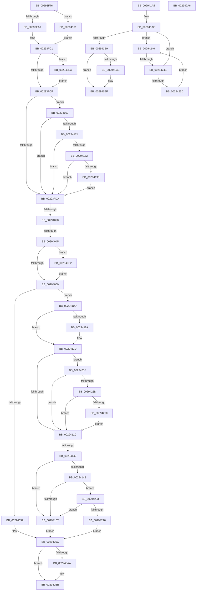

# sub_00293F76

- RVA: `0x00293F76`–`0x002942F1` (길이 `891` bytes)
- VA: `0x0000000140293F76`
- 실행 섹션: `.text`
- PDB 이름 있음: `아니요`; PDB Function 태그: `아니요`
- unwind 정보 RVA: `0x00067730`
- 디코드: `189`개 명령, `891/891` bytes 표시
- 미해석 바이트: `0` (있으면 어셈블리에 `.byte`로 보존)

> 이 문서는 커널 이미지의 기계어와 PDB 기호를 분석해 생성했습니다. 4번과 5번은 함수 원형과 자료형을 바이너리 사용 방식에서 추정한 C 해석이며 원본 소스 복구 결과는 아닙니다.

## 1. Dependencies

- 직접 호출 지점: **12**; 고유 호출 대상: **10**
- 직접 호출자로 확인된 함수: **0**
- RIP 상대 이미지 참조: **5**

### Outgoing calls
- `0x00293FFE` → [MI_READ_PTE_LOCK_FREE](../28/MI_READ_PTE_LOCK_FREE_function_002828A0.md) (function, `0x002828A0`)
- `0x002940ED` → [MI_WSLE_LOG_ACCESS](MI_WSLE_LOG_ACCESS_function_00294400.md) (function, `0x00294400`)
- `0x00294135` → [MiPteInShadowRange](../23/MiPteInShadowRange_function_0023FB00.md) (function, `0x0023FB00`)
- `0x00294174` → [MiGetPfnPriority](../32/MiGetPfnPriority_function_003226F0.md) (function, `0x003226F0`)
- `0x00294185` → [MiGetPfnPriority](../32/MiGetPfnPriority_function_003226F0.md) (function, `0x003226F0`)
- `0x0029419B` → [MiLockSetPfnPriority](MiLockSetPfnPriority_function_00294E10.md) (function, `0x00294E10`)
- `0x002941BF` → [MiDecreaseUsedPtesInPfn](../2A/MiDecreaseUsedPtesInPfn_function_002A27AC.md) (function, `0x002A27AC`)
- `0x00294232` → [MiCheckLinearProtectedPteAccessedBit](MiCheckLinearProtectedPteAccessedBit_function_00292D80.md) (function, `0x00292D80`)
- `0x0029429C` → [MiCheckLinearProtectedPteAccessedBit](MiCheckLinearProtectedPteAccessedBit_function_00292D80.md) (function, `0x00292D80`)
- `0x002942B0` → [MiInitializeTbFlushStamps](../44/MiInitializeTbFlushStamps_function_004499EC.md) (function, `0x004499EC`)
- `0x002942CB` → [MiLockWorkingSetOptimal](../23/MiLockWorkingSetOptimal_function_00238FC0.md) (function, `0x00238FC0`)
- `0x002942E7` → [MiUnlockWorkingSetOptimal](../23/MiUnlockWorkingSetOptimal_function_00238DFC.md) (function, `0x00238DFC`)

### Direct callers
- 이 함수 시작 RVA로 연결되는 직접 call은 확인되지 않았습니다. 간접 호출은 완전히 역산할 수 없습니다.

### Static image references
- `0x00293FB1` → RVA `0x00E30088` (`.data`; read)
- `0x00294023` → RVA `0x00FC6A88` (`ALMOSTRO`; read)
- `0x0029402A` → RVA `0x00010880` (`.rdata`; read)
- `0x00294101` → RVA `0x00E38D00` (`.data`; read)
- `0x00294242` → RVA `0x00FC52AC` (`ALMOSTRO`; reference)

## 2. Other-region calls and transfers

- 다른 실행 섹션으로 향하는 call: **0**
- call이 아닌 외부 분기/꼬리 이동: **7**
  - `0x0029401A` → [sub_0029430C + 0xAD](Unknown_function_0029430C.md) (`tail-transfer`)
  - `0x0029403F` → [sub_0029430C + 0x6B](Unknown_function_0029430C.md) (`tail-transfer`)
  - `0x002940DD` → [sub_00293C9B + 0xE6](Unknown_function_00293C9B.md) (`tail-transfer`)
  - `0x0029413C` → [sub_0029430C](Unknown_function_0029430C.md) (`tail-transfer`)
  - `0x002941FE` → [sub_00293C9B + 0x151](Unknown_function_00293C9B.md) (`tail-transfer`)
  - `0x00294248` → [sub_0029430C + 0x44](Unknown_function_0029430C.md) (`tail-transfer`)
  - `0x002942EC` → [sub_00293C9B + 0x2C0](Unknown_function_00293C9B.md) (`tail-transfer`)

## 3. Assembly (complete function range)

```asm
00293F76  48 C1 E8 0C                     shr rax, 0xc
00293F7A  49 23 C0                        and rax, r8
00293F7D  4C 8D 2C 40                     lea r13, [rax + rax*2]
00293F81  48 B8 00 00 00 00 00 DE FF FF   movabs rax, 0xffffde0000000000
00293F8B  49 C1 E5 04                     shl r13, 4
00293F8F  48 8B C0                        mov rax, rax
00293F92  48 8B 4C 24 40                  mov rcx, qword ptr [rsp + 0x40]
00293F97  4C 03 E8                        add r13, rax
00293F9A  8B 81 B8 00 00 00               mov eax, dword ptr [rcx + 0xb8]
00293FA0  24 0F                           and al, 0xf
00293FA2  3C 01                           cmp al, 1
00293FA4  0F 84 57 01 00 00               je 0x140294101
00293FAA  0F B7 89 AE 00 00 00            movzx ecx, word ptr [rcx + 0xae]
00293FB1  48 8B 05 D0 C0 B9 00            mov rax, qword ptr [rip + 0xb9c0d0]
00293FB8  48 8B 04 C8                     mov rax, qword ptr [rax + rcx*8]
00293FBC  48 8B 4C 24 40                  mov rcx, qword ptr [rsp + 0x40]
00293FC1  8B 80 2C 44 00 00               mov eax, dword ptr [rax + 0x442c]
00293FC7  85 C0                           test eax, eax
00293FC9  0F 85 1B 01 00 00               jne 0x1402940ea
00293FCF  83 7C 24 58 00                  cmp dword ptr [rsp + 0x58], 0
00293FD4  0F 85 86 01 00 00               jne 0x140294160
00293FDA  48 B8 F8 FF FF FF 7F 00 00 00   movabs rax, 0x7ffffffff8
00293FE4  48 8B CF                        mov rcx, rdi
00293FE7  48 C1 E9 09                     shr rcx, 9
00293FEB  48 23 C8                        and rcx, rax
00293FEE  48 B8 00 00 00 00 80 F6 FF FF   movabs rax, 0xfffff68000000000
00293FF8  48 8B C0                        mov rax, rax
00293FFB  48 03 C8                        add rcx, rax
00293FFE  E8 9D E8 FE FF                  call 0x1402828a0
00294003  48 8B D8                        mov rbx, rax
00294006  48 C1 E8 38                     shr rax, 0x38
0029400A  48 C1 EB 3C                     shr rbx, 0x3c
0029400E  24 0F                           and al, 0xf
00294010  80 E3 07                        and bl, 7
00294013  C0 E3 04                        shl bl, 4
00294016  0A D8                           or bl, al
00294018  3C 08                           cmp al, 8
0029401A  0F 84 99 03 00 00               je 0x1402943b9
00294020  49 8B 0E                        mov rcx, qword ptr [r14]
00294023  48 8B 05 5E 2A D3 00            mov rax, qword ptr [rip + 0xd32a5e]
0029402A  48 8B 3D 4F C8 D7 FF            mov rdi, qword ptr [rip - 0x2837b1]
00294031  48 8B D0                        mov rdx, rax
00294034  48 C1 EA 1A                     shr rdx, 0x1a
00294038  83 E2 03                        and edx, 3
0029403B  48 83 FA 01                     cmp rdx, 1
0029403F  0F 86 32 03 00 00               jbe 0x140294377
00294045  48 0F BA E0 19                  bt rax, 0x19
0029404A  0F 82 92 00 00 00               jb 0x1402940e2
00294050  F6 C1 20                        test cl, 0x20
00294053  0F 84 B4 00 00 00               je 0x14029410d
00294059  49 89 3E                        mov qword ptr [r14], rdi
0029405C  48 8B 7C 24 38                  mov rdi, qword ptr [rsp + 0x38]
00294061  8B 85 68 40 00 00               mov eax, dword ptr [rbp + 0x4068]
00294067  BA FF 01 00 00                  mov edx, 0x1ff
0029406C  48 8D 0C C5 00 00 00 00         lea rcx, [rax*8]
00294074  33 C0                           xor eax, eax
00294076  48 03 CD                        add rcx, rbp
00294079  89 81 70 40 00 00               mov dword ptr [rcx + 0x4070], eax
0029407F  41 8B C6                        mov eax, r14d
00294082  80 89 71 40 00 00 01            or byte ptr [rcx + 0x4071], 1
00294089  C1 E8 03                        shr eax, 3
0029408C  66 23 C2                        and ax, dx
0029408F  88 99 70 40 00 00               mov byte ptr [rcx + 0x4070], bl
00294095  66 89 81 72 40 00 00            mov word ptr [rcx + 0x4072], ax
0029409C  FF 85 68 40 00 00               inc dword ptr [rbp + 0x4068]
002940A2  48 83 7C 24 50 00               cmp qword ptr [rsp + 0x50], 0
002940A8  74 11                           je 0x1402940bb
002940AA  4D 8B 7D 08                     mov r15, qword ptr [r13 + 8]
002940AE  48 B8 00 00 00 00 00 00 00 80   movabs rax, 0x8000000000000000
002940B8  4C 0B F8                        or r15, rax
002940BB  48 FF 44 24 60                  inc qword ptr [rsp + 0x60]
002940C0  49 B8 FF FF FF FF FF 00 00 00   movabs r8, 0xffffffffff
002940CA  48 8B 54 24 50                  mov rdx, qword ptr [rsp + 0x50]
002940CF  FF C6                           inc esi
002940D1  8B DE                           mov ebx, esi
002940D3  49 B9 FF FF FF FF FF FF FF 3F   movabs r9, 0x3fffffffffffffff
002940DD  E9 9F FC FF FF                  jmp 0x140293d81
002940E2  0F AE E8                        lfence
002940E5  E9 66 FF FF FF                  jmp 0x140294050
002940EA  49 8B D6                        mov rdx, r14
002940ED  E8 0E 03 00 00                  call 0x140294400
002940F2  49 B9 FF FF FF FF FF FF FF 3F   movabs r9, 0x3fffffffffffffff
002940FC  E9 CE FE FF FF                  jmp 0x140293fcf
00294101  48 8D 05 F8 4B BA 00            lea rax, [rip + 0xba4bf8]
00294108  E9 B4 FE FF FF                  jmp 0x140293fc1
0029410D  48 F7 05 70 29 D3 00 00 00 00 02  test qword ptr [rip + 0xd32970], 0x2000000
00294118  74 03                           je 0x14029411d
0029411A  0F AE E8                        lfence
0029411D  48 0F BA 25 62 29 D3 00 24      bt qword ptr [rip + 0xd32962], 0x24
00294126  0F 82 33 01 00 00               jb 0x14029425f
0029412C  48 8B F7                        mov rsi, rdi
0029412F  49 8B CE                        mov rcx, r14
00294132  49 87 36                        xchg qword ptr [r14], rsi
00294135  E8 C6 B9 FA FF                  call 0x14023fb00
0029413A  85 C0                           test eax, eax
0029413C  0F 85 CA 01 00 00               jne 0x14029430c
00294142  40 F6 C6 20                     test sil, 0x20
00294146  75 0F                           jne 0x140294157
00294148  48 0F BA 25 37 29 D3 00 24      bt qword ptr [rip + 0xd32937], 0x24
00294151  0F 82 AC 00 00 00               jb 0x140294203
00294157  8B 74 24 34                     mov esi, dword ptr [rsp + 0x34]
0029415B  E9 FC FE FF FF                  jmp 0x14029405c
00294160  49 8B 45 18                     mov rax, qword ptr [r13 + 0x18]
00294164  49 23 C1                        and rax, r9
00294167  48 83 F8 01                     cmp rax, 1
0029416B  0F 85 69 FE FF FF               jne 0x140293fda
00294171  49 8B CD                        mov rcx, r13
00294174  E8 77 E5 08 00                  call 0x1403226f0
00294179  83 F8 02                        cmp eax, 2
0029417C  0F 86 58 FE FF FF               jbe 0x140293fda
00294182  49 8B CD                        mov rcx, r13
00294185  E8 66 E5 08 00                  call 0x1403226f0
0029418A  83 F8 05                        cmp eax, 5
0029418D  0F 87 47 FE FF FF               ja 0x140293fda
00294193  BA 02 00 00 00                  mov edx, 2
00294198  49 8B CD                        mov rcx, r13
0029419B  E8 70 0C 00 00                  call 0x140294e10
002941A0  E9 35 FE FF FF                  jmp 0x140293fda
002941A5  48 8B 7C 24 78                  mov rdi, qword ptr [rsp + 0x78]
002941AA  33 DB                           xor ebx, ebx
002941AC  F0 48 0F BA 6F 18 3F            lock bts qword ptr [rdi + 0x18], 0x3f
002941B3  0F 82 87 00 00 00               jb 0x140294240
002941B9  41 8B D4                        mov edx, r12d
002941BC  48 8B CF                        mov rcx, rdi
002941BF  E8 E8 E5 00 00                  call 0x1402a27ac
002941C4  48 8B 54 24 60                  mov rdx, qword ptr [rsp + 0x60]
002941C9  48 85 D2                        test rdx, rdx
002941CC  74 21                           je 0x1402941ef
002941CE  48 8B 47 18                     mov rax, qword ptr [rdi + 0x18]
002941D2  48 8B C8                        mov rcx, rax
002941D5  48 2B CA                        sub rcx, rdx
002941D8  48 BA 00 00 00 00 00 00 00 C0   movabs rdx, 0xc000000000000000
002941E2  48 33 C1                        xor rax, rcx
002941E5  48 23 C2                        and rax, rdx
002941E8  48 33 C1                        xor rax, rcx
002941EB  48 89 47 18                     mov qword ptr [rdi + 0x18], rax
002941EF  48 B8 FF FF FF FF FF FF FF 7F   movabs rax, 0x7fffffffffffffff
002941F9  F0 48 21 47 18                  lock and qword ptr [rdi + 0x18], rax
002941FE  E9 E9 FB FF FF                  jmp 0x140293dec
00294203  48 B8 00 00 00 00 80 F6 FF FF   movabs rax, 0xfffff68000000000
0029420D  48 8B C0                        mov rax, rax
00294210  48 B9 00 00 00 00 40 00 00 00   movabs rcx, 0x4000000000
0029421A  48 03 C1                        add rax, rcx
0029421D  4C 3B F0                        cmp r14, rax
00294220  0F 82 31 FF FF FF               jb 0x140294157
00294226  41 B8 02 00 00 00               mov r8d, 2
0029422C  48 8B D6                        mov rdx, rsi
0029422F  49 8B CE                        mov rcx, r14
00294232  E8 49 EB FF FF                  call 0x140292d80
00294237  8B 74 24 34                     mov esi, dword ptr [rsp + 0x34]
0029423B  E9 1C FE FF FF                  jmp 0x14029405c
00294240  FF C3                           inc ebx
00294242  85 1D 64 10 D3 00               test dword ptr [rip + 0xd31064], ebx
00294248  0F 84 02 01 00 00               je 0x140294350
0029424E  F3 90                           pause
00294250  48 8B 47 18                     mov rax, qword ptr [rdi + 0x18]
00294254  48 85 C0                        test rax, rax
00294257  0F 89 4F FF FF FF               jns 0x1402941ac
0029425D  EB E1                           jmp 0x140294240
0029425F  40 0F B6 C7                     movzx eax, dil
00294263  24 21                           and al, 0x21
00294265  3C 01                           cmp al, 1
00294267  0F 85 BF FE FF FF               jne 0x14029412c
0029426D  48 B8 00 00 00 00 80 F6 FF FF   movabs rax, 0xfffff68000000000
00294277  48 8B C0                        mov rax, rax
0029427A  48 B9 00 00 00 00 40 00 00 00   movabs rcx, 0x4000000000
00294284  48 03 C1                        add rax, rcx
00294287  4C 3B F0                        cmp r14, rax
0029428A  0F 82 9C FE FF FF               jb 0x14029412c
00294290  41 B8 80 00 00 00               mov r8d, 0x80
00294296  48 8B D7                        mov rdx, rdi
00294299  49 8B CE                        mov rcx, r14
0029429C  E8 DF EA FF FF                  call 0x140292d80
002942A1  E9 86 FE FF FF                  jmp 0x14029412c
002942A6  48 8D 4C 24 48                  lea rcx, [rsp + 0x48]
002942AB  4C 89 64 24 48                  mov qword ptr [rsp + 0x48], r12
002942B0  E8 37 57 1B 00                  call 0x1404499ec
002942B5  48 8B 9C 24 A0 00 00 00         mov rbx, qword ptr [rsp + 0xa0]
002942BD  4C 8D 84 24 88 01 00 00         lea r8, [rsp + 0x188]
002942C5  48 8B D3                        mov rdx, rbx
002942C8  49 8B CD                        mov rcx, r13
002942CB  E8 F0 4C FA FF                  call 0x140238fc0
002942D0  48 8B 54 24 48                  mov rdx, qword ptr [rsp + 0x48]
002942D5  49 8B CD                        mov rcx, r13
002942D8  44 0F B6 84 24 88 01 00 00      movzx r8d, byte ptr [rsp + 0x188]
002942E1  48 89 13                        mov qword ptr [rbx], rdx
002942E4  48 8B D0                        mov rdx, rax
002942E7  E8 10 4B FA FF                  call 0x140238dfc
002942EC  E9 6A FC FF FF                  jmp 0x140293f5b
```

## 4. C-style interpretation (structured pseudocode)

```c
__int64 __fastcall sub_00293F76(__int64 a1, __int64 a2, __int64 a3, __int64 a4, __int64 a5, __int64 a6, __int64 a7, __int64 a8, __int64 a9, __int64 a10, unsigned int a11, __int64 a12)
{
    __int64 result;
    __int64 v_r13;
    __int64 v_r15;
    __int64 v_rbx;
    __int64 v_rsi;
    unsigned __int64 v_stack_p188;
    unsigned int v_stack_p34;
    unsigned __int64 v_stack_p48;
    unsigned __int64 v_stack_p60;
    unsigned __int64 v_stack_p78;
    unsigned __int64 v_stack_pA0;

    result = (result) >> (12);
    result = (result) & (a3);
    v_r13 = (result + result * 2) << (4);
    v_r13 = (v_r13) + (result);
    result = (unsigned __int8)(((unsigned int)(*(unsigned int *)(a8 + 184))) & (15));
    if (((unsigned __int8)(result)) == 1) goto loc_00294101;
loc_00293FC1:
    if ((unsigned int)((unsigned int)(*(unsigned int *)(*(unsigned __int64 *)(*(unsigned __int64 *)(v_rip + 12173520) + *(unsigned __int16 *)(a8 + 174) * 8) + 17452))) != 0) goto loc_002940EA;
loc_00293FCF:
    if (a11 != 0) goto loc_00294160;
loc_00293FDA:
    a1 = (v_rdi) >> (9);
    a1 = (a1) & ((unsigned int)(*(unsigned int *)(*(unsigned __int64 *)(*(unsigned __int64 *)(v_rip + 12173520) + *(unsigned __int16 *)(a8 + 174) * 8) + 17452)));
    a1 = (a1) + ((unsigned int)(*(unsigned int *)(*(unsigned __int64 *)(*(unsigned __int64 *)(v_rip + 12173520) + *(unsigned __int16 *)(a8 + 174) * 8) + 17452)));
    result = MI_READ_PTE_LOCK_FREE(a1, a2, a3, a4);
    result = (result) >> (56);
    v_rbx = (result) >> (60);
    result = (unsigned __int8)((result) & (15));
    v_rbx = (unsigned __int8)((v_rbx) & (7));
    v_rbx = (unsigned __int8)((v_rbx) << (4));
    v_rbx = (unsigned __int8)((v_rbx) | ((unsigned __int8)(result)));
    a2 = (*(unsigned __int64 *)(v_rip + 13838942)) >> (26);
    a2 = (unsigned int)((a2) & (3));
    if (a2 < 1) goto loc_002940E2;
loc_00294050:
    if ((((unsigned __int8)(*(unsigned __int64 *)(v_r14))) & (32)) == 0) goto loc_0029410D;
    *(unsigned __int64 *)(v_r14) = *(unsigned __int64 *)(v_rip - 2635697);
loc_0029405C:
    result = 0;
    a1 = ((unsigned int)(*(unsigned int *)(v_rbp + 16488)) * 8) + (v_rbp);
    *(unsigned int *)(a1 + 16496) = 0;
    result = (unsigned int)(((unsigned int)((unsigned int)(v_r14))) >> (3));
    result = (unsigned __int16)((result) & (511));
    *(unsigned __int8 *)(a1 + 16496) = (unsigned __int8)(v_rbx);
    *(unsigned __int16 *)(a1 + 16498) = (unsigned __int16)(result);
    if (a10 != 0) {
        v_r15 = *(unsigned __int64 *)(v_r13 + 8);
        v_r15 = (v_r15) | (result);
    }
    v_rsi = (unsigned int)((v_rsi) + 1);
loc_002940E2:
    goto loc_00294050;
loc_002940EA:
    result = MI_WSLE_LOG_ACCESS(a1, v_r14, a3, a4);
    goto loc_00293FCF;
loc_00294101:
    goto loc_00293FC1;
loc_0029410D:
    if (((*(unsigned __int64 *)(v_rip + 13838704)) & (0x2000000ULL)) != 0) {
    }
    if (condition_is_below) goto loc_0029425F;
loc_0029412C:
    result = MiPteInShadowRange(v_r14, v_r14, a3, a4);
    if ((((unsigned __int8)(a7)) & (32)) != 0) goto loc_00294157;
    if (condition_is_below) goto loc_00294203;
loc_00294157:
    goto loc_0029405C;
loc_00294160:
    result = (*(unsigned __int64 *)(v_r13 + 24)) & (a4);
    if (result != 1) goto loc_00293FDA;
    result = MiGetPfnPriority(v_r13, v_r14, a3, a4);
    if (((unsigned int)(result)) <= 2) goto loc_00293FDA;
    result = MiGetPfnPriority(v_r13, v_r14, a3, a4);
    if (((unsigned int)(result)) > 5) goto loc_00293FDA;
    result = MiLockSetPfnPriority(v_r13, 2, a3, a4);
    goto loc_00293FDA;
loc_00294203:
    result = (result) + (v_r13);
    if (v_r14 < result) goto loc_00294157;
    result = MiCheckLinearProtectedPteAccessedBit(v_r14, (unsigned int)(v_stack_p34), 2, a4);
    goto loc_0029405C;
loc_0029425F:
    result = (unsigned __int8)(((unsigned __int8)(a7)) & (33));
    if (((unsigned __int8)(result)) != 1) goto loc_0029412C;
    result = (result) + (v_r14);
    if (v_r14 < result) goto loc_0029412C;
    result = MiCheckLinearProtectedPteAccessedBit(v_r14, a7, 128, a4);
    goto loc_0029412C;
}
```

## 5. (Beta) C Style

```c
int64_t sub_00293F76(int64_t Arg1, int64_t Arg2, int64_t Arg3, int64_t Arg4, uint64_t Arg5, uint64_t Arg6, int64_t Arg7, void *Arg8, uint64_t Arg9, int64_t Arg10, uint32_t Arg11, int64_t Arg12)
{
    uint8_t *arg8 = (uint8_t *)Arg8;

    int64_t result;
    int64_t local_r13;
    int64_t local_r15;
    int64_t local_rbx;
    int64_t local_rsi;
    uint64_t v_stack_p188;
    uint32_t v_stack_p34;
    uint64_t v_stack_p48;
    uint64_t v_stack_p60;
    uint64_t v_stack_p78;
    uint64_t v_stack_pA0;

    result = (result) >> (12);
    result = (result) & (Arg3);
    local_r13 = (result + result * 2) << (4);
    local_r13 = (local_r13) + (result);
    result = (uint8_t)(((uint32_t)(*(uint32_t *)(arg8 + 0xB8))) & (15));
    if (((uint8_t)(result)) == 1) goto loc_00294101;
loc_00293FC1:
    if ((uint32_t)((uint32_t)(*(uint32_t *)(*(uint64_t *)(*(uint64_t *)(v_rip + 0xB9C0D0) + *(uint16_t *)(arg8 + 0xAE) * 8) + 0x442C))) != 0) goto loc_002940EA;
loc_00293FCF:
    if (Arg11 != 0) goto loc_00294160;
loc_00293FDA:
    Arg1 = (local_rdi) >> (9);
    Arg1 = (Arg1) & ((uint32_t)(*(uint32_t *)(*(uint64_t *)(*(uint64_t *)(v_rip + 0xB9C0D0) + *(uint16_t *)(arg8 + 0xAE) * 8) + 0x442C)));
    Arg1 = (Arg1) + ((uint32_t)(*(uint32_t *)(*(uint64_t *)(*(uint64_t *)(v_rip + 0xB9C0D0) + *(uint16_t *)(arg8 + 0xAE) * 8) + 0x442C)));
    result = MI_READ_PTE_LOCK_FREE(Arg1, Arg2, Arg3, Arg4);
    result = (result) >> (56);
    local_rbx = (result) >> (60);
    result = (uint8_t)((result) & (15));
    local_rbx = (uint8_t)((local_rbx) & (7));
    local_rbx = (uint8_t)((local_rbx) << (4));
    local_rbx = (uint8_t)((local_rbx) | ((uint8_t)(result)));
    Arg2 = (*(uint64_t *)(v_rip + 0xD32A5E)) >> (26);
    Arg2 = (uint32_t)((Arg2) & (3));
    if (Arg2 < 1) goto loc_002940E2;
loc_00294050:
    if ((((uint8_t)(*(uint64_t *)(local_r14))) & (32)) == 0) goto loc_0029410D;
    *(uint64_t *)(local_r14) = *(uint64_t *)(v_rip - 0x2837B1);
loc_0029405C:
    result = 0;
    Arg1 = ((uint32_t)(*(uint32_t *)(local_rbp + 0x4068)) * 8) + (local_rbp);
    *(uint32_t *)(Arg1 + 0x4070) = 0;
    result = (uint32_t)(((uint32_t)((uint32_t)(local_r14))) >> (3));
    result = (uint16_t)((result) & (511));
    *(uint8_t *)(Arg1 + 0x4070) = (uint8_t)(local_rbx);
    *(uint16_t *)(Arg1 + 0x4072) = (uint16_t)(result);
    if (Arg10 != 0) {
        local_r15 = *(uint64_t *)(local_r13 + 0x8);
        local_r15 = (local_r15) | (result);
    }
    local_rsi = (uint32_t)((local_rsi) + 1);
loc_002940E2:
    goto loc_00294050;
loc_002940EA:
    result = MI_WSLE_LOG_ACCESS(Arg1, local_r14, Arg3, Arg4);
    goto loc_00293FCF;
loc_00294101:
    goto loc_00293FC1;
loc_0029410D:
    if (((*(uint64_t *)(v_rip + 0xD32970)) & (0x2000000ULL)) != 0) {
    }
    if (condition_is_below) goto loc_0029425F;
loc_0029412C:
    result = MiPteInShadowRange(local_r14, local_r14, Arg3, Arg4);
    if ((((uint8_t)(Arg7)) & (32)) != 0) goto loc_00294157;
    if (condition_is_below) goto loc_00294203;
loc_00294157:
    goto loc_0029405C;
loc_00294160:
    result = (*(uint64_t *)(local_r13 + 0x18)) & (Arg4);
    if (result != 1) goto loc_00293FDA;
    result = MiGetPfnPriority(local_r13, local_r14, Arg3, Arg4);
    if (((uint32_t)(result)) <= 2) goto loc_00293FDA;
    result = MiGetPfnPriority(local_r13, local_r14, Arg3, Arg4);
    if (((uint32_t)(result)) > 5) goto loc_00293FDA;
    result = MiLockSetPfnPriority(local_r13, 2, Arg3, Arg4);
    goto loc_00293FDA;
loc_00294203:
    result = (result) + (local_r13);
    if (local_r14 < result) goto loc_00294157;
    result = MiCheckLinearProtectedPteAccessedBit(local_r14, (uint32_t)(v_stack_p34), 2, Arg4);
    goto loc_0029405C;
loc_0029425F:
    result = (uint8_t)(((uint8_t)(Arg7)) & (33));
    if (((uint8_t)(result)) != 1) goto loc_0029412C;
    result = (result) + (local_r14);
    if (local_r14 < result) goto loc_0029412C;
    result = MiCheckLinearProtectedPteAccessedBit(local_r14, Arg7, 128, Arg4);
    goto loc_0029412C;
}
```

### 관측된 메모리 오프셋

구조체 형식이 확인되지 않은 접근은 인자 기준의 오프셋으로만 기록했습니다.

| 기준 인자 | 오프셋 표현 | 폭 (bit) | 접근 |
|---|---:|---:|---|
| `Arg8` | `+ 0xAE` | `16` | `R` |
| `Arg8` | `+ 0xB8` | `32` | `R` |

## 6. Execution-region graph

[열기: 2D/3D 그래프와 함수 탐색 컨트롤 패널](../../../control-panel.html?section=text&rva=0x00293F76&view=graph)

- 2D 그래프는 위에서 아래로 흐르고, 3D 그래프는 빈 공간을 드래그해 회전합니다. Shift+드래그는 이동, 휠은 확대·축소, 함수 노드 선택은 대상 보고서 이동입니다.

### Static fallback


