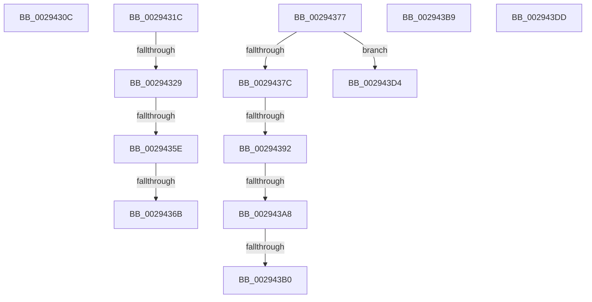

# sub_0029430C

- RVA: `0x0029430C`–`0x002943F7` (길이 `235` bytes)
- VA: `0x000000014029430C`
- 실행 섹션: `.text`
- PDB 이름 있음: `아니요`; PDB Function 태그: `아니요`
- unwind 정보 RVA: `0x00067754`
- 디코드: `51`개 명령, `235/235` bytes 표시
- 미해석 바이트: `0` (있으면 어셈블리에 `.byte`로 보존)

> 이 문서는 커널 이미지의 기계어와 PDB 기호를 분석해 생성했습니다. 4번과 5번은 함수 원형과 자료형을 바이너리 사용 방식에서 추정한 C 해석이며 원본 소스 복구 결과는 아닙니다.

## 1. Dependencies

- 직접 호출 지점: **6**; 고유 호출 대상: **6**
- 직접 호출자로 확인된 함수: **0**
- RIP 상대 이미지 참조: **1**

### Outgoing calls
- `0x00294312` → [MiWritePteShadow](MiWritePteShadow_function_00294EAC.md) (function, `0x00294EAC`)
- `0x0029434A` → [KeBugCheckEx](../4F/KeBugCheckEx_function_004FD660.md) (function, `0x004FD660`)
- `0x0029435E` → [KiCheckVpBackingLongSpinWaitHypercall](../30/KiCheckVpBackingLongSpinWaitHypercall_function_0030F490.md) (function, `0x0030F490`)
- `0x0029436D` → [HvlNotifyLongSpinWait](../30/HvlNotifyLongSpinWait_function_0030F460.md) (function, `0x0030F460`)
- `0x002943CA` → [MiUnlockWsle](../40/MiUnlockWsle_function_00407F84.md) (function, `0x00407F84`)
- `0x002943ED` → [MiReturnCrossPartitionSectionCharges](../4B/MiReturnCrossPartitionSectionCharges_function_004BA61C.md) (function, `0x004BA61C`)

### Direct callers
- 이 함수 시작 RVA로 연결되는 직접 call은 확인되지 않았습니다. 간접 호출은 완전히 역산할 수 없습니다.

### Static image references
- `0x00294350` → RVA `0x00FC6AB8` (`ALMOSTRO`; read)

## 2. Other-region calls and transfers

- 다른 실행 섹션으로 향하는 call: **0**
- call이 아닌 외부 분기/꼬리 이동: **12**
  - `0x00294317` → [sub_00293F76 + 0x1CC](Unknown_function_00293F76.md) (`tail-transfer`)
  - `0x00294323` → [sub_00293C9B + 0x255](Unknown_function_00293C9B.md) (`tail-transfer`)
  - `0x00294358` → [sub_00293F76 + 0x2D8](Unknown_function_00293F76.md) (`tail-transfer`)
  - `0x00294365` → [sub_00293F76 + 0x2D8](Unknown_function_00293F76.md) (`tail-transfer`)
  - `0x00294372` → [sub_00293F76 + 0x2DA](Unknown_function_00293F76.md) (`tail-transfer`)
  - `0x0029438C` → [sub_00293F76 + 0xDA](Unknown_function_00293F76.md) (`tail-transfer`)
  - `0x002943A2` → [sub_00293F76 + 0xDA](Unknown_function_00293F76.md) (`tail-transfer`)
  - `0x002943AA` → [sub_00293F76 + 0xDA](Unknown_function_00293F76.md) (`tail-transfer`)
  - `0x002943B4` → [sub_00293F76 + 0xDA](Unknown_function_00293F76.md) (`tail-transfer`)
  - `0x002943CF` → [sub_00293F76 + 0xEB](Unknown_function_00293F76.md) (`tail-transfer`)
  - `0x002943D8` → [sub_00293F76 + 0xDA](Unknown_function_00293F76.md) (`tail-transfer`)
  - `0x002943F2` → [sub_00293C9B + 0x2A3](Unknown_function_00293C9B.md) (`tail-transfer`)

## 3. Assembly (complete function range)

```asm
0029430C  48 8B D7                        mov rdx, rdi
0029430F  49 8B CE                        mov rcx, r14
00294312  E8 95 0B 00 00                  call 0x140294eac
00294317  E9 26 FE FF FF                  jmp 0x140294142
0029431C  4D 8B 76 10                     mov r14, qword ptr [r14 + 0x10]
00294320  4D 85 F6                        test r14, r14
00294323  0F 85 C7 FB FF FF               jne 0x140293ef0
00294329  48 8B 84 24 78 01 00 00         mov rax, qword ptr [rsp + 0x178]
00294331  41 8D 4E 1A                     lea ecx, [r14 + 0x1a]
00294335  4C 8B 8C 24 70 01 00 00         mov r9, qword ptr [rsp + 0x170]
0029433D  4C 8B C6                        mov r8, rsi
00294340  BA 83 07 00 00                  mov edx, 0x783
00294345  48 89 44 24 20                  mov qword ptr [rsp + 0x20], rax
0029434A  E8 11 93 26 00                  call 0x1404fd660
0029434F  CC                              int3
00294350  8B 05 62 27 D3 00               mov eax, dword ptr [rip + 0xd32762]
00294356  A8 40                           test al, 0x40
00294358  0F 84 F0 FE FF FF               je 0x14029424e
0029435E  E8 2D B1 07 00                  call 0x14030f490
00294363  84 C0                           test al, al
00294365  0F 84 E3 FE FF FF               je 0x14029424e
0029436B  8B CB                           mov ecx, ebx
0029436D  E8 EE B0 07 00                  call 0x14030f460
00294372  E9 D9 FE FF FF                  jmp 0x140294250
00294377  48 85 D2                        test rdx, rdx
0029437A  74 58                           je 0x1402943d4
0029437C  48 B8 00 00 00 40 FB F6 FF FF   movabs rax, 0xfffff6fb40000000
00294386  48 8B C0                        mov rax, rax
00294389  4C 3B F0                        cmp r14, rax
0029438C  0F 82 BE FC FF FF               jb 0x140294050
00294392  48 B8 FF FF FF 7F FB F6 FF FF   movabs rax, 0xfffff6fb7fffffff
0029439C  48 8B C0                        mov rax, rax
0029439F  4C 3B F0                        cmp r14, rax
002943A2  0F 87 A8 FC FF FF               ja 0x140294050
002943A8  84 C9                           test cl, cl
002943AA  0F 88 A0 FC FF FF               js 0x140294050
002943B0  48 83 C9 20                     or rcx, 0x20
002943B4  E9 97 FC FF FF                  jmp 0x140294050
002943B9  48 8B 4C 24 40                  mov rcx, qword ptr [rsp + 0x40]
002943BE  41 B9 01 00 00 00               mov r9d, 1
002943C4  4D 8B C5                        mov r8, r13
002943C7  48 8B D7                        mov rdx, rdi
002943CA  E8 B5 3B 17 00                  call 0x140407f84
002943CF  E9 8D FC FF FF                  jmp 0x140294061
002943D4  48 83 C9 20                     or rcx, 0x20
002943D8  E9 73 FC FF FF                  jmp 0x140294050
002943DD  48 8B 8C 24 98 00 00 00         mov rcx, qword ptr [rsp + 0x98]
002943E5  4C 8B C7                        mov r8, rdi
002943E8  BA 01 00 00 00                  mov edx, 1
002943ED  E8 2A 62 22 00                  call 0x1404ba61c
002943F2  E9 47 FB FF FF                  jmp 0x140293f3e
```

## 4. C-style interpretation (structured pseudocode)

```c
__int64 __fastcall sub_0029430C(void)
{
    __int64 result;
    unsigned __int64 v_stack_p170;
    unsigned __int64 v_stack_p178;
    unsigned __int64 v_stack_p20;
    unsigned __int64 v_stack_p40;
    unsigned __int64 v_stack_p98;

    result = MiWritePteShadow(v_r14, v_rdi, a3, a4);
}
```

## 5. (Beta) C Style

```c
void sub_0029430C(void)
{
    int64_t result;
    uint64_t v_stack_p170;
    uint64_t v_stack_p178;
    uint64_t v_stack_p20;
    uint64_t v_stack_p40;
    uint64_t v_stack_p98;

    result = MiWritePteShadow(local_r14, local_rdi, a3, a4);
}
```

## 6. Execution-region graph

[열기: 2D/3D 그래프와 함수 탐색 컨트롤 패널](../../../control-panel.html?section=text&rva=0x0029430C&view=graph)

- 2D 그래프는 위에서 아래로 흐르고, 3D 그래프는 빈 공간을 드래그해 회전합니다. Shift+드래그는 이동, 휠은 확대·축소, 함수 노드 선택은 대상 보고서 이동입니다.

### Static fallback


