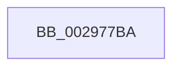

# sub_002977BA

- RVA: `0x002977BA`–`0x002977DE` (길이 `36` bytes)
- VA: `0x00000001402977BA`
- 실행 섹션: `.text`
- PDB 이름 있음: `아니요`; PDB Function 태그: `아니요`
- unwind 정보 RVA: `0x00067A18`
- 디코드: `10`개 명령, `36/36` bytes 표시
- 미해석 바이트: `0` (있으면 어셈블리에 `.byte`로 보존)

> 이 문서는 커널 이미지의 기계어와 PDB 기호를 분석해 생성했습니다. 4번과 5번은 함수 원형과 자료형을 바이너리 사용 방식에서 추정한 C 해석이며 원본 소스 복구 결과는 아닙니다.

## 1. Dependencies

- 직접 호출 지점: **1**; 고유 호출 대상: **1**
- 직접 호출자로 확인된 함수: **0**
- RIP 상대 이미지 참조: **0**

### Outgoing calls
- `0x002977CE` → [memset](../6C/memset_function_006C6C40.md) (function, `0x006C6C40`)

### Direct callers
- 이 함수 시작 RVA로 연결되는 직접 call은 확인되지 않았습니다. 간접 호출은 완전히 역산할 수 없습니다.

### Static image references
- 디코드된 RIP-relative 메모리 참조가 없습니다.

## 2. Other-region calls and transfers

- 다른 실행 섹션으로 향하는 call: **0**
- 별도 외부 분기/꼬리 이동을 확인하지 못했습니다.

## 3. Assembly (complete function range)

```asm
002977BA  48 89 7C 24 38                  mov qword ptr [rsp + 0x38], rdi
002977BF  33 D2                           xor edx, edx
002977C1  48 8B FB                        mov rdi, rbx
002977C4  48 8B CE                        mov rcx, rsi
002977C7  48 C1 EF 03                     shr rdi, 3
002977CB  4C 8B C7                        mov r8, rdi
002977CE  E8 6D F4 42 00                  call 0x1406c6c40
002977D3  48 03 F7                        add rsi, rdi
002977D6  48 8B 7C 24 38                  mov rdi, qword ptr [rsp + 0x38]
002977DB  83 E3 07                        and ebx, 7
```

## 4. C-style interpretation (structured pseudocode)

```c
__int64 __fastcall sub_002977BA(__int64 a1, int a2, __int64 a3, __int64 a4, __int64 a5, __int64 a6, __int64 a7)
{
    __int64 result;
    __int64 v_rbx;
    __int64 v_rdi;
    __int64 v_rsi;
    unsigned __int64 v_stack_p38;

    v_stack_p38 = v_rdi;
    a2 = 0;
    v_rdi = (v_rbx) >> (3);
    result = memset(v_rsi, a2, v_rdi, a4);
    v_rsi = (v_rsi) + (v_rdi);
    v_rbx = (unsigned int)((v_rbx) & (7));
    return result;
}
```

## 5. (Beta) C Style

```c
int64_t sub_002977BA(int64_t Arg1, int32_t Arg2, int64_t Arg3, int64_t Arg4, uint64_t Arg5, uint64_t Arg6, int64_t Arg7)
{
    int64_t result;
    int64_t local_rbx;
    int64_t local_rdi;
    int64_t local_rsi;
    uint64_t v_stack_p38;

    v_stack_p38 = local_rdi;
    Arg2 = 0;
    local_rdi = (local_rbx) >> (3);
    result = memset(local_rsi, Arg2, local_rdi, Arg4);
    local_rsi = (local_rsi) + (local_rdi);
    local_rbx = (uint32_t)((local_rbx) & (7));
    return result;
}
```

## 6. Execution-region graph

[열기: 2D/3D 그래프와 함수 탐색 컨트롤 패널](../../../control-panel.html?section=text&rva=0x002977BA&view=graph)

- 2D 그래프는 위에서 아래로 흐르고, 3D 그래프는 빈 공간을 드래그해 회전합니다. Shift+드래그는 이동, 휠은 확대·축소, 함수 노드 선택은 대상 보고서 이동입니다.

### Static fallback


