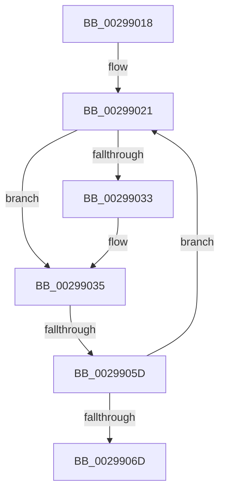

# sub_00299018

- RVA: `0x00299018`–`0x00299072` (길이 `90` bytes)
- VA: `0x0000000140299018`
- 실행 섹션: `.text`
- PDB 이름 있음: `아니요`; PDB Function 태그: `아니요`
- unwind 정보 RVA: `0x00067B78`
- 디코드: `25`개 명령, `90/90` bytes 표시
- 미해석 바이트: `0` (있으면 어셈블리에 `.byte`로 보존)

> 이 문서는 커널 이미지의 기계어와 PDB 기호를 분석해 생성했습니다. 4번과 5번은 함수 원형과 자료형을 바이너리 사용 방식에서 추정한 C 해석이며 원본 소스 복구 결과는 아닙니다.

## 1. Dependencies

- 직접 호출 지점: **1**; 고유 호출 대상: **1**
- 직접 호출자로 확인된 함수: **0**
- RIP 상대 이미지 참조: **0**

### Outgoing calls
- `0x00299052` → [guard_dispatch_icall](../6B/guard_dispatch_icall_function_006BAAD0.md) (function, `0x006BAAD0`)

### Direct callers
- 이 함수 시작 RVA로 연결되는 직접 call은 확인되지 않았습니다. 간접 호출은 완전히 역산할 수 없습니다.

### Static image references
- 디코드된 RIP-relative 메모리 참조가 없습니다.

## 2. Other-region calls and transfers

- 다른 실행 섹션으로 향하는 call: **0**
- call이 아닌 외부 분기/꼬리 이동: **1**
  - `0x0029905B` → [sub_00299080](Unknown_function_00299080.md) (`tail-transfer`)

## 3. Assembly (complete function range)

```asm
00299018  48 89 74 24 30                  mov qword ptr [rsp + 0x30], rsi
0029901D  48 8D 71 34                     lea rsi, [rcx + 0x34]
00299021  44 0F B7 C0                     movzx r8d, ax
00299025  49 C1 E0 05                     shl r8, 5
00299029  4C 03 43 50                     add r8, qword ptr [rbx + 0x50]
0029902D  80 7B 04 F9                     cmp byte ptr [rbx + 4], 0xf9
00299031  75 02                           jne 0x140299035
00299033  89 3E                           mov dword ptr [rsi], edi
00299035  49 8B 40 E0                     mov rax, qword ptr [r8 - 0x20]
00299039  8B D7                           mov edx, edi
0029903B  48 89 43 08                     mov qword ptr [rbx + 8], rax
0029903F  48 8B CB                        mov rcx, rbx
00299042  49 8B 40 E8                     mov rax, qword ptr [r8 - 0x18]
00299046  48 89 43 10                     mov qword ptr [rbx + 0x10], rax
0029904A  49 8B 40 F8                     mov rax, qword ptr [r8 - 8]
0029904E  4D 8B 40 F0                     mov r8, qword ptr [r8 - 0x10]
00299052  E8 79 1A 42 00                  call 0x1406baad0
00299057  80 7B 04 F9                     cmp byte ptr [rbx + 4], 0xf9
0029905B  75 23                           jne 0x140299080
0029905D  8B 3E                           mov edi, dword ptr [rsi]
0029905F  0F B7 43 4A                     movzx eax, word ptr [rbx + 0x4a]
00299063  66 83 E8 01                     sub ax, 1
00299067  66 89 43 4A                     mov word ptr [rbx + 0x4a], ax
0029906B  75 B4                           jne 0x140299021
0029906D  48 8B 74 24 30                  mov rsi, qword ptr [rsp + 0x30]
```

## 4. C-style interpretation (structured pseudocode)

```c
__int64 __fastcall sub_00299018(__int64 a1, __int64 a2, __int64 a3, __int64 a4, __int64 a5, __int64 a6)
{
    __int64 result;
    unsigned __int64 v_stack_p30;

    v_stack_p30 = v_rsi;
loc_00299021:
    a3 = ((unsigned __int16)(result)) << (5);
    a3 = (a3) + (*(unsigned __int64 *)(v_rbx + 80));
    if ((*(unsigned __int8 *)(v_rbx + 4)) == 249) {
        *(unsigned int *)(a1 + 52) = (unsigned int)(v_rdi);
    }
    *(unsigned __int64 *)(v_rbx + 8) = *(unsigned __int64 *)(a3 - 32);
    *(unsigned __int64 *)(v_rbx + 16) = *(unsigned __int64 *)(a3 - 24);
    result = guard_dispatch_icall(v_rbx, (unsigned int)((unsigned int)(v_rdi)), *(unsigned __int64 *)(a3 - 16), a4);
    result = (unsigned __int16)((*(unsigned __int16 *)(v_rbx + 74)) - (1));
    *(unsigned __int16 *)(v_rbx + 74) = (unsigned __int16)(result);
    if (condition_is_not_equal) goto loc_00299021;
    return result;
}
```

## 5. (Beta) C Style

```c
int64_t sub_00299018(void *Arg1, int64_t Arg2, int64_t Arg3, int64_t Arg4, uint64_t Arg5, int64_t Arg6)
{
    uint8_t *arg1 = (uint8_t *)Arg1;

    int64_t result;
    uint64_t v_stack_p30;

    v_stack_p30 = local_rsi;
loc_00299021:
    Arg3 = ((uint16_t)(result)) << (5);
    Arg3 = (Arg3) + (*(uint64_t *)(local_rbx + 0x50));
    if ((*(uint8_t *)(local_rbx + 0x4)) == 249) {
        *(uint32_t *)(arg1 + 0x34) = (uint32_t)(local_rdi);
    }
    *(uint64_t *)(local_rbx + 0x8) = *(uint64_t *)(Arg3 - 0x20);
    *(uint64_t *)(local_rbx + 0x10) = *(uint64_t *)(Arg3 - 0x18);
    result = guard_dispatch_icall(local_rbx, (uint32_t)((uint32_t)(local_rdi)), *(uint64_t *)(Arg3 - 0x10), Arg4);
    result = (uint16_t)((*(uint16_t *)(local_rbx + 0x4A)) - (1));
    *(uint16_t *)(local_rbx + 0x4A) = (uint16_t)(result);
    if (condition_is_not_equal) goto loc_00299021;
    return result;
}
```

### 관측된 메모리 오프셋

구조체 형식이 확인되지 않은 접근은 인자 기준의 오프셋으로만 기록했습니다.

| 기준 인자 | 오프셋 표현 | 폭 (bit) | 접근 |
|---|---:|---:|---|
| `Arg1` | `+ 0x0` | `32` | `R` |
| `Arg1` | `+ 0x0` | `32` | `W` |
| `Arg1` | `+ 0x34` | `64` | `R` |

## 6. Execution-region graph

[열기: 2D/3D 그래프와 함수 탐색 컨트롤 패널](../../../control-panel.html?section=text&rva=0x00299018&view=graph)

- 2D 그래프는 위에서 아래로 흐르고, 3D 그래프는 빈 공간을 드래그해 회전합니다. Shift+드래그는 이동, 휠은 확대·축소, 함수 노드 선택은 대상 보고서 이동입니다.

### Static fallback


