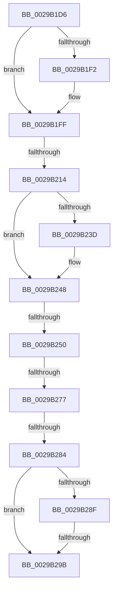

# sub_0029B1D6

- RVA: `0x0029B1D6`–`0x0029B2B7` (길이 `225` bytes)
- VA: `0x000000014029B1D6`
- 실행 섹션: `.text`
- PDB 이름 있음: `아니요`; PDB Function 태그: `아니요`
- unwind 정보 RVA: `0x00067D60`
- 디코드: `56`개 명령, `225/225` bytes 표시
- 미해석 바이트: `0` (있으면 어셈블리에 `.byte`로 보존)

> 이 문서는 커널 이미지의 기계어와 PDB 기호를 분석해 생성했습니다. 4번과 5번은 함수 원형과 자료형을 바이너리 사용 방식에서 추정한 C 해석이며 원본 소스 복구 결과는 아닙니다.

## 1. Dependencies

- 직접 호출 지점: **2**; 고유 호출 대상: **2**
- 직접 호출자로 확인된 함수: **0**
- RIP 상대 이미지 참조: **0**

### Outgoing calls
- `0x0029B1FA` → [ObfReferenceObjectWithTag](../21/ObfReferenceObjectWithTag_function_00210710.md) (function, `0x00210710`)
- `0x0029B2A1` → [IofCallDriver](IofCallDriver_function_0029B4B0.md) (function, `0x0029B4B0`)

### Direct callers
- 이 함수 시작 RVA로 연결되는 직접 call은 확인되지 않았습니다. 간접 호출은 완전히 역산할 수 없습니다.

### Static image references
- 디코드된 RIP-relative 메모리 참조가 없습니다.

## 2. Other-region calls and transfers

- 다른 실행 섹션으로 향하는 call: **0**
- call이 아닌 외부 분기/꼬리 이동: **6**
  - `0x0029B20E` → [sub_0029B35C](Unknown_function_0029B35C.md) (`tail-transfer`)
  - `0x0029B24A` → [sub_0029B35C + 0x13](Unknown_function_0029B35C.md) (`tail-transfer`)
  - `0x0029B271` → [sub_0029B41F](Unknown_function_0029B41F.md) (`tail-transfer`)
  - `0x0029B27E` → [sub_0029B35C + 0x35](Unknown_function_0029B35C.md) (`tail-transfer`)
  - `0x0029B299` → [sub_0029B308](Unknown_function_0029B308.md) (`tail-transfer`)
  - `0x0029B2B5` → [sub_0029B2B7 + 0x35](Unknown_function_0029B2B7.md) (`tail-transfer`)

## 3. Assembly (complete function range)

```asm
0029B1D6  48 89 6C 24 58                  mov qword ptr [rsp + 0x58], rbp
0029B1DB  49 8B F1                        mov rsi, r9
0029B1DE  4C 89 74 24 50                  mov qword ptr [rsp + 0x50], r14
0029B1E3  4C 8B F1                        mov r14, rcx
0029B1E6  41 0F B6 E8                     movzx ebp, r8b
0029B1EA  48 8B FA                        mov rdi, rdx
0029B1ED  45 84 C0                        test r8b, r8b
0029B1F0  75 0D                           jne 0x14029b1ff
0029B1F2  BA 44 66 6C 74                  mov edx, 0x746c6644
0029B1F7  49 8B C9                        mov rcx, r9
0029B1FA  E8 11 55 F7 FF                  call 0x140210710
0029B1FF  48 8B 86 D0 00 00 00            mov rax, qword ptr [rsi + 0xd0]
0029B206  BA 02 00 00 00                  mov edx, 2
0029B20B  48 85 C0                        test rax, rax
0029B20E  0F 85 48 01 00 00               jne 0x14029b35c
0029B214  65 4C 8B 04 25 88 01 00 00      mov r8, qword ptr gs:[0x188]
0029B21D  49 8B 88 20 02 00 00            mov rcx, qword ptr [r8 + 0x220]
0029B224  41 8B 80 A0 05 00 00            mov eax, dword ptr [r8 + 0x5a0]
0029B22B  C1 E8 09                        shr eax, 9
0029B22E  83 E0 07                        and eax, 7
0029B231  48 8B 89 A0 02 00 00            mov rcx, qword ptr [rcx + 0x2a0]
0029B238  48 85 C9                        test rcx, rcx
0029B23B  74 0B                           je 0x14029b248
0029B23D  8B 89 3C 04 00 00               mov ecx, dword ptr [rcx + 0x43c]
0029B243  3B C1                           cmp eax, ecx
0029B245  0F 4D C1                        cmovge eax, ecx
0029B248  3B C2                           cmp eax, edx
0029B24A  0F 8C 1F 01 00 00               jl 0x14029b36f
0029B250  C1 E0 11                        shl eax, 0x11
0029B253  05 00 00 02 00                  add eax, 0x20000
0029B258  8B 4F 10                        mov ecx, dword ptr [rdi + 0x10]
0029B25B  81 E1 FF FF F1 FF               and ecx, 0xfff1ffff
0029B261  0B C1                           or eax, ecx
0029B263  89 4F 10                        mov dword ptr [rdi + 0x10], ecx
0029B266  8B C8                           mov ecx, eax
0029B268  89 47 10                        mov dword ptr [rdi + 0x10], eax
0029B26B  C1 E9 11                        shr ecx, 0x11
0029B26E  83 E1 07                        and ecx, 7
0029B271  0F 85 A8 01 00 00               jne 0x14029b41f
0029B277  0F B6 4F 40                     movzx ecx, byte ptr [rdi + 0x40]
0029B27B  83 FA 02                        cmp edx, 2
0029B27E  0F 8C 0D 01 00 00               jl 0x14029b391
0029B284  80 7F 47 00                     cmp byte ptr [rdi + 0x47], 0
0029B288  48 89 5C 24 60                  mov qword ptr [rsp + 0x60], rbx
0029B28D  7C 0C                           jl 0x14029b29b
0029B28F  48 8B 87 C8 00 00 00            mov rax, qword ptr [rdi + 0xc8]
0029B296  48 85 C0                        test rax, rax
0029B299  75 6D                           jne 0x14029b308
0029B29B  48 8B D7                        mov rdx, rdi
0029B29E  49 8B CE                        mov rcx, r14
0029B2A1  E8 0A 02 00 00                  call 0x14029b4b0
0029B2A6  8B F8                           mov edi, eax
0029B2A8  4C 8B 74 24 50                  mov r14, qword ptr [rsp + 0x50]
0029B2AD  40 84 ED                        test bpl, bpl
0029B2B0  48 8B 6C 24 58                  mov rbp, qword ptr [rsp + 0x58]
0029B2B5  75 35                           jne 0x14029b2ec
```

## 4. C-style interpretation (structured pseudocode)

```c
__int64 __fastcall sub_0029B1D6(__int64 a1, __int64 a2, unsigned __int8 a3, __int64 a4, __int64 a5, __int64 a6, __int64 a7, __int64 a8, __int64 a9, __int64 a10, __int64 a11)
{
    __int64 result;
    unsigned __int64 v_stack_p50;
    unsigned __int64 v_stack_p58;
    unsigned __int64 v_stack_p60;

    v_stack_p58 = v_rbp;
    v_stack_p50 = v_r14;
    if (a3 == 0) {
        a2 = 0x746C6644ULL;
        a1 = a4;
        result = ObfReferenceObjectWithTag(a1, a2, a3, a4);
    }
    result = (unsigned int)(((unsigned int)(*(unsigned int *)(*(unsigned __int64 *)(gs_base + (0 + 392)) + 1440))) >> (9));
    result = (unsigned int)((result) & (7));
    if (*(unsigned __int64 *)(*(unsigned __int64 *)(*(unsigned __int64 *)(gs_base + (0 + 392)) + 544) + 672) != 0) {
        a1 = *(unsigned int *)(*(unsigned __int64 *)(*(unsigned __int64 *)(*(unsigned __int64 *)(gs_base + (0 + 392)) + 544) + 672) + 1084);
        if (((unsigned int)(result)) >= ((unsigned int)(a1))) { result = (unsigned int)(a1); }
    }
    result = (unsigned int)((result) << (17));
    result = (unsigned int)((result) + (0x20000ULL));
    a1 = (unsigned int)(((unsigned int)(*(unsigned int *)(a2 + 16))) & (0xFFF1FFFFULL));
    result = (unsigned int)((result) | ((unsigned int)(a1)));
    *(unsigned int *)(a2 + 16) = (unsigned int)(a1);
    *(unsigned int *)(a2 + 16) = (unsigned int)(result);
    a1 = (unsigned int)(((unsigned int)((unsigned int)(result))) >> (17));
    a1 = (unsigned int)((a1) & (7));
    v_stack_p60 = v_rbx;
    if ((*(unsigned __int8 *)(a2 + 71)) < 0) goto loc_0029B29B;
loc_0029B29B:
    result = IofCallDriver(a1, a2, *(unsigned __int64 *)(gs_base + (0 + 392)), a4);
}
```

## 5. (Beta) C Style

```c
int64_t sub_0029B1D6(int64_t Arg1, void *Arg2, uint8_t Arg3, void *Arg4, uint64_t Arg5, uint64_t Arg6, uint64_t Arg7, uint64_t Arg8, uint64_t Arg9, int64_t Arg10, int64_t Arg11)
{
    uint8_t *arg2 = (uint8_t *)Arg2;
    uint8_t *arg4 = (uint8_t *)Arg4;

    int64_t result;
    uint64_t v_stack_p50;
    uint64_t v_stack_p58;
    uint64_t v_stack_p60;

    v_stack_p58 = local_rbp;
    v_stack_p50 = local_r14;
    if (Arg3 == 0) {
        Arg2 = 0x746C6644ULL;
        Arg1 = Arg4;
        result = ObfReferenceObjectWithTag(Arg1, Arg2, Arg3, Arg4);
    }
    result = (uint32_t)(((uint32_t)(*(uint32_t *)(*(uint64_t *)(gs_base + (0 + 0x188)) + 0x5A0))) >> (9));
    result = (uint32_t)((result) & (7));
    if (*(uint64_t *)(*(uint64_t *)(*(uint64_t *)(gs_base + (0 + 0x188)) + 0x220) + 0x2A0) != 0) {
        Arg1 = *(uint32_t *)(*(uint64_t *)(*(uint64_t *)(*(uint64_t *)(gs_base + (0 + 0x188)) + 0x220) + 0x2A0) + 0x43C);
        if (((uint32_t)(result)) >= ((uint32_t)(Arg1))) { result = (uint32_t)(Arg1); }
    }
    result = (uint32_t)((result) << (17));
    result = (uint32_t)((result) + (0x20000ULL));
    Arg1 = (uint32_t)(((uint32_t)(*(uint32_t *)(arg2 + 0x10))) & (0xFFF1FFFFULL));
    result = (uint32_t)((result) | ((uint32_t)(Arg1)));
    *(uint32_t *)(arg2 + 0x10) = (uint32_t)(Arg1);
    *(uint32_t *)(arg2 + 0x10) = (uint32_t)(result);
    Arg1 = (uint32_t)(((uint32_t)((uint32_t)(result))) >> (17));
    Arg1 = (uint32_t)((Arg1) & (7));
    v_stack_p60 = local_rbx;
    if ((*(uint8_t *)(arg2 + 0x47)) < 0) goto loc_0029B29B;
loc_0029B29B:
    result = IofCallDriver(Arg1, Arg2, *(uint64_t *)(gs_base + (0 + 0x188)), Arg4);
}
```

### 관측된 메모리 오프셋

구조체 형식이 확인되지 않은 접근은 인자 기준의 오프셋으로만 기록했습니다.

| 기준 인자 | 오프셋 표현 | 폭 (bit) | 접근 |
|---|---:|---:|---|
| `Arg2` | `+ 0x10` | `32` | `R` |
| `Arg2` | `+ 0x10` | `32` | `W` |
| `Arg2` | `+ 0x40` | `8` | `R` |
| `Arg2` | `+ 0x47` | `8` | `R` |
| `Arg2` | `+ 0xC8` | `64` | `R` |
| `Arg4` | `+ 0xD0` | `64` | `R` |

## 6. Execution-region graph

[열기: 2D/3D 그래프와 함수 탐색 컨트롤 패널](../../../control-panel.html?section=text&rva=0x0029B1D6&view=graph)

- 2D 그래프는 위에서 아래로 흐르고, 3D 그래프는 빈 공간을 드래그해 회전합니다. Shift+드래그는 이동, 휠은 확대·축소, 함수 노드 선택은 대상 보고서 이동입니다.

### Static fallback


