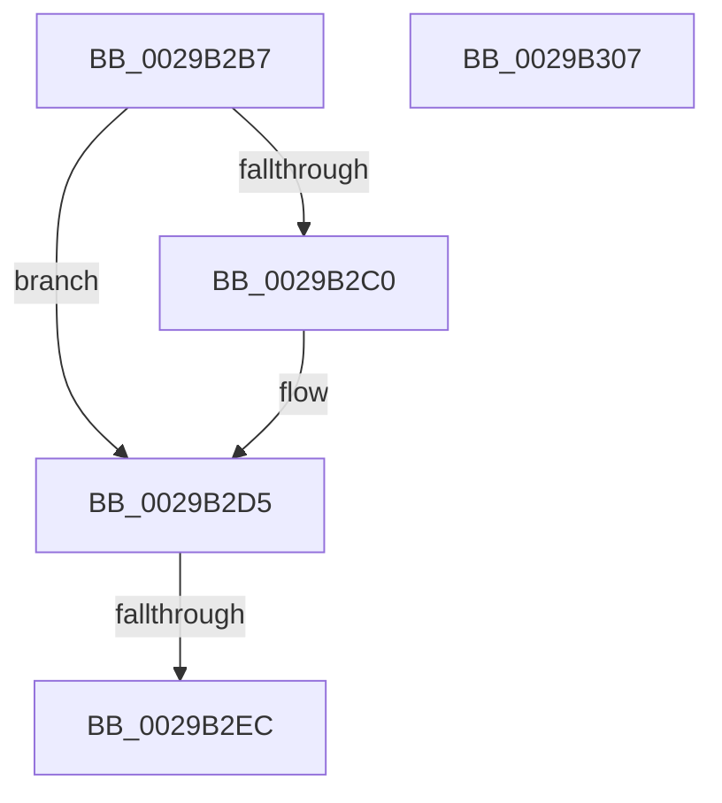

# sub_0029B2B7

- RVA: `0x0029B2B7`–`0x0029B308` (길이 `81` bytes)
- VA: `0x000000014029B2B7`
- 실행 섹션: `.text`
- PDB 이름 있음: `아니요`; PDB Function 태그: `아니요`
- unwind 정보 RVA: `0x00067D7C`
- 디코드: `21`개 명령, `81/81` bytes 표시
- 미해석 바이트: `0` (있으면 어셈블리에 `.byte`로 보존)

> 이 문서는 커널 이미지의 기계어와 PDB 기호를 분석해 생성했습니다. 4번과 5번은 함수 원형과 자료형을 바이너리 사용 방식에서 추정한 C 해석이며 원본 소스 복구 결과는 아닙니다.

## 1. Dependencies

- 직접 호출 지점: **2**; 고유 호출 대상: **2**
- 직접 호출자로 확인된 함수: **0**
- RIP 상대 이미지 참조: **1**

### Outgoing calls
- `0x0029B2D0` → [ObpPushStackInfo](../21/ObpPushStackInfo_function_002109E4.md) (function, `0x002109E4`)
- `0x0029B2FB` → [_security_check_cookie](../6A/_security_check_cookie_function_006AC640.md) (function, `0x006AC640`)

### Direct callers
- 이 함수 시작 RVA로 연결되는 직접 call은 확인되지 않았습니다. 간접 호출은 완전히 역산할 수 없습니다.

### Static image references
- `0x0029B2B7` → RVA `0x00FC5010` (`ALMOSTRO`; read)

## 2. Other-region calls and transfers

- 다른 실행 섹션으로 향하는 call: **0**
- call이 아닌 외부 분기/꼬리 이동: **1**
  - `0x0029B2E6` → [sub_0029B3F6](Unknown_function_0029B3F6.md) (`tail-transfer`)

## 3. Assembly (complete function range)

```asm
0029B2B7  83 3D 52 9D D2 00 00            cmp dword ptr [rip + 0xd29d52], 0
0029B2BE  74 15                           je 0x14029b2d5
0029B2C0  33 D2                           xor edx, edx
0029B2C2  48 8D 4E D0                     lea rcx, [rsi - 0x30]
0029B2C6  41 B9 44 66 6C 74               mov r9d, 0x746c6644
0029B2CC  44 8D 42 01                     lea r8d, [rdx + 1]
0029B2D0  E8 0F 57 F7 FF                  call 0x1402109e4
0029B2D5  48 C7 C0 FF FF FF FF            mov rax, 0xffffffffffffffff
0029B2DC  F0 48 0F C1 46 D0               lock xadd qword ptr [rsi - 0x30], rax
0029B2E2  48 83 E8 01                     sub rax, 1
0029B2E6  0F 8E 0A 01 00 00               jle 0x14029b3f6
0029B2EC  48 8B 5C 24 60                  mov rbx, qword ptr [rsp + 0x60]
0029B2F1  8B C7                           mov eax, edi
0029B2F3  48 8B 4C 24 40                  mov rcx, qword ptr [rsp + 0x40]
0029B2F8  48 33 CC                        xor rcx, rsp
0029B2FB  E8 40 13 41 00                  call 0x1406ac640
0029B300  48 83 C4 68                     add rsp, 0x68
0029B304  5F                              pop rdi
0029B305  5E                              pop rsi
0029B306  C3                              ret
0029B307  CC                              int3
```

## 4. C-style interpretation (structured pseudocode)

```c
__int64 __fastcall sub_0029B2B7(__int64 a1, int a2, __int64 a3, __int64 a4, __int64 a5, __int64 a6, __int64 a7, __int64 a8, __int64 a9, __int64 a10, __int64 a11, __int64 a12)
{
    __int64 result;
    __int64 v_rsp;

    if ((*(unsigned int *)(v_rip + 13802834)) != 0) {
        a2 = 0;
        a1 = v_rsi - 48;
        a4 = 0x746C6644ULL;
        a3 = a2 + 1;
        result = ObpPushStackInfo(a1, a2, a3, a4);
    }
    result = (-1) - (1);
    a1 = (a8) ^ (v_rsp);
    result = _security_check_cookie(a1, a2, a3, a4);
    v_rsp = (v_rsp) + (104);
    return result;
}
```

## 5. (Beta) C Style

```c
int64_t sub_0029B2B7(int64_t Arg1, int32_t Arg2, int64_t Arg3, int64_t Arg4, uint64_t Arg5, uint64_t Arg6, uint64_t Arg7, int64_t Arg8, uint64_t Arg9, uint64_t Arg10, uint64_t Arg11, int64_t Arg12)
{
    int64_t result;
    int64_t local_rsp;

    if ((*(uint32_t *)(v_rip + 0xD29D52)) != 0) {
        Arg2 = 0;
        Arg1 = local_rsi - 48;
        Arg4 = 0x746C6644ULL;
        Arg3 = Arg2 + 1;
        result = ObpPushStackInfo(Arg1, Arg2, Arg3, Arg4);
    }
    result = (-1) - (1);
    Arg1 = (Arg8) ^ (local_rsp);
    result = _security_check_cookie(Arg1, Arg2, Arg3, Arg4);
    local_rsp = (local_rsp) + (104);
    return result;
}
```

## 6. Execution-region graph

[열기: 2D/3D 그래프와 함수 탐색 컨트롤 패널](../../../control-panel.html?section=text&rva=0x0029B2B7&view=graph)

- 2D 그래프는 위에서 아래로 흐르고, 3D 그래프는 빈 공간을 드래그해 회전합니다. Shift+드래그는 이동, 휠은 확대·축소, 함수 노드 선택은 대상 보고서 이동입니다.

### Static fallback


