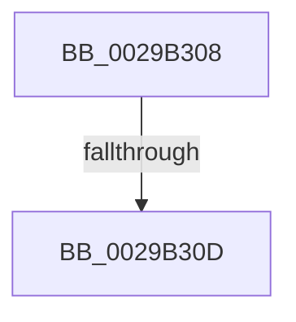

# sub_0029B308

- RVA: `0x0029B308`–`0x0029B35C` (길이 `84` bytes)
- VA: `0x000000014029B308`
- 실행 섹션: `.text`
- PDB 이름 있음: `아니요`; PDB Function 태그: `아니요`
- unwind 정보 RVA: `0x00067D94`
- 디코드: `17`개 명령, `84/84` bytes 표시
- 미해석 바이트: `0` (있으면 어셈블리에 `.byte`로 보존)

> 이 문서는 커널 이미지의 기계어와 PDB 기호를 분석해 생성했습니다. 4번과 5번은 함수 원형과 자료형을 바이너리 사용 방식에서 추정한 C 해석이며 원본 소스 복구 결과는 아닙니다.

## 1. Dependencies

- 직접 호출 지점: **1**; 고유 호출 대상: **1**
- 직접 호출자로 확인된 함수: **0**
- RIP 상대 이미지 참조: **0**

### Outgoing calls
- `0x0029B340` → [IofCallDriver](IofCallDriver_function_0029B4B0.md) (function, `0x0029B4B0`)

### Direct callers
- 이 함수 시작 RVA로 연결되는 직접 call은 확인되지 않았습니다. 간접 호출은 완전히 역산할 수 없습니다.

### Static image references
- 디코드된 RIP-relative 메모리 참조가 없습니다.

## 2. Other-region calls and transfers

- 다른 실행 섹션으로 향하는 call: **0**
- call이 아닌 외부 분기/꼬리 이동: **2**
  - `0x0029B30B` → [sub_0029B1D6 + 0xC5](Unknown_function_0029B1D6.md) (`tail-transfer`)
  - `0x0029B357` → [sub_0029B1D6 + 0xD2](Unknown_function_0029B1D6.md) (`tail-transfer`)

## 3. Assembly (complete function range)

```asm
0029B308  F6 00 02                        test byte ptr [rax], 2
0029B30B  74 8E                           je 0x14029b29b
0029B30D  0F 57 C0                        xorps xmm0, xmm0
0029B310  48 8D 4C 24 30                  lea rcx, [rsp + 0x30]
0029B315  0F 11 44 24 30                  movups xmmword ptr [rsp + 0x30], xmm0
0029B31A  48 8B D7                        mov rdx, rdi
0029B31D  0F 10 40 18                     movups xmm0, xmmword ptr [rax + 0x18]
0029B321  0F 11 44 24 30                  movups xmmword ptr [rsp + 0x30], xmm0
0029B326  65 48 8B 04 25 88 01 00 00      mov rax, qword ptr gs:[0x188]
0029B32F  48 8B 98 30 06 00 00            mov rbx, qword ptr [rax + 0x630]
0029B336  48 89 88 30 06 00 00            mov qword ptr [rax + 0x630], rcx
0029B33D  49 8B CE                        mov rcx, r14
0029B340  E8 6B 01 00 00                  call 0x14029b4b0
0029B345  8B F8                           mov edi, eax
0029B347  65 48 8B 04 25 88 01 00 00      mov rax, qword ptr gs:[0x188]
0029B350  48 89 98 30 06 00 00            mov qword ptr [rax + 0x630], rbx
0029B357  E9 4C FF FF FF                  jmp 0x14029b2a8
```

## 4. C-style interpretation (structured pseudocode)

```c
__int64 __fastcall sub_0029B308(__int64 a1, __int64 a2, __int64 a3, __int64 a4, __int64 a5, __int64 a6)
{
    __int64 result;

    a6 = v_xmm0;
    a6 = v_xmm0;
    *(unsigned __int64 *)(*(unsigned __int64 *)(gs_base + (0 + 392)) + 1584) = a6;
    result = IofCallDriver(v_r14, v_rdi, a3, a4);
    *(unsigned __int64 *)(*(unsigned __int64 *)(gs_base + (0 + 392)) + 1584) = *(unsigned __int64 *)(*(unsigned __int64 *)(gs_base + (0 + 392)) + 1584);
}
```

## 5. (Beta) C Style

```c
int64_t sub_0029B308(int64_t Arg1, int64_t Arg2, int64_t Arg3, int64_t Arg4, uint64_t Arg5, int64_t Arg6)
{
    int64_t result;

    Arg6 = v_xmm0;
    Arg6 = v_xmm0;
    *(uint64_t *)(*(uint64_t *)(gs_base + (0 + 0x188)) + 0x630) = Arg6;
    result = IofCallDriver(local_r14, local_rdi, Arg3, Arg4);
    *(uint64_t *)(*(uint64_t *)(gs_base + (0 + 0x188)) + 0x630) = *(uint64_t *)(*(uint64_t *)(gs_base + (0 + 0x188)) + 0x630);
}
```

## 6. Execution-region graph

[열기: 2D/3D 그래프와 함수 탐색 컨트롤 패널](../../../control-panel.html?section=text&rva=0x0029B308&view=graph)

- 2D 그래프는 위에서 아래로 흐르고, 3D 그래프는 빈 공간을 드래그해 회전합니다. Shift+드래그는 이동, 휠은 확대·축소, 함수 노드 선택은 대상 보고서 이동입니다.

### Static fallback


