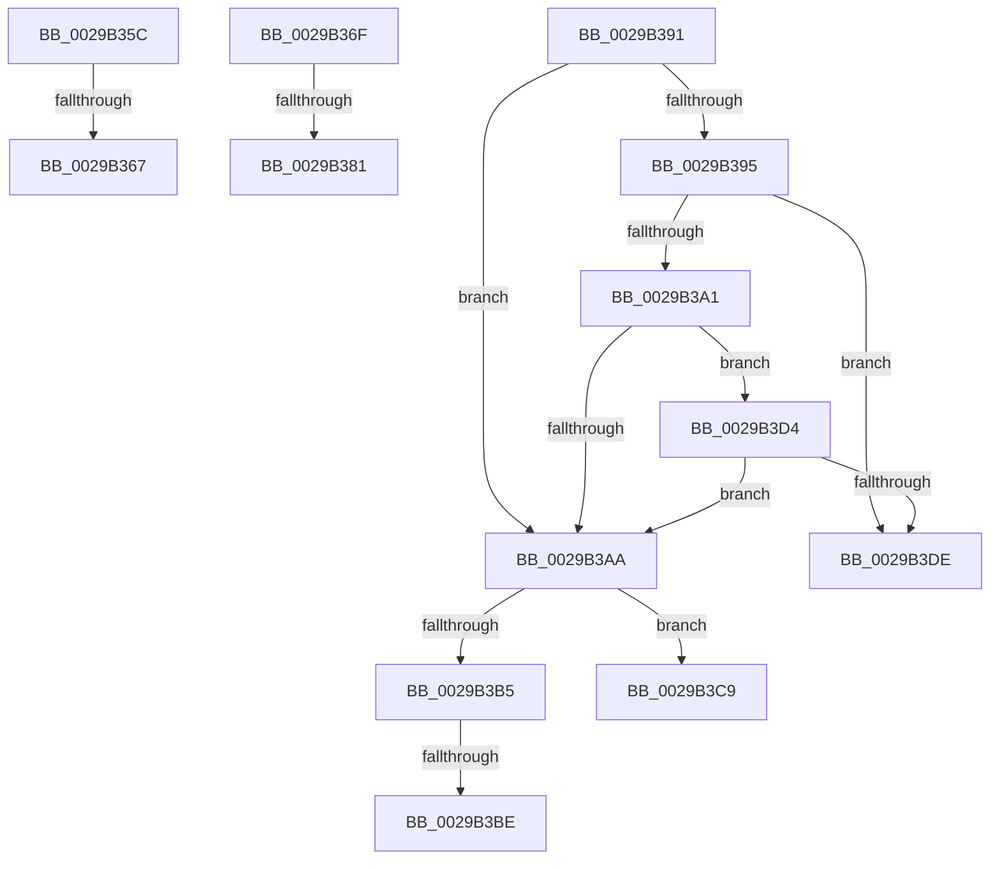

# sub_0029B35C

- RVA: `0x0029B35C`–`0x0029B3F6` (길이 `154` bytes)
- VA: `0x000000014029B35C`
- 실행 섹션: `.text`
- PDB 이름 있음: `아니요`; PDB Function 태그: `아니요`
- unwind 정보 RVA: `0x00067DB0`
- 디코드: `35`개 명령, `154/154` bytes 표시
- 미해석 바이트: `0` (있으면 어셈블리에 `.byte`로 보존)

> 이 문서는 커널 이미지의 기계어와 PDB 기호를 분석해 생성했습니다. 4번과 5번은 함수 원형과 자료형을 바이너리 사용 방식에서 추정한 C 해석이며 원본 소스 복구 결과는 아닙니다.

## 1. Dependencies

- 직접 호출 지점: **0**; 고유 호출 대상: **0**
- 직접 호출자로 확인된 함수: **0**
- RIP 상대 이미지 참조: **3**

### Outgoing calls
- 직접 디코드된 call 명령이 없습니다.

### Direct callers
- 이 함수 시작 RVA로 연결되는 직접 call은 확인되지 않았습니다. 간접 호출은 완전히 역산할 수 없습니다.

### Static image references
- `0x0029B3BE` → RVA `0x00F8D208` (`.data`; read/write)
- `0x0029B3C9` → RVA `0x00F8D204` (`.data`; read/write)
- `0x0029B3DE` → RVA `0x00F8D20C` (`.data`; read/write)

## 2. Other-region calls and transfers

- 다른 실행 섹션으로 향하는 call: **0**
- call이 아닌 외부 분기/꼬리 이동: **8**
  - `0x0029B361` → [sub_0029B1D6 + 0x3E](Unknown_function_0029B1D6.md) (`tail-transfer`)
  - `0x0029B36A` → [sub_0029B1D6 + 0x82](Unknown_function_0029B1D6.md) (`tail-transfer`)
  - `0x0029B37B` → [sub_0029B1D6 + 0x7A](Unknown_function_0029B1D6.md) (`tail-transfer`)
  - `0x0029B38C` → [sub_0029B1D6 + 0x7A](Unknown_function_0029B1D6.md) (`tail-transfer`)
  - `0x0029B3B8` → [sub_0029B1D6 + 0xAE](Unknown_function_0029B1D6.md) (`tail-transfer`)
  - `0x0029B3C4` → [sub_0029B1D6 + 0xAE](Unknown_function_0029B1D6.md) (`tail-transfer`)
  - `0x0029B3CF` → [sub_0029B1D6 + 0xAE](Unknown_function_0029B1D6.md) (`tail-transfer`)
  - `0x0029B3F1` → [sub_0029B1D6 + 0xAE](Unknown_function_0029B1D6.md) (`tail-transfer`)

## 3. Assembly (complete function range)

```asm
0029B35C  8B 40 58                        mov eax, dword ptr [rax + 0x58]
0029B35F  85 C0                           test eax, eax
0029B361  0F 84 AD FE FF FF               je 0x14029b214
0029B367  C1 E0 11                        shl eax, 0x11
0029B36A  E9 E9 FE FF FF                  jmp 0x14029b258
0029B36F  65 48 8B 0C 25 88 01 00 00      mov rcx, qword ptr gs:[0x188]
0029B378  4C 3B C1                        cmp r8, rcx
0029B37B  0F 85 CF FE FF FF               jne 0x14029b250
0029B381  41 83 B8 E0 05 00 00 00         cmp dword ptr [r8 + 0x5e0], 0
0029B389  0F 45 C2                        cmovne eax, edx
0029B38C  E9 BF FE FF FF                  jmp 0x14029b250
0029B391  84 C9                           test cl, cl
0029B393  75 15                           jne 0x14029b3aa
0029B395  48 8B 97 98 00 00 00            mov rdx, qword ptr [rdi + 0x98]
0029B39C  48 85 D2                        test rdx, rdx
0029B39F  74 3D                           je 0x14029b3de
0029B3A1  F7 42 74 00 04 00 00            test dword ptr [rdx + 0x74], 0x400
0029B3A8  74 2A                           je 0x14029b3d4
0029B3AA  8B 8C 24 A0 00 00 00            mov ecx, dword ptr [rsp + 0xa0]
0029B3B1  85 C9                           test ecx, ecx
0029B3B3  74 14                           je 0x14029b3c9
0029B3B5  83 F9 01                        cmp ecx, 1
0029B3B8  0F 85 C6 FE FF FF               jne 0x14029b284
0029B3BE  FF 05 44 1E CF 00               inc dword ptr [rip + 0xcf1e44]
0029B3C4  E9 BB FE FF FF                  jmp 0x14029b284
0029B3C9  FF 05 35 1E CF 00               inc dword ptr [rip + 0xcf1e35]
0029B3CF  E9 B0 FE FF FF                  jmp 0x14029b284
0029B3D4  8B 8A A4 05 00 00               mov ecx, dword ptr [rdx + 0x5a4]
0029B3DA  84 C9                           test cl, cl
0029B3DC  78 CC                           js 0x14029b3aa
0029B3DE  FF 05 28 1E CF 00               inc dword ptr [rip + 0xcf1e28]
0029B3E4  25 FF FF F1 FF                  and eax, 0xfff1ffff
0029B3E9  0D 00 00 06 00                  or eax, 0x60000
0029B3EE  89 47 10                        mov dword ptr [rdi + 0x10], eax
0029B3F1  E9 8E FE FF FF                  jmp 0x14029b284
```

## 4. C-style interpretation (structured pseudocode)

```c
__int64 __fastcall sub_0029B35C(__int64 a1, int a2, __int64 a3)
{
    __int64 result;
    unsigned int v_stack_pA0;

    result = (unsigned int)(((unsigned int)(*(unsigned int *)(result + 88))) << (17));
}
```

## 5. (Beta) C Style

```c
int64_t sub_0029B35C(int64_t Arg1, int32_t Arg2, int64_t Arg3)
{
    int64_t result;
    uint32_t v_stack_pA0;

    result = (uint32_t)(((uint32_t)(*(uint32_t *)(result + 0x58))) << (17));
}
```

## 6. Execution-region graph

[열기: 2D/3D 그래프와 함수 탐색 컨트롤 패널](../../../control-panel.html?section=text&rva=0x0029B35C&view=graph)

- 2D 그래프는 위에서 아래로 흐르고, 3D 그래프는 빈 공간을 드래그해 회전합니다. Shift+드래그는 이동, 휠은 확대·축소, 함수 노드 선택은 대상 보고서 이동입니다.

### Static fallback


