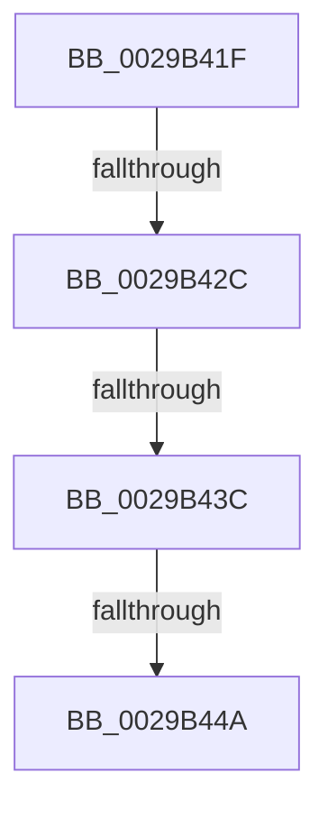

# sub_0029B41F

- RVA: `0x0029B41F`–`0x0029B44F` (길이 `48` bytes)
- VA: `0x000000014029B41F`
- 실행 섹션: `.text`
- PDB 이름 있음: `아니요`; PDB Function 태그: `아니요`
- unwind 정보 RVA: `0x00067DDC`
- 디코드: `10`개 명령, `48/48` bytes 표시
- 미해석 바이트: `0` (있으면 어셈블리에 `.byte`로 보존)

> 이 문서는 커널 이미지의 기계어와 PDB 기호를 분석해 생성했습니다. 4번과 5번은 함수 원형과 자료형을 바이너리 사용 방식에서 추정한 C 해석이며 원본 소스 복구 결과는 아닙니다.

## 1. Dependencies

- 직접 호출 지점: **0**; 고유 호출 대상: **0**
- 직접 호출자로 확인된 함수: **0**
- RIP 상대 이미지 참조: **0**

### Outgoing calls
- 직접 디코드된 call 명령이 없습니다.

### Direct callers
- 이 함수 시작 RVA로 연결되는 직접 call은 확인되지 않았습니다. 간접 호출은 완전히 역산할 수 없습니다.

### Static image references
- 디코드된 RIP-relative 메모리 참조가 없습니다.

## 2. Other-region calls and transfers

- 다른 실행 섹션으로 향하는 call: **0**
- call이 아닌 외부 분기/꼬리 이동: **4**
  - `0x0029B426` → [sub_0029B1D6 + 0xA1](Unknown_function_0029B1D6.md) (`tail-transfer`)
  - `0x0029B436` → [sub_0029B1D6 + 0xA1](Unknown_function_0029B1D6.md) (`tail-transfer`)
  - `0x0029B444` → [sub_0029B1D6 + 0xAE](Unknown_function_0029B1D6.md) (`tail-transfer`)
  - `0x0029B44A` → [sub_0029B1D6 + 0xA1](Unknown_function_0029B1D6.md) (`tail-transfer`)

## 3. Assembly (complete function range)

```asm
0029B41F  FF C9                           dec ecx
0029B421  8B D1                           mov edx, ecx
0029B423  83 F9 02                        cmp ecx, 2
0029B426  0F 8D 4B FE FF FF               jge 0x14029b277
0029B42C  4C 8B 87 98 00 00 00            mov r8, qword ptr [rdi + 0x98]
0029B433  4D 85 C0                        test r8, r8
0029B436  0F 84 3B FE FF FF               je 0x14029b277
0029B43C  41 83 B8 E0 05 00 00 00         cmp dword ptr [r8 + 0x5e0], 0
0029B444  0F 85 3A FE FF FF               jne 0x14029b284
0029B44A  E9 28 FE FF FF                  jmp 0x14029b277
```

## 4. C-style interpretation (structured pseudocode)

```c
void __fastcall sub_0029B41F(int a1)
{
    a1 = (unsigned int)((a1) - 1);
}
```

## 5. (Beta) C Style

```c
void sub_0029B41F(int32_t Arg1)
{
    Arg1 = (uint32_t)((Arg1) - 1);
}
```

## 6. Execution-region graph

[열기: 2D/3D 그래프와 함수 탐색 컨트롤 패널](../../../control-panel.html?section=text&rva=0x0029B41F&view=graph)

- 2D 그래프는 위에서 아래로 흐르고, 3D 그래프는 빈 공간을 드래그해 회전합니다. Shift+드래그는 이동, 휠은 확대·축소, 함수 노드 선택은 대상 보고서 이동입니다.

### Static fallback


