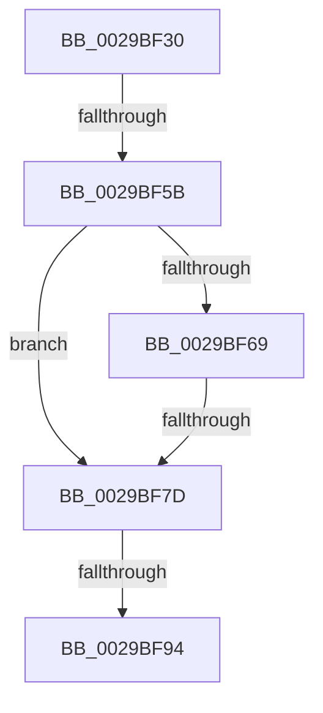

# sub_0029BF30

- RVA: `0x0029BF30`–`0x0029BFBF` (길이 `143` bytes)
- VA: `0x000000014029BF30`
- 실행 섹션: `.text`
- PDB 이름 있음: `아니요`; PDB Function 태그: `아니요`
- unwind 정보 RVA: `0x00067E64`
- 디코드: `30`개 명령, `143/143` bytes 표시
- 미해석 바이트: `0` (있으면 어셈블리에 `.byte`로 보존)

> 이 문서는 커널 이미지의 기계어와 PDB 기호를 분석해 생성했습니다. 4번과 5번은 함수 원형과 자료형을 바이너리 사용 방식에서 추정한 C 해석이며 원본 소스 복구 결과는 아닙니다.

## 1. Dependencies

- 직접 호출 지점: **0**; 고유 호출 대상: **0**
- 직접 호출자로 확인된 함수: **0**
- RIP 상대 이미지 참조: **0**

### Outgoing calls
- 직접 디코드된 call 명령이 없습니다.

### Direct callers
- 이 함수 시작 RVA로 연결되는 직접 call은 확인되지 않았습니다. 간접 호출은 완전히 역산할 수 없습니다.

### Static image references
- 디코드된 RIP-relative 메모리 참조가 없습니다.

## 2. Other-region calls and transfers

- 다른 실행 섹션으로 향하는 call: **0**
- call이 아닌 외부 분기/꼬리 이동: **4**
  - `0x0029BF59` → [sub_0029BFC9](Unknown_function_0029BFC9.md) (`tail-transfer`)
  - `0x0029BF77` → [sub_0029BFC9 + 0xC5](Unknown_function_0029BFC9.md) (`tail-transfer`)
  - `0x0029BF8E` → [sub_0029BFC9 + 0x61](Unknown_function_0029BFC9.md) (`tail-transfer`)
  - `0x0029BFB9` → [sub_0029C0C9](Unknown_function_0029C0C9.md) (`tail-transfer`)

## 3. Assembly (complete function range)

```asm
0029BF30  48 89 6C 24 60                  mov qword ptr [rsp + 0x60], rbp
0029BF35  8B EB                           mov ebp, ebx
0029BF37  48 89 74 24 40                  mov qword ptr [rsp + 0x40], rsi
0029BF3C  48 8B F2                        mov rsi, rdx
0029BF3F  4C 89 64 24 38                  mov qword ptr [rsp + 0x38], r12
0029BF44  4C 89 6C 24 30                  mov qword ptr [rsp + 0x30], r13
0029BF49  4C 8B E9                        mov r13, rcx
0029BF4C  4C 89 74 24 28                  mov qword ptr [rsp + 0x28], r14
0029BF51  4C 89 7C 24 20                  mov qword ptr [rsp + 0x20], r15
0029BF56  48 85 FF                        test rdi, rdi
0029BF59  75 6E                           jne 0x14029bfc9
0029BF5B  65 48 8B 04 25 88 01 00 00      mov rax, qword ptr gs:[0x188]
0029BF64  48 3B F0                        cmp rsi, rax
0029BF67  75 14                           jne 0x14029bf7d
0029BF69  48 8B 96 B8 00 00 00            mov rdx, qword ptr [rsi + 0xb8]
0029BF70  48 3B 96 20 02 00 00            cmp rdx, qword ptr [rsi + 0x220]
0029BF77  0F 85 11 01 00 00               jne 0x14029c08e
0029BF7D  48 8B B6 20 02 00 00            mov rsi, qword ptr [rsi + 0x220]
0029BF84  4C 8B F3                        mov r14, rbx
0029BF87  48 39 9E D8 06 00 00            cmp qword ptr [rsi + 0x6d8], rbx
0029BF8E  0F 85 96 00 00 00               jne 0x14029c02a
0029BF94  BB 25 02 00 C0                  mov ebx, 0xc0000225
0029BF99  4C 8B 7C 24 20                  mov r15, qword ptr [rsp + 0x20]
0029BF9E  85 ED                           test ebp, ebp
0029BFA0  48 8B 6C 24 60                  mov rbp, qword ptr [rsp + 0x60]
0029BFA5  4C 8B 74 24 28                  mov r14, qword ptr [rsp + 0x28]
0029BFAA  4C 8B 6C 24 30                  mov r13, qword ptr [rsp + 0x30]
0029BFAF  4C 8B 64 24 38                  mov r12, qword ptr [rsp + 0x38]
0029BFB4  48 8B 74 24 40                  mov rsi, qword ptr [rsp + 0x40]
0029BFB9  0F 85 0A 01 00 00               jne 0x14029c0c9
```

## 4. C-style interpretation (structured pseudocode)

```c
__int64 __fastcall sub_0029BF30(__int64 a1, __int64 a2, __int64 a3, __int64 a4, __int64 a5, __int64 a6, __int64 a7, __int64 a8, __int64 a9, __int64 a10, __int64 a11, __int64 a12)
{
    unsigned __int64 v_stack_p20;
    unsigned __int64 v_stack_p28;
    unsigned __int64 v_stack_p30;
    unsigned __int64 v_stack_p38;
    unsigned __int64 v_stack_p40;
    unsigned __int64 v_stack_p60;

    v_stack_p60 = v_rbp;
    v_stack_p40 = v_rsi;
    v_stack_p38 = v_r12;
    v_stack_p30 = v_r13;
    v_stack_p28 = v_r14;
    v_stack_p20 = v_r15;
    if (a2 != (*(unsigned __int64 *)(gs_base + (0 + 392)))) goto loc_0029BF7D;
loc_0029BF7D:
}
```

## 5. (Beta) C Style

```c
int64_t sub_0029BF30(int64_t Arg1, int64_t Arg2, int64_t Arg3, int64_t Arg4, int64_t Arg5, int64_t Arg6, int64_t Arg7, int64_t Arg8, uint64_t Arg9, uint64_t Arg10, uint64_t Arg11, int64_t Arg12)
{
    uint64_t v_stack_p20;
    uint64_t v_stack_p28;
    uint64_t v_stack_p30;
    uint64_t v_stack_p38;
    uint64_t v_stack_p40;
    uint64_t v_stack_p60;

    v_stack_p60 = local_rbp;
    v_stack_p40 = local_rsi;
    v_stack_p38 = local_r12;
    v_stack_p30 = local_r13;
    v_stack_p28 = local_r14;
    v_stack_p20 = local_r15;
    if (Arg2 != (*(uint64_t *)(gs_base + (0 + 0x188)))) goto loc_0029BF7D;
loc_0029BF7D:
}
```

## 6. Execution-region graph

[열기: 2D/3D 그래프와 함수 탐색 컨트롤 패널](../../../control-panel.html?section=text&rva=0x0029BF30&view=graph)

- 2D 그래프는 위에서 아래로 흐르고, 3D 그래프는 빈 공간을 드래그해 회전합니다. Shift+드래그는 이동, 휠은 확대·축소, 함수 노드 선택은 대상 보고서 이동입니다.

### Static fallback


