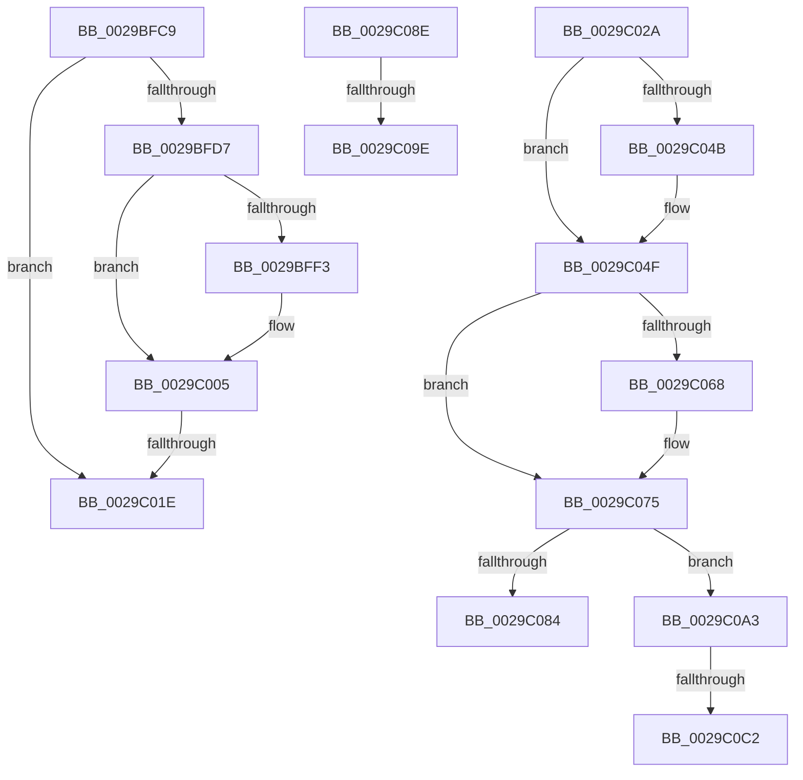

# sub_0029BFC9

- RVA: `0x0029BFC9`–`0x0029C0C9` (길이 `256` bytes)
- VA: `0x000000014029BFC9`
- 실행 섹션: `.text`
- PDB 이름 있음: `아니요`; PDB Function 태그: `아니요`
- unwind 정보 RVA: `0x00067EA0`
- 디코드: `56`개 명령, `256/256` bytes 표시
- 미해석 바이트: `0` (있으면 어셈블리에 `.byte`로 보존)

> 이 문서는 커널 이미지의 기계어와 PDB 기호를 분석해 생성했습니다. 4번과 5번은 함수 원형과 자료형을 바이너리 사용 방식에서 추정한 C 해석이며 원본 소스 복구 결과는 아닙니다.

## 1. Dependencies

- 직접 호출 지점: **8**; 고유 호출 대상: **7**
- 직접 호출자로 확인된 함수: **0**
- RIP 상대 이미지 참조: **3**

### Outgoing calls
- `0x0029BFDE` → [ExAcquireSpinLockShared](../24/ExAcquireSpinLockShared_function_0024DCE0.md) (function, `0x0024DCE0`)
- `0x0029BFFB` → [ObfReferenceObjectWithTag](../21/ObfReferenceObjectWithTag_function_00210710.md) (function, `0x00210710`)
- `0x0029C010` → [ExReleaseSpinLockShared](../2F/ExReleaseSpinLockShared_function_002F0EF0.md) (function, `0x002F0EF0`)
- `0x0029C031` → [ExAcquireSpinLockShared](../24/ExAcquireSpinLockShared_function_0024DCE0.md) (function, `0x0024DCE0`)
- `0x0029C056` → [ExReleaseSpinLockSharedFromDpcLevel](../24/ExReleaseSpinLockSharedFromDpcLevel_function_0024A590.md) (function, `0x0024A590`)
- `0x0029C070` → [KiLowerIrqlProcessIrqlFlags](../4F/KiLowerIrqlProcessIrqlFlags_function_004F5698.md) (function, `0x004F5698`)
- `0x0029C091` → [IopSetDiskIoAttributionFromProcess](IopSetDiskIoAttributionFromProcess_function_0029C520.md) (function, `0x0029C520`)
- `0x0029C0B5` → [IopSetDiskIoAttributionExtension](IopSetDiskIoAttributionExtension_function_0029C0E4.md) (function, `0x0029C0E4`)

### Direct callers
- 이 함수 시작 RVA로 연결되는 직접 call은 확인되지 않았습니다. 간접 호출은 완전히 역산할 수 없습니다.

### Static image references
- `0x0029BFD7` → RVA `0x00F06590` (`.data`; read)
- `0x0029C02A` → RVA `0x00F8D1E0` (`.data`; read)
- `0x0029C05B` → RVA `0x00FC6D20` (`ALMOSTRO`; read)

## 2. Other-region calls and transfers

- 다른 실행 섹션으로 향하는 call: **0**
- call이 아닌 외부 분기/꼬리 이동: **7**
  - `0x0029C018` → [sub_0029BF30 + 0x2B](Unknown_function_0029BF30.md) (`tail-transfer`)
  - `0x0029C025` → [sub_0029BF30 + 0x54](Unknown_function_0029BF30.md) (`tail-transfer`)
  - `0x0029C089` → [sub_0029BF30 + 0x69](Unknown_function_0029BF30.md) (`tail-transfer`)
  - `0x0029C098` → [sub_0029BF30 + 0x4D](Unknown_function_0029BF30.md) (`tail-transfer`)
  - `0x0029C09E` → [sub_0029BF30 + 0x69](Unknown_function_0029BF30.md) (`tail-transfer`)
  - `0x0029C0BC` → [sub_0029BF30 + 0x69](Unknown_function_0029BF30.md) (`tail-transfer`)
  - `0x0029C0C4` → [sub_0029BF30 + 0x69](Unknown_function_0029BF30.md) (`tail-transfer`)

## 3. Assembly (complete function range)

```asm
0029BFC9  65 48 8B 04 25 88 01 00 00      mov rax, qword ptr gs:[0x188]
0029BFD2  48 3B F0                        cmp rsi, rax
0029BFD5  74 47                           je 0x14029c01e
0029BFD7  48 8D 0D B2 A5 C6 00            lea rcx, [rip + 0xc6a5b2]
0029BFDE  E8 FD 1C FB FF                  call 0x14024dce0
0029BFE3  48 8B BE 50 06 00 00            mov rdi, qword ptr [rsi + 0x650]
0029BFEA  44 0F B6 F0                     movzx r14d, al
0029BFEE  48 85 FF                        test rdi, rdi
0029BFF1  74 12                           je 0x14029c005
0029BFF3  BA 44 66 6C 74                  mov edx, 0x746c6644
0029BFF8  48 8B CF                        mov rcx, rdi
0029BFFB  E8 10 47 F7 FF                  call 0x140210710
0029C000  BD 01 00 00 00                  mov ebp, 1
0029C005  41 0F B6 D6                     movzx edx, r14b
0029C009  48 8D 0D 80 A5 C6 00            lea rcx, [rip + 0xc6a580]
0029C010  E8 DB 4E 05 00                  call 0x1402f0ef0
0029C015  48 85 FF                        test rdi, rdi
0029C018  0F 84 3D FF FF FF               je 0x14029bf5b
0029C01E  48 8B B7 20 02 00 00            mov rsi, qword ptr [rdi + 0x220]
0029C025  E9 5A FF FF FF                  jmp 0x14029bf84
0029C02A  48 8D 0D AF 11 CF 00            lea rcx, [rip + 0xcf11af]
0029C031  E8 AA 1C FB FF                  call 0x14024dce0
0029C036  88 44 24 68                     mov byte ptr [rsp + 0x68], al
0029C03A  48 8B 86 D8 06 00 00            mov rax, qword ptr [rsi + 0x6d8]
0029C041  48 89 44 24 70                  mov qword ptr [rsp + 0x70], rax
0029C046  48 85 C0                        test rax, rax
0029C049  74 04                           je 0x14029c04f
0029C04B  4C 8B 70 18                     mov r14, qword ptr [rax + 0x18]
0029C04F  48 8D 0D 8A 11 CF 00            lea rcx, [rip + 0xcf118a]
0029C056  E8 35 E5 FA FF                  call 0x14024a590
0029C05B  39 1D BF AC D2 00               cmp dword ptr [rip + 0xd2acbf], ebx
0029C061  0F B6 74 24 68                  movzx esi, byte ptr [rsp + 0x68]
0029C066  74 0D                           je 0x14029c075
0029C068  44 0F 20 C1                     mov rcx, cr8
0029C06C  40 0F B6 D6                     movzx edx, sil
0029C070  E8 23 96 25 00                  call 0x1404f5698
0029C075  40 0F B6 C6                     movzx eax, sil
0029C079  44 0F 22 C0                     mov cr8, rax
0029C07D  48 39 5C 24 70                  cmp qword ptr [rsp + 0x70], rbx
0029C082  75 1F                           jne 0x14029c0a3
0029C084  BB 25 02 00 C0                  mov ebx, 0xc0000225
0029C089  E9 0B FF FF FF                  jmp 0x14029bf99
0029C08E  49 8B CD                        mov rcx, r13
0029C091  E8 8A 04 00 00                  call 0x14029c520
0029C096  85 C0                           test eax, eax
0029C098  0F 88 DF FE FF FF               js 0x14029bf7d
0029C09E  E9 F6 FE FF FF                  jmp 0x14029bf99
0029C0A3  65 4C 8B 04 25 88 01 00 00      mov r8, qword ptr gs:[0x188]
0029C0AC  45 33 C9                        xor r9d, r9d
0029C0AF  49 8B D6                        mov rdx, r14
0029C0B2  49 8B CD                        mov rcx, r13
0029C0B5  E8 2A 00 00 00                  call 0x14029c0e4
0029C0BA  85 C0                           test eax, eax
0029C0BC  0F 89 D7 FE FF FF               jns 0x14029bf99
0029C0C2  8B D8                           mov ebx, eax
0029C0C4  E9 D0 FE FF FF                  jmp 0x14029bf99
```

## 4. C-style interpretation (structured pseudocode)

```c
__int64 __fastcall sub_0029BFC9(__int64 a1, __int64 a2, __int64 a3, int a4)
{
    __int64 result;
    __int64 v_rbp;
    unsigned __int8 v_stack_p68;
    unsigned __int64 v_stack_p70;

    if (v_rsi == (*(unsigned __int64 *)(gs_base + (0 + 392)))) goto loc_0029C01E;
    result = ExAcquireSpinLockShared(v_rip + 13018546, a2, a3, a4);
    if (*(unsigned __int64 *)(v_rsi + 1616) != 0) {
        a2 = 0x746C6644ULL;
        a1 = *(unsigned __int64 *)(v_rsi + 1616);
        result = ObfReferenceObjectWithTag(a1, a2, a3, a4);
        v_rbp = 1;
    }
    result = ExReleaseSpinLockShared(v_rip + 13018496, (unsigned __int8)((unsigned __int8)(result)), a3, a4);
loc_0029C01E:
}
```

## 5. (Beta) C Style

```c
int64_t sub_0029BFC9(int64_t Arg1, int64_t Arg2, int64_t Arg3, int32_t Arg4)
{
    int64_t result;
    int64_t local_rbp;
    uint8_t v_stack_p68;
    uint64_t v_stack_p70;

    if (local_rsi == (*(uint64_t *)(gs_base + (0 + 0x188)))) goto loc_0029C01E;
    result = ExAcquireSpinLockShared(v_rip + 13018546, Arg2, Arg3, Arg4);
    if (*(uint64_t *)(local_rsi + 0x650) != 0) {
        Arg2 = 0x746C6644ULL;
        Arg1 = *(uint64_t *)(local_rsi + 0x650);
        result = ObfReferenceObjectWithTag(Arg1, Arg2, Arg3, Arg4);
        local_rbp = 1;
    }
    result = ExReleaseSpinLockShared(v_rip + 13018496, (uint8_t)((uint8_t)(result)), Arg3, Arg4);
loc_0029C01E:
}
```

## 6. Execution-region graph

[열기: 2D/3D 그래프와 함수 탐색 컨트롤 패널](../../../control-panel.html?section=text&rva=0x0029BFC9&view=graph)

- 2D 그래프는 위에서 아래로 흐르고, 3D 그래프는 빈 공간을 드래그해 회전합니다. Shift+드래그는 이동, 휠은 확대·축소, 함수 노드 선택은 대상 보고서 이동입니다.

### Static fallback


