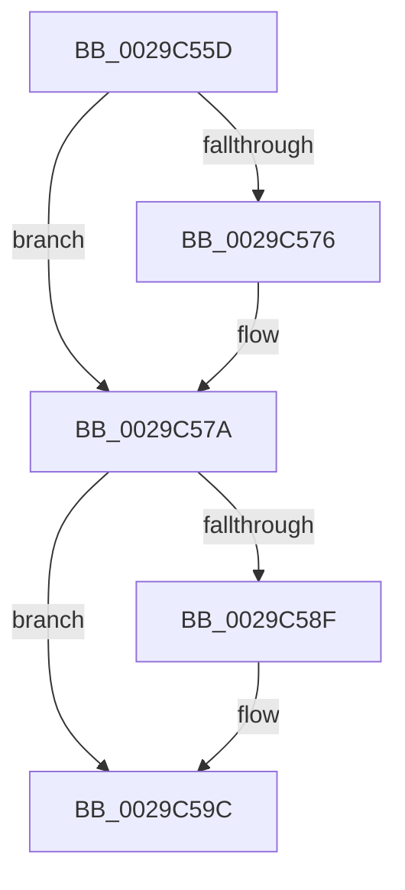

# sub_0029C55D

- RVA: `0x0029C55D`–`0x0029C5AA` (길이 `77` bytes)
- VA: `0x000000014029C55D`
- 실행 섹션: `.text`
- PDB 이름 있음: `아니요`; PDB Function 태그: `아니요`
- unwind 정보 RVA: `0x00067F24`
- 디코드: `18`개 명령, `77/77` bytes 표시
- 미해석 바이트: `0` (있으면 어셈블리에 `.byte`로 보존)

> 이 문서는 커널 이미지의 기계어와 PDB 기호를 분석해 생성했습니다. 4번과 5번은 함수 원형과 자료형을 바이너리 사용 방식에서 추정한 C 해석이며 원본 소스 복구 결과는 아닙니다.

## 1. Dependencies

- 직접 호출 지점: **3**; 고유 호출 대상: **3**
- 직접 호출자로 확인된 함수: **0**
- RIP 상대 이미지 참조: **2**

### Outgoing calls
- `0x0029C562` → [ExAcquireSpinLockShared](../24/ExAcquireSpinLockShared_function_0024DCE0.md) (function, `0x0024DCE0`)
- `0x0029C581` → [ExReleaseSpinLockSharedFromDpcLevel](../24/ExReleaseSpinLockSharedFromDpcLevel_function_0024A590.md) (function, `0x0024A590`)
- `0x0029C597` → [KiLowerIrqlProcessIrqlFlags](../4F/KiLowerIrqlProcessIrqlFlags_function_004F5698.md) (function, `0x004F5698`)

### Direct callers
- 이 함수 시작 RVA로 연결되는 직접 call은 확인되지 않았습니다. 간접 호출은 완전히 역산할 수 없습니다.

### Static image references
- `0x0029C57A` → RVA `0x00F8D1E0` (`.data`; read)
- `0x0029C586` → RVA `0x00FC6D20` (`ALMOSTRO`; read)

## 2. Other-region calls and transfers

- 다른 실행 섹션으로 향하는 call: **0**
- call이 아닌 외부 분기/꼬리 이동: **1**
  - `0x0029C5A8` → [IopSetDiskIoAttributionFromProcess + 0x20](IopSetDiskIoAttributionFromProcess_function_0029C520.md) (`tail-transfer`)

## 3. Assembly (complete function range)

```asm
0029C55D  48 89 6C 24 30                  mov qword ptr [rsp + 0x30], rbp
0029C562  E8 79 17 FB FF                  call 0x14024dce0
0029C567  48 8B 9B D8 06 00 00            mov rbx, qword ptr [rbx + 0x6d8]
0029C56E  0F B6 E8                        movzx ebp, al
0029C571  48 85 DB                        test rbx, rbx
0029C574  74 04                           je 0x14029c57a
0029C576  48 8B 7B 18                     mov rdi, qword ptr [rbx + 0x18]
0029C57A  48 8D 0D 5F 0C CF 00            lea rcx, [rip + 0xcf0c5f]
0029C581  E8 0A E0 FA FF                  call 0x14024a590
0029C586  83 3D 93 A7 D2 00 00            cmp dword ptr [rip + 0xd2a793], 0
0029C58D  74 0D                           je 0x14029c59c
0029C58F  44 0F 20 C1                     mov rcx, cr8
0029C593  40 0F B6 D5                     movzx edx, bpl
0029C597  E8 FC 90 25 00                  call 0x1404f5698
0029C59C  44 0F 22 C5                     mov cr8, rbp
0029C5A0  48 8B 6C 24 30                  mov rbp, qword ptr [rsp + 0x30]
0029C5A5  48 85 DB                        test rbx, rbx
0029C5A8  74 96                           je 0x14029c540
```

## 4. C-style interpretation (structured pseudocode)

```c
__int64 __fastcall sub_0029C55D(__int64 a1, __int64 a2, __int64 a3, __int64 a4, __int64 a5, __int64 a6)
{
    __int64 result;
    __int64 v_rdi;
    unsigned __int64 v_stack_p30;

    v_stack_p30 = v_rbp;
    result = ExAcquireSpinLockShared(a1, a2, a3, a4);
    if (*(unsigned __int64 *)(v_rbx + 1752) != 0) {
        v_rdi = *(unsigned __int64 *)(*(unsigned __int64 *)(v_rbx + 1752) + 24);
    }
    result = ExReleaseSpinLockSharedFromDpcLevel(v_rip + 13569119, a2, a3, a4);
    if ((*(unsigned int *)(v_rip + 13805459)) != 0) {
        a1 = v_cr8;
        a2 = (unsigned __int8)((unsigned __int8)(result));
        result = KiLowerIrqlProcessIrqlFlags(a1, a2, a3, a4);
    }
}
```

## 5. (Beta) C Style

```c
int64_t sub_0029C55D(int64_t Arg1, int64_t Arg2, int64_t Arg3, int64_t Arg4, uint64_t Arg5, int64_t Arg6)
{
    int64_t result;
    int64_t local_rdi;
    uint64_t v_stack_p30;

    v_stack_p30 = local_rbp;
    result = ExAcquireSpinLockShared(Arg1, Arg2, Arg3, Arg4);
    if (*(uint64_t *)(local_rbx + 0x6D8) != 0) {
        local_rdi = *(uint64_t *)(*(uint64_t *)(local_rbx + 0x6D8) + 0x18);
    }
    result = ExReleaseSpinLockSharedFromDpcLevel(v_rip + 13569119, Arg2, Arg3, Arg4);
    if ((*(uint32_t *)(v_rip + 0xD2A793)) != 0) {
        Arg1 = v_cr8;
        Arg2 = (uint8_t)((uint8_t)(result));
        result = KiLowerIrqlProcessIrqlFlags(Arg1, Arg2, Arg3, Arg4);
    }
}
```

## 6. Execution-region graph

[열기: 2D/3D 그래프와 함수 탐색 컨트롤 패널](../../../control-panel.html?section=text&rva=0x0029C55D&view=graph)

- 2D 그래프는 위에서 아래로 흐르고, 3D 그래프는 빈 공간을 드래그해 회전합니다. Shift+드래그는 이동, 휠은 확대·축소, 함수 노드 선택은 대상 보고서 이동입니다.

### Static fallback


