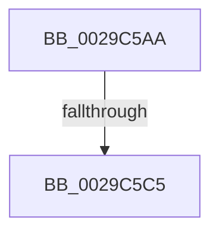

# sub_0029C5AA

- RVA: `0x0029C5AA`–`0x0029C5CC` (길이 `34` bytes)
- VA: `0x000000014029C5AA`
- 실행 섹션: `.text`
- PDB 이름 있음: `아니요`; PDB Function 태그: `아니요`
- unwind 정보 RVA: `0x00067F38`
- 디코드: `9`개 명령, `34/34` bytes 표시
- 미해석 바이트: `0` (있으면 어셈블리에 `.byte`로 보존)

> 이 문서는 커널 이미지의 기계어와 PDB 기호를 분석해 생성했습니다. 4번과 5번은 함수 원형과 자료형을 바이너리 사용 방식에서 추정한 C 해석이며 원본 소스 복구 결과는 아닙니다.

## 1. Dependencies

- 직접 호출 지점: **1**; 고유 호출 대상: **1**
- 직접 호출자로 확인된 함수: **0**
- RIP 상대 이미지 참조: **0**

### Outgoing calls
- `0x0029C5BC` → [IopSetDiskIoAttributionExtension](IopSetDiskIoAttributionExtension_function_0029C0E4.md) (function, `0x0029C0E4`)

### Direct callers
- 이 함수 시작 RVA로 연결되는 직접 call은 확인되지 않았습니다. 간접 호출은 완전히 역산할 수 없습니다.

### Static image references
- 디코드된 RIP-relative 메모리 참조가 없습니다.

## 2. Other-region calls and transfers

- 다른 실행 섹션으로 향하는 call: **0**
- call이 아닌 외부 분기/꼬리 이동: **2**
  - `0x0029C5C3` → [IopSetDiskIoAttributionFromProcess + 0x25](IopSetDiskIoAttributionFromProcess_function_0029C520.md) (`tail-transfer`)
  - `0x0029C5C7` → [IopSetDiskIoAttributionFromProcess + 0x25](IopSetDiskIoAttributionFromProcess_function_0029C520.md) (`tail-transfer`)

## 3. Assembly (complete function range)

```asm
0029C5AA  65 4C 8B 04 25 88 01 00 00      mov r8, qword ptr gs:[0x188]
0029C5B3  45 33 C9                        xor r9d, r9d
0029C5B6  48 8B D7                        mov rdx, rdi
0029C5B9  48 8B CE                        mov rcx, rsi
0029C5BC  E8 23 FB FF FF                  call 0x14029c0e4
0029C5C1  85 C0                           test eax, eax
0029C5C3  78 80                           js 0x14029c545
0029C5C5  33 C0                           xor eax, eax
0029C5C7  E9 79 FF FF FF                  jmp 0x14029c545
```

## 4. C-style interpretation (structured pseudocode)

```c
__int64 __fastcall sub_0029C5AA(__int64 a1, __int64 a2, __int64 a3, int a4)
{
    __int64 result;

    a4 = 0;
    result = IopSetDiskIoAttributionExtension(v_rsi, v_rdi, *(unsigned __int64 *)(gs_base + (0 + 392)), a4);
    result = 0;
}
```

## 5. (Beta) C Style

```c
int64_t sub_0029C5AA(int64_t Arg1, int64_t Arg2, int64_t Arg3, int32_t Arg4)
{
    int64_t result;

    Arg4 = 0;
    result = IopSetDiskIoAttributionExtension(local_rsi, local_rdi, *(uint64_t *)(gs_base + (0 + 0x188)), Arg4);
    result = 0;
}
```

## 6. Execution-region graph

[열기: 2D/3D 그래프와 함수 탐색 컨트롤 패널](../../../control-panel.html?section=text&rva=0x0029C5AA&view=graph)

- 2D 그래프는 위에서 아래로 흐르고, 3D 그래프는 빈 공간을 드래그해 회전합니다. Shift+드래그는 이동, 휠은 확대·축소, 함수 노드 선택은 대상 보고서 이동입니다.

### Static fallback


