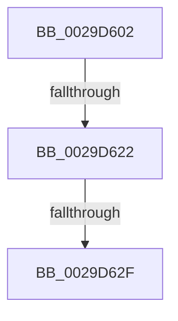

# sub_0029D602

- RVA: `0x0029D602`–`0x0029D652` (길이 `80` bytes)
- VA: `0x000000014029D602`
- 실행 섹션: `.text`
- PDB 이름 있음: `아니요`; PDB Function 태그: `아니요`
- unwind 정보 RVA: `0x00067FF8`
- 디코드: `15`개 명령, `80/80` bytes 표시
- 미해석 바이트: `0` (있으면 어셈블리에 `.byte`로 보존)

> 이 문서는 커널 이미지의 기계어와 PDB 기호를 분석해 생성했습니다. 4번과 5번은 함수 원형과 자료형을 바이너리 사용 방식에서 추정한 C 해석이며 원본 소스 복구 결과는 아닙니다.

## 1. Dependencies

- 직접 호출 지점: **0**; 고유 호출 대상: **0**
- 직접 호출자로 확인된 함수: **0**
- RIP 상대 이미지 참조: **1**

### Outgoing calls
- 직접 디코드된 call 명령이 없습니다.

### Direct callers
- 이 함수 시작 RVA로 연결되는 직접 call은 확인되지 않았습니다. 간접 호출은 완전히 역산할 수 없습니다.

### Static image references
- `0x0029D619` → RVA `0x00FC6D20` (`ALMOSTRO`; read)

## 2. Other-region calls and transfers

- 다른 실행 섹션으로 향하는 call: **0**
- call이 아닌 외부 분기/꼬리 이동: **3**
  - `0x0029D620` → [sub_0029D673](Unknown_function_0029D673.md) (`tail-transfer`)
  - `0x0029D62D` → [sub_0029D673 + 0xE](Unknown_function_0029D673.md) (`tail-transfer`)
  - `0x0029D650` → [sub_0029D652 + 0xD](Unknown_function_0029D652.md) (`tail-transfer`)

## 3. Assembly (complete function range)

```asm
0029D602  48 89 74 24 38                  mov qword ptr [rsp + 0x38], rsi
0029D607  48 89 7C 24 40                  mov qword ptr [rsp + 0x40], rdi
0029D60C  44 0F 20 C7                     mov rdi, cr8
0029D610  B8 02 00 00 00                  mov eax, 2
0029D615  44 0F 22 C0                     mov cr8, rax
0029D619  83 3D 00 97 D2 00 00            cmp dword ptr [rip + 0xd29700], 0
0029D620  75 51                           jne 0x14029d673
0029D622  33 F6                           xor esi, esi
0029D624  F0 0F BA AB 98 00 00 00 07      lock bts dword ptr [rbx + 0x98], 7
0029D62D  72 52                           jb 0x14029d681
0029D62F  C7 83 9C 00 00 00 00 00 00 00   mov dword ptr [rbx + 0x9c], 0
0029D639  F0 81 A3 98 00 00 00 7F FF FF FF  lock and dword ptr [rbx + 0x98], 0xffffff7f
0029D644  83 3D D5 96 D2 00 00            cmp dword ptr [rip + 0xd296d5], 0
0029D64B  48 8B 74 24 38                  mov rsi, qword ptr [rsp + 0x38]
0029D650  74 0D                           je 0x14029d65f
```

## 4. C-style interpretation (structured pseudocode)

```c
__int64 __fastcall sub_0029D602(__int64 a1, __int64 a2, __int64 a3, __int64 a4, __int64 a5, __int64 a6, __int64 a7)
{
    __int64 v_rsi;
    unsigned __int64 v_stack_p38;
    unsigned __int64 v_stack_p40;

    v_stack_p38 = v_rsi;
    v_stack_p40 = v_rdi;
    v_rsi = 0;
    *(unsigned int *)(v_rbx + 156) = 0;
}
```

## 5. (Beta) C Style

```c
int64_t sub_0029D602(int64_t Arg1, int64_t Arg2, int64_t Arg3, int64_t Arg4, uint64_t Arg5, uint64_t Arg6, int64_t Arg7)
{
    int64_t local_rsi;
    uint64_t v_stack_p38;
    uint64_t v_stack_p40;

    v_stack_p38 = local_rsi;
    v_stack_p40 = local_rdi;
    local_rsi = 0;
    *(uint32_t *)(local_rbx + 0x9C) = 0;
}
```

## 6. Execution-region graph

[열기: 2D/3D 그래프와 함수 탐색 컨트롤 패널](../../../control-panel.html?section=text&rva=0x0029D602&view=graph)

- 2D 그래프는 위에서 아래로 흐르고, 3D 그래프는 빈 공간을 드래그해 회전합니다. Shift+드래그는 이동, 휠은 확대·축소, 함수 노드 선택은 대상 보고서 이동입니다.

### Static fallback


