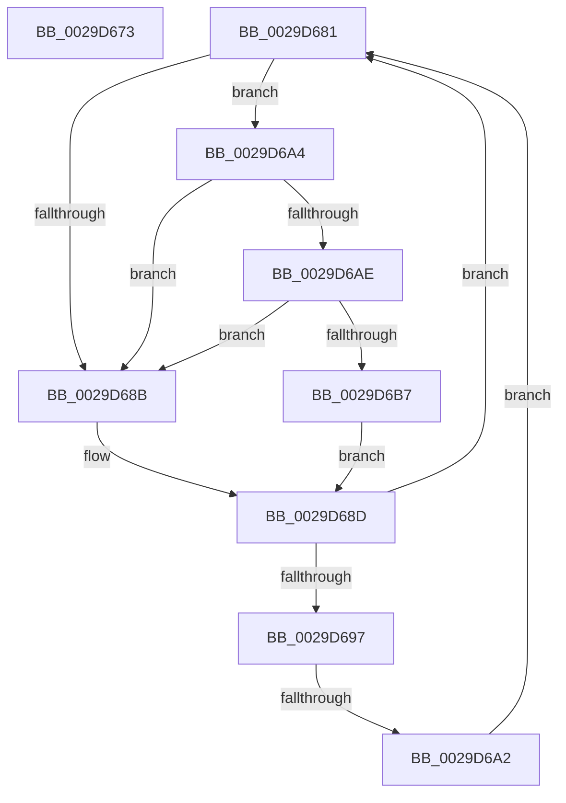

# sub_0029D673

- RVA: `0x0029D673`–`0x0029D6C0` (길이 `77` bytes)
- VA: `0x000000014029D673`
- 실행 섹션: `.text`
- PDB 이름 있음: `아니요`; PDB Function 태그: `아니요`
- unwind 정보 RVA: `0x00068038`
- 디코드: `23`개 명령, `77/77` bytes 표시
- 미해석 바이트: `0` (있으면 어셈블리에 `.byte`로 보존)

> 이 문서는 커널 이미지의 기계어와 PDB 기호를 분석해 생성했습니다. 4번과 5번은 함수 원형과 자료형을 바이너리 사용 방식에서 추정한 C 해석이며 원본 소스 복구 결과는 아닙니다.

## 1. Dependencies

- 직접 호출 지점: **3**; 고유 호출 대상: **3**
- 직접 호출자로 확인된 함수: **0**
- RIP 상대 이미지 참조: **2**

### Outgoing calls
- `0x0029D67A` → [KiRaiseIrqlProcessIrqlFlags](../4F/KiRaiseIrqlProcessIrqlFlags_function_004F56FC.md) (function, `0x004F56FC`)
- `0x0029D6AE` → [KiCheckVpBackingLongSpinWaitHypercall](../30/KiCheckVpBackingLongSpinWaitHypercall_function_0030F490.md) (function, `0x0030F490`)
- `0x0029D6B9` → [HvlNotifyLongSpinWait](../30/HvlNotifyLongSpinWait_function_0030F460.md) (function, `0x0030F460`)

### Direct callers
- 이 함수 시작 RVA로 연결되는 직접 call은 확인되지 않았습니다. 간접 호출은 완전히 역산할 수 없습니다.

### Static image references
- `0x0029D683` → RVA `0x00FC52AC` (`ALMOSTRO`; reference)
- `0x0029D6A4` → RVA `0x00FC6AB8` (`ALMOSTRO`; read)

## 2. Other-region calls and transfers

- 다른 실행 섹션으로 향하는 call: **0**
- call이 아닌 외부 분기/꼬리 이동: **2**
  - `0x0029D67F` → [sub_0029D602 + 0x20](Unknown_function_0029D602.md) (`tail-transfer`)
  - `0x0029D6A0` → [sub_0029D602 + 0x2D](Unknown_function_0029D602.md) (`tail-transfer`)

## 3. Assembly (complete function range)

```asm
0029D673  0F B6 D0                        movzx edx, al
0029D676  40 0F B6 CF                     movzx ecx, dil
0029D67A  E8 7D 80 25 00                  call 0x1404f56fc
0029D67F  EB A1                           jmp 0x14029d622
0029D681  FF C6                           inc esi
0029D683  85 35 23 7C D2 00               test dword ptr [rip + 0xd27c23], esi
0029D689  74 19                           je 0x14029d6a4
0029D68B  F3 90                           pause
0029D68D  8B 83 98 00 00 00               mov eax, dword ptr [rbx + 0x98]
0029D693  84 C0                           test al, al
0029D695  78 EA                           js 0x14029d681
0029D697  F0 0F BA AB 98 00 00 00 07      lock bts dword ptr [rbx + 0x98], 7
0029D6A0  73 8D                           jae 0x14029d62f
0029D6A2  EB DD                           jmp 0x14029d681
0029D6A4  8B 05 0E 94 D2 00               mov eax, dword ptr [rip + 0xd2940e]
0029D6AA  A8 40                           test al, 0x40
0029D6AC  74 DD                           je 0x14029d68b
0029D6AE  E8 DD 1D 07 00                  call 0x14030f490
0029D6B3  84 C0                           test al, al
0029D6B5  74 D4                           je 0x14029d68b
0029D6B7  8B CE                           mov ecx, esi
0029D6B9  E8 A2 1D 07 00                  call 0x14030f460
0029D6BE  EB CD                           jmp 0x14029d68d
```

## 4. C-style interpretation (structured pseudocode)

```c
__int64 __fastcall sub_0029D673(void)
{
    __int64 result;

    result = KiRaiseIrqlProcessIrqlFlags((unsigned __int8)(v_rdi), (unsigned __int8)(result), a3, a4);
}
```

## 5. (Beta) C Style

```c
void sub_0029D673(void)
{
    int64_t result;

    result = KiRaiseIrqlProcessIrqlFlags((uint8_t)(local_rdi), (uint8_t)(result), a3, a4);
}
```

## 6. Execution-region graph

[열기: 2D/3D 그래프와 함수 탐색 컨트롤 패널](../../../control-panel.html?section=text&rva=0x0029D673&view=graph)

- 2D 그래프는 위에서 아래로 흐르고, 3D 그래프는 빈 공간을 드래그해 회전합니다. Shift+드래그는 이동, 휠은 확대·축소, 함수 노드 선택은 대상 보고서 이동입니다.

### Static fallback


