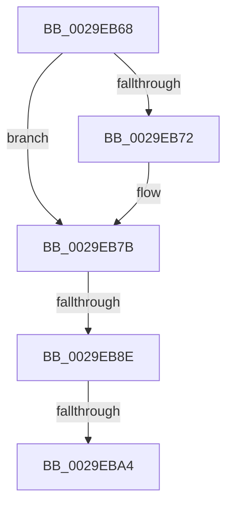

# sub_0029EB68

- RVA: `0x0029EB68`–`0x0029EBBD` (길이 `85` bytes)
- VA: `0x000000014029EB68`
- 실행 섹션: `.text`
- PDB 이름 있음: `아니요`; PDB Function 태그: `아니요`
- unwind 정보 RVA: `0x0006821C`
- 디코드: `21`개 명령, `85/85` bytes 표시
- 미해석 바이트: `0` (있으면 어셈블리에 `.byte`로 보존)

> 이 문서는 커널 이미지의 기계어와 PDB 기호를 분석해 생성했습니다. 4번과 5번은 함수 원형과 자료형을 바이너리 사용 방식에서 추정한 C 해석이며 원본 소스 복구 결과는 아닙니다.

## 1. Dependencies

- 직접 호출 지점: **1**; 고유 호출 대상: **1**
- 직접 호출자로 확인된 함수: **0**
- RIP 상대 이미지 참조: **0**

### Outgoing calls
- `0x0029EBAE` → [guard_dispatch_icall](../6B/guard_dispatch_icall_function_006BAAD0.md) (function, `0x006BAAD0`)

### Direct callers
- 이 함수 시작 RVA로 연결되는 직접 call은 확인되지 않았습니다. 간접 호출은 완전히 역산할 수 없습니다.

### Static image references
- 디코드된 RIP-relative 메모리 참조가 없습니다.

## 2. Other-region calls and transfers

- 다른 실행 섹션으로 향하는 call: **0**
- call이 아닌 외부 분기/꼬리 이동: **3**
  - `0x0029EB8C` → [sub_0029EBBD](Unknown_function_0029EBBD.md) (`tail-transfer`)
  - `0x0029EBA2` → [sub_0029EBBD](Unknown_function_0029EBBD.md) (`tail-transfer`)
  - `0x0029EBB8` → [IoFreeMdl + 0x6F](IoFreeMdl_function_0029EA80.md) (`tail-transfer`)

## 3. Assembly (complete function range)

```asm
0029EB68  48 89 7C 24 30                  mov qword ptr [rsp + 0x30], rdi
0029EB6D  48 85 D2                        test rdx, rdx
0029EB70  75 09                           jne 0x14029eb7b
0029EB72  65 48 8B 14 25 20 00 00 00      mov rdx, qword ptr gs:[0x20]
0029EB7B  48 8B BA 30 08 00 00            mov rdi, qword ptr [rdx + 0x830]
0029EB82  FF 47 1C                        inc dword ptr [rdi + 0x1c]
0029EB85  0F B7 47 10                     movzx eax, word ptr [rdi + 0x10]
0029EB89  66 39 07                        cmp word ptr [rdi], ax
0029EB8C  72 2F                           jb 0x14029ebbd
0029EB8E  FF 47 20                        inc dword ptr [rdi + 0x20]
0029EB91  48 8B BA 38 08 00 00            mov rdi, qword ptr [rdx + 0x838]
0029EB98  FF 47 1C                        inc dword ptr [rdi + 0x1c]
0029EB9B  0F B7 47 10                     movzx eax, word ptr [rdi + 0x10]
0029EB9F  66 39 07                        cmp word ptr [rdi], ax
0029EBA2  72 19                           jb 0x14029ebbd
0029EBA4  FF 47 20                        inc dword ptr [rdi + 0x20]
0029EBA7  48 8B CB                        mov rcx, rbx
0029EBAA  48 8B 47 38                     mov rax, qword ptr [rdi + 0x38]
0029EBAE  E8 1D BF 41 00                  call 0x1406baad0
0029EBB3  48 8B 7C 24 30                  mov rdi, qword ptr [rsp + 0x30]
0029EBB8  E9 32 FF FF FF                  jmp 0x14029eaef
```

## 4. C-style interpretation (structured pseudocode)

```c
__int64 __fastcall sub_0029EB68(__int64 a1, __int64 a2, __int64 a3, __int64 a4, __int64 a5, __int64 a6)
{
    __int64 result;
    unsigned __int64 v_stack_p30;

    v_stack_p30 = v_rdi;
    if (a2 == 0) {
        a2 = *(unsigned __int64 *)(gs_base + (0 + 32));
    }
    result = guard_dispatch_icall(v_rbx, a2, a3, a4);
}
```

## 5. (Beta) C Style

```c
int64_t sub_0029EB68(int64_t Arg1, int64_t Arg2, int64_t Arg3, int64_t Arg4, uint64_t Arg5, int64_t Arg6)
{
    int64_t result;
    uint64_t v_stack_p30;

    v_stack_p30 = local_rdi;
    if (Arg2 == 0) {
        Arg2 = *(uint64_t *)(gs_base + (0 + 0x20));
    }
    result = guard_dispatch_icall(local_rbx, Arg2, Arg3, Arg4);
}
```

## 6. Execution-region graph

[열기: 2D/3D 그래프와 함수 탐색 컨트롤 패널](../../../control-panel.html?section=text&rva=0x0029EB68&view=graph)

- 2D 그래프는 위에서 아래로 흐르고, 3D 그래프는 빈 공간을 드래그해 회전합니다. Shift+드래그는 이동, 휠은 확대·축소, 함수 노드 선택은 대상 보고서 이동입니다.

### Static fallback


