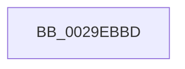

# sub_0029EBBD

- RVA: `0x0029EBBD`–`0x0029EBE0` (길이 `35` bytes)
- VA: `0x000000014029EBBD`
- 실행 섹션: `.text`
- PDB 이름 있음: `아니요`; PDB Function 태그: `아니요`
- unwind 정보 RVA: `0x00068230`
- 디코드: `9`개 명령, `35/35` bytes 표시
- 미해석 바이트: `0` (있으면 어셈블리에 `.byte`로 보존)

> 이 문서는 커널 이미지의 기계어와 PDB 기호를 분석해 생성했습니다. 4번과 5번은 함수 원형과 자료형을 바이너리 사용 방식에서 추정한 C 해석이며 원본 소스 복구 결과는 아닙니다.

## 1. Dependencies

- 직접 호출 지점: **2**; 고유 호출 대상: **2**
- 직접 호출자로 확인된 함수: **0**
- RIP 상대 이미지 참조: **0**

### Outgoing calls
- `0x0029EBCE` → [VfPtMiscPoolNotification](../3F/VfPtMiscPoolNotification_function_003FF310.md) (function, `0x003FF310`)
- `0x0029EBD9` → [ExpInterlockedPushEntrySList](../6B/ExpInterlockedPushEntrySList_function_006BA5B0.md) (function, `0x006BA5B0`)

### Direct callers
- 이 함수 시작 RVA로 연결되는 직접 call은 확인되지 않았습니다. 간접 호출은 완전히 역산할 수 없습니다.

### Static image references
- 디코드된 RIP-relative 메모리 참조가 없습니다.

## 2. Other-region calls and transfers

- 다른 실행 섹션으로 향하는 call: **0**
- call이 아닌 외부 분기/꼬리 이동: **1**
  - `0x0029EBDE` → [sub_0029EB68 + 0x4B](Unknown_function_0029EB68.md) (`tail-transfer`)

## 3. Assembly (complete function range)

```asm
0029EBBD  48 0F BF 53 08                  movsx rdx, word ptr [rbx + 8]
0029EBC2  41 B1 01                        mov r9b, 1
0029EBC5  41 B8 4D 64 6C 20               mov r8d, 0x206c644d
0029EBCB  48 8B CB                        mov rcx, rbx
0029EBCE  E8 3D 07 16 00                  call 0x1403ff310
0029EBD3  48 8B D3                        mov rdx, rbx
0029EBD6  48 8B CF                        mov rcx, rdi
0029EBD9  E8 D2 B9 41 00                  call 0x1406ba5b0
0029EBDE  EB D3                           jmp 0x14029ebb3
```

## 4. C-style interpretation (structured pseudocode)

```c
__int64 __fastcall sub_0029EBBD(void)
{
    __int64 result;

    result = VfPtMiscPoolNotification(v_rbx, (__int16)(*(unsigned __int16 *)(v_rbx + 8)), (unsigned int)(0x206C644DULL), 1);
    result = ExpInterlockedPushEntrySList(v_rdi, v_rbx, (unsigned int)(0x206C644DULL), 1);
}
```

## 5. (Beta) C Style

```c
void sub_0029EBBD(void)
{
    int64_t result;

    result = VfPtMiscPoolNotification(local_rbx, (int16_t)(*(uint16_t *)(local_rbx + 0x8)), (uint32_t)(0x206C644DULL), 1);
    result = ExpInterlockedPushEntrySList(local_rdi, local_rbx, (uint32_t)(0x206C644DULL), 1);
}
```

## 6. Execution-region graph

[열기: 2D/3D 그래프와 함수 탐색 컨트롤 패널](../../../control-panel.html?section=text&rva=0x0029EBBD&view=graph)

- 2D 그래프는 위에서 아래로 흐르고, 3D 그래프는 빈 공간을 드래그해 회전합니다. Shift+드래그는 이동, 휠은 확대·축소, 함수 노드 선택은 대상 보고서 이동입니다.

### Static fallback


