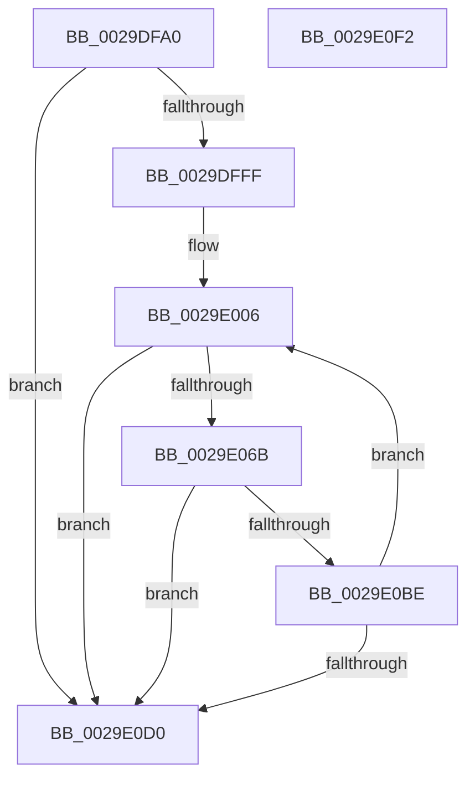

# VslValidateSecureImagePages

- RVA: `0x0029DFA0`–`0x0029E0F3` (길이 `339` bytes)
- VA: `0x000000014029DFA0`
- 실행 섹션: `.text`
- PDB 이름 있음: `예`; PDB Function 태그: `아니요`
- unwind 정보 RVA: `0x000680D0`
- 디코드: `95`개 명령, `339/339` bytes 표시
- 미해석 바이트: `0` (있으면 어셈블리에 `.byte`로 보존)

> 이 문서는 커널 이미지의 기계어와 PDB 기호를 분석해 생성했습니다. 4번과 5번은 함수 원형과 자료형을 바이너리 사용 방식에서 추정한 C 해석이며 원본 소스 복구 결과는 아닙니다.

## 1. Dependencies

- 직접 호출 지점: **6**; 고유 호출 대상: **5**
- 직접 호출자로 확인된 함수: **0**
- RIP 상대 이미지 참조: **1**

### Outgoing calls
- `0x0029DFDF` → [memset](../6C/memset_function_006C6C40.md) (function, `0x006C6C40`)
- `0x0029DFEF` → [memset](../6C/memset_function_006C6C40.md) (function, `0x006C6C40`)
- `0x0029E060` → [VslpLockPagesForTransfer](VslpLockPagesForTransfer_function_0029E0FC.md) (function, `0x0029E0FC`)
- `0x0029E0A9` → [VslpEnterIumSecureMode](../23/VslpEnterIumSecureMode_function_00235E50.md) (function, `0x00235E50`)
- `0x0029E0B5` → [VslpUnlockPagesForTransfer](VslpUnlockPagesForTransfer_function_0029EE4C.md) (function, `0x0029EE4C`)
- `0x0029E0D9` → [_security_check_cookie](../6A/_security_check_cookie_function_006AC640.md) (function, `0x006AC640`)

### Direct callers
- 이 함수 시작 RVA로 연결되는 직접 call은 확인되지 않았습니다. 간접 호출은 완전히 역산할 수 없습니다.

### Static image references
- `0x0029DFB9` → RVA `0x00E0A740` (`.data`; read)

## 2. Other-region calls and transfers

- 다른 실행 섹션으로 향하는 call: **0**
- 별도 외부 분기/꼬리 이동을 확인하지 못했습니다.

## 3. Assembly (complete function range)

```asm
0029DFA0  40 55                           push rbp
0029DFA2  53                              push rbx
0029DFA3  56                              push rsi
0029DFA4  57                              push rdi
0029DFA5  41 54                           push r12
0029DFA7  41 55                           push r13
0029DFA9  41 56                           push r14
0029DFAB  41 57                           push r15
0029DFAD  48 8D 6C 24 E8                  lea rbp, [rsp - 0x18]
0029DFB2  48 81 EC 18 01 00 00            sub rsp, 0x118
0029DFB9  48 8B 05 80 C7 B6 00            mov rax, qword ptr [rip + 0xb6c780]
0029DFC0  48 33 C4                        xor rax, rsp
0029DFC3  48 89 45 00                     mov qword ptr [rbp], rax
0029DFC7  44 8B FA                        mov r15d, edx
0029DFCA  48 89 4C 24 30                  mov qword ptr [rsp + 0x30], rcx
0029DFCF  33 D2                           xor edx, edx
0029DFD1  48 8D 4D 90                     lea rcx, [rbp - 0x70]
0029DFD5  4D 8B F0                        mov r14, r8
0029DFD8  4D 8B E1                        mov r12, r9
0029DFDB  44 8D 42 68                     lea r8d, [rdx + 0x68]
0029DFDF  E8 5C 8C 42 00                  call 0x1406c6c40
0029DFE4  33 D2                           xor edx, edx
0029DFE6  48 8D 4C 24 40                  lea rcx, [rsp + 0x40]
0029DFEB  44 8D 42 48                     lea r8d, [rdx + 0x48]
0029DFEF  E8 4C 8C 42 00                  call 0x1406c6c40
0029DFF4  33 FF                           xor edi, edi
0029DFF6  4D 85 F6                        test r14, r14
0029DFF9  0F 84 D1 00 00 00               je 0x14029e0d0
0029DFFF  48 8B B5 80 00 00 00            mov rsi, qword ptr [rbp + 0x80]
0029E006  41 8B C4                        mov eax, r12d
0029E009  C7 44 24 20 10 00 00 00         mov dword ptr [rsp + 0x20], 0x10
0029E011  25 FF 0F 00 00                  and eax, 0xfff
0029E016  41 BD 00 00 00 00               mov r13d, 0
0029E01C  F7 D8                           neg eax
0029E01E  49 8B DE                        mov rbx, r14
0029E021  49 8B D4                        mov rdx, r12
0029E024  48 1B C9                        sbb rcx, rcx
0029E027  48 81 E1 00 F0 FF FF            and rcx, 0xfffffffffffff000
0029E02E  48 81 C1 00 A0 1F 00            add rcx, 0x1fa000
0029E035  49 3B CE                        cmp rcx, r14
0029E038  48 0F 46 D9                     cmovbe rbx, rcx
0029E03C  48 8D 4C 24 40                  lea rcx, [rsp + 0x40]
0029E041  48 F7 C3 FF 0F 00 00            test rbx, 0xfff
0029E048  48 8B C3                        mov rax, rbx
0029E04B  41 0F 95 C5                     setne r13b
0029E04F  48 C1 E8 0C                     shr rax, 0xc
0029E053  44 03 E8                        add r13d, eax
0029E056  45 33 C9                        xor r9d, r9d
0029E059  45 8B C5                        mov r8d, r13d
0029E05C  41 C1 E0 0C                     shl r8d, 0xc
0029E060  E8 97 00 00 00                  call 0x14029e0fc
0029E065  8B F8                           mov edi, eax
0029E067  85 C0                           test eax, eax
0029E069  78 65                           js 0x14029e0d0
0029E06B  48 8B 44 24 30                  mov rax, qword ptr [rsp + 0x30]
0029E070  4C 8D 4D 90                     lea r9, [rbp - 0x70]
0029E074  48 89 45 98                     mov qword ptr [rbp - 0x68], rax
0029E078  BA C1 00 00 00                  mov edx, 0xc1
0029E07D  48 8B 44 24 40                  mov rax, qword ptr [rsp + 0x40]
0029E082  45 33 C0                        xor r8d, r8d
0029E085  48 89 45 A8                     mov qword ptr [rbp - 0x58], rax
0029E089  B1 02                           mov cl, 2
0029E08B  48 8B 44 24 78                  mov rax, qword ptr [rsp + 0x78]
0029E090  48 89 45 B0                     mov qword ptr [rbp - 0x50], rax
0029E094  8B 85 88 00 00 00               mov eax, dword ptr [rbp + 0x88]
0029E09A  89 45 C0                        mov dword ptr [rbp - 0x40], eax
0029E09D  44 89 7D A0                     mov dword ptr [rbp - 0x60], r15d
0029E0A1  44 89 6D A4                     mov dword ptr [rbp - 0x5c], r13d
0029E0A5  48 89 75 B8                     mov qword ptr [rbp - 0x48], rsi
0029E0A9  E8 A2 7D F9 FF                  call 0x140235e50
0029E0AE  48 8D 4C 24 40                  lea rcx, [rsp + 0x40]
0029E0B3  8B F8                           mov edi, eax
0029E0B5  E8 92 0D 00 00                  call 0x14029ee4c
0029E0BA  85 FF                           test edi, edi
0029E0BC  78 12                           js 0x14029e0d0
0029E0BE  4C 03 E3                        add r12, rbx
0029E0C1  48 03 F3                        add rsi, rbx
0029E0C4  45 03 FD                        add r15d, r13d
0029E0C7  4C 2B F3                        sub r14, rbx
0029E0CA  0F 85 36 FF FF FF               jne 0x14029e006
0029E0D0  8B C7                           mov eax, edi
0029E0D2  48 8B 4D 00                     mov rcx, qword ptr [rbp]
0029E0D6  48 33 CC                        xor rcx, rsp
0029E0D9  E8 62 E5 40 00                  call 0x1406ac640
0029E0DE  48 81 C4 18 01 00 00            add rsp, 0x118
0029E0E5  41 5F                           pop r15
0029E0E7  41 5E                           pop r14
0029E0E9  41 5D                           pop r13
0029E0EB  41 5C                           pop r12
0029E0ED  5F                              pop rdi
0029E0EE  5E                              pop rsi
0029E0EF  5B                              pop rbx
0029E0F0  5D                              pop rbp
0029E0F1  C3                              ret
0029E0F2  CC                              int3
```

## 4. C-style interpretation (structured pseudocode)

```c
__int64 __fastcall VslValidateSecureImagePages(__int64 a1, int a2, __int64 a3, __int64 a4, __int64 a5, unsigned int a6)
{
    __int64 result;
    __int64 v_r12;
    __int64 v_r13;
    __int64 v_r14;
    __int64 v_r15;
    __int64 v_rdi;
    __int64 v_rsi;
    __int64 v_rsp;
    unsigned __int64 v_stack_m118;
    unsigned __int64 v_stack_m128;
    unsigned int v_stack_m138;
    unsigned __int64 v_stack_m58;
    unsigned int v_stack_m98;
    unsigned __int64 v_stack_mA0;
    unsigned __int64 v_stack_mA8;
    unsigned __int64 v_stack_mB0;
    unsigned int v_stack_mB4;
    unsigned int v_stack_mB8;
    unsigned __int64 v_stack_mC0;
    unsigned __int64 v_stack_mC8;
    unsigned __int64 v_stack_mE0;

    v_rsp = (v_rsp) - (280);
    result = (*(unsigned __int64 *)(v_rip + 11978624)) ^ (v_rsp);
    v_stack_m58 = result;
    v_stack_m128 = a1;
    a2 = 0;
    result = memset(v_stack_mC8, a2, a2 + 104, a4);
    a2 = 0;
    result = memset(v_stack_m118, a2, a2 + 72, a4);
    v_rdi = 0;
    if (a3 == 0) goto loc_0029E0D0;
loc_0029E006:
    v_stack_m138 = 16;
    result = (unsigned int)(((unsigned int)((unsigned int)(a4))) & (0xFFFULL));
    result = (unsigned int)(-(result));
    a1 = (v_stack_m118) & (0xFFFFFFFFFFFFF000ULL);
    a1 = (a1) + (0x1FA000ULL);
    if (a1 <= a3) { a3 = a1; }
    v_r13 = (((a3) & (0xFFFULL)) != 0) ? 1 : 0;
    result = (a3) >> (12);
    v_r13 = (unsigned int)((v_r13) + ((unsigned int)(result)));
    a4 = 0;
    a3 = (unsigned int)(((unsigned int)((unsigned int)(v_r13))) << (12));
    result = VslpLockPagesForTransfer(v_stack_m118, a4, a3, a4);
    if (sign_flag) goto loc_0029E0D0;
    v_stack_mC0 = v_stack_m128;
    a3 = 0;
    v_stack_mB0 = v_stack_m118;
    v_stack_mA8 = v_stack_mE0;
    v_stack_m98 = (unsigned int)((unsigned int)(a6));
    v_stack_mB8 = (unsigned int)((unsigned int)(a2));
    v_stack_mB4 = (unsigned int)(v_r13);
    v_stack_mA0 = a5;
    result = VslpEnterIumSecureMode(2, 193, a3, v_stack_mC8);
    result = VslpUnlockPagesForTransfer(v_stack_m118, 193, a3, v_stack_mC8);
    if (sign_flag) goto loc_0029E0D0;
    v_r12 = (a4) + (0);
    v_rsi = (a5) + (0);
    v_r15 = (unsigned int)(((unsigned int)(a2)) + ((unsigned int)(v_r13)));
    v_r14 = (a3) - (0);
    if (condition_is_not_equal) goto loc_0029E006;
loc_0029E0D0:
    a1 = (v_stack_m58) ^ (v_rsp);
    result = _security_check_cookie(a1, 193, a3, v_stack_mC8);
    v_rsp = (v_rsp) + (280);
    return result;
}
```

## 5. (Beta) C Style

```c
int64_t VslValidateSecureImagePages(int64_t Arg1, int32_t Arg2, int64_t Arg3, int64_t Arg4, int64_t Arg5, uint32_t Arg6)
{
    int64_t result;
    int64_t local_r12;
    int64_t local_r13;
    int64_t local_r14;
    int64_t local_r15;
    int64_t local_rdi;
    int64_t local_rsi;
    int64_t local_rsp;
    uint64_t v_stack_m118;
    uint64_t v_stack_m128;
    uint32_t v_stack_m138;
    uint64_t v_stack_m58;
    uint32_t v_stack_m98;
    uint64_t v_stack_mA0;
    uint64_t v_stack_mA8;
    uint64_t v_stack_mB0;
    uint32_t v_stack_mB4;
    uint32_t v_stack_mB8;
    uint64_t v_stack_mC0;
    uint64_t v_stack_mC8;
    uint64_t v_stack_mE0;

    local_rsp = (local_rsp) - (280);
    result = (*(uint64_t *)(v_rip + 0xB6C780)) ^ (local_rsp);
    v_stack_m58 = result;
    v_stack_m128 = Arg1;
    Arg2 = 0;
    result = memset(v_stack_mC8, Arg2, Arg2 + 104, Arg4);
    Arg2 = 0;
    result = memset(v_stack_m118, Arg2, Arg2 + 72, Arg4);
    local_rdi = 0;
    if (Arg3 == 0) goto loc_0029E0D0;
loc_0029E006:
    v_stack_m138 = 16;
    result = (uint32_t)(((uint32_t)((uint32_t)(Arg4))) & (0xFFFULL));
    result = (uint32_t)(-(result));
    Arg1 = (v_stack_m118) & (0xFFFFFFFFFFFFF000ULL);
    Arg1 = (Arg1) + (0x1FA000ULL);
    if (Arg1 <= Arg3) { Arg3 = Arg1; }
    local_r13 = (((Arg3) & (0xFFFULL)) != 0) ? 1 : 0;
    result = (Arg3) >> (12);
    local_r13 = (uint32_t)((local_r13) + ((uint32_t)(result)));
    Arg4 = 0;
    Arg3 = (uint32_t)(((uint32_t)((uint32_t)(local_r13))) << (12));
    result = VslpLockPagesForTransfer(v_stack_m118, Arg4, Arg3, Arg4);
    if (sign_flag) goto loc_0029E0D0;
    v_stack_mC0 = v_stack_m128;
    Arg3 = 0;
    v_stack_mB0 = v_stack_m118;
    v_stack_mA8 = v_stack_mE0;
    v_stack_m98 = (uint32_t)((uint32_t)(Arg6));
    v_stack_mB8 = (uint32_t)((uint32_t)(Arg2));
    v_stack_mB4 = (uint32_t)(local_r13);
    v_stack_mA0 = Arg5;
    result = VslpEnterIumSecureMode(2, 193, Arg3, v_stack_mC8);
    result = VslpUnlockPagesForTransfer(v_stack_m118, 193, Arg3, v_stack_mC8);
    if (sign_flag) goto loc_0029E0D0;
    local_r12 = (Arg4) + (0);
    local_rsi = (Arg5) + (0);
    local_r15 = (uint32_t)(((uint32_t)(Arg2)) + ((uint32_t)(local_r13)));
    local_r14 = (Arg3) - (0);
    if (condition_is_not_equal) goto loc_0029E006;
loc_0029E0D0:
    Arg1 = (v_stack_m58) ^ (local_rsp);
    result = _security_check_cookie(Arg1, 193, Arg3, v_stack_mC8);
    local_rsp = (local_rsp) + (280);
    return result;
}
```

## 6. Execution-region graph

[열기: 2D/3D 그래프와 함수 탐색 컨트롤 패널](../../../control-panel.html?section=text&rva=0x0029DFA0&view=graph)

- 2D 그래프는 위에서 아래로 흐르고, 3D 그래프는 빈 공간을 드래그해 회전합니다. Shift+드래그는 이동, 휠은 확대·축소, 함수 노드 선택은 대상 보고서 이동입니다.

### Static fallback


