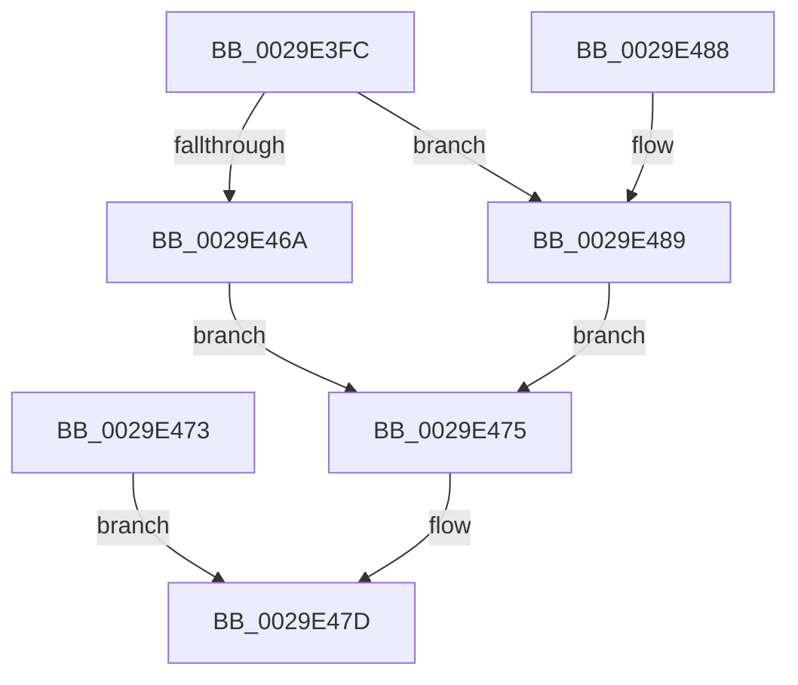

# VslpLockMdlForTransfer

- RVA: `0x0029E3FC`–`0x0029E490` (길이 `148` bytes)
- VA: `0x000000014029E3FC`
- 실행 섹션: `.text`
- PDB 이름 있음: `예`; PDB Function 태그: `아니요`
- unwind 정보 RVA: `0x00068134`
- 디코드: `41`개 명령, `148/148` bytes 표시
- 미해석 바이트: `0` (있으면 어셈블리에 `.byte`로 보존)

> 이 문서는 커널 이미지의 기계어와 PDB 기호를 분석해 생성했습니다. 4번과 5번은 함수 원형과 자료형을 바이너리 사용 방식에서 추정한 C 해석이며 원본 소스 복구 결과는 아닙니다.

## 1. Dependencies

- 직접 호출 지점: **2**; 고유 호출 대상: **2**
- 직접 호출자로 확인된 함수: **2**
- RIP 상대 이미지 참조: **0**

### Outgoing calls
- `0x0029E46C` → [MmProbeAndLockPages](../23/MmProbeAndLockPages_function_0023B990.md) (function, `0x0023B990`)
- `0x0029E489` → [MmBuildMdlForNonPagedPool](../23/MmBuildMdlForNonPagedPool_function_0023A870.md) (function, `0x0023A870`)

### Direct callers
- [VslpLockPagesForTransfer](VslpLockPagesForTransfer_function_0029E0FC.md) at `0x0029E264`
- [VslLoadEnclaveData](../../page/71/VslLoadEnclaveData_function_00718E54.md) at `0x00718EC8`

### Static image references
- 디코드된 RIP-relative 메모리 참조가 없습니다.

## 2. Other-region calls and transfers

- 다른 실행 섹션으로 향하는 call: **0**
- 별도 외부 분기/꼬리 이동을 확인하지 못했습니다.

## 3. Assembly (complete function range)

```asm
0029E3FC  48 89 5C 24 08                  mov qword ptr [rsp + 8], rbx
0029E401  57                              push rdi
0029E402  48 83 EC 20                     sub rsp, 0x20
0029E406  41 8B D8                        mov ebx, r8d
0029E409  48 8B F9                        mov rdi, rcx
0029E40C  48 89 11                        mov qword ptr [rcx], rdx
0029E40F  4C 0F BF 5A 08                  movsx r11, word ptr [rdx + 8]
0029E414  48 83 C1 08                     add rcx, 8
0029E418  45 33 C0                        xor r8d, r8d
0029E41B  4C 89 01                        mov qword ptr [rcx], r8
0029E41E  44 8B D2                        mov r10d, edx
0029E421  41 8B C2                        mov eax, r10d
0029E424  25 FF 0F 00 00                  and eax, 0xfff
0029E429  4D 8D 8B FF 0F 00 00            lea r9, [r11 + 0xfff]
0029E430  4C 03 C8                        add r9, rax
0029E433  49 C1 E9 0C                     shr r9, 0xc
0029E437  66 41 83 C1 06                  add r9w, 6
0029E43C  66 41 C1 E1 03                  shl r9w, 3
0029E441  66 44 89 49 08                  mov word ptr [rcx + 8], r9w
0029E446  66 44 89 41 0A                  mov word ptr [rcx + 0xa], r8w
0029E44B  48 81 E2 00 F0 FF FF            and rdx, 0xfffffffffffff000
0029E452  48 89 51 20                     mov qword ptr [rcx + 0x20], rdx
0029E456  41 81 E2 FF 0F 00 00            and r10d, 0xfff
0029E45D  44 89 51 2C                     mov dword ptr [rcx + 0x2c], r10d
0029E461  44 89 59 28                     mov dword ptr [rcx + 0x28], r11d
0029E465  F6 C3 24                        test bl, 0x24
0029E468  75 1F                           jne 0x14029e489
0029E46A  33 D2                           xor edx, edx
0029E46C  E8 1F D5 F9 FF                  call 0x14023b990
0029E471  EB 02                           jmp 0x14029e475
0029E473  EB 08                           jmp 0x14029e47d
0029E475  83 E3 20                        and ebx, 0x20
0029E478  89 5F 40                        mov dword ptr [rdi + 0x40], ebx
0029E47B  33 C0                           xor eax, eax
0029E47D  48 8B 5C 24 30                  mov rbx, qword ptr [rsp + 0x30]
0029E482  48 83 C4 20                     add rsp, 0x20
0029E486  5F                              pop rdi
0029E487  C3                              ret
0029E488  CC                              int3
0029E489  E8 E2 C3 F9 FF                  call 0x14023a870
0029E48E  EB E5                           jmp 0x14029e475
```

## 4. C-style interpretation (structured pseudocode)

```c
__int64 __fastcall VslpLockMdlForTransfer(__int64 a1, __int64 a2, int a3)
{
    __int64 result;
    __int64 v_r10;
    __int64 v_rbx;
    __int64 v_rsp;
    unsigned __int64 v_stack_p8;

    v_stack_p8 = v_rbx;
    v_rsp = (v_rsp) - (32);
    *(unsigned __int64 *)(a1) = a2;
    a1 = (a1) + (8);
    a3 = 0;
    *(unsigned __int64 *)(a1) = 0;
    result = (unsigned int)(((unsigned int)((unsigned int)((unsigned int)((unsigned int)(a2))))) & (0xFFFULL));
    a4 = ((__int16)(*(unsigned __int16 *)(a2 + 8)) + 4095) + (result);
    a4 = (a4) >> (12);
    a4 = (unsigned __int16)((a4) + (6));
    a4 = (unsigned __int16)((a4) << (3));
    *(unsigned __int16 *)(a1 + 8) = (unsigned __int16)(a4);
    *(unsigned __int16 *)(a1 + 10) = 0;
    a2 = (a2) & (0xFFFFFFFFFFFFF000ULL);
    *(unsigned __int64 *)(a1 + 32) = a2;
    v_r10 = (unsigned int)(((unsigned int)((unsigned int)(a2))) & (0xFFFULL));
    *(unsigned int *)(a1 + 44) = (unsigned int)(v_r10);
    *(unsigned int *)(a1 + 40) = (unsigned int)((__int16)(*(unsigned __int16 *)(a2 + 8)));
    if ((((unsigned __int8)((unsigned int)(a3))) & (36)) != 0) goto loc_0029E489;
    a2 = 0;
    result = MmProbeAndLockPages(a1, a2, a3, a4);
    goto loc_0029E475;
loc_0029E475:
    v_rbx = (unsigned int)(((unsigned int)(a3)) & (32));
    *(unsigned int *)(a1 + 64) = (unsigned int)(v_rbx);
    result = 0;
loc_0029E47D:
    v_rsp = (v_rsp) + (32);
    return result;
loc_0029E489:
    result = MmBuildMdlForNonPagedPool(a1, a2, a3, a4);
    goto loc_0029E475;
}
```

## 5. (Beta) C Style

```c
int64_t VslpLockMdlForTransfer(void *Arg1, void *Arg2, int32_t Arg3)
{
    uint8_t *arg1 = (uint8_t *)Arg1;
    uint8_t *arg2 = (uint8_t *)Arg2;

    int64_t result;
    int64_t local_r10;
    int64_t local_rbx;
    int64_t local_rsp;
    uint64_t v_stack_p8;

    v_stack_p8 = local_rbx;
    local_rsp = (local_rsp) - (32);
    *(void **)(arg1) = Arg2;
    Arg1 = (Arg1) + (8);
    Arg3 = 0;
    *(uint64_t *)(arg1) = 0;
    result = (uint32_t)(((uint32_t)((uint32_t)((uint32_t)((uint32_t)(Arg2))))) & (0xFFFULL));
    a4 = ((int16_t)(*(uint16_t *)(arg2 + 0x8)) + 4095) + (result);
    a4 = (a4) >> (12);
    a4 = (uint16_t)((a4) + (6));
    a4 = (uint16_t)((a4) << (3));
    *(uint16_t *)(arg1 + 0x8) = (uint16_t)(a4);
    *(uint16_t *)(arg1 + 0xA) = 0;
    Arg2 = (Arg2) & (0xFFFFFFFFFFFFF000ULL);
    *(void **)(arg1 + 0x20) = Arg2;
    local_r10 = (uint32_t)(((uint32_t)((uint32_t)(Arg2))) & (0xFFFULL));
    *(uint32_t *)(arg1 + 0x2C) = (uint32_t)(local_r10);
    *(uint32_t *)(arg1 + 0x28) = (uint32_t)((int16_t)(*(uint16_t *)(arg2 + 0x8)));
    if ((((uint8_t)((uint32_t)(Arg3))) & (36)) != 0) goto loc_0029E489;
    Arg2 = 0;
    result = MmProbeAndLockPages(Arg1, Arg2, Arg3, a4);
    goto loc_0029E475;
loc_0029E475:
    local_rbx = (uint32_t)(((uint32_t)(Arg3)) & (32));
    *(uint32_t *)(arg1 + 0x40) = (uint32_t)(local_rbx);
    result = 0;
loc_0029E47D:
    local_rsp = (local_rsp) + (32);
    return result;
loc_0029E489:
    result = MmBuildMdlForNonPagedPool(Arg1, Arg2, Arg3, a4);
    goto loc_0029E475;
}
```

### 관측된 메모리 오프셋

구조체 형식이 확인되지 않은 접근은 인자 기준의 오프셋으로만 기록했습니다.

| 기준 인자 | 오프셋 표현 | 폭 (bit) | 접근 |
|---|---:|---:|---|
| `Arg1` | `+ 0x0` | `64` | `W` |
| `Arg1` | `+ 0x8` | `16` | `W` |
| `Arg1` | `+ 0xA` | `16` | `W` |
| `Arg1` | `+ 0x20` | `64` | `W` |
| `Arg1` | `+ 0x28` | `32` | `W` |
| `Arg1` | `+ 0x2C` | `32` | `W` |
| `Arg1` | `+ 0x40` | `32` | `W` |
| `Arg2` | `+ 0x8` | `16` | `R` |

## 6. Execution-region graph

[열기: 2D/3D 그래프와 함수 탐색 컨트롤 패널](../../../control-panel.html?section=text&rva=0x0029E3FC&view=graph)

- 2D 그래프는 위에서 아래로 흐르고, 3D 그래프는 빈 공간을 드래그해 회전합니다. Shift+드래그는 이동, 휠은 확대·축소, 함수 노드 선택은 대상 보고서 이동입니다.

### Static fallback


