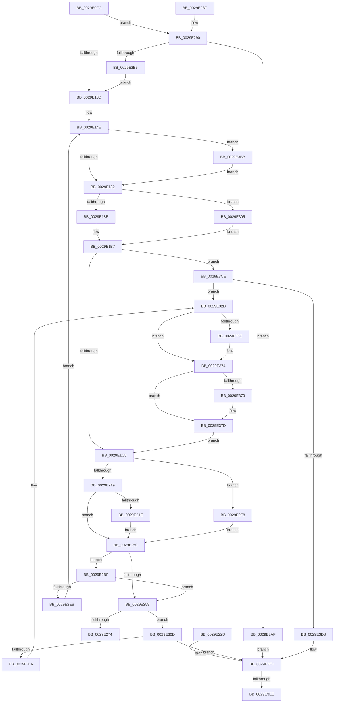

# VslpLockPagesForTransfer

- RVA: `0x0029E0FC`–`0x0029E3F3` (길이 `759` bytes)
- VA: `0x000000014029E0FC`
- 실행 섹션: `.text`
- PDB 이름 있음: `예`; PDB Function 태그: `예`
- unwind 정보 RVA: `0x000680F4`
- 디코드: `180`개 명령, `759/759` bytes 표시
- 미해석 바이트: `0` (있으면 어셈블리에 `.byte`로 보존)

> 이 문서는 커널 이미지의 기계어와 PDB 기호를 분석해 생성했습니다. 4번과 5번은 함수 원형과 자료형을 바이너리 사용 방식에서 추정한 C 해석이며 원본 소스 복구 결과는 아닙니다.

## 1. Dependencies

- 직접 호출 지점: **8**; 고유 호출 대상: **8**
- 직접 호출자로 확인된 함수: **35**
- RIP 상대 이미지 참조: **3**

### Outgoing calls
- `0x0029E19A` → [ExAllocatePool2](../../poolcode/B8/ExAllocatePool2_function_00B820F0.md) (function, `0x00B820F0`)
- `0x0029E226` → [MmProbeAndLockPages](../23/MmProbeAndLockPages_function_0023B990.md) (function, `0x0023B990`)
- `0x0029E264` → [VslpLockMdlForTransfer](VslpLockMdlForTransfer_function_0029E3FC.md) (function, `0x0029E3FC`)
- `0x0029E2FB` → [MmBuildMdlForNonPagedPool](../23/MmBuildMdlForNonPagedPool_function_0023A870.md) (function, `0x0023A870`)
- `0x0029E319` → [MmUnlockPages](MmUnlockPages_function_0029EEE0.md) (function, `0x0029EEE0`)
- `0x0029E323` → [ExFreePoolWithTag](../../poolcode/B8/ExFreePoolWithTag_function_00B82870.md) (function, `0x00B82870`)
- `0x0029E34A` → [KeAbPreAcquire](../21/KeAbPreAcquire_function_00210230.md) (function, `0x00210230`)
- `0x0029E36F` → [ExfAcquirePushLockExclusiveEx](../20/ExfAcquirePushLockExclusiveEx_function_0020FC90.md) (function, `0x0020FC90`)

### Direct callers
- [VslValidateSecureImagePages](VslValidateSecureImagePages_function_0029DFA0.md) at `0x0029E060`
- [VslIumEfiRuntimeService](../49/VslIumEfiRuntimeService_function_0049C0C0.md) at `0x0049C221`
- [VslCreateSecureImageSection](../4B/VslCreateSecureImageSection_function_004B69D0.md) at `0x004B6A47`
- [VslFillSecureAllocation](../4B/VslFillSecureAllocation_function_004BA4F0.md) at `0x004BA57D`
- [VslAllocatePool](../4B/VslAllocatePool_function_004BAF80.md) at `0x004BB029`
- [VslTransferSecureImageVersionResource](../4C/VslTransferSecureImageVersionResource_function_004C3960.md) at `0x004C39E8`
- [VslPrepareSecureImageRelocations](../4D/VslPrepareSecureImageRelocations_function_004D0510.md) at `0x004D061F`
- [VslPrepareSecureImageRelocations](../4D/VslPrepareSecureImageRelocations_function_004D0510.md) at `0x004D064C`
- [VslPrepareSecureImageRelocations](../4D/VslPrepareSecureImageRelocations_function_004D0510.md) at `0x004D0677`
- [VslRegisterLogPages](../4D/VslRegisterLogPages_function_004D32F0.md) at `0x004D3368`
- [VslFinishStartSecureProcessor](../58/VslFinishStartSecureProcessor_function_0058E25C.md) at `0x0058E2E4`
- [VslGetEtwDebugId](../58/VslGetEtwDebugId_function_0058E3B4.md) at `0x0058E424`
- [VslInitializeSecureProcess](../58/VslInitializeSecureProcess_function_0058EA00.md) at `0x0058EAA5`
- [VslQueryActiveSecurePatches](../58/VslQueryActiveSecurePatches_function_0058ED14.md) at `0x0058EE04`
- [VslQuerySecureKernelProfileInformation](../58/VslQuerySecureKernelProfileInformation_function_0058EED8.md) at `0x0058EF62`
- [VslRegisterSecurePatch](../58/VslRegisterSecurePatch_function_0058F0BC.md) at `0x0058F119`
- [VslRetrieveMailbox](../58/VslRetrieveMailbox_function_0058F4B0.md) at `0x0058F545`
- [VslCaptureImageHotPatchMetadata](../58/VslCaptureImageHotPatchMetadata_function_0058FD90.md) at `0x0058FE22`
- [VslInitFunctionOverrideCapabilities](../58/VslInitFunctionOverrideCapabilities_function_0058FFA8.md) at `0x00590003`
- [VslCapturePgoData](../../page/71/VslCapturePgoData_function_00718860.md) at `0x007188FB`
- [VslGetOnDemandDebugChallenge](../../page/71/VslGetOnDemandDebugChallenge_function_00718B58.md) at `0x00718BC7`
- [VslGetSetSecureContext](../../page/71/VslGetSetSecureContext_function_00718C8C.md) at `0x00718D03`
- [VslInitializeEnclave](../../page/71/VslInitializeEnclave_function_00718D64.md) at `0x00718DCC`
- [VslObtainHotPatchUndoTable](../../page/71/VslObtainHotPatchUndoTable_function_00718F50.md) at `0x00719053`
- [VslQueryRuntimeAttestationReport](../../page/71/VslQueryRuntimeAttestationReport_function_00719100.md) at `0x0071920A`
- [VslRegisterSyscallProviderServiceTableMetadata](../../page/71/VslRegisterSyscallProviderServiceTableMetadata_function_00719450.md) at `0x007194B1`
- [VslStartSecureProcessor](../../page/71/VslStartSecureProcessor_function_00719714.md) at `0x007198B2`
- [VslStartSecureProcessor](../../page/71/VslStartSecureProcessor_function_00719714.md) at `0x007198F5`
- [VslTransformDumpKey](../../page/71/VslTransformDumpKey_function_00719A08.md) at `0x00719B14`
- [VslReapplyImportOptimizationForDriverVerifier](../../page/71/VslReapplyImportOptimizationForDriverVerifier_function_00719BD4.md) at `0x00719C69`
- [VslDebugReadWriteSecureProcess](../../page/9B/VslDebugReadWriteSecureProcess_function_009BC670.md) at `0x009BC718`
- [VslValidateDynamicCodePages](../../page/A5/VslValidateDynamicCodePages_function_00A5687C.md) at `0x00A5698F`
- [VslCreateSecureSection](../../page/A7/VslCreateSecureSection_function_00A722A0.md) at `0x00A72333`
- [VslCreateEnclave](../../page/A9/VslCreateEnclave_function_00A9C18C.md) at `0x00A9C2E4`
- [VslLoadEnclaveModule](../../page/AB/VslLoadEnclaveModule_function_00AB200C.md) at `0x00AB2091`
- [VslCaptureSecureImageIat](../../page/AB/VslCaptureSecureImageIat_function_00AB79F4.md) at `0x00AB7A80`
- [VslRegisterBootDrivers](../../init/C7/VslRegisterBootDrivers_function_00C7453C.md) at `0x00C74663`
- [VslConnectSwInterrupt](../../init/C7/VslConnectSwInterrupt_function_00C75C70.md) at `0x00C75D39`
- [VslConnectSwInterrupt](../../init/C7/VslConnectSwInterrupt_function_00C75C70.md) at `0x00C75DD6`
- [VslConnectSwInterrupt](../../init/C7/VslConnectSwInterrupt_function_00C75C70.md) at `0x00C75EDA`

### Static image references
- `0x0029E343` → RVA `0x00F8EBE8` (`.data`; read)
- `0x0029E352` → RVA `0x00F8EBE8` (`.data`; read/write)
- `0x0029E37D` → RVA `0x00F8EBE0` (`.data`; read)

## 2. Other-region calls and transfers

- 다른 실행 섹션으로 향하는 call: **2**
  - `0x0029E19A` → [ExAllocatePool2](../../poolcode/B8/ExAllocatePool2_function_00B820F0.md) (`.text` → `POOLCODE`)
  - `0x0029E323` → [ExFreePoolWithTag](../../poolcode/B8/ExFreePoolWithTag_function_00B82870.md) (`.text` → `POOLCODE`)
- call이 아닌 외부 분기/꼬리 이동: **2**
  - `0x0029E3E8` → [sub_006DAA04](../6D/Unknown_function_006DAA04.md) (`tail-transfer`)
  - `0x0029E3EE` → [sub_006DAA04 + 0x2B](../6D/Unknown_function_006DAA04.md) (`tail-transfer`)

## 3. Assembly (complete function range)

```asm
0029E0FC  48 8B C4                        mov rax, rsp
0029E0FF  44 89 48 20                     mov dword ptr [rax + 0x20], r9d
0029E103  44 89 40 18                     mov dword ptr [rax + 0x18], r8d
0029E107  48 89 50 10                     mov qword ptr [rax + 0x10], rdx
0029E10B  48 89 48 08                     mov qword ptr [rax + 8], rcx
0029E10F  53                              push rbx
0029E110  56                              push rsi
0029E111  57                              push rdi
0029E112  41 54                           push r12
0029E114  41 55                           push r13
0029E116  41 56                           push r14
0029E118  41 57                           push r15
0029E11A  48 83 EC 30                     sub rsp, 0x30
0029E11E  45 8B D9                        mov r11d, r9d
0029E121  45 8B C8                        mov r9d, r8d
0029E124  4C 8B D2                        mov r10, rdx
0029E127  33 F6                           xor esi, esi
0029E129  8B FE                           mov edi, esi
0029E12B  44 8B B4 24 90 00 00 00         mov r14d, dword ptr [rsp + 0x90]
0029E133  41 F6 C6 13                     test r14b, 0x13
0029E137  0F 85 53 01 00 00               jne 0x14029e290
0029E13D  4C 8B FE                        mov r15, rsi
0029E140  48 89 74 24 28                  mov qword ptr [rsp + 0x28], rsi
0029E145  BA 00 10 00 00                  mov edx, 0x1000
0029E14A  48 83 CB FF                     or rbx, 0xffffffffffffffff
0029E14E  49 8B CA                        mov rcx, r10
0029E151  81 E1 FF 0F 00 00               and ecx, 0xfff
0029E157  41 8B C1                        mov eax, r9d
0029E15A  48 81 C1 FF 0F 00 00            add rcx, 0xfff
0029E161  48 03 C8                        add rcx, rax
0029E164  48 C1 E9 0C                     shr rcx, 0xc
0029E168  44 8D 2C CD 30 00 00 00         lea r13d, [rcx*8 + 0x30]
0029E170  41 F6 C6 01                     test r14b, 1
0029E174  44 0F 45 EA                     cmovne r13d, edx
0029E178  41 F6 C6 04                     test r14b, 4
0029E17C  0F 85 39 02 00 00               jne 0x14029e3bb
0029E182  41 8B C6                        mov eax, r14d
0029E185  83 E0 20                        and eax, 0x20
0029E188  0F 85 77 01 00 00               jne 0x14029e305
0029E18E  41 8B D5                        mov edx, r13d
0029E191  8D 48 40                        lea ecx, [rax + 0x40]
0029E194  41 B8 56 6D 73 54               mov r8d, 0x54736d56
0029E19A  E8 51 3F 8E 00                  call 0x140b820f0
0029E19F  48 8B F8                        mov rdi, rax
0029E1A2  44 8B 8C 24 80 00 00 00         mov r9d, dword ptr [rsp + 0x80]
0029E1AA  4C 8B 54 24 78                  mov r10, qword ptr [rsp + 0x78]
0029E1AF  44 8B 9C 24 88 00 00 00         mov r11d, dword ptr [rsp + 0x88]
0029E1B7  48 89 7C 24 20                  mov qword ptr [rsp + 0x20], rdi
0029E1BC  48 85 FF                        test rdi, rdi
0029E1BF  0F 84 09 02 00 00               je 0x14029e3ce
0029E1C5  41 8B D1                        mov edx, r9d
0029E1C8  48 89 37                        mov qword ptr [rdi], rsi
0029E1CB  45 8B C2                        mov r8d, r10d
0029E1CE  41 8B C0                        mov eax, r8d
0029E1D1  25 FF 0F 00 00                  and eax, 0xfff
0029E1D6  48 05 FF 0F 00 00               add rax, 0xfff
0029E1DC  48 03 D0                        add rdx, rax
0029E1DF  48 C1 EA 0C                     shr rdx, 0xc
0029E1E3  66 83 C2 06                     add dx, 6
0029E1E7  66 C1 E2 03                     shl dx, 3
0029E1EB  66 89 57 08                     mov word ptr [rdi + 8], dx
0029E1EF  66 89 77 0A                     mov word ptr [rdi + 0xa], si
0029E1F3  49 8B C2                        mov rax, r10
0029E1F6  48 25 00 F0 FF FF               and rax, 0xfffffffffffff000
0029E1FC  48 89 47 20                     mov qword ptr [rdi + 0x20], rax
0029E200  41 81 E0 FF 0F 00 00            and r8d, 0xfff
0029E207  44 89 47 2C                     mov dword ptr [rdi + 0x2c], r8d
0029E20B  44 89 4F 28                     mov dword ptr [rdi + 0x28], r9d
0029E20F  41 F6 C6 06                     test r14b, 6
0029E213  0F 85 DF 00 00 00               jne 0x14029e2f8
0029E219  45 85 C9                        test r9d, r9d
0029E21C  74 32                           je 0x14029e250
0029E21E  45 8B C3                        mov r8d, r11d
0029E221  33 D2                           xor edx, edx
0029E223  48 8B CF                        mov rcx, rdi
0029E226  E8 65 D7 F9 FF                  call 0x14023b990
0029E22B  EB 23                           jmp 0x14029e250
0029E22D  44 8B F8                        mov r15d, eax
0029E230  48 8B 44 24 28                  mov rax, qword ptr [rsp + 0x28]
0029E235  48 8B 7C 24 20                  mov rdi, qword ptr [rsp + 0x20]
0029E23A  48 89 07                        mov qword ptr [rdi], rax
0029E23D  33 F6                           xor esi, esi
0029E23F  48 83 CB FF                     or rbx, 0xffffffffffffffff
0029E243  44 8B B4 24 90 00 00 00         mov r14d, dword ptr [rsp + 0x90]
0029E24B  E9 91 01 00 00                  jmp 0x14029e3e1
0029E250  45 8B E6                        mov r12d, r14d
0029E253  41 83 E4 10                     and r12d, 0x10
0029E257  74 66                           je 0x14029e2bf
0029E259  45 8B C6                        mov r8d, r14d
0029E25C  48 8B D7                        mov rdx, rdi
0029E25F  48 8B 4C 24 70                  mov rcx, qword ptr [rsp + 0x70]
0029E264  E8 93 01 00 00                  call 0x14029e3fc
0029E269  44 8B F8                        mov r15d, eax
0029E26C  85 C0                           test eax, eax
0029E26E  0F 88 99 00 00 00               js 0x14029e30d
0029E274  48 8B 44 24 70                  mov rax, qword ptr [rsp + 0x70]
0029E279  83 48 40 08                     or dword ptr [rax + 0x40], 8
0029E27D  33 C0                           xor eax, eax
0029E27F  48 83 C4 30                     add rsp, 0x30
0029E283  41 5F                           pop r15
0029E285  41 5E                           pop r14
0029E287  41 5D                           pop r13
0029E289  41 5C                           pop r12
0029E28B  5F                              pop rdi
0029E28C  5E                              pop rsi
0029E28D  5B                              pop rbx
0029E28E  C3                              ret
0029E28F  CC                              int3
0029E290  41 81 E2 FF 0F 00 00            and r10d, 0xfff
0029E297  4D 8D 81 FF 0F 00 00            lea r8, [r9 + 0xfff]
0029E29E  4D 03 C2                        add r8, r10
0029E2A1  49 81 E0 00 F0 FF FF            and r8, 0xfffffffffffff000
0029E2A8  49 81 F8 00 A0 1F 00            cmp r8, 0x1fa000
0029E2AF  0F 87 FA 00 00 00               ja 0x14029e3af
0029E2B5  4C 8B 54 24 78                  mov r10, qword ptr [rsp + 0x78]
0029E2BA  E9 7E FE FF FF                  jmp 0x14029e13d
0029E2BF  4C 89 3F                        mov qword ptr [rdi], r15
0029E2C2  4C 8B FF                        mov r15, rdi
0029E2C5  48 89 7C 24 28                  mov qword ptr [rsp + 0x28], rdi
0029E2CA  4C 8B D7                        mov r10, rdi
0029E2CD  48 89 7C 24 78                  mov qword ptr [rsp + 0x78], rdi
0029E2D2  45 8B CD                        mov r9d, r13d
0029E2D5  44 89 AC 24 80 00 00 00         mov dword ptr [rsp + 0x80], r13d
0029E2DD  BA 00 10 00 00                  mov edx, 0x1000
0029E2E2  44 3B EA                        cmp r13d, edx
0029E2E5  0F 86 6E FF FF FF               jbe 0x14029e259
0029E2EB  44 8B 9C 24 88 00 00 00         mov r11d, dword ptr [rsp + 0x88]
0029E2F3  E9 56 FE FF FF                  jmp 0x14029e14e
0029E2F8  48 8B CF                        mov rcx, rdi
0029E2FB  E8 70 C5 F9 FF                  call 0x14023a870
0029E300  E9 4B FF FF FF                  jmp 0x14029e250
0029E305  48 8B FE                        mov rdi, rsi
0029E308  E9 AA FE FF FF                  jmp 0x14029e1b7
0029E30D  45 85 E4                        test r12d, r12d
0029E310  0F 84 CB 00 00 00               je 0x14029e3e1
0029E316  48 8B CF                        mov rcx, rdi
0029E319  E8 C2 0B 00 00                  call 0x14029eee0
0029E31E  33 D2                           xor edx, edx
0029E320  48 8B CF                        mov rcx, rdi
0029E323  E8 48 45 8E 00                  call 0x140b82870
0029E328  4C 8B 7C 24 28                  mov r15, qword ptr [rsp + 0x28]
0029E32D  65 48 8B 04 25 88 01 00 00      mov rax, qword ptr gs:[0x188]
0029E336  66 01 98 E4 01 00 00            add word ptr [rax + 0x1e4], bx
0029E33D  90                              nop
0029E33E  45 33 C0                        xor r8d, r8d
0029E341  33 D2                           xor edx, edx
0029E343  48 8D 0D 9E 08 CF 00            lea rcx, [rip + 0xcf089e]
0029E34A  E8 E1 1E F7 FF                  call 0x140210230
0029E34F  48 8B F8                        mov rdi, rax
0029E352  F0 48 0F BA 2D 8C 08 CF 00 00   lock bts qword ptr [rip + 0xcf088c], 0
0029E35C  73 16                           jae 0x14029e374
0029E35E  4C 8D 05 83 08 CF 00            lea r8, [rip + 0xcf0883]
0029E365  48 8B D0                        mov rdx, rax
0029E368  48 8D 0D 79 08 CF 00            lea rcx, [rip + 0xcf0879]
0029E36F  E8 1C 19 F7 FF                  call 0x14020fc90
0029E374  48 85 FF                        test rdi, rdi
0029E377  74 04                           je 0x14029e37d
0029E379  C6 47 0A 01                     mov byte ptr [rdi + 0xa], 1
0029E37D  48 8B 3D 5C 08 CF 00            mov rdi, qword ptr [rip + 0xcf085c]
0029E384  48 89 7C 24 20                  mov qword ptr [rsp + 0x20], rdi
0029E389  41 83 CE 20                     or r14d, 0x20
0029E38D  44 89 B4 24 90 00 00 00         mov dword ptr [rsp + 0x90], r14d
0029E395  44 8B 8C 24 80 00 00 00         mov r9d, dword ptr [rsp + 0x80]
0029E39D  4C 8B 54 24 78                  mov r10, qword ptr [rsp + 0x78]
0029E3A2  44 8B 9C 24 88 00 00 00         mov r11d, dword ptr [rsp + 0x88]
0029E3AA  E9 16 FE FF FF                  jmp 0x14029e1c5
0029E3AF  41 BF 0D 00 00 C0               mov r15d, 0xc000000d
0029E3B5  48 83 CB FF                     or rbx, 0xffffffffffffffff
0029E3B9  EB 26                           jmp 0x14029e3e1
0029E3BB  41 81 C5 FF 0F 00 00            add r13d, 0xfff
0029E3C2  41 81 E5 00 F0 FF FF            and r13d, 0xfffff000
0029E3C9  E9 B4 FD FF FF                  jmp 0x14029e182
0029E3CE  41 F6 C6 10                     test r14b, 0x10
0029E3D2  0F 85 55 FF FF FF               jne 0x14029e32d
0029E3D8  49 8B FF                        mov rdi, r15
0029E3DB  41 BF 9A 00 00 C0               mov r15d, 0xc000009a
0029E3E1  41 83 E6 20                     and r14d, 0x20
0029E3E5  48 85 FF                        test rdi, rdi
0029E3E8  0F 85 16 C6 43 00               jne 0x1406daa04
0029E3EE  E9 3C C6 43 00                  jmp 0x1406daa2f
```

## 4. C-style interpretation (structured pseudocode)

```c
__int64 __fastcall VslpLockPagesForTransfer(__int64 a1, __int64 a2, int a3, int a4, unsigned int a5)
{
    __int64 result;
    __int64 v_r10;
    __int64 v_r12;
    __int64 v_r13;
    __int64 v_r14;
    __int64 v_rbx;
    __int64 v_rsi;
    __int64 v_rsp;
    unsigned __int64 v_stack_m40;
    unsigned __int64 v_stack_m48;
    unsigned __int64 v_stack_p10;
    unsigned int v_stack_p18;
    unsigned int v_stack_p20;
    unsigned int v_stack_p28;
    unsigned __int64 v_stack_p78;
    unsigned __int64 v_stack_p8;
    unsigned int v_stack_p80;
    unsigned int v_stack_p88;
    unsigned int v_stack_p90;

    *(unsigned int *)(v_rsp + 32) = a4;
    *(unsigned int *)(v_rsp + 24) = a3;
    *(unsigned __int64 *)(v_rsp + 16) = a2;
    *(unsigned __int64 *)(v_rsp + 8) = a1;
    v_rsp = (v_rsp) - (48);
    v_rsi = 0;
    if ((((unsigned __int8)((unsigned int)(a5))) & (19)) != 0) goto loc_0029E290;
loc_0029E13D:
    v_stack_m40 = 0;
    v_rbx = (v_rbx) | (-1);
loc_0029E14E:
    a1 = (unsigned int)((a2) & (0xFFFULL));
    a1 = (a1) + (0xFFFULL);
    a1 = (a1) + ((unsigned int)((unsigned int)((unsigned int)(a3))));
    a1 = (a1) >> (12);
    v_r13 = a1 * 8 + 48;
    if ((((unsigned __int8)((unsigned int)(a5))) & (1)) != 0) { v_r13 = (unsigned int)((unsigned int)(0x1000ULL)); }
    if ((((unsigned __int8)((unsigned int)(a5))) & (4)) != 0) goto loc_0029E3BB;
loc_0029E182:
    result = (unsigned int)(((unsigned int)((unsigned int)((unsigned int)(a5)))) & (32));
    if (condition_is_not_equal) goto loc_0029E305;
    result = ExAllocatePool2(result + 64, (unsigned int)((unsigned int)(v_r13)), (unsigned int)(0x54736D56ULL), (unsigned int)(a3));
loc_0029E1B7:
    v_stack_m48 = result;
    if (result == 0) goto loc_0029E3CE;
loc_0029E1C5:
    *(unsigned __int64 *)(result) = 0;
    result = (unsigned int)(((unsigned int)((unsigned int)((unsigned int)((unsigned int)(v_stack_p10))))) & (0xFFFULL));
    result = (result) + (0xFFFULL);
    a2 = ((unsigned int)((unsigned int)((unsigned int)(v_stack_p18)))) + (result);
    a2 = (a2) >> (12);
    a2 = (unsigned __int16)((a2) + (6));
    a2 = (unsigned __int16)((a2) << (3));
    *(unsigned __int16 *)(result + 8) = (unsigned __int16)(a2);
    *(unsigned __int16 *)(result + 10) = 0;
    result = (v_stack_p10) & (0xFFFFFFFFFFFFF000ULL);
    *(unsigned __int64 *)(result + 32) = result;
    a3 = (unsigned int)(((unsigned int)((unsigned int)(v_stack_p10))) & (0xFFFULL));
    *(unsigned int *)(result + 44) = a3;
    *(unsigned int *)(result + 40) = (unsigned int)((unsigned int)(v_stack_p18));
    if ((((unsigned __int8)((unsigned int)(a5))) & (6)) != 0) goto loc_0029E2F8;
    if ((unsigned int)((unsigned int)(v_stack_p18)) == 0) goto loc_0029E250;
    a2 = 0;
    result = MmProbeAndLockPages(result, a2, (unsigned int)((unsigned int)((unsigned int)(v_stack_p20))), (unsigned int)(v_stack_p18));
    goto loc_0029E250;
loc_0029E250:
    v_r12 = (unsigned int)(((unsigned int)((unsigned int)((unsigned int)(a5)))) & (16));
    if (condition_is_equal) goto loc_0029E2BF;
loc_0029E259:
    result = VslpLockMdlForTransfer(v_stack_p8, result, (unsigned int)((unsigned int)((unsigned int)(a5))), (unsigned int)(v_stack_p18));
    if (sign_flag) goto loc_0029E30D;
    result = 0;
    v_rsp = (v_rsp) + (48);
    return result;
loc_0029E290:
    v_r10 = (unsigned int)((v_stack_p10) & (0xFFFULL));
    a3 = ((unsigned int)(v_stack_p18) + 4095) + (v_r10);
    a3 = (a3) & (0xFFFFFFFFFFFFF000ULL);
    if (a3 > 0x1FA000ULL) goto loc_0029E3AF;
    goto loc_0029E13D;
loc_0029E2BF:
    *(unsigned __int64 *)(result) = (unsigned int)((unsigned int)(result));
    v_stack_p28 = 0;
    v_stack_p78 = 0;
    v_stack_p80 = (unsigned int)(v_r13);
    if (((unsigned int)(v_r13)) <= ((unsigned int)((unsigned int)(0x1000ULL)))) goto loc_0029E259;
    goto loc_0029E14E;
loc_0029E2F8:
    result = MmBuildMdlForNonPagedPool(0, (unsigned int)(0x1000ULL), a3, (unsigned int)((unsigned int)(v_r13)));
    goto loc_0029E250;
loc_0029E305:
    goto loc_0029E1B7;
loc_0029E30D:
    if ((unsigned int)(v_r12) == 0) goto loc_0029E3E1;
    result = MmUnlockPages(0, (unsigned int)(0x1000ULL), a3, (unsigned int)((unsigned int)(v_r13)));
    a2 = 0;
    result = ExFreePoolWithTag(0, a2, a3, (unsigned int)((unsigned int)(v_r13)));
loc_0029E32D:
    a3 = 0;
    a2 = 0;
    result = KeAbPreAcquire(v_rip + 13568158, a2, a3, (unsigned int)((unsigned int)(v_r13)));
    if (!(condition_is_above_or_equal)) {
        a3 = v_rip + 13568131;
        a2 = result;
        a1 = v_rip + 13568121;
        result = ExfAcquirePushLockExclusiveEx(a1, a2, a3, (unsigned int)((unsigned int)(v_r13)));
    }
    if (result != 0) {
        *(unsigned __int8 *)(result + 10) = 1;
    }
    v_stack_p20 = *(unsigned __int64 *)(v_rip + 13568092);
    v_r14 = (unsigned int)(((unsigned int)(a5)) | (32));
    v_stack_p90 = (unsigned int)(v_r14);
    goto loc_0029E1C5;
loc_0029E3AF:
    v_rbx = (v_rbx) | (-1);
    goto loc_0029E3E1;
loc_0029E3BB:
    v_r13 = (unsigned int)((v_r13) + (0xFFFULL));
    v_r13 = (unsigned int)((v_r13) & (0xFFFFF000ULL));
    goto loc_0029E182;
loc_0029E3CE:
    if ((((unsigned __int8)(v_r14)) & (16)) != 0) goto loc_0029E32D;
loc_0029E3E1:
    v_r14 = (unsigned int)((v_r14) & (32));
}
```

## 5. (Beta) C Style

```c
int64_t VslpLockPagesForTransfer(int64_t Arg1, int64_t Arg2, void *Arg3, int32_t Arg4, uint32_t Arg5)
{
    uint8_t *arg3 = (uint8_t *)Arg3;

    int64_t result;
    int64_t local_r10;
    int64_t local_r12;
    int64_t local_r13;
    int64_t local_r14;
    int64_t local_rbx;
    int64_t local_rsi;
    int64_t local_rsp;
    uint64_t v_stack_m40;
    uint64_t v_stack_m48;
    uint64_t v_stack_p10;
    uint32_t v_stack_p18;
    uint32_t v_stack_p20;
    uint32_t v_stack_p28;
    uint64_t v_stack_p78;
    uint64_t v_stack_p8;
    uint32_t v_stack_p80;
    uint32_t v_stack_p88;
    uint32_t v_stack_p90;

    *(uint32_t *)(local_rsp + 0x20) = Arg4;
    *(uint32_t *)(local_rsp + 0x18) = Arg3;
    *(uint64_t *)(local_rsp + 0x10) = Arg2;
    *(uint64_t *)(local_rsp + 0x8) = Arg1;
    local_rsp = (local_rsp) - (48);
    local_rsi = 0;
    if ((((uint8_t)((uint32_t)(Arg5))) & (19)) != 0) goto loc_0029E290;
loc_0029E13D:
    v_stack_m40 = 0;
    local_rbx = (local_rbx) | (-1);
loc_0029E14E:
    Arg1 = (uint32_t)((Arg2) & (0xFFFULL));
    Arg1 = (Arg1) + (0xFFFULL);
    Arg1 = (Arg1) + ((uint32_t)((uint32_t)((uint32_t)(Arg3))));
    Arg1 = (Arg1) >> (12);
    local_r13 = Arg1 * 8 + 48;
    if ((((uint8_t)((uint32_t)(Arg5))) & (1)) != 0) { local_r13 = (uint32_t)((uint32_t)(0x1000ULL)); }
    if ((((uint8_t)((uint32_t)(Arg5))) & (4)) != 0) goto loc_0029E3BB;
loc_0029E182:
    result = (uint32_t)(((uint32_t)((uint32_t)((uint32_t)(Arg5)))) & (32));
    if (condition_is_not_equal) goto loc_0029E305;
    result = ExAllocatePool2(result + 64, (uint32_t)((uint32_t)(local_r13)), (uint32_t)(0x54736D56ULL), (uint32_t)(Arg3));
loc_0029E1B7:
    v_stack_m48 = result;
    if (result == 0) goto loc_0029E3CE;
loc_0029E1C5:
    *(uint64_t *)(result) = 0;
    result = (uint32_t)(((uint32_t)((uint32_t)((uint32_t)((uint32_t)(v_stack_p10))))) & (0xFFFULL));
    result = (result) + (0xFFFULL);
    Arg2 = ((uint32_t)((uint32_t)((uint32_t)(v_stack_p18)))) + (result);
    Arg2 = (Arg2) >> (12);
    Arg2 = (uint16_t)((Arg2) + (6));
    Arg2 = (uint16_t)((Arg2) << (3));
    *(uint16_t *)(result + 0x8) = (uint16_t)(Arg2);
    *(uint16_t *)(result + 0xA) = 0;
    result = (v_stack_p10) & (0xFFFFFFFFFFFFF000ULL);
    *(uint64_t *)(result + 0x20) = result;
    Arg3 = (uint32_t)(((uint32_t)((uint32_t)(v_stack_p10))) & (0xFFFULL));
    *(uint32_t *)(result + 0x2C) = Arg3;
    *(uint32_t *)(result + 0x28) = (uint32_t)((uint32_t)(v_stack_p18));
    if ((((uint8_t)((uint32_t)(Arg5))) & (6)) != 0) goto loc_0029E2F8;
    if ((uint32_t)((uint32_t)(v_stack_p18)) == 0) goto loc_0029E250;
    Arg2 = 0;
    result = MmProbeAndLockPages(result, Arg2, (uint32_t)((uint32_t)((uint32_t)(v_stack_p20))), (uint32_t)(v_stack_p18));
    goto loc_0029E250;
loc_0029E250:
    local_r12 = (uint32_t)(((uint32_t)((uint32_t)((uint32_t)(Arg5)))) & (16));
    if (condition_is_equal) goto loc_0029E2BF;
loc_0029E259:
    result = VslpLockMdlForTransfer(v_stack_p8, result, (uint32_t)((uint32_t)((uint32_t)(Arg5))), (uint32_t)(v_stack_p18));
    if (sign_flag) goto loc_0029E30D;
    result = 0;
    local_rsp = (local_rsp) + (48);
    return result;
loc_0029E290:
    local_r10 = (uint32_t)((v_stack_p10) & (0xFFFULL));
    Arg3 = ((uint32_t)(v_stack_p18) + 4095) + (local_r10);
    Arg3 = (Arg3) & (0xFFFFFFFFFFFFF000ULL);
    if (Arg3 > 0x1FA000ULL) goto loc_0029E3AF;
    goto loc_0029E13D;
loc_0029E2BF:
    *(uint64_t *)(result) = (uint32_t)((uint32_t)(result));
    v_stack_p28 = 0;
    v_stack_p78 = 0;
    v_stack_p80 = (uint32_t)(local_r13);
    if (((uint32_t)(local_r13)) <= ((uint32_t)((uint32_t)(0x1000ULL)))) goto loc_0029E259;
    goto loc_0029E14E;
loc_0029E2F8:
    result = MmBuildMdlForNonPagedPool(0, (uint32_t)(0x1000ULL), Arg3, (uint32_t)((uint32_t)(local_r13)));
    goto loc_0029E250;
loc_0029E305:
    goto loc_0029E1B7;
loc_0029E30D:
    if ((uint32_t)(local_r12) == 0) goto loc_0029E3E1;
    result = MmUnlockPages(0, (uint32_t)(0x1000ULL), Arg3, (uint32_t)((uint32_t)(local_r13)));
    Arg2 = 0;
    result = ExFreePoolWithTag(0, Arg2, Arg3, (uint32_t)((uint32_t)(local_r13)));
loc_0029E32D:
    Arg3 = 0;
    Arg2 = 0;
    result = KeAbPreAcquire(v_rip + 13568158, Arg2, Arg3, (uint32_t)((uint32_t)(local_r13)));
    if (!(condition_is_above_or_equal)) {
        Arg3 = v_rip + 13568131;
        Arg2 = result;
        Arg1 = v_rip + 13568121;
        result = ExfAcquirePushLockExclusiveEx(Arg1, Arg2, Arg3, (uint32_t)((uint32_t)(local_r13)));
    }
    if (result != 0) {
        *(uint8_t *)(result + 0xA) = 1;
    }
    v_stack_p20 = *(uint64_t *)(v_rip + 0xCF085C);
    local_r14 = (uint32_t)(((uint32_t)(Arg5)) | (32));
    v_stack_p90 = (uint32_t)(local_r14);
    goto loc_0029E1C5;
loc_0029E3AF:
    local_rbx = (local_rbx) | (-1);
    goto loc_0029E3E1;
loc_0029E3BB:
    local_r13 = (uint32_t)((local_r13) + (0xFFFULL));
    local_r13 = (uint32_t)((local_r13) & (0xFFFFF000ULL));
    goto loc_0029E182;
loc_0029E3CE:
    if ((((uint8_t)(local_r14)) & (16)) != 0) goto loc_0029E32D;
loc_0029E3E1:
    local_r14 = (uint32_t)((local_r14) & (32));
}
```

### 관측된 메모리 오프셋

구조체 형식이 확인되지 않은 접근은 인자 기준의 오프셋으로만 기록했습니다.

| 기준 인자 | 오프셋 표현 | 폭 (bit) | 접근 |
|---|---:|---:|---|
| `Arg3` | `+ 0xFFF` | `64` | `R` |

## 6. Execution-region graph

[열기: 2D/3D 그래프와 함수 탐색 컨트롤 패널](../../../control-panel.html?section=text&rva=0x0029E0FC&view=graph)

- 2D 그래프는 위에서 아래로 흐르고, 3D 그래프는 빈 공간을 드래그해 회전합니다. Shift+드래그는 이동, 휠은 확대·축소, 함수 노드 선택은 대상 보고서 이동입니다.

### Static fallback


