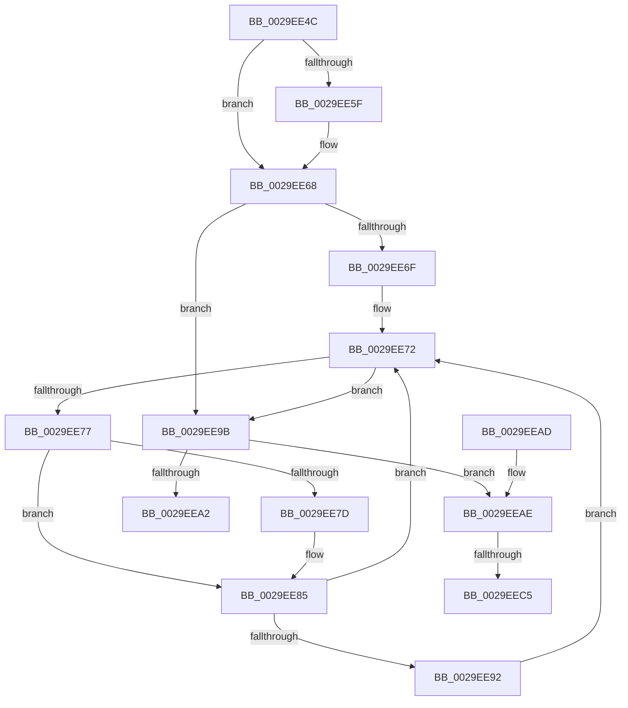

# VslpUnlockPagesForTransfer

- RVA: `0x0029EE4C`–`0x0029EED7` (길이 `139` bytes)
- VA: `0x000000014029EE4C`
- 실행 섹션: `.text`
- PDB 이름 있음: `예`; PDB Function 태그: `예`
- unwind 정보 RVA: `0x00068270`
- 디코드: `43`개 명령, `139/139` bytes 표시
- 미해석 바이트: `0` (있으면 어셈블리에 `.byte`로 보존)

> 이 문서는 커널 이미지의 기계어와 PDB 기호를 분석해 생성했습니다. 4번과 5번은 함수 원형과 자료형을 바이너리 사용 방식에서 추정한 C 해석이며 원본 소스 복구 결과는 아닙니다.

## 1. Dependencies

- 직접 호출 지점: **4**; 고유 호출 대상: **3**
- 직접 호출자로 확인된 함수: **36**
- RIP 상대 이미지 참조: **2**

### Outgoing calls
- `0x0029EE63` → [MmUnlockPages](MmUnlockPages_function_0029EEE0.md) (function, `0x0029EEE0`)
- `0x0029EE80` → [MmUnlockPages](MmUnlockPages_function_0029EEE0.md) (function, `0x0029EEE0`)
- `0x0029EE94` → [ExFreePoolWithTag](../../poolcode/B8/ExFreePoolWithTag_function_00B82870.md) (function, `0x00B82870`)
- `0x0029EECC` → [ExfTryToWakePushLock](../26/ExfTryToWakePushLock_function_00265DD0.md) (function, `0x00265DD0`)

### Direct callers
- [VslValidateSecureImagePages](VslValidateSecureImagePages_function_0029DFA0.md) at `0x0029E0B5`
- [VslIumEfiRuntimeService](../49/VslIumEfiRuntimeService_function_0049C0C0.md) at `0x0049C1D8`
- [VslCreateSecureImageSection](../4B/VslCreateSecureImageSection_function_004B69D0.md) at `0x004B6A8A`
- [VslFillSecureAllocation](../4B/VslFillSecureAllocation_function_004BA4F0.md) at `0x004BA5D0`
- [VslTransferSecureImageVersionResource](../4C/VslTransferSecureImageVersionResource_function_004C3960.md) at `0x004C3A2C`
- [VslFreePoolTransferObject](../4C/VslFreePoolTransferObject_function_004C4290.md) at `0x004C42AF`
- [VslPrepareSecureImageRelocations](../4D/VslPrepareSecureImageRelocations_function_004D0510.md) at `0x004D06E7`
- [VslPrepareSecureImageRelocations](../4D/VslPrepareSecureImageRelocations_function_004D0510.md) at `0x004D06F6`
- [VslPrepareSecureImageRelocations](../4D/VslPrepareSecureImageRelocations_function_004D0510.md) at `0x004D0705`
- [VslRegisterLogPages](../4D/VslRegisterLogPages_function_004D32F0.md) at `0x004D33E0`
- [VslFinishStartSecureProcessor](../58/VslFinishStartSecureProcessor_function_0058E25C.md) at `0x0058E327`
- [VslGetEtwDebugId](../58/VslGetEtwDebugId_function_0058E3B4.md) at `0x0058E46D`
- [VslInitializeSecureProcess](../58/VslInitializeSecureProcess_function_0058EA00.md) at `0x0058EADF`
- [VslQueryActiveSecurePatches](../58/VslQueryActiveSecurePatches_function_0058ED14.md) at `0x0058EE48`
- [VslQuerySecureKernelProfileInformation](../58/VslQuerySecureKernelProfileInformation_function_0058EED8.md) at `0x0058EFBC`
- [VslRegisterSecurePatch](../58/VslRegisterSecurePatch_function_0058F0BC.md) at `0x0058F15F`
- [VslRetrieveMailbox](../58/VslRetrieveMailbox_function_0058F4B0.md) at `0x0058F589`
- [VslCaptureImageHotPatchMetadata](../58/VslCaptureImageHotPatchMetadata_function_0058FD90.md) at `0x0058FE73`
- [VslInitFunctionOverrideCapabilities](../58/VslInitFunctionOverrideCapabilities_function_0058FFA8.md) at `0x00590044`
- [VslCapturePgoData](../../page/71/VslCapturePgoData_function_00718860.md) at `0x00718946`
- [VslGetOnDemandDebugChallenge](../../page/71/VslGetOnDemandDebugChallenge_function_00718B58.md) at `0x00718C1B`
- [VslGetSetSecureContext](../../page/71/VslGetSetSecureContext_function_00718C8C.md) at `0x00718D36`
- [VslInitializeEnclave](../../page/71/VslInitializeEnclave_function_00718D64.md) at `0x00718E21`
- [VslLoadEnclaveData](../../page/71/VslLoadEnclaveData_function_00718E54.md) at `0x00718F0C`
- [VslObtainHotPatchUndoTable](../../page/71/VslObtainHotPatchUndoTable_function_00718F50.md) at `0x0071909E`
- [VslQueryRuntimeAttestationReport](../../page/71/VslQueryRuntimeAttestationReport_function_00719100.md) at `0x007192DC`
- [VslRegisterSyscallProviderServiceTableMetadata](../../page/71/VslRegisterSyscallProviderServiceTableMetadata_function_00719450.md) at `0x007194FA`
- [VslStartSecureProcessor](../../page/71/VslStartSecureProcessor_function_00719714.md) at `0x0071992C`
- [VslStartSecureProcessor](../../page/71/VslStartSecureProcessor_function_00719714.md) at `0x00719935`
- [VslTransformDumpKey](../../page/71/VslTransformDumpKey_function_00719A08.md) at `0x00719B90`
- [VslReapplyImportOptimizationForDriverVerifier](../../page/71/VslReapplyImportOptimizationForDriverVerifier_function_00719BD4.md) at `0x00719CB6`
- [VslDebugReadWriteSecureProcess](../../page/9B/VslDebugReadWriteSecureProcess_function_009BC670.md) at `0x009BC76A`
- [VslValidateDynamicCodePages](../../page/A5/VslValidateDynamicCodePages_function_00A5687C.md) at `0x00A569EA`
- [VslCreateSecureSection](../../page/A7/VslCreateSecureSection_function_00A722A0.md) at `0x00A72376`
- [VslCreateEnclave](../../page/A9/VslCreateEnclave_function_00A9C18C.md) at `0x00A9C2F7`
- [VslLoadEnclaveModule](../../page/AB/VslLoadEnclaveModule_function_00AB200C.md) at `0x00AB20DB`
- [VslCaptureSecureImageIat](../../page/AB/VslCaptureSecureImageIat_function_00AB79F4.md) at `0x00AB7AC9`
- [VslRegisterBootDrivers](../../init/C7/VslRegisterBootDrivers_function_00C7453C.md) at `0x00C746CC`
- [VslConnectSwInterrupt](../../init/C7/VslConnectSwInterrupt_function_00C75C70.md) at `0x00C75F61`
- [VslConnectSwInterrupt](../../init/C7/VslConnectSwInterrupt_function_00C75C70.md) at `0x00C75FAB`

### Static image references
- `0x0029EEB2` → RVA `0x00F8EBE8` (`.data`; read/write)
- `0x0029EEC5` → RVA `0x00F8EBE8` (`.data`; read)

## 2. Other-region calls and transfers

- 다른 실행 섹션으로 향하는 call: **1**
  - `0x0029EE94` → [ExFreePoolWithTag](../../poolcode/B8/ExFreePoolWithTag_function_00B82870.md) (`.text` → `POOLCODE`)
- call이 아닌 외부 분기/꼬리 이동: **2**
  - `0x0029EEBF` → [sub_006DAA76](../6D/Unknown_function_006DAA76.md) (`tail-transfer`)
  - `0x0029EED2` → [sub_006DAA76](../6D/Unknown_function_006DAA76.md) (`tail-transfer`)

## 3. Assembly (complete function range)

```asm
0029EE4C  48 89 5C 24 08                  mov qword ptr [rsp + 8], rbx
0029EE51  57                              push rdi
0029EE52  48 83 EC 20                     sub rsp, 0x20
0029EE56  F6 41 12 02                     test byte ptr [rcx + 0x12], 2
0029EE5A  48 8B D9                        mov rbx, rcx
0029EE5D  74 09                           je 0x14029ee68
0029EE5F  48 83 C1 08                     add rcx, 8
0029EE63  E8 78 00 00 00                  call 0x14029eee0
0029EE68  8B 43 40                        mov eax, dword ptr [rbx + 0x40]
0029EE6B  A8 08                           test al, 8
0029EE6D  74 2C                           je 0x14029ee9b
0029EE6F  48 8B 3B                        mov rdi, qword ptr [rbx]
0029EE72  48 85 FF                        test rdi, rdi
0029EE75  74 24                           je 0x14029ee9b
0029EE77  F6 47 0A 02                     test byte ptr [rdi + 0xa], 2
0029EE7B  74 08                           je 0x14029ee85
0029EE7D  48 8B CF                        mov rcx, rdi
0029EE80  E8 5B 00 00 00                  call 0x14029eee0
0029EE85  8B 43 40                        mov eax, dword ptr [rbx + 0x40]
0029EE88  48 8B CF                        mov rcx, rdi
0029EE8B  48 8B 3F                        mov rdi, qword ptr [rdi]
0029EE8E  A8 20                           test al, 0x20
0029EE90  75 E0                           jne 0x14029ee72
0029EE92  33 D2                           xor edx, edx
0029EE94  E8 D7 39 8E 00                  call 0x140b82870
0029EE99  EB D7                           jmp 0x14029ee72
0029EE9B  8B 43 40                        mov eax, dword ptr [rbx + 0x40]
0029EE9E  A8 20                           test al, 0x20
0029EEA0  75 0C                           jne 0x14029eeae
0029EEA2  48 8B 5C 24 30                  mov rbx, qword ptr [rsp + 0x30]
0029EEA7  48 83 C4 20                     add rsp, 0x20
0029EEAB  5F                              pop rdi
0029EEAC  C3                              ret
0029EEAD  CC                              int3
0029EEAE  48 83 C8 FF                     or rax, 0xffffffffffffffff
0029EEB2  F0 48 0F C1 05 2D FD CE 00      lock xadd qword ptr [rip + 0xcefd2d], rax
0029EEBB  24 06                           and al, 6
0029EEBD  3C 02                           cmp al, 2
0029EEBF  0F 85 B1 BB 43 00               jne 0x1406daa76
0029EEC5  48 8D 0D 1C FD CE 00            lea rcx, [rip + 0xcefd1c]
0029EECC  E8 FF 6E FC FF                  call 0x140265dd0
0029EED1  90                              nop
0029EED2  E9 9F BB 43 00                  jmp 0x1406daa76
```

## 4. C-style interpretation (structured pseudocode)

```c
__int64 __fastcall VslpUnlockPagesForTransfer(__int64 a1, int a2)
{
    __int64 result;
    __int64 v_rsp;
    unsigned __int64 v_stack_p8;

    v_stack_p8 = v_rbx;
    v_rsp = (v_rsp) - (32);
    if (((*(unsigned __int8 *)(a1 + 18)) & (2)) != 0) {
        a1 = (a1) + (8);
        result = MmUnlockPages(a1, a2, a3, a4);
    }
    if ((((unsigned __int8)((unsigned int)(*(unsigned int *)(a1 + 64)))) & (8)) == 0) goto loc_0029EE9B;
loc_0029EE72:
    if (*(unsigned __int64 *)(a1) == 0) goto loc_0029EE9B;
    result = (unsigned int)(*(unsigned int *)(a1 + 64));
    if (((*(unsigned __int8 *)(*(unsigned __int64 *)(a1) + 10)) & (2)) != 0) {
        a1 = *(unsigned __int64 *)(a1);
        result = MmUnlockPages(a1, a2, a3, a4);
    }
    if ((((unsigned __int8)((unsigned int)(*(unsigned int *)(a1 + 64)))) & (32)) != 0) goto loc_0029EE72;
    a2 = 0;
    result = ExFreePoolWithTag(*(unsigned __int64 *)(a1), a2, a3, a4);
    goto loc_0029EE72;
loc_0029EE9B:
    if ((((unsigned __int8)((unsigned int)(*(unsigned int *)(a1 + 64)))) & (32)) != 0) goto loc_0029EEAE;
    v_rsp = (v_rsp) + (32);
    return (unsigned int)(*(unsigned int *)(a1 + 64));
loc_0029EEAE:
    result = ((unsigned int)(*(unsigned int *)(a1 + 64))) | (-1);
    result = (unsigned __int8)((result) & (6));
    result = ExfTryToWakePushLock(v_rip + 13565212, a2, a3, a4);
}
```

## 5. (Beta) C Style

```c
int64_t VslpUnlockPagesForTransfer(void *Arg1, int32_t Arg2)
{
    uint8_t *arg1 = (uint8_t *)Arg1;

    int64_t result;
    int64_t local_rsp;
    uint64_t v_stack_p8;

    v_stack_p8 = local_rbx;
    local_rsp = (local_rsp) - (32);
    if (((*(uint8_t *)(arg1 + 0x12)) & (2)) != 0) {
        Arg1 = (Arg1) + (8);
        result = MmUnlockPages(Arg1, Arg2, a3, a4);
    }
    if ((((uint8_t)((uint32_t)(*(uint32_t *)(arg1 + 0x40)))) & (8)) == 0) goto loc_0029EE9B;
loc_0029EE72:
    if (*(uint64_t *)(arg1) == 0) goto loc_0029EE9B;
    result = (uint32_t)(*(uint32_t *)(arg1 + 0x40));
    if (((*(uint8_t *)(*(uint64_t *)(arg1) + 0xA)) & (2)) != 0) {
        Arg1 = *(uint64_t *)(arg1);
        result = MmUnlockPages(Arg1, Arg2, a3, a4);
    }
    if ((((uint8_t)((uint32_t)(*(uint32_t *)(arg1 + 0x40)))) & (32)) != 0) goto loc_0029EE72;
    Arg2 = 0;
    result = ExFreePoolWithTag(*(uint64_t *)(arg1), Arg2, a3, a4);
    goto loc_0029EE72;
loc_0029EE9B:
    if ((((uint8_t)((uint32_t)(*(uint32_t *)(arg1 + 0x40)))) & (32)) != 0) goto loc_0029EEAE;
    local_rsp = (local_rsp) + (32);
    return (uint32_t)(*(uint32_t *)(arg1 + 0x40));
loc_0029EEAE:
    result = ((uint32_t)(*(uint32_t *)(arg1 + 0x40))) | (-1);
    result = (uint8_t)((result) & (6));
    result = ExfTryToWakePushLock(v_rip + 13565212, Arg2, a3, a4);
}
```

### 관측된 메모리 오프셋

구조체 형식이 확인되지 않은 접근은 인자 기준의 오프셋으로만 기록했습니다.

| 기준 인자 | 오프셋 표현 | 폭 (bit) | 접근 |
|---|---:|---:|---|
| `Arg1` | `+ 0x0` | `64` | `R` |
| `Arg1` | `+ 0x12` | `8` | `R` |
| `Arg1` | `+ 0x40` | `32` | `R` |

## 6. Execution-region graph

[열기: 2D/3D 그래프와 함수 탐색 컨트롤 패널](../../../control-panel.html?section=text&rva=0x0029EE4C&view=graph)

- 2D 그래프는 위에서 아래로 흐르고, 3D 그래프는 빈 공간을 드래그해 회전합니다. Shift+드래그는 이동, 휠은 확대·축소, 함수 노드 선택은 대상 보고서 이동입니다.

### Static fallback


