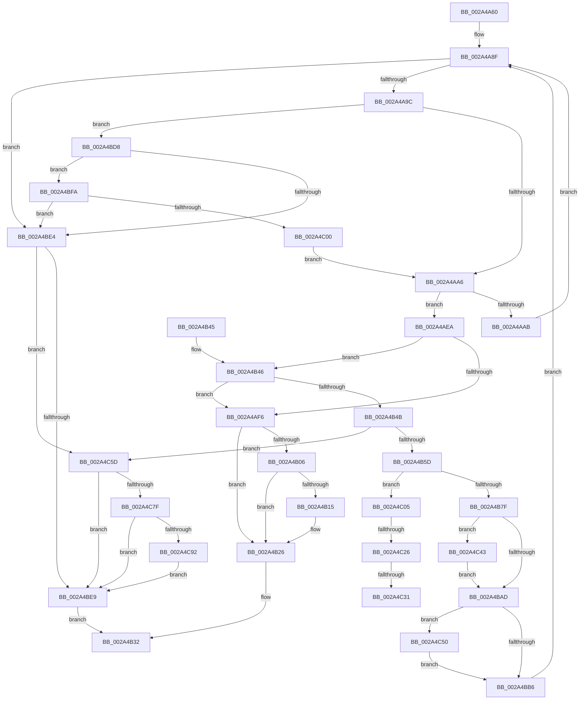

# CmpTryToRundownHive

- RVA: `0x002A4A60`–`0x002A4CA8` (길이 `584` bytes)
- VA: `0x00000001402A4A60`
- 실행 섹션: `.text`
- PDB 이름 있음: `예`; PDB Function 태그: `예`
- unwind 정보 RVA: `0x0006891C`
- 디코드: `141`개 명령, `584/584` bytes 표시
- 미해석 바이트: `0` (있으면 어셈블리에 `.byte`로 보존)

> 이 문서는 커널 이미지의 기계어와 PDB 기호를 분석해 생성했습니다. 4번과 5번은 함수 원형과 자료형을 바이너리 사용 방식에서 추정한 C 해석이며 원본 소스 복구 결과는 아닙니다.

## 1. Dependencies

- 직접 호출 지점: **26**; 고유 호출 대상: **18**
- 직접 호출자로 확인된 함수: **1**
- RIP 상대 이미지 참조: **2**

### Outgoing calls
- `0x002A4A8A` → [CmpInitializeRollbackPacket](../../page/A9/CmpInitializeRollbackPacket_function_00A973BC.md) (function, `0x00A973BC`)
- `0x002A4A8F` → [CmpIsHiveLoadUnloadRundownActive](../../pagecmrc/BC/CmpIsHiveLoadUnloadRundownActive_function_00BC9FE4.md) (function, `0x00BC9FE4`)
- `0x002A4AB0` → [CmpUnlockRegistry](../../pagecmrc/BC/CmpUnlockRegistry_function_00BC9A84.md) (function, `0x00BC9A84`)
- `0x002A4AB5` → [UNLOCK_HIVE_LOAD](../../page/9B/UNLOCK_HIVE_LOAD_function_009B2EBC.md) (function, `0x009B2EBC`)
- `0x002A4ACB` → [ExWaitForRundownProtectionRelease](ExWaitForRundownProtectionRelease_function_002A4CB0.md) (function, `0x002A4CB0`)
- `0x002A4ADB` → [LOCK_HIVE_LOAD](../../page/9B/LOCK_HIVE_LOAD_function_009B2300.md) (function, `0x009B2300`)
- `0x002A4AE3` → [CmpLockRegistryFreezeAware](../../page/9B/CmpLockRegistryFreezeAware_function_009B4AE4.md) (function, `0x009B4AE4`)
- `0x002A4B21` → [ExpUnblockPushLock](ExpUnblockPushLock_function_002A40FC.md) (function, `0x002A40FC`)
- `0x002A4B2B` → [CmpCleanupRollbackPacket](../../page/9B/CmpCleanupRollbackPacket_function_009B014C.md) (function, `0x009B014C`)
- `0x002A4B50` → [CmSnapshotRMTxArray](../../page/9A/CmSnapshotRMTxArray_function_009AEC9C.md) (function, `0x009AEC9C`)
- `0x002A4B6A` → [CmpLogTransactionAbortedForRollbackPacket](../../page/9A/CmpLogTransactionAbortedForRollbackPacket_function_009AE7F4.md) (function, `0x009AE7F4`)
- `0x002A4B6F` → [CmpUnlockRegistry](../../pagecmrc/BC/CmpUnlockRegistry_function_00BC9A84.md) (function, `0x00BC9A84`)
- `0x002A4B88` → [CmCloseRmHandle](../../page/70/CmCloseRmHandle_function_00702DD8.md) (function, `0x00702DD8`)
- `0x002A4B97` → [CmCloseTmHandle](../../page/70/CmCloseTmHandle_function_00702DFC.md) (function, `0x00702DFC`)
- `0x002A4B9F` → [UNLOCK_HIVE_LOAD](../../page/9B/UNLOCK_HIVE_LOAD_function_009B2EBC.md) (function, `0x009B2EBC`)
- `0x002A4BB6` → [LOCK_HIVE_LOAD](../../page/9B/LOCK_HIVE_LOAD_function_009B2300.md) (function, `0x009B2300`)
- `0x002A4BC4` → [CmShutdownCmRM](../../page/9B/CmShutdownCmRM_function_009B05E0.md) (function, `0x009B05E0`)
- `0x002A4BCB` → [CmpLockRegistryFreezeAware](../../page/9B/CmpLockRegistryFreezeAware_function_009B4AE4.md) (function, `0x009B4AE4`)
- `0x002A4BDB` → [CmpDoesKeyHaveOpenSubkeys](../../page/9B/CmpDoesKeyHaveOpenSubkeys_function_009B0274.md) (function, `0x009B0274`)
- `0x002A4BEE` → [CmpCleanupRollbackPacket](../../page/9B/CmpCleanupRollbackPacket_function_009B014C.md) (function, `0x009B014C`)
- `0x002A4C0A` → [UNLOCK_HIVE_LOAD](../../page/9B/UNLOCK_HIVE_LOAD_function_009B2EBC.md) (function, `0x009B2EBC`)
- `0x002A4C19` → [CmpAbortRollbackPacket](../../page/AB/CmpAbortRollbackPacket_function_00ABEA80.md) (function, `0x00ABEA80`)
- `0x002A4C38` → [CmObliterateRMTxArray](../../page/7E/CmObliterateRMTxArray_function_007EDF3C.md) (function, `0x007EDF3C`)
- `0x002A4C46` → [ZwClose](../6A/ZwClose_function_006AD2B0.md) (function, `0x006AD2B0`)
- `0x002A4C53` → [ZwClose](../6A/ZwClose_function_006AD2B0.md) (function, `0x006AD2B0`)
- `0x002A4C9E` → [ExpUnblockPushLock](ExpUnblockPushLock_function_002A40FC.md) (function, `0x002A40FC`)

### Direct callers
- [CmpLateUnloadHiveWorker](../../page/9B/CmpLateUnloadHiveWorker_function_009B20D0.md) at `0x009B21A7`

### Static image references
- `0x002A4ABA` → RVA `0x00EEFBD0` (`.data`; read/write)
- `0x002A4B0B` → RVA `0x00EF7B30` (`.data`; read)

## 2. Other-region calls and transfers

- 다른 실행 섹션으로 향하는 call: **21**
  - `0x002A4A8A` → [CmpInitializeRollbackPacket](../../page/A9/CmpInitializeRollbackPacket_function_00A973BC.md) (`.text` → `PAGE`)
  - `0x002A4A8F` → [CmpIsHiveLoadUnloadRundownActive](../../pagecmrc/BC/CmpIsHiveLoadUnloadRundownActive_function_00BC9FE4.md) (`.text` → `PAGECMRC`)
  - `0x002A4AB0` → [CmpUnlockRegistry](../../pagecmrc/BC/CmpUnlockRegistry_function_00BC9A84.md) (`.text` → `PAGECMRC`)
  - `0x002A4AB5` → [UNLOCK_HIVE_LOAD](../../page/9B/UNLOCK_HIVE_LOAD_function_009B2EBC.md) (`.text` → `PAGE`)
  - `0x002A4ADB` → [LOCK_HIVE_LOAD](../../page/9B/LOCK_HIVE_LOAD_function_009B2300.md) (`.text` → `PAGE`)
  - `0x002A4AE3` → [CmpLockRegistryFreezeAware](../../page/9B/CmpLockRegistryFreezeAware_function_009B4AE4.md) (`.text` → `PAGE`)
  - `0x002A4B2B` → [CmpCleanupRollbackPacket](../../page/9B/CmpCleanupRollbackPacket_function_009B014C.md) (`.text` → `PAGE`)
  - `0x002A4B50` → [CmSnapshotRMTxArray](../../page/9A/CmSnapshotRMTxArray_function_009AEC9C.md) (`.text` → `PAGE`)
  - `0x002A4B6A` → [CmpLogTransactionAbortedForRollbackPacket](../../page/9A/CmpLogTransactionAbortedForRollbackPacket_function_009AE7F4.md) (`.text` → `PAGE`)
  - `0x002A4B6F` → [CmpUnlockRegistry](../../pagecmrc/BC/CmpUnlockRegistry_function_00BC9A84.md) (`.text` → `PAGECMRC`)
  - `0x002A4B88` → [CmCloseRmHandle](../../page/70/CmCloseRmHandle_function_00702DD8.md) (`.text` → `PAGE`)
  - `0x002A4B97` → [CmCloseTmHandle](../../page/70/CmCloseTmHandle_function_00702DFC.md) (`.text` → `PAGE`)
  - `0x002A4B9F` → [UNLOCK_HIVE_LOAD](../../page/9B/UNLOCK_HIVE_LOAD_function_009B2EBC.md) (`.text` → `PAGE`)
  - `0x002A4BB6` → [LOCK_HIVE_LOAD](../../page/9B/LOCK_HIVE_LOAD_function_009B2300.md) (`.text` → `PAGE`)
  - `0x002A4BC4` → [CmShutdownCmRM](../../page/9B/CmShutdownCmRM_function_009B05E0.md) (`.text` → `PAGE`)
  - `0x002A4BCB` → [CmpLockRegistryFreezeAware](../../page/9B/CmpLockRegistryFreezeAware_function_009B4AE4.md) (`.text` → `PAGE`)
  - `0x002A4BDB` → [CmpDoesKeyHaveOpenSubkeys](../../page/9B/CmpDoesKeyHaveOpenSubkeys_function_009B0274.md) (`.text` → `PAGE`)
  - `0x002A4BEE` → [CmpCleanupRollbackPacket](../../page/9B/CmpCleanupRollbackPacket_function_009B014C.md) (`.text` → `PAGE`)
  - `0x002A4C0A` → [UNLOCK_HIVE_LOAD](../../page/9B/UNLOCK_HIVE_LOAD_function_009B2EBC.md) (`.text` → `PAGE`)
  - `0x002A4C19` → [CmpAbortRollbackPacket](../../page/AB/CmpAbortRollbackPacket_function_00ABEA80.md) (`.text` → `PAGE`)
  - `0x002A4C38` → [CmObliterateRMTxArray](../../page/7E/CmObliterateRMTxArray_function_007EDF3C.md) (`.text` → `PAGE`)
- call이 아닌 외부 분기/꼬리 이동: **3**
  - `0x002A4C20` → [sub_006DAE8A + 0xC](../6D/Unknown_function_006DAE8A.md) (`tail-transfer`)
  - `0x002A4C2B` → [sub_006DAE8A](../6D/Unknown_function_006DAE8A.md) (`tail-transfer`)
  - `0x002A4C3E` → [sub_006DAE8A](../6D/Unknown_function_006DAE8A.md) (`tail-transfer`)

## 3. Assembly (complete function range)

```asm
002A4A60  48 8B C4                        mov rax, rsp
002A4A63  48 89 58 08                     mov qword ptr [rax + 8], rbx
002A4A67  48 89 68 10                     mov qword ptr [rax + 0x10], rbp
002A4A6B  56                              push rsi
002A4A6C  57                              push rdi
002A4A6D  41 56                           push r14
002A4A6F  48 83 EC 30                     sub rsp, 0x30
002A4A73  0F 57 C0                        xorps xmm0, xmm0
002A4A76  48 8B F1                        mov rsi, rcx
002A4A79  48 8D 48 D8                     lea rcx, [rax - 0x28]
002A4A7D  40 32 ED                        xor bpl, bpl
002A4A80  45 32 F6                        xor r14b, r14b
002A4A83  48 8B FA                        mov rdi, rdx
002A4A86  0F 11 40 D8                     movups xmmword ptr [rax - 0x28], xmm0
002A4A8A  E8 2D 29 7F 00                  call 0x140a973bc
002A4A8F  E8 50 55 92 00                  call 0x140bc9fe4
002A4A94  84 C0                           test al, al
002A4A96  0F 85 48 01 00 00               jne 0x1402a4be4
002A4A9C  48 83 3F 02                     cmp qword ptr [rdi], 2
002A4AA0  0F 85 32 01 00 00               jne 0x1402a4bd8
002A4AA6  40 84 ED                        test bpl, bpl
002A4AA9  75 3F                           jne 0x1402a4aea
002A4AAB  0F BA 6F 08 12                  bts dword ptr [rdi + 8], 0x12
002A4AB0  E8 CF 4F 92 00                  call 0x140bc9a84
002A4AB5  E8 02 E4 70 00                  call 0x1409b2ebc
002A4ABA  F0 FF 05 0F B1 C4 00            lock inc dword ptr [rip + 0xc4b10f]
002A4AC1  48 8D 9E 68 06 00 00            lea rbx, [rsi + 0x668]
002A4AC8  48 8B CB                        mov rcx, rbx
002A4ACB  E8 E0 01 00 00                  call 0x1402a4cb0
002A4AD0  B8 01 00 00 00                  mov eax, 1
002A4AD5  40 B5 01                        mov bpl, 1
002A4AD8  48 87 03                        xchg qword ptr [rbx], rax
002A4ADB  E8 20 D8 70 00                  call 0x1409b2300
002A4AE0  40 8A CD                        mov cl, bpl
002A4AE3  E8 FC FF 70 00                  call 0x1409b4ae4
002A4AE8  EB A5                           jmp 0x1402a4a8f
002A4AEA  48 8B 8E 38 10 00 00            mov rcx, qword ptr [rsi + 0x1038]
002A4AF1  48 85 C9                        test rcx, rcx
002A4AF4  75 50                           jne 0x1402a4b46
002A4AF6  83 C8 FF                        or eax, 0xffffffff
002A4AF9  F0 0F C1 05 CF B0 C4 00         lock xadd dword ptr [rip + 0xc4b0cf], eax
002A4B01  83 F8 01                        cmp eax, 1
002A4B04  75 20                           jne 0x1402a4b26
002A4B06  F0 83 0C 24 00                  lock or dword ptr [rsp], 0
002A4B0B  48 83 3D 1D 30 C5 00 00         cmp qword ptr [rip + 0xc5301d], 0
002A4B13  74 11                           je 0x1402a4b26
002A4B15  45 33 C0                        xor r8d, r8d
002A4B18  48 8D 0D 11 30 C5 00            lea rcx, [rip + 0xc53011]
002A4B1F  33 D2                           xor edx, edx
002A4B21  E8 D6 F5 FF FF                  call 0x1402a40fc
002A4B26  48 8D 4C 24 20                  lea rcx, [rsp + 0x20]
002A4B2B  E8 1C B6 70 00                  call 0x1409b014c
002A4B30  B0 01                           mov al, 1
002A4B32  48 8B 5C 24 50                  mov rbx, qword ptr [rsp + 0x50]
002A4B37  48 8B 6C 24 58                  mov rbp, qword ptr [rsp + 0x58]
002A4B3C  48 83 C4 30                     add rsp, 0x30
002A4B40  41 5E                           pop r14
002A4B42  5F                              pop rdi
002A4B43  5E                              pop rsi
002A4B44  C3                              ret
002A4B45  CC                              int3
002A4B46  45 84 F6                        test r14b, r14b
002A4B49  75 AB                           jne 0x1402a4af6
002A4B4B  48 8D 54 24 20                  lea rdx, [rsp + 0x20]
002A4B50  E8 47 A1 70 00                  call 0x1409aec9c
002A4B55  85 C0                           test eax, eax
002A4B57  0F 88 00 01 00 00               js 0x1402a4c5d
002A4B5D  4C 8D 44 24 20                  lea r8, [rsp + 0x20]
002A4B62  BA 0B 00 00 00                  mov edx, 0xb
002A4B67  48 8B CF                        mov rcx, rdi
002A4B6A  E8 85 9C 70 00                  call 0x1409ae7f4
002A4B6F  E8 10 4F 92 00                  call 0x140bc9a84
002A4B74  83 7C 24 20 00                  cmp dword ptr [rsp + 0x20], 0
002A4B79  0F 85 86 00 00 00               jne 0x1402a4c05
002A4B7F  48 8B 8E 38 10 00 00            mov rcx, qword ptr [rsi + 0x1038]
002A4B86  33 D2                           xor edx, edx
002A4B88  E8 4B E2 45 00                  call 0x140702dd8
002A4B8D  48 8B 8E 38 10 00 00            mov rcx, qword ptr [rsi + 0x1038]
002A4B94  4C 8B F0                        mov r14, rax
002A4B97  E8 60 E2 45 00                  call 0x140702dfc
002A4B9C  48 8B D8                        mov rbx, rax
002A4B9F  E8 18 E3 70 00                  call 0x1409b2ebc
002A4BA4  4D 85 F6                        test r14, r14
002A4BA7  0F 85 96 00 00 00               jne 0x1402a4c43
002A4BAD  48 85 DB                        test rbx, rbx
002A4BB0  0F 85 9A 00 00 00               jne 0x1402a4c50
002A4BB6  E8 45 D7 70 00                  call 0x1409b2300
002A4BBB  48 8B 8E 38 10 00 00            mov rcx, qword ptr [rsi + 0x1038]
002A4BC2  B2 01                           mov dl, 1
002A4BC4  E8 17 BA 70 00                  call 0x1409b05e0
002A4BC9  B1 01                           mov cl, 1
002A4BCB  E8 14 FF 70 00                  call 0x1409b4ae4
002A4BD0  41 B6 01                        mov r14b, 1
002A4BD3  E9 B7 FE FF FF                  jmp 0x1402a4a8f
002A4BD8  48 8B CF                        mov rcx, rdi
002A4BDB  E8 94 B6 70 00                  call 0x1409b0274
002A4BE0  84 C0                           test al, al
002A4BE2  74 16                           je 0x1402a4bfa
002A4BE4  40 84 ED                        test bpl, bpl
002A4BE7  75 74                           jne 0x1402a4c5d
002A4BE9  48 8D 4C 24 20                  lea rcx, [rsp + 0x20]
002A4BEE  E8 59 B5 70 00                  call 0x1409b014c
002A4BF3  32 C0                           xor al, al
002A4BF5  E9 38 FF FF FF                  jmp 0x1402a4b32
002A4BFA  48 83 3F 02                     cmp qword ptr [rdi], 2
002A4BFE  75 E4                           jne 0x1402a4be4
002A4C00  E9 A1 FE FF FF                  jmp 0x1402a4aa6
002A4C05  C6 44 24 60 00                  mov byte ptr [rsp + 0x60], 0
002A4C0A  E8 AD E2 70 00                  call 0x1409b2ebc
002A4C0F  48 8D 54 24 60                  lea rdx, [rsp + 0x60]
002A4C14  48 8D 4C 24 20                  lea rcx, [rsp + 0x20]
002A4C19  E8 62 9E 81 00                  call 0x140abea80
002A4C1E  85 C0                           test eax, eax
002A4C20  0F 88 70 62 43 00               js 0x1406dae96
002A4C26  80 7C 24 60 01                  cmp byte ptr [rsp + 0x60], 1
002A4C2B  0F 85 59 62 43 00               jne 0x1406dae8a
002A4C31  48 8B 8E 38 10 00 00            mov rcx, qword ptr [rsi + 0x1038]
002A4C38  E8 FF 92 54 00                  call 0x1407edf3c
002A4C3D  90                              nop
002A4C3E  E9 47 62 43 00                  jmp 0x1406dae8a
002A4C43  49 8B CE                        mov rcx, r14
002A4C46  E8 65 86 40 00                  call 0x1406ad2b0
002A4C4B  E9 5D FF FF FF                  jmp 0x1402a4bad
002A4C50  48 8B CB                        mov rcx, rbx
002A4C53  E8 58 86 40 00                  call 0x1406ad2b0
002A4C58  E9 59 FF FF FF                  jmp 0x1402a4bb6
002A4C5D  0F BA 77 08 12                  btr dword ptr [rdi + 8], 0x12
002A4C62  33 C0                           xor eax, eax
002A4C64  48 87 86 68 06 00 00            xchg qword ptr [rsi + 0x668], rax
002A4C6B  83 C8 FF                        or eax, 0xffffffff
002A4C6E  F0 0F C1 05 5A AF C4 00         lock xadd dword ptr [rip + 0xc4af5a], eax
002A4C76  83 F8 01                        cmp eax, 1
002A4C79  0F 85 6A FF FF FF               jne 0x1402a4be9
002A4C7F  F0 83 0C 24 00                  lock or dword ptr [rsp], 0
002A4C84  48 83 3D A4 2E C5 00 00         cmp qword ptr [rip + 0xc52ea4], 0
002A4C8C  0F 84 57 FF FF FF               je 0x1402a4be9
002A4C92  45 33 C0                        xor r8d, r8d
002A4C95  48 8D 0D 94 2E C5 00            lea rcx, [rip + 0xc52e94]
002A4C9C  33 D2                           xor edx, edx
002A4C9E  E8 59 F4 FF FF                  call 0x1402a40fc
002A4CA3  E9 41 FF FF FF                  jmp 0x1402a4be9
```

## 4. C-style interpretation (structured pseudocode)

```c
__int64 __fastcall CmpTryToRundownHive(__int64 a1, __int64 a2, int a3)
{
    __int64 result;
    __int64 v_r14;
    __int64 v_rbp;
    __int64 v_rsp;
    unsigned __int64 v_stack_m28;
    unsigned int v_stack_m48;
    unsigned int v_stack_p0;
    unsigned __int64 v_stack_p10;
    unsigned __int64 v_stack_p20;
    unsigned __int8 v_stack_p60;
    unsigned __int64 v_stack_p8;

    *(unsigned __int64 *)(v_rsp + 8) = v_rbx;
    *(unsigned __int64 *)(v_rsp + 16) = v_rbp;
    v_rsp = (v_rsp) - (48);
    v_rbp = 0;
    v_r14 = 0;
    *(unsigned __int64 *)(v_rsp - 40) = v_xmm0;
    result = CmpInitializeRollbackPacket(v_rsp - 40, a2, a3, a4);
loc_002A4A8F:
    result = CmpIsHiveLoadUnloadRundownActive(v_rsp - 40, a2, a3, a4);
    if ((unsigned __int8)(result) != 0) goto loc_002A4BE4;
    if ((*(unsigned __int64 *)(a2)) != 2) goto loc_002A4BD8;
loc_002A4AA6:
    if (0 != 0) goto loc_002A4AEA;
    result = CmpUnlockRegistry(v_rsp - 40, a2, a3, a4);
    result = UNLOCK_HIVE_LOAD(v_rsp - 40, a2, a3, a4);
    result = ExWaitForRundownProtectionRelease(a1 + 1640, a2, a3, a4);
    result = LOCK_HIVE_LOAD(a1 + 1640, a2, a3, a4);
    result = CmpLockRegistryFreezeAware(1, a2, a3, a4);
    goto loc_002A4A8F;
loc_002A4AEA:
    if (*(unsigned __int64 *)(a1 + 4152) != 0) goto loc_002A4B46;
loc_002A4AF6:
    result = (unsigned int)((result) | (0xFFFFFFFFULL));
    if (((unsigned int)(result)) != 1) goto loc_002A4B26;
    if ((*(unsigned __int64 *)(v_rip + 12922909)) != 0) {
        a3 = 0;
        a1 = v_rip + 12922897;
        a2 = 0;
        result = ExpUnblockPushLock(a1, a2, a3, a4);
    }
    result = CmpCleanupRollbackPacket(v_stack_m28, a2, a3, a4);
loc_002A4B32:
    v_rsp = (v_rsp) + (48);
    return 1;
loc_002A4B46:
    if (0 != 0) goto loc_002A4AF6;
    result = CmSnapshotRMTxArray(v_stack_m28, v_stack_p20, a3, a4);
    if (sign_flag) goto loc_002A4C5D;
    result = CmpLogTransactionAbortedForRollbackPacket(0, 11, v_stack_p20, a4);
    result = CmpUnlockRegistry(0, 11, v_stack_p20, a4);
    if (v_stack_p20 != 0) goto loc_002A4C05;
    a2 = 0;
    result = CmCloseRmHandle(*(unsigned __int64 *)(a1 + 4152), a2, v_stack_p20, a4);
    result = CmCloseTmHandle(*(unsigned __int64 *)(a1 + 4152), a2, v_stack_p20, a4);
    result = UNLOCK_HIVE_LOAD(*(unsigned __int64 *)(a1 + 4152), a2, v_stack_p20, a4);
    if (result != 0) goto loc_002A4C43;
loc_002A4BAD:
    if (result != 0) goto loc_002A4C50;
loc_002A4BB6:
    result = LOCK_HIVE_LOAD(*(unsigned __int64 *)(a1 + 4152), a2, v_stack_p20, a4);
    result = CmShutdownCmRM(*(unsigned __int64 *)(a1 + 4152), 1, v_stack_p20, a4);
    result = CmpLockRegistryFreezeAware(1, 1, v_stack_p20, a4);
    goto loc_002A4A8F;
loc_002A4BD8:
    result = CmpDoesKeyHaveOpenSubkeys(0, 1, v_stack_p20, a4);
    if ((unsigned __int8)(result) == 0) goto loc_002A4BFA;
loc_002A4BE4:
    if ((unsigned __int8)(v_stack_p10) != 0) goto loc_002A4C5D;
loc_002A4BE9:
    result = CmpCleanupRollbackPacket(v_stack_p20, 1, v_stack_p20, a4);
    result = 0;
    goto loc_002A4B32;
loc_002A4BFA:
    if ((*(unsigned __int64 *)(a2)) != 2) goto loc_002A4BE4;
    goto loc_002A4AA6;
loc_002A4C05:
    v_stack_p60 = 0;
    result = UNLOCK_HIVE_LOAD(v_stack_p20, 1, v_stack_p20, a4);
    result = CmpAbortRollbackPacket(v_stack_p20, v_stack_p60, v_stack_p20, a4);
    result = CmObliterateRMTxArray(*(unsigned __int64 *)(a1 + 4152), v_stack_p60, v_stack_p20, a4);
loc_002A4C43:
    result = ZwClose(1, v_stack_p60, v_stack_p20, a4);
    goto loc_002A4BAD;
loc_002A4C50:
    result = ZwClose(result, v_stack_p60, v_stack_p20, a4);
    goto loc_002A4BB6;
loc_002A4C5D:
    result = 0;
    result = (unsigned int)((result) | (0xFFFFFFFFULL));
    if (((unsigned int)(result)) != 1) goto loc_002A4BE9;
    if ((*(unsigned __int64 *)(v_rip + 12922532)) == 0) goto loc_002A4BE9;
    a3 = 0;
    a2 = 0;
    result = ExpUnblockPushLock(v_rip + 12922516, a2, a3, a4);
    goto loc_002A4BE9;
}
```

## 5. (Beta) C Style

```c
int64_t CmpTryToRundownHive(void *Arg1, void *Arg2, int32_t Arg3)
{
    uint8_t *arg1 = (uint8_t *)Arg1;
    uint8_t *arg2 = (uint8_t *)Arg2;

    int64_t result;
    int64_t local_r14;
    int64_t local_rbp;
    int64_t local_rsp;
    uint64_t v_stack_m28;
    uint32_t v_stack_m48;
    uint32_t v_stack_p0;
    uint64_t v_stack_p10;
    uint64_t v_stack_p20;
    uint8_t v_stack_p60;
    uint64_t v_stack_p8;

    *(uint64_t *)(local_rsp + 0x8) = local_rbx;
    *(uint64_t *)(local_rsp + 0x10) = local_rbp;
    local_rsp = (local_rsp) - (48);
    local_rbp = 0;
    local_r14 = 0;
    *(uint64_t *)(local_rsp - 0x28) = v_xmm0;
    result = CmpInitializeRollbackPacket(local_rsp - 40, Arg2, Arg3, a4);
loc_002A4A8F:
    result = CmpIsHiveLoadUnloadRundownActive(local_rsp - 40, Arg2, Arg3, a4);
    if ((uint8_t)(result) != 0) goto loc_002A4BE4;
    if ((*(uint64_t *)(arg2)) != 2) goto loc_002A4BD8;
loc_002A4AA6:
    if (0 != 0) goto loc_002A4AEA;
    result = CmpUnlockRegistry(local_rsp - 40, Arg2, Arg3, a4);
    result = UNLOCK_HIVE_LOAD(local_rsp - 40, Arg2, Arg3, a4);
    result = ExWaitForRundownProtectionRelease(Arg1 + 1640, Arg2, Arg3, a4);
    result = LOCK_HIVE_LOAD(Arg1 + 1640, Arg2, Arg3, a4);
    result = CmpLockRegistryFreezeAware(1, Arg2, Arg3, a4);
    goto loc_002A4A8F;
loc_002A4AEA:
    if (*(uint64_t *)(arg1 + 0x1038) != 0) goto loc_002A4B46;
loc_002A4AF6:
    result = (uint32_t)((result) | (0xFFFFFFFFULL));
    if (((uint32_t)(result)) != 1) goto loc_002A4B26;
    if ((*(uint64_t *)(v_rip + 0xC5301D)) != 0) {
        Arg3 = 0;
        Arg1 = v_rip + 12922897;
        Arg2 = 0;
        result = ExpUnblockPushLock(Arg1, Arg2, Arg3, a4);
    }
    result = CmpCleanupRollbackPacket(v_stack_m28, Arg2, Arg3, a4);
loc_002A4B32:
    local_rsp = (local_rsp) + (48);
    return 1;
loc_002A4B46:
    if (0 != 0) goto loc_002A4AF6;
    result = CmSnapshotRMTxArray(v_stack_m28, v_stack_p20, Arg3, a4);
    if (sign_flag) goto loc_002A4C5D;
    result = CmpLogTransactionAbortedForRollbackPacket(0, 11, v_stack_p20, a4);
    result = CmpUnlockRegistry(0, 11, v_stack_p20, a4);
    if (v_stack_p20 != 0) goto loc_002A4C05;
    Arg2 = 0;
    result = CmCloseRmHandle(*(uint64_t *)(arg1 + 0x1038), Arg2, v_stack_p20, a4);
    result = CmCloseTmHandle(*(uint64_t *)(arg1 + 0x1038), Arg2, v_stack_p20, a4);
    result = UNLOCK_HIVE_LOAD(*(uint64_t *)(arg1 + 0x1038), Arg2, v_stack_p20, a4);
    if (result != 0) goto loc_002A4C43;
loc_002A4BAD:
    if (result != 0) goto loc_002A4C50;
loc_002A4BB6:
    result = LOCK_HIVE_LOAD(*(uint64_t *)(arg1 + 0x1038), Arg2, v_stack_p20, a4);
    result = CmShutdownCmRM(*(uint64_t *)(arg1 + 0x1038), 1, v_stack_p20, a4);
    result = CmpLockRegistryFreezeAware(1, 1, v_stack_p20, a4);
    goto loc_002A4A8F;
loc_002A4BD8:
    result = CmpDoesKeyHaveOpenSubkeys(0, 1, v_stack_p20, a4);
    if ((uint8_t)(result) == 0) goto loc_002A4BFA;
loc_002A4BE4:
    if ((uint8_t)(v_stack_p10) != 0) goto loc_002A4C5D;
loc_002A4BE9:
    result = CmpCleanupRollbackPacket(v_stack_p20, 1, v_stack_p20, a4);
    result = 0;
    goto loc_002A4B32;
loc_002A4BFA:
    if ((*(uint64_t *)(arg2)) != 2) goto loc_002A4BE4;
    goto loc_002A4AA6;
loc_002A4C05:
    v_stack_p60 = 0;
    result = UNLOCK_HIVE_LOAD(v_stack_p20, 1, v_stack_p20, a4);
    result = CmpAbortRollbackPacket(v_stack_p20, v_stack_p60, v_stack_p20, a4);
    result = CmObliterateRMTxArray(*(uint64_t *)(arg1 + 0x1038), v_stack_p60, v_stack_p20, a4);
loc_002A4C43:
    result = ZwClose(1, v_stack_p60, v_stack_p20, a4);
    goto loc_002A4BAD;
loc_002A4C50:
    result = ZwClose(result, v_stack_p60, v_stack_p20, a4);
    goto loc_002A4BB6;
loc_002A4C5D:
    result = 0;
    result = (uint32_t)((result) | (0xFFFFFFFFULL));
    if (((uint32_t)(result)) != 1) goto loc_002A4BE9;
    if ((*(uint64_t *)(v_rip + 0xC52EA4)) == 0) goto loc_002A4BE9;
    Arg3 = 0;
    Arg2 = 0;
    result = ExpUnblockPushLock(v_rip + 12922516, Arg2, Arg3, a4);
    goto loc_002A4BE9;
}
```

### 관측된 메모리 오프셋

구조체 형식이 확인되지 않은 접근은 인자 기준의 오프셋으로만 기록했습니다.

| 기준 인자 | 오프셋 표현 | 폭 (bit) | 접근 |
|---|---:|---:|---|
| `Arg1` | `+ 0x0` | `64` | `R/W` |
| `Arg1` | `+ 0x668` | `64` | `R` |
| `Arg1` | `+ 0x668` | `64` | `R/W` |
| `Arg1` | `+ 0x1038` | `64` | `R` |
| `Arg2` | `+ 0x0` | `64` | `R` |
| `Arg2` | `+ 0x8` | `32` | `R/W` |

## 6. Execution-region graph

[열기: 2D/3D 그래프와 함수 탐색 컨트롤 패널](../../../control-panel.html?section=text&rva=0x002A4A60&view=graph)

- 2D 그래프는 위에서 아래로 흐르고, 3D 그래프는 빈 공간을 드래그해 회전합니다. Shift+드래그는 이동, 휠은 확대·축소, 함수 노드 선택은 대상 보고서 이동입니다.

### Static fallback


