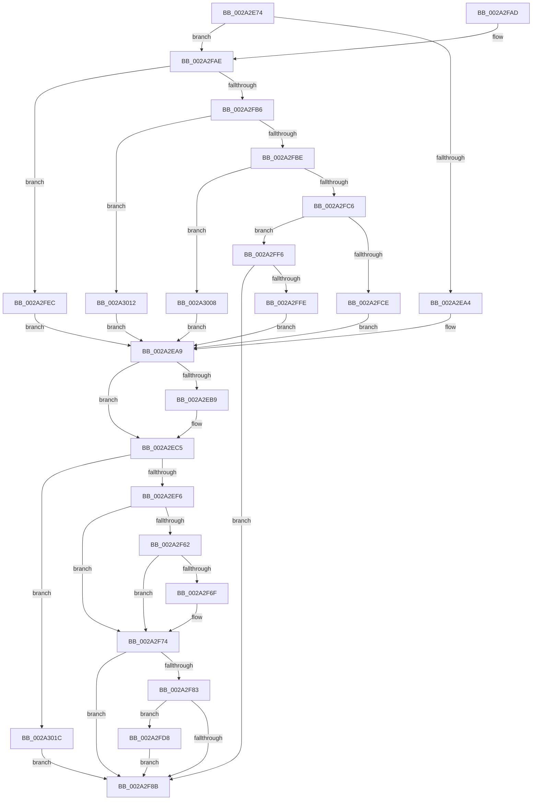

# EtwTracePageFault

- RVA: `0x002A2E74`–`0x002A304C` (길이 `472` bytes)
- VA: `0x00000001402A2E74`
- 실행 섹션: `.text`
- PDB 이름 있음: `예`; PDB Function 태그: `아니요`
- unwind 정보 RVA: `0x00068698`
- 디코드: `109`개 명령, `472/472` bytes 표시
- 미해석 바이트: `0` (있으면 어셈블리에 `.byte`로 보존)

> 이 문서는 커널 이미지의 기계어와 PDB 기호를 분석해 생성했습니다. 4번과 5번은 함수 원형과 자료형을 바이너리 사용 방식에서 추정한 C 해석이며 원본 소스 복구 결과는 아닙니다.

## 1. Dependencies

- 직접 호출 지점: **7**; 고유 호출 대상: **5**
- 직접 호출자로 확인된 함수: **1**
- RIP 상대 이미지 참조: **2**

### Outgoing calls
- `0x002A2F25` → [PsGetThreadServerSilo](../22/PsGetThreadServerSilo_function_002247B0.md) (function, `0x002247B0`)
- `0x002A2F44` → [EtwTraceSiloKernelEvent](../22/EtwTraceSiloKernelEvent_function_002242A0.md) (function, `0x002242A0`)
- `0x002A2F6F` → [KiCheckForKernelApcDelivery](../2E/KiCheckForKernelApcDelivery_function_002E2C80.md) (function, `0x002E2C80`)
- `0x002A2F93` → [_security_check_cookie](../6A/_security_check_cookie_function_006AC640.md) (function, `0x006AC640`)
- `0x002A2FE5` → [EtwpCoverageSamplerPageFault](../4F/EtwpCoverageSamplerPageFault_function_004FBEF0.md) (function, `0x004FBEF0`)
- `0x002A301C` → [PsGetThreadServerSilo](../22/PsGetThreadServerSilo_function_002247B0.md) (function, `0x002247B0`)
- `0x002A3042` → [EtwTraceSiloKernelEvent](../22/EtwTraceSiloKernelEvent_function_002242A0.md) (function, `0x002242A0`)

### Direct callers
- [MiConvertFaultStatus](MiConvertFaultStatus_function_002A2CC0.md) at `0x002A2D2D`

### Static image references
- `0x002A2E86` → RVA `0x00E0A740` (`.data`; read)
- `0x002A2F74` → RVA `0x00FC6AA8` (`ALMOSTRO`; read)

## 2. Other-region calls and transfers

- 다른 실행 섹션으로 향하는 call: **0**
- 별도 외부 분기/꼬리 이동을 확인하지 못했습니다.

## 3. Assembly (complete function range)

```asm
002A2E74  48 89 5C 24 08                  mov qword ptr [rsp + 8], rbx
002A2E79  48 89 6C 24 18                  mov qword ptr [rsp + 0x18], rbp
002A2E7E  56                              push rsi
002A2E7F  57                              push rdi
002A2E80  41 56                           push r14
002A2E82  48 83 EC 60                     sub rsp, 0x60
002A2E86  48 8B 05 B3 78 B6 00            mov rax, qword ptr [rip + 0xb678b3]
002A2E8D  48 33 C4                        xor rax, rsp
002A2E90  48 89 44 24 50                  mov qword ptr [rsp + 0x50], rax
002A2E95  45 8A F0                        mov r14b, r8b
002A2E98  81 F9 11 01 00 00               cmp ecx, 0x111
002A2E9E  0F 85 0A 01 00 00               jne 0x1402a2fae
002A2EA4  BF 0B 02 00 00                  mov edi, 0x20b
002A2EA9  48 83 64 24 38 00               and qword ptr [rsp + 0x38], 0
002A2EAF  48 89 54 24 30                  mov qword ptr [rsp + 0x30], rdx
002A2EB4  4D 85 C9                        test r9, r9
002A2EB7  74 0C                           je 0x1402a2ec5
002A2EB9  49 8B 81 68 01 00 00            mov rax, qword ptr [r9 + 0x168]
002A2EC0  48 89 44 24 38                  mov qword ptr [rsp + 0x38], rax
002A2EC5  83 64 24 4C 00                  and dword ptr [rsp + 0x4c], 0
002A2ECA  48 8D 44 24 30                  lea rax, [rsp + 0x30]
002A2ECF  48 89 44 24 40                  mov qword ptr [rsp + 0x40], rax
002A2ED4  C7 44 24 48 10 00 00 00         mov dword ptr [rsp + 0x48], 0x10
002A2EDC  65 48 8B 34 25 88 01 00 00      mov rsi, qword ptr gs:[0x188]
002A2EE5  48 8B CE                        mov rcx, rsi
002A2EE8  8B 86 A8 05 00 00               mov eax, dword ptr [rsi + 0x5a8]
002A2EEE  A8 10                           test al, 0x10
002A2EF0  0F 85 26 01 00 00               jne 0x1402a301c
002A2EF6  BD 01 00 00 00                  mov ebp, 1
002A2EFB  66 29 AE E6 01 00 00            sub word ptr [rsi + 0x1e6], bp
002A2F02  90                              nop
002A2F03  8B 86 A8 05 00 00               mov eax, dword ptr [rsi + 0x5a8]
002A2F09  83 C8 10                        or eax, 0x10
002A2F0C  89 86 A8 05 00 00               mov dword ptr [rsi + 0x5a8], eax
002A2F12  41 8A C6                        mov al, r14b
002A2F15  F6 D8                           neg al
002A2F17  1B DB                           sbb ebx, ebx
002A2F19  81 E3 00 F8 FF FE               and ebx, 0xfefff800
002A2F1F  81 C3 02 19 00 03               add ebx, 0x3001902
002A2F25  E8 86 18 F8 FF                  call 0x1402247b0
002A2F2A  48 8B C8                        mov rcx, rax
002A2F2D  89 5C 24 28                     mov dword ptr [rsp + 0x28], ebx
002A2F31  41 B9 00 10 00 00               mov r9d, 0x1000
002A2F37  66 89 7C 24 20                  mov word ptr [rsp + 0x20], di
002A2F3C  44 8B C5                        mov r8d, ebp
002A2F3F  48 8D 54 24 40                  lea rdx, [rsp + 0x40]
002A2F44  E8 57 13 F8 FF                  call 0x1402242a0
002A2F49  8B 86 A8 05 00 00               mov eax, dword ptr [rsi + 0x5a8]
002A2F4F  83 E0 EF                        and eax, 0xffffffef
002A2F52  89 86 A8 05 00 00               mov dword ptr [rsi + 0x5a8], eax
002A2F58  90                              nop
002A2F59  66 01 AE E6 01 00 00            add word ptr [rsi + 0x1e6], bp
002A2F60  75 12                           jne 0x1402a2f74
002A2F62  48 8D 86 98 00 00 00            lea rax, [rsi + 0x98]
002A2F69  90                              nop
002A2F6A  48 39 00                        cmp qword ptr [rax], rax
002A2F6D  74 05                           je 0x1402a2f74
002A2F6F  E8 0C FD 03 00                  call 0x1402e2c80
002A2F74  48 8B 05 2D 3B D2 00            mov rax, qword ptr [rip + 0xd23b2d]
002A2F7B  48 05 EC 12 00 00               add rax, 0x12ec
002A2F81  74 08                           je 0x1402a2f8b
002A2F83  F7 00 00 10 00 00               test dword ptr [rax], 0x1000
002A2F89  75 4D                           jne 0x1402a2fd8
002A2F8B  48 8B 4C 24 50                  mov rcx, qword ptr [rsp + 0x50]
002A2F90  48 33 CC                        xor rcx, rsp
002A2F93  E8 A8 96 40 00                  call 0x1406ac640
002A2F98  4C 8D 5C 24 60                  lea r11, [rsp + 0x60]
002A2F9D  49 8B 5B 20                     mov rbx, qword ptr [r11 + 0x20]
002A2FA1  49 8B 6B 30                     mov rbp, qword ptr [r11 + 0x30]
002A2FA5  49 8B E3                        mov rsp, r11
002A2FA8  41 5E                           pop r14
002A2FAA  5F                              pop rdi
002A2FAB  5E                              pop rsi
002A2FAC  C3                              ret
002A2FAD  CC                              int3
002A2FAE  81 F9 10 01 00 00               cmp ecx, 0x110
002A2FB4  74 36                           je 0x1402a2fec
002A2FB6  81 F9 12 01 00 00               cmp ecx, 0x112
002A2FBC  74 54                           je 0x1402a3012
002A2FBE  81 F9 14 01 00 00               cmp ecx, 0x114
002A2FC4  74 42                           je 0x1402a3008
002A2FC6  81 F9 13 01 00 00               cmp ecx, 0x113
002A2FCC  75 28                           jne 0x1402a2ff6
002A2FCE  BF 0D 02 00 00                  mov edi, 0x20d
002A2FD3  E9 D1 FE FF FF                  jmp 0x1402a2ea9
002A2FD8  48 8B 54 24 30                  mov rdx, qword ptr [rsp + 0x30]
002A2FDD  45 8A C6                        mov r8b, r14b
002A2FE0  48 8B 4C 24 38                  mov rcx, qword ptr [rsp + 0x38]
002A2FE5  E8 06 8F 25 00                  call 0x1404fbef0
002A2FEA  EB 9F                           jmp 0x1402a2f8b
002A2FEC  BF 0A 02 00 00                  mov edi, 0x20a
002A2FF1  E9 B3 FE FF FF                  jmp 0x1402a2ea9
002A2FF6  81 F9 05 00 00 C0               cmp ecx, 0xc0000005
002A2FFC  75 8D                           jne 0x1402a2f8b
002A2FFE  BF 0F 02 00 00                  mov edi, 0x20f
002A3003  E9 A1 FE FF FF                  jmp 0x1402a2ea9
002A3008  BF 0E 02 00 00                  mov edi, 0x20e
002A300D  E9 97 FE FF FF                  jmp 0x1402a2ea9
002A3012  BF 0C 02 00 00                  mov edi, 0x20c
002A3017  E9 8D FE FF FF                  jmp 0x1402a2ea9
002A301C  E8 8F 17 F8 FF                  call 0x1402247b0
002A3021  48 8B C8                        mov rcx, rax
002A3024  C7 44 24 28 02 01 00 02         mov dword ptr [rsp + 0x28], 0x2000102
002A302C  41 B9 00 10 00 00               mov r9d, 0x1000
002A3032  66 89 7C 24 20                  mov word ptr [rsp + 0x20], di
002A3037  41 B8 01 00 00 00               mov r8d, 1
002A303D  48 8D 54 24 40                  lea rdx, [rsp + 0x40]
002A3042  E8 59 12 F8 FF                  call 0x1402242a0
002A3047  E9 3F FF FF FF                  jmp 0x1402a2f8b
```

## 4. C-style interpretation (structured pseudocode)

```c
__int64 __fastcall EtwTracePageFault(int a1, __int64 a2, unsigned __int8 a3, __int64 a4)
{
    __int64 result;
    __int64 v_rbx;
    __int64 v_rsp;
    unsigned __int64 v_stack_m18;
    unsigned __int64 v_stack_m20;
    unsigned __int64 v_stack_m28;
    unsigned int v_stack_m2C;
    unsigned int v_stack_m30;
    unsigned __int64 v_stack_m38;
    unsigned __int64 v_stack_m40;
    unsigned __int64 v_stack_m48;
    unsigned int v_stack_m50;
    unsigned __int16 v_stack_m58;
    unsigned __int64 v_stack_p18;
    unsigned __int64 v_stack_p8;

    v_stack_p8 = v_rbx;
    v_stack_p18 = v_rbp;
    v_rsp = (v_rsp) - (96);
    result = (*(unsigned __int64 *)(v_rip + 11958451)) ^ (v_rsp);
    v_stack_m28 = result;
    if (a1 != 273) goto loc_002A2FAE;
loc_002A2EA9:
    v_stack_m48 = a2;
    if (a4 != 0) {
        result = *(unsigned __int64 *)(a4 + 360);
        v_stack_m40 = result;
    }
    v_stack_m38 = v_stack_m48;
    v_stack_m30 = 16;
    if ((((unsigned __int8)((unsigned int)(*(unsigned int *)(*(unsigned __int64 *)(gs_base + (0 + 392)) + 1448)))) & (16)) != 0) goto loc_002A301C;
    result = (unsigned int)(((unsigned int)(*(unsigned int *)(*(unsigned __int64 *)(gs_base + (0 + 392)) + 1448))) | (16));
    *(unsigned int *)(*(unsigned __int64 *)(gs_base + (0 + 392)) + 1448) = (unsigned int)(result);
    result = (unsigned __int8)(-(a3));
    v_rbx = (unsigned int)((v_rbx) & (0xFEFFF800ULL));
    v_rbx = (unsigned int)((v_rbx) + (0x3001902ULL));
    result = PsGetThreadServerSilo(*(unsigned __int64 *)(gs_base + (0 + 392)), a2, a3, a4);
    v_stack_m50 = (unsigned int)(v_rbx);
    v_stack_m58 = 523;
    result = EtwTraceSiloKernelEvent(result, v_stack_m38, 1, (unsigned int)(0x1000ULL));
    result = (unsigned int)(((unsigned int)(*(unsigned int *)(*(unsigned __int64 *)(gs_base + (0 + 392)) + 1448))) & (0xFFFFFFEFULL));
    *(unsigned int *)(*(unsigned __int64 *)(gs_base + (0 + 392)) + 1448) = (unsigned int)(result);
    if (condition_is_not_equal) goto loc_002A2F74;
    result = *(unsigned __int64 *)(gs_base + (0 + 392)) + 152;
    if ((*(unsigned __int64 *)(*(unsigned __int64 *)(gs_base + (0 + 392)) + 152)) != (*(unsigned __int64 *)(gs_base + (0 + 392)) + 152)) {
        result = KiCheckForKernelApcDelivery(result, v_stack_m38, 1, (unsigned int)(0x1000ULL));
    }
    result = (*(unsigned __int64 *)(v_rip + 13777709)) + (0x12ECULL);
    if (condition_is_equal) goto loc_002A2F8B;
    if (((*(unsigned int *)(result)) & (0x1000ULL)) != 0) goto loc_002A2FD8;
loc_002A2F8B:
    a1 = (v_stack_m28) ^ (v_rsp);
    result = _security_check_cookie(a1, v_stack_m38, 1, (unsigned int)(0x1000ULL));
    return result;
loc_002A2FAE:
    if (a1 == 272) goto loc_002A2FEC;
    if (a1 == 274) goto loc_002A3012;
    if (a1 == 276) goto loc_002A3008;
    if (a1 != 275) goto loc_002A2FF6;
    goto loc_002A2EA9;
loc_002A2FD8:
    result = EtwpCoverageSamplerPageFault(v_stack_m28, v_stack_m30, a3, (unsigned int)(0x1000ULL));
    goto loc_002A2F8B;
loc_002A2FEC:
    goto loc_002A2EA9;
loc_002A2FF6:
    if (((unsigned int)(v_stack_m28)) != 0xC0000005ULL) goto loc_002A2F8B;
    goto loc_002A2EA9;
loc_002A3008:
    goto loc_002A2EA9;
loc_002A3012:
    goto loc_002A2EA9;
loc_002A301C:
    result = PsGetThreadServerSilo(v_stack_m28, v_stack_m30, a3, (unsigned int)(0x1000ULL));
    v_stack_m38 = 0x2000102ULL;
    v_stack_m40 = 524;
    result = EtwTraceSiloKernelEvent(result, v_stack_m20, 1, (unsigned int)(0x1000ULL));
    goto loc_002A2F8B;
}
```

## 5. (Beta) C Style

```c
int64_t EtwTracePageFault(int32_t Arg1, int64_t Arg2, uint8_t Arg3, int64_t Arg4)
{
    int64_t result;
    int64_t local_rbx;
    int64_t local_rsp;
    uint64_t v_stack_m18;
    uint64_t v_stack_m20;
    uint64_t v_stack_m28;
    uint32_t v_stack_m2C;
    uint32_t v_stack_m30;
    uint64_t v_stack_m38;
    uint64_t v_stack_m40;
    uint64_t v_stack_m48;
    uint32_t v_stack_m50;
    uint16_t v_stack_m58;
    uint64_t v_stack_p18;
    uint64_t v_stack_p8;

    v_stack_p8 = local_rbx;
    v_stack_p18 = local_rbp;
    local_rsp = (local_rsp) - (96);
    result = (*(uint64_t *)(v_rip + 0xB678B3)) ^ (local_rsp);
    v_stack_m28 = result;
    if (Arg1 != 273) goto loc_002A2FAE;
loc_002A2EA9:
    v_stack_m48 = Arg2;
    if (Arg4 != 0) {
        result = *(uint64_t *)(Arg4 + 0x168);
        v_stack_m40 = result;
    }
    v_stack_m38 = v_stack_m48;
    v_stack_m30 = 16;
    if ((((uint8_t)((uint32_t)(*(uint32_t *)(*(uint64_t *)(gs_base + (0 + 0x188)) + 0x5A8)))) & (16)) != 0) goto loc_002A301C;
    result = (uint32_t)(((uint32_t)(*(uint32_t *)(*(uint64_t *)(gs_base + (0 + 0x188)) + 0x5A8))) | (16));
    *(uint32_t *)(*(uint64_t *)(gs_base + (0 + 0x188)) + 0x5A8) = (uint32_t)(result);
    result = (uint8_t)(-(Arg3));
    local_rbx = (uint32_t)((local_rbx) & (0xFEFFF800ULL));
    local_rbx = (uint32_t)((local_rbx) + (0x3001902ULL));
    result = PsGetThreadServerSilo(*(uint64_t *)(gs_base + (0 + 0x188)), Arg2, Arg3, Arg4);
    v_stack_m50 = (uint32_t)(local_rbx);
    v_stack_m58 = 523;
    result = EtwTraceSiloKernelEvent(result, v_stack_m38, 1, (uint32_t)(0x1000ULL));
    result = (uint32_t)(((uint32_t)(*(uint32_t *)(*(uint64_t *)(gs_base + (0 + 0x188)) + 0x5A8))) & (0xFFFFFFEFULL));
    *(uint32_t *)(*(uint64_t *)(gs_base + (0 + 0x188)) + 0x5A8) = (uint32_t)(result);
    if (condition_is_not_equal) goto loc_002A2F74;
    result = *(uint64_t *)(gs_base + (0 + 0x188)) + 152;
    if ((*(uint64_t *)(*(uint64_t *)(gs_base + (0 + 0x188)) + 0x98)) != (*(uint64_t *)(gs_base + (0 + 0x188)) + 152)) {
        result = KiCheckForKernelApcDelivery(result, v_stack_m38, 1, (uint32_t)(0x1000ULL));
    }
    result = (*(uint64_t *)(v_rip + 0xD23B2D)) + (0x12ECULL);
    if (condition_is_equal) goto loc_002A2F8B;
    if (((*(uint32_t *)(result)) & (0x1000ULL)) != 0) goto loc_002A2FD8;
loc_002A2F8B:
    Arg1 = (v_stack_m28) ^ (local_rsp);
    result = _security_check_cookie(Arg1, v_stack_m38, 1, (uint32_t)(0x1000ULL));
    return result;
loc_002A2FAE:
    if (Arg1 == 272) goto loc_002A2FEC;
    if (Arg1 == 274) goto loc_002A3012;
    if (Arg1 == 276) goto loc_002A3008;
    if (Arg1 != 275) goto loc_002A2FF6;
    goto loc_002A2EA9;
loc_002A2FD8:
    result = EtwpCoverageSamplerPageFault(v_stack_m28, v_stack_m30, Arg3, (uint32_t)(0x1000ULL));
    goto loc_002A2F8B;
loc_002A2FEC:
    goto loc_002A2EA9;
loc_002A2FF6:
    if (((uint32_t)(v_stack_m28)) != 0xC0000005ULL) goto loc_002A2F8B;
    goto loc_002A2EA9;
loc_002A3008:
    goto loc_002A2EA9;
loc_002A3012:
    goto loc_002A2EA9;
loc_002A301C:
    result = PsGetThreadServerSilo(v_stack_m28, v_stack_m30, Arg3, (uint32_t)(0x1000ULL));
    v_stack_m38 = 0x2000102ULL;
    v_stack_m40 = 524;
    result = EtwTraceSiloKernelEvent(result, v_stack_m20, 1, (uint32_t)(0x1000ULL));
    goto loc_002A2F8B;
}
```

## 6. Execution-region graph

[열기: 2D/3D 그래프와 함수 탐색 컨트롤 패널](../../../control-panel.html?section=text&rva=0x002A2E74&view=graph)

- 2D 그래프는 위에서 아래로 흐르고, 3D 그래프는 빈 공간을 드래그해 회전합니다. Shift+드래그는 이동, 휠은 확대·축소, 함수 노드 선택은 대상 보고서 이동입니다.

### Static fallback


