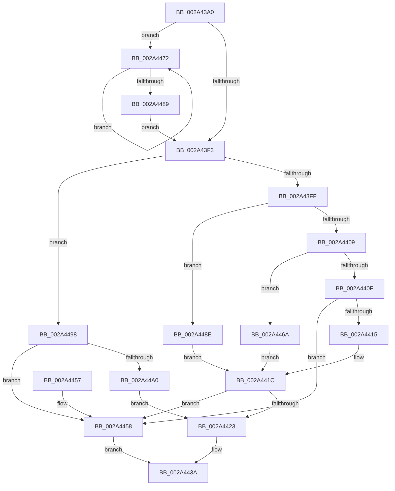

# ExBlockOnAddressPushLock

- RVA: `0x002A43A0`–`0x002A44A2` (길이 `258` bytes)
- VA: `0x00000001402A43A0`
- 실행 섹션: `.text`
- PDB 이름 있음: `예`; PDB Function 태그: `아니요`
- unwind 정보 RVA: `0x000688B4`
- 디코드: `73`개 명령, `258/258` bytes 표시
- 미해석 바이트: `0` (있으면 어셈블리에 `.byte`로 보존)

> 이 문서는 커널 이미지의 기계어와 PDB 기호를 분석해 생성했습니다. 4번과 5번은 함수 원형과 자료형을 바이너리 사용 방식에서 추정한 C 해석이며 원본 소스 복구 결과는 아닙니다.

## 1. Dependencies

- 직접 호출 지점: **3**; 고유 호출 대상: **3**
- 직접 호출자로 확인된 함수: **13**
- RIP 상대 이미지 참조: **0**

### Outgoing calls
- `0x002A43CF` → [memset](../6C/memset_function_006C6C40.md) (function, `0x006C6C40`)
- `0x002A4433` → [ExTimedWaitForUnblockPushLock](ExTimedWaitForUnblockPushLock_function_002A44B0.md) (function, `0x002A44B0`)
- `0x002A4463` → [ExpUnblockPushLock](ExpUnblockPushLock_function_002A40FC.md) (function, `0x002A40FC`)

### Direct callers
- [PsSetVmProcessorHostProcess](../../page/78/PsSetVmProcessorHostProcess_function_00783CEC.md) at `0x00783E19`
- [CmUnRegisterCallback](../../page/7E/CmUnRegisterCallback_function_007E1510.md) at `0x007E15CF`
- [CmUnRegisterCallback](../../page/7E/CmUnRegisterCallback_function_007E1510.md) at `0x007E179B`
- [CmFcManagerUnregisterFeatureUsageProvider](../../page/7F/CmFcManagerUnregisterFeatureUsageProvider_function_007F4ABC.md) at `0x007F4BB7`
- [ExpBlockOnLockedHandleEntry](../../page/86/ExpBlockOnLockedHandleEntry_function_00868838.md) at `0x00868856`
- [CmpTransSearchAddTrans](../../page/87/CmpTransSearchAddTrans_function_008743FC.md) at `0x008745AC`
- [CmLoadAppKey](../../page/87/CmLoadAppKey_function_00876FFC.md) at `0x00877AD0`
- [PopBatteryUpdateCurrentState](../../page/A3/PopBatteryUpdateCurrentState_function_00A35658.md) at `0x00A356B3`
- [MiLockImageSection](../../page/A4/MiLockImageSection_function_00A48D78.md) at `0x00A48E47`
- [CmFcManagerFlushFeatureUsage](../../page/AC/CmFcManagerFlushFeatureUsage_function_00AC1814.md) at `0x00AC18B7`
- [CmFcManagerFlushFeatureUsage](../../page/AC/CmFcManagerFlushFeatureUsage_function_00AC1814.md) at `0x00AC1942`
- [CmFcManagerFlushFeatureUsage](../../page/AC/CmFcManagerFlushFeatureUsage_function_00AC1814.md) at `0x00AC198D`
- [CmFcpManagerProcessUsageDataProviders](../../page/AF/CmFcpManagerProcessUsageDataProviders_function_00AF7B6C.md) at `0x00AF7CE9`
- [sub_00B179DA](../../page/B1/Unknown_function_00B179DA.md) at `0x00B17A8E`
- [sub_00B2DB58](../../page/B2/Unknown_function_00B2DB58.md) at `0x00B2DB70`
- [sub_00B3B096](../../page/B3/Unknown_function_00B3B096.md) at `0x00B3B13B`

### Static image references
- 디코드된 RIP-relative 메모리 참조가 없습니다.

## 2. Other-region calls and transfers

- 다른 실행 섹션으로 향하는 call: **0**
- 별도 외부 분기/꼬리 이동을 확인하지 못했습니다.

## 3. Assembly (complete function range)

```asm
002A43A0  48 8B C4                        mov rax, rsp
002A43A3  48 89 58 08                     mov qword ptr [rax + 8], rbx
002A43A7  48 89 68 10                     mov qword ptr [rax + 0x10], rbp
002A43AB  48 89 70 18                     mov qword ptr [rax + 0x18], rsi
002A43AF  48 89 78 20                     mov qword ptr [rax + 0x20], rdi
002A43B3  41 56                           push r14
002A43B5  48 83 EC 60                     sub rsp, 0x60
002A43B9  4C 8B F2                        mov r14, rdx
002A43BC  49 8B E8                        mov rbp, r8
002A43BF  33 D2                           xor edx, edx
002A43C1  48 8B F1                        mov rsi, rcx
002A43C4  48 8D 48 B8                     lea rcx, [rax - 0x48]
002A43C8  49 8B D9                        mov rbx, r9
002A43CB  44 8D 42 40                     lea r8d, [rdx + 0x40]
002A43CF  E8 6C 28 42 00                  call 0x1406c6c40
002A43D4  C7 44 24 54 02 00 00 00         mov dword ptr [rsp + 0x54], 2
002A43DC  0F 0D 0E                        prefetchw byte ptr [rsi]
002A43DF  48 8B 06                        mov rax, qword ptr [rsi]
002A43E2  48 8D 4C 24 20                  lea rcx, [rsp + 0x20]
002A43E7  48 89 44 24 38                  mov qword ptr [rsp + 0x38], rax
002A43EC  F0 48 0F B1 0E                  lock cmpxchg qword ptr [rsi], rcx
002A43F1  75 7F                           jne 0x1402a4472
002A43F3  33 FF                           xor edi, edi
002A43F5  48 83 EB 01                     sub rbx, 1
002A43F9  0F 84 99 00 00 00               je 0x1402a4498
002A43FF  48 83 EB 01                     sub rbx, 1
002A4403  0F 84 85 00 00 00               je 0x1402a448e
002A4409  48 83 EB 02                     sub rbx, 2
002A440D  74 5B                           je 0x1402a446a
002A440F  48 83 FB 04                     cmp rbx, 4
002A4413  75 43                           jne 0x1402a4458
002A4415  49 8B 06                        mov rax, qword ptr [r14]
002A4418  48 3B 45 00                     cmp rax, qword ptr [rbp]
002A441C  0F 94 C0                        sete al
002A441F  84 C0                           test al, al
002A4421  74 35                           je 0x1402a4458
002A4423  4C 8B 84 24 90 00 00 00         mov r8, qword ptr [rsp + 0x90]
002A442B  48 8D 54 24 20                  lea rdx, [rsp + 0x20]
002A4430  48 8B CE                        mov rcx, rsi
002A4433  E8 78 00 00 00                  call 0x1402a44b0
002A4438  8B F8                           mov edi, eax
002A443A  4C 8D 5C 24 60                  lea r11, [rsp + 0x60]
002A443F  8B C7                           mov eax, edi
002A4441  49 8B 5B 10                     mov rbx, qword ptr [r11 + 0x10]
002A4445  49 8B 6B 18                     mov rbp, qword ptr [r11 + 0x18]
002A4449  49 8B 73 20                     mov rsi, qword ptr [r11 + 0x20]
002A444D  49 8B 7B 28                     mov rdi, qword ptr [r11 + 0x28]
002A4451  49 8B E3                        mov rsp, r11
002A4454  41 5E                           pop r14
002A4456  C3                              ret
002A4457  CC                              int3
002A4458  45 33 C0                        xor r8d, r8d
002A445B  48 8D 54 24 20                  lea rdx, [rsp + 0x20]
002A4460  48 8B CE                        mov rcx, rsi
002A4463  E8 94 FC FF FF                  call 0x1402a40fc
002A4468  EB D0                           jmp 0x1402a443a
002A446A  41 8B 06                        mov eax, dword ptr [r14]
002A446D  3B 45 00                        cmp eax, dword ptr [rbp]
002A4470  EB AA                           jmp 0x1402a441c
002A4472  48 8B C8                        mov rcx, rax
002A4475  48 89 44 24 38                  mov qword ptr [rsp + 0x38], rax
002A447A  48 8D 54 24 20                  lea rdx, [rsp + 0x20]
002A447F  F0 48 0F B1 16                  lock cmpxchg qword ptr [rsi], rdx
002A4484  48 3B C1                        cmp rax, rcx
002A4487  75 E9                           jne 0x1402a4472
002A4489  E9 65 FF FF FF                  jmp 0x1402a43f3
002A448E  41 0F B7 06                     movzx eax, word ptr [r14]
002A4492  66 3B 45 00                     cmp ax, word ptr [rbp]
002A4496  EB 84                           jmp 0x1402a441c
002A4498  41 8A 06                        mov al, byte ptr [r14]
002A449B  3A 45 00                        cmp al, byte ptr [rbp]
002A449E  75 B8                           jne 0x1402a4458
002A44A0  EB 81                           jmp 0x1402a4423
```

## 4. C-style interpretation (structured pseudocode)

```c
__int64 __fastcall ExBlockOnAddressPushLock(__int64 a1, __int64 a2, __int64 a3, __int64 a4, __int64 a5)
{
    __int64 result;
    __int64 v_rbx;
    __int64 v_rdi;
    __int64 v_rsp;
    unsigned int v_stack_m14;
    unsigned __int64 v_stack_m28;
    unsigned __int64 v_stack_m30;
    unsigned __int64 v_stack_m40;
    unsigned __int64 v_stack_m48;
    unsigned __int64 v_stack_m8;

    *(unsigned __int64 *)(v_rsp + 8) = v_rbx;
    *(unsigned __int64 *)(v_rsp + 16) = v_rbp;
    *(unsigned __int64 *)(v_rsp + 24) = v_rsi;
    *(unsigned __int64 *)(v_rsp + 32) = v_rdi;
    v_rsp = (v_rsp) - (96);
    a2 = 0;
    result = memset(v_rsp - 72, a2, a2 + 64, a4);
    v_stack_m14 = 2;
    v_stack_m30 = *(unsigned __int64 *)(a1);
    if (condition_is_not_equal) goto loc_002A4472;
loc_002A43F3:
    v_rdi = 0;
    v_rbx = (a4) - (1);
    if (condition_is_equal) goto loc_002A4498;
    v_rbx = (v_rbx) - (1);
    if (condition_is_equal) goto loc_002A448E;
    v_rbx = (v_rbx) - (2);
    if (condition_is_equal) goto loc_002A446A;
    if (v_rbx != 4) goto loc_002A4458;
loc_002A441C:
    result = ((*(unsigned __int64 *)(a2)) == (*(unsigned __int64 *)(a3))) ? 1 : 0;
    if ((unsigned __int8)(result) == 0) goto loc_002A4458;
loc_002A4423:
    result = ExTimedWaitForUnblockPushLock(a1, v_stack_m48, a5, a4);
loc_002A443A:
    return (unsigned int)((unsigned int)((unsigned int)((unsigned int)(result))));
loc_002A4458:
    a3 = 0;
    result = ExpUnblockPushLock(*(unsigned __int64 *)(v_stack_m8 + 32), v_stack_m40, a3, a4);
    goto loc_002A443A;
loc_002A446A:
    goto loc_002A441C;
loc_002A4472:
    v_stack_m28 = (unsigned int)(*(unsigned int *)(a2));
    if (((unsigned int)(*(unsigned int *)(a2))) != ((unsigned int)(*(unsigned int *)(a2)))) goto loc_002A4472;
    goto loc_002A43F3;
loc_002A448E:
    goto loc_002A441C;
loc_002A4498:
    if (((unsigned __int8)(*(unsigned __int8 *)(a2))) != (*(unsigned __int8 *)(*(unsigned __int64 *)(v_stack_m8 + 24)))) goto loc_002A4458;
    goto loc_002A4423;
}
```

## 5. (Beta) C Style

```c
int64_t ExBlockOnAddressPushLock(void *Arg1, void *Arg2, void *Arg3, int64_t Arg4, int64_t Arg5)
{
    uint8_t *arg1 = (uint8_t *)Arg1;
    uint8_t *arg2 = (uint8_t *)Arg2;
    uint8_t *arg3 = (uint8_t *)Arg3;

    int64_t result;
    int64_t local_rbx;
    int64_t local_rdi;
    int64_t local_rsp;
    uint32_t v_stack_m14;
    uint64_t v_stack_m28;
    uint64_t v_stack_m30;
    uint64_t v_stack_m40;
    uint64_t v_stack_m48;
    uint64_t v_stack_m8;

    *(uint64_t *)(local_rsp + 0x8) = local_rbx;
    *(uint64_t *)(local_rsp + 0x10) = local_rbp;
    *(uint64_t *)(local_rsp + 0x18) = local_rsi;
    *(uint64_t *)(local_rsp + 0x20) = local_rdi;
    local_rsp = (local_rsp) - (96);
    Arg2 = 0;
    result = memset(local_rsp - 72, Arg2, Arg2 + 64, Arg4);
    v_stack_m14 = 2;
    v_stack_m30 = *(uint64_t *)(arg1);
    if (condition_is_not_equal) goto loc_002A4472;
loc_002A43F3:
    local_rdi = 0;
    local_rbx = (Arg4) - (1);
    if (condition_is_equal) goto loc_002A4498;
    local_rbx = (local_rbx) - (1);
    if (condition_is_equal) goto loc_002A448E;
    local_rbx = (local_rbx) - (2);
    if (condition_is_equal) goto loc_002A446A;
    if (local_rbx != 4) goto loc_002A4458;
loc_002A441C:
    result = ((*(uint64_t *)(arg2)) == (*(uint64_t *)(arg3))) ? 1 : 0;
    if ((uint8_t)(result) == 0) goto loc_002A4458;
loc_002A4423:
    result = ExTimedWaitForUnblockPushLock(Arg1, v_stack_m48, Arg5, Arg4);
loc_002A443A:
    return (uint32_t)((uint32_t)((uint32_t)((uint32_t)(result))));
loc_002A4458:
    Arg3 = 0;
    result = ExpUnblockPushLock(*(uint64_t *)(v_stack_m8 + 0x20), v_stack_m40, Arg3, Arg4);
    goto loc_002A443A;
loc_002A446A:
    goto loc_002A441C;
loc_002A4472:
    v_stack_m28 = (uint32_t)(*(uint32_t *)(arg2));
    if (((uint32_t)(*(uint32_t *)(arg2))) != ((uint32_t)(*(uint32_t *)(arg2)))) goto loc_002A4472;
    goto loc_002A43F3;
loc_002A448E:
    goto loc_002A441C;
loc_002A4498:
    if (((uint8_t)(*(uint8_t *)(arg2))) != (*(uint8_t *)(*(uint64_t *)(v_stack_m8 + 0x18)))) goto loc_002A4458;
    goto loc_002A4423;
}
```

### 관측된 메모리 오프셋

구조체 형식이 확인되지 않은 접근은 인자 기준의 오프셋으로만 기록했습니다.

| 기준 인자 | 오프셋 표현 | 폭 (bit) | 접근 |
|---|---:|---:|---|
| `Arg1` | `+ 0x0` | `8` | `R` |
| `Arg1` | `+ 0x0` | `64` | `R` |
| `Arg2` | `+ 0x0` | `8` | `R` |
| `Arg2` | `+ 0x0` | `16` | `R` |
| `Arg2` | `+ 0x0` | `32` | `R` |
| `Arg2` | `+ 0x0` | `64` | `R` |
| `Arg3` | `+ 0x0` | `8` | `R` |
| `Arg3` | `+ 0x0` | `16` | `R` |
| `Arg3` | `+ 0x0` | `32` | `R` |
| `Arg3` | `+ 0x0` | `64` | `R` |

## 6. Execution-region graph

[열기: 2D/3D 그래프와 함수 탐색 컨트롤 패널](../../../control-panel.html?section=text&rva=0x002A43A0&view=graph)

- 2D 그래프는 위에서 아래로 흐르고, 3D 그래프는 빈 공간을 드래그해 회전합니다. Shift+드래그는 이동, 휠은 확대·축소, 함수 노드 선택은 대상 보고서 이동입니다.

### Static fallback


