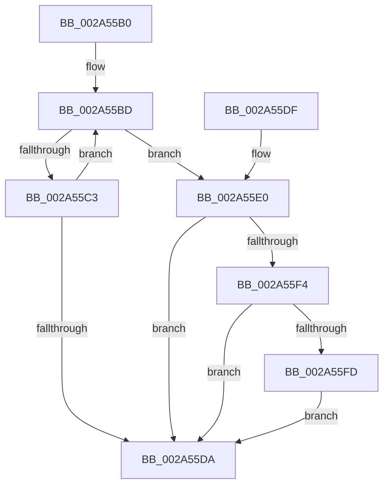

# ExReleaseRundownProtectionEx

- RVA: `0x002A55B0`–`0x002A560D` (길이 `93` bytes)
- VA: `0x00000001402A55B0`
- 실행 섹션: `.text`
- PDB 이름 있음: `예`; PDB Function 태그: `아니요`
- unwind 정보 RVA: `0x000689DC`
- 디코드: `29`개 명령, `93/93` bytes 표시
- 미해석 바이트: `0` (있으면 어셈블리에 `.byte`로 보존)

> 이 문서는 커널 이미지의 기계어와 PDB 기호를 분석해 생성했습니다. 4번과 5번은 함수 원형과 자료형을 바이너리 사용 방식에서 추정한 C 해석이며 원본 소스 복구 결과는 아닙니다.

## 1. Dependencies

- 직접 호출 지점: **1**; 고유 호출 대상: **1**
- 직접 호출자로 확인된 함수: **4**
- RIP 상대 이미지 참조: **0**

### Outgoing calls
- `0x002A5606` → [KeSetEvent](../33/KeSetEvent_function_0033F310.md) (function, `0x0033F310`)

### Direct callers
- [PfSnRemoveProcessTrace](PfSnRemoveProcessTrace_function_002A51CC.md) at `0x002A51EE`
- [sub_002F0200](../2F/Unknown_function_002F0200.md) at `0x002F0208`
- [ExCompareExchangeCallBack](../41/ExCompareExchangeCallBack_function_0041BCD0.md) at `0x0041BD82`
- [ExCompareExchangeCallBack](../41/ExCompareExchangeCallBack_function_0041BCD0.md) at `0x0041BD9A`
- [SmHwAcceleratorPartitionCtxCleanup](../../page/7A/SmHwAcceleratorPartitionCtxCleanup_function_007AB2D8.md) at `0x007AB300`

### Static image references
- 디코드된 RIP-relative 메모리 참조가 없습니다.

## 2. Other-region calls and transfers

- 다른 실행 섹션으로 향하는 call: **0**
- 별도 외부 분기/꼬리 이동을 확인하지 못했습니다.

## 3. Assembly (complete function range)

```asm
002A55B0  48 83 EC 28                     sub rsp, 0x28
002A55B4  44 8B DA                        mov r11d, edx
002A55B7  0F 0D 09                        prefetchw byte ptr [rcx]
002A55BA  4C 8B 11                        mov r10, qword ptr [rcx]
002A55BD  41 F6 C2 01                     test r10b, 1
002A55C1  75 1D                           jne 0x1402a55e0
002A55C3  47 8D 0C 1B                     lea r9d, [r11 + r11]
002A55C7  49 8B D2                        mov rdx, r10
002A55CA  49 2B D1                        sub rdx, r9
002A55CD  49 8B C2                        mov rax, r10
002A55D0  F0 48 0F B1 11                  lock cmpxchg qword ptr [rcx], rdx
002A55D5  4C 8B D0                        mov r10, rax
002A55D8  75 E3                           jne 0x1402a55bd
002A55DA  48 83 C4 28                     add rsp, 0x28
002A55DE  C3                              ret
002A55DF  CC                              int3
002A55E0  49 83 E2 FE                     and r10, 0xfffffffffffffffe
002A55E4  49 8B C3                        mov rax, r11
002A55E7  48 F7 D8                        neg rax
002A55EA  F0 49 0F C1 02                  lock xadd qword ptr [r10], rax
002A55EF  49 3B C3                        cmp rax, r11
002A55F2  75 E6                           jne 0x1402a55da
002A55F4  F0 41 0F BA 72 20 00            lock btr dword ptr [r10 + 0x20], 0
002A55FB  72 DD                           jb 0x1402a55da
002A55FD  49 8D 4A 08                     lea rcx, [r10 + 8]
002A5601  45 33 C0                        xor r8d, r8d
002A5604  33 D2                           xor edx, edx
002A5606  E8 05 9D 09 00                  call 0x14033f310
002A560B  EB CD                           jmp 0x1402a55da
```

## 4. C-style interpretation (structured pseudocode)

```c
__int64 __fastcall ExReleaseRundownProtectionEx(__int64 a1, int a2, int a3)
{
    __int64 result;
    __int64 v_r10;
    __int64 v_rsp;

    v_rsp = (v_rsp) - (40);
loc_002A55BD:
    if ((((unsigned __int8)(*(unsigned __int64 *)(a1))) & (1)) != 0) goto loc_002A55E0;
    a2 = (*(unsigned __int64 *)(a1)) - ((unsigned int)(a2) + (unsigned int)(a2) * 1);
    if (condition_is_not_equal) goto loc_002A55BD;
loc_002A55DA:
    v_rsp = (v_rsp) + (40);
    return *(unsigned __int64 *)(a1);
loc_002A55E0:
    v_r10 = (*(unsigned __int64 *)(a1)) & (-2);
    result = -((unsigned int)(a2));
    if (result != ((unsigned int)(a2))) goto loc_002A55DA;
    if (result < ((unsigned int)(a2))) goto loc_002A55DA;
    a3 = 0;
    a2 = 0;
    result = KeSetEvent(v_r10 + 8, a2, a3, (unsigned int)(a2) + (unsigned int)(a2) * 1);
    goto loc_002A55DA;
}
```

## 5. (Beta) C Style

```c
int64_t ExReleaseRundownProtectionEx(void *Arg1, void *Arg2, int32_t Arg3)
{
    uint8_t *arg1 = (uint8_t *)Arg1;
    uint8_t *arg2 = (uint8_t *)Arg2;

    int64_t result;
    int64_t local_r10;
    int64_t local_rsp;

    local_rsp = (local_rsp) - (40);
loc_002A55BD:
    if ((((uint8_t)(*(uint64_t *)(arg1))) & (1)) != 0) goto loc_002A55E0;
    Arg2 = (*(uint64_t *)(arg1)) - ((uint32_t)(Arg2) + (uint32_t)(Arg2) * 1);
    if (condition_is_not_equal) goto loc_002A55BD;
loc_002A55DA:
    local_rsp = (local_rsp) + (40);
    return *(uint64_t *)(arg1);
loc_002A55E0:
    local_r10 = (*(uint64_t *)(arg1)) & (-2);
    result = -((uint32_t)(Arg2));
    if (result != ((uint32_t)(Arg2))) goto loc_002A55DA;
    if (result < ((uint32_t)(Arg2))) goto loc_002A55DA;
    Arg3 = 0;
    Arg2 = 0;
    result = KeSetEvent(local_r10 + 8, Arg2, Arg3, (uint32_t)(Arg2) + (uint32_t)(Arg2) * 1);
    goto loc_002A55DA;
}
```

### 관측된 메모리 오프셋

구조체 형식이 확인되지 않은 접근은 인자 기준의 오프셋으로만 기록했습니다.

| 기준 인자 | 오프셋 표현 | 폭 (bit) | 접근 |
|---|---:|---:|---|
| `Arg1` | `+ 0x0` | `8` | `R` |
| `Arg1` | `+ 0x0` | `64` | `R` |
| `Arg2` | `+ 0x0 + r11*1` | `32` | `R` |

## 6. Execution-region graph

[열기: 2D/3D 그래프와 함수 탐색 컨트롤 패널](../../../control-panel.html?section=text&rva=0x002A55B0&view=graph)

- 2D 그래프는 위에서 아래로 흐르고, 3D 그래프는 빈 공간을 드래그해 회전합니다. Shift+드래그는 이동, 휠은 확대·축소, 함수 노드 선택은 대상 보고서 이동입니다.

### Static fallback


