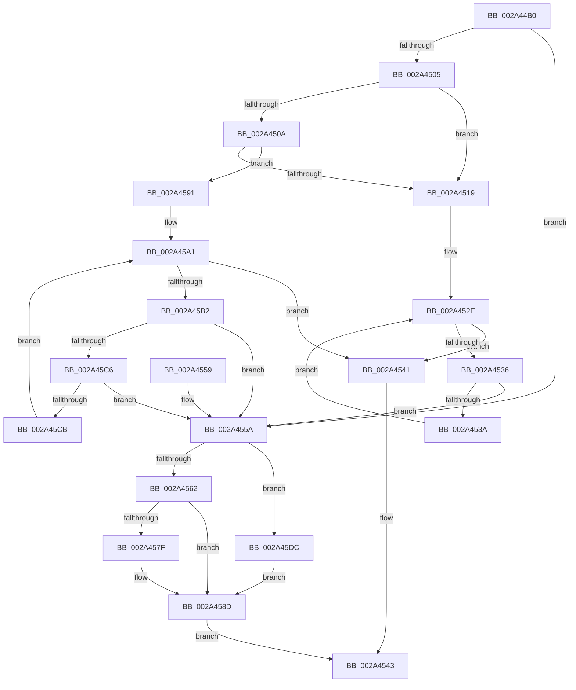

# ExTimedWaitForUnblockPushLock

- RVA: `0x002A44B0`–`0x002A45E0` (길이 `304` bytes)
- VA: `0x00000001402A44B0`
- 실행 섹션: `.text`
- PDB 이름 있음: `예`; PDB Function 태그: `아니요`
- unwind 정보 RVA: `0x000688D0`
- 디코드: `93`개 명령, `304/304` bytes 표시
- 미해석 바이트: `0` (있으면 어셈블리에 `.byte`로 보존)

> 이 문서는 커널 이미지의 기계어와 PDB 기호를 분석해 생성했습니다. 4번과 5번은 함수 원형과 자료형을 바이너리 사용 방식에서 추정한 C 해석이며 원본 소스 복구 결과는 아닙니다.

## 1. Dependencies

- 직접 호출 지점: **2**; 고유 호출 대상: **2**
- 직접 호출자로 확인된 함수: **5**
- RIP 상대 이미지 참조: **1**

### Outgoing calls
- `0x002A4574` → [KeWaitForSingleObject](../20/KeWaitForSingleObject_function_0020E6B0.md) (function, `0x0020E6B0`)
- `0x002A4588` → [ExpUnblockPushLock](ExpUnblockPushLock_function_002A40FC.md) (function, `0x002A40FC`)

### Direct callers
- [ExpUnblockPushLock](ExpUnblockPushLock_function_002A40FC.md) at `0x002A41DC`
- [ExBlockOnAddressPushLock](ExBlockOnAddressPushLock_function_002A43A0.md) at `0x002A4433`
- [RtlpCSparseBitmapWaitOnAddress](../2E/RtlpCSparseBitmapWaitOnAddress_function_002EFF0C.md) at `0x002EFF8F`
- [CmpWaitForLateUnloadWorker](../45/CmpWaitForLateUnloadWorker_function_004573F8.md) at `0x00457476`
- [ExWaitForUnblockPushLock](../4B/ExWaitForUnblockPushLock_function_004BB2C0.md) at `0x004BB2C7`

### Static image references
- `0x002A44D5` → RVA `0x00E68588` (`.data`; read)

## 2. Other-region calls and transfers

- 다른 실행 섹션으로 향하는 call: **0**
- 별도 외부 분기/꼬리 이동을 확인하지 못했습니다.

## 3. Assembly (complete function range)

```asm
002A44B0  48 89 5C 24 08                  mov qword ptr [rsp + 8], rbx
002A44B5  48 89 74 24 10                  mov qword ptr [rsp + 0x10], rsi
002A44BA  48 89 7C 24 18                  mov qword ptr [rsp + 0x18], rdi
002A44BF  41 56                           push r14
002A44C1  48 83 EC 30                     sub rsp, 0x30
002A44C5  66 83 22 00                     and word ptr [rdx], 0
002A44C9  48 8D 42 08                     lea rax, [rdx + 8]
002A44CD  83 62 04 00                     and dword ptr [rdx + 4], 0
002A44D1  4C 8D 4A 34                     lea r9, [rdx + 0x34]
002A44D5  8B 1D AD 40 BC 00               mov ebx, dword ptr [rip + 0xbc40ad]
002A44DB  41 BE 01 00 00 00               mov r14d, 1
002A44E1  C6 42 02 06                     mov byte ptr [rdx + 2], 6
002A44E5  4D 8B D8                        mov r11, r8
002A44E8  48 89 40 08                     mov qword ptr [rax + 8], rax
002A44EC  48 8B FA                        mov rdi, rdx
002A44EF  48 89 00                        mov qword ptr [rax], rax
002A44F2  48 8B F1                        mov rsi, rcx
002A44F5  48 B8 6A 03 00 00 80 F7 FF FF   movabs rax, 0xfffff7800000036a
002A44FF  66 44 39 30                     cmp word ptr [rax], r14w
002A4503  76 55                           jbe 0x1402a455a
002A4505  4D 85 C9                        test r9, r9
002A4508  74 0F                           je 0x1402a4519
002A450A  48 B8 97 02 00 00 80 F7 FF FF   movabs rax, 0xfffff78000000297
002A4514  80 38 00                        cmp byte ptr [rax], 0
002A4517  75 78                           jne 0x1402a4591
002A4519  48 B8 D6 02 00 00 80 F7 FF FF   movabs rax, 0xfffff780000002d6
002A4523  33 D2                           xor edx, edx
002A4525  0F B7 08                        movzx ecx, word ptr [rax]
002A4528  8B C3                           mov eax, ebx
002A452A  F7 F1                           div ecx
002A452C  33 D2                           xor edx, edx
002A452E  41 8B 09                        mov ecx, dword ptr [r9]
002A4531  F6 C1 02                        test cl, 2
002A4534  74 0B                           je 0x1402a4541
002A4536  3B D0                           cmp edx, eax
002A4538  74 20                           je 0x1402a455a
002A453A  F3 90                           pause
002A453C  41 03 D6                        add edx, r14d
002A453F  EB ED                           jmp 0x1402a452e
002A4541  33 C0                           xor eax, eax
002A4543  48 8B 5C 24 40                  mov rbx, qword ptr [rsp + 0x40]
002A4548  48 8B 74 24 48                  mov rsi, qword ptr [rsp + 0x48]
002A454D  48 8B 7C 24 50                  mov rdi, qword ptr [rsp + 0x50]
002A4552  48 83 C4 30                     add rsp, 0x30
002A4556  41 5E                           pop r14
002A4558  C3                              ret
002A4559  CC                              int3
002A455A  F0 41 0F BA 31 01               lock btr dword ptr [r9], 1
002A4560  73 7A                           jae 0x1402a45dc
002A4562  45 33 C9                        xor r9d, r9d
002A4565  4C 89 5C 24 20                  mov qword ptr [rsp + 0x20], r11
002A456A  45 33 C0                        xor r8d, r8d
002A456D  48 8B CF                        mov rcx, rdi
002A4570  41 8D 51 1C                     lea edx, [r9 + 0x1c]
002A4574  E8 37 A1 F6 FF                  call 0x14020e6b0
002A4579  8B D8                           mov ebx, eax
002A457B  85 C0                           test eax, eax
002A457D  74 0E                           je 0x1402a458d
002A457F  45 8A C6                        mov r8b, r14b
002A4582  48 8B D7                        mov rdx, rdi
002A4585  48 8B CE                        mov rcx, rsi
002A4588  E8 6F FB FF FF                  call 0x1402a40fc
002A458D  8B C3                           mov eax, ebx
002A458F  EB B2                           jmp 0x1402a4543
002A4591  0F 31                           rdtsc
002A4593  48 C1 E2 20                     shl rdx, 0x20
002A4597  48 0B C2                        or rax, rdx
002A459A  4C 8B C0                        mov r8, rax
002A459D  4C 8D 14 18                     lea r10, [rax + rbx]
002A45A1  49 8B C1                        mov rax, r9
002A45A4  33 C9                           xor ecx, ecx
002A45A6  33 D2                           xor edx, edx
002A45A8  0F 01 FA                        monitorx
002A45AB  41 8B 01                        mov eax, dword ptr [r9]
002A45AE  A8 02                           test al, 2
002A45B0  74 8F                           je 0x1402a4541
002A45B2  49 8B C8                        mov rcx, r8
002A45B5  0F 31                           rdtsc
002A45B7  48 C1 E2 20                     shl rdx, 0x20
002A45BB  48 0B C2                        or rax, rdx
002A45BE  4C 8B C0                        mov r8, rax
002A45C1  48 3B C1                        cmp rax, rcx
002A45C4  72 94                           jb 0x1402a455a
002A45C6  49 3B C2                        cmp rax, r10
002A45C9  73 8F                           jae 0x1402a455a
002A45CB  41 8B DA                        mov ebx, r10d
002A45CE  B9 02 00 00 00                  mov ecx, 2
002A45D3  2B D8                           sub ebx, eax
002A45D5  33 C0                           xor eax, eax
002A45D7  0F 01 FB                        mwaitx
002A45DA  EB C5                           jmp 0x1402a45a1
002A45DC  33 DB                           xor ebx, ebx
002A45DE  EB AD                           jmp 0x1402a458d
```

## 4. C-style interpretation (structured pseudocode)

```c
__int64 __fastcall ExTimedWaitForUnblockPushLock(__int64 a1, __int64 a2, __int64 a3)
{
    __int64 result;
    __int64 v_rbx;
    __int64 v_rsp;
    unsigned __int64 v_stack_p10;
    unsigned __int64 v_stack_p18;
    unsigned __int64 v_stack_p20;
    unsigned __int64 v_stack_p8;

    v_stack_p8 = v_rbx;
    v_stack_p10 = v_rsi;
    v_stack_p18 = v_rdi;
    v_rsp = (v_rsp) - (48);
    *(unsigned __int8 *)(a2 + 2) = 6;
    *(unsigned __int64 *)(a2 + 8 + 8) = a2 + 8;
    *(unsigned __int64 *)(a2 + 8) = a2 + 8;
    if ((*(unsigned __int16 *)(a2 + 8)) <= 1) goto loc_002A455A;
    if (a2 + 52 == 0) goto loc_002A4519;
    if ((*(unsigned __int8 *)(a2 + 8)) != 0) goto loc_002A4591;
loc_002A4519:
    a2 = 0;
    a2 = 0;
loc_002A452E:
    if ((((unsigned __int8)((unsigned int)(*(unsigned int *)(a2 + 52)))) & (2)) == 0) goto loc_002A4541;
    if (0 == ((unsigned int)((unsigned int)((unsigned int)((unsigned int)(*(unsigned int *)(v_rip + 12337325))))))) goto loc_002A455A;
    a2 = (unsigned int)((a2) + (1));
    goto loc_002A452E;
loc_002A4541:
    result = 0;
loc_002A4543:
    v_rsp = (v_rsp) + (48);
    return result;
loc_002A455A:
    if (condition_is_above_or_equal) goto loc_002A45DC;
    a4 = 0;
    v_stack_p20 = a3;
    a3 = 0;
    result = KeWaitForSingleObject(v_stack_p18, a4 + 28, a3, a4);
    if ((unsigned int)(result) != 0) {
        a3 = 1;
        a2 = v_stack_p18;
        a1 = v_stack_p10;
        result = ExpUnblockPushLock(a1, a2, a3, a4);
    }
    goto loc_002A4543;
loc_002A4591:
    a2 = (a2) << (32);
    result = ((unsigned int)((unsigned int)((unsigned int)((unsigned int)(result))))) | (a2);
loc_002A45A1:
    a1 = 0;
    a2 = 0;
    if ((((unsigned __int8)((unsigned int)(*(unsigned int *)(a4)))) & (2)) == 0) goto loc_002A4541;
    a2 = (a2) << (32);
    result = ((unsigned int)(*(unsigned int *)(a4))) | (a2);
    if (result < result) goto loc_002A455A;
    if (result >= (result + (unsigned int)((unsigned int)(result)) * 1)) goto loc_002A455A;
    v_rbx = (unsigned int)(((unsigned int)((unsigned int)(result + (unsigned int)((unsigned int)(result)) * 1))) - ((unsigned int)(result)));
    result = 0;
    goto loc_002A45A1;
loc_002A45DC:
    v_rbx = 0;
    goto loc_002A458D;
}
```

## 5. (Beta) C Style

```c
int64_t ExTimedWaitForUnblockPushLock(int64_t Arg1, void *Arg2, int64_t Arg3)
{
    uint8_t *arg2 = (uint8_t *)Arg2;

    int64_t result;
    int64_t local_rbx;
    int64_t local_rsp;
    uint64_t v_stack_p10;
    uint64_t v_stack_p18;
    uint64_t v_stack_p20;
    uint64_t v_stack_p8;

    v_stack_p8 = local_rbx;
    v_stack_p10 = local_rsi;
    v_stack_p18 = local_rdi;
    local_rsp = (local_rsp) - (48);
    *(uint8_t *)(arg2 + 0x2) = 6;
    *(void **)(arg2 + 0x8 + 0x8) = Arg2 + 8;
    *(void **)(arg2 + 0x8) = Arg2 + 8;
    if ((*(uint16_t *)(arg2 + 0x8)) <= 1) goto loc_002A455A;
    if (Arg2 + 52 == 0) goto loc_002A4519;
    if ((*(uint8_t *)(arg2 + 0x8)) != 0) goto loc_002A4591;
loc_002A4519:
    Arg2 = 0;
    Arg2 = 0;
loc_002A452E:
    if ((((uint8_t)((uint32_t)(*(uint32_t *)(arg2 + 0x34)))) & (2)) == 0) goto loc_002A4541;
    if (0 == ((uint32_t)((uint32_t)((uint32_t)((uint32_t)(*(uint32_t *)(v_rip + 0xBC40AD))))))) goto loc_002A455A;
    Arg2 = (uint32_t)((Arg2) + (1));
    goto loc_002A452E;
loc_002A4541:
    result = 0;
loc_002A4543:
    local_rsp = (local_rsp) + (48);
    return result;
loc_002A455A:
    if (condition_is_above_or_equal) goto loc_002A45DC;
    a4 = 0;
    v_stack_p20 = Arg3;
    Arg3 = 0;
    result = KeWaitForSingleObject(v_stack_p18, a4 + 28, Arg3, a4);
    if ((uint32_t)(result) != 0) {
        Arg3 = 1;
        Arg2 = v_stack_p18;
        Arg1 = v_stack_p10;
        result = ExpUnblockPushLock(Arg1, Arg2, Arg3, a4);
    }
    goto loc_002A4543;
loc_002A4591:
    Arg2 = (Arg2) << (32);
    result = ((uint32_t)((uint32_t)((uint32_t)((uint32_t)(result))))) | (Arg2);
loc_002A45A1:
    Arg1 = 0;
    Arg2 = 0;
    if ((((uint8_t)((uint32_t)(*(uint32_t *)(a4)))) & (2)) == 0) goto loc_002A4541;
    Arg2 = (Arg2) << (32);
    result = ((uint32_t)(*(uint32_t *)(a4))) | (Arg2);
    if (result < result) goto loc_002A455A;
    if (result >= (result + (uint32_t)((uint32_t)(result)) * 1)) goto loc_002A455A;
    local_rbx = (uint32_t)(((uint32_t)((uint32_t)(result + (uint32_t)((uint32_t)(result)) * 1))) - ((uint32_t)(result)));
    result = 0;
    goto loc_002A45A1;
loc_002A45DC:
    local_rbx = 0;
    goto loc_002A458D;
}
```

### 관측된 메모리 오프셋

구조체 형식이 확인되지 않은 접근은 인자 기준의 오프셋으로만 기록했습니다.

| 기준 인자 | 오프셋 표현 | 폭 (bit) | 접근 |
|---|---:|---:|---|
| `Arg2` | `+ 0x0` | `16` | `R/W` |
| `Arg2` | `+ 0x0` | `64` | `W` |
| `Arg2` | `+ 0x2` | `8` | `W` |
| `Arg2` | `+ 0x4` | `32` | `R/W` |
| `Arg2` | `+ 0x8` | `64` | `R` |
| `Arg2` | `+ 0x8` | `64` | `W` |
| `Arg2` | `+ 0x34` | `64` | `R` |

## 6. Execution-region graph

[열기: 2D/3D 그래프와 함수 탐색 컨트롤 패널](../../../control-panel.html?section=text&rva=0x002A44B0&view=graph)

- 2D 그래프는 위에서 아래로 흐르고, 3D 그래프는 빈 공간을 드래그해 회전합니다. Shift+드래그는 이동, 휠은 확대·축소, 함수 노드 선택은 대상 보고서 이동입니다.

### Static fallback


