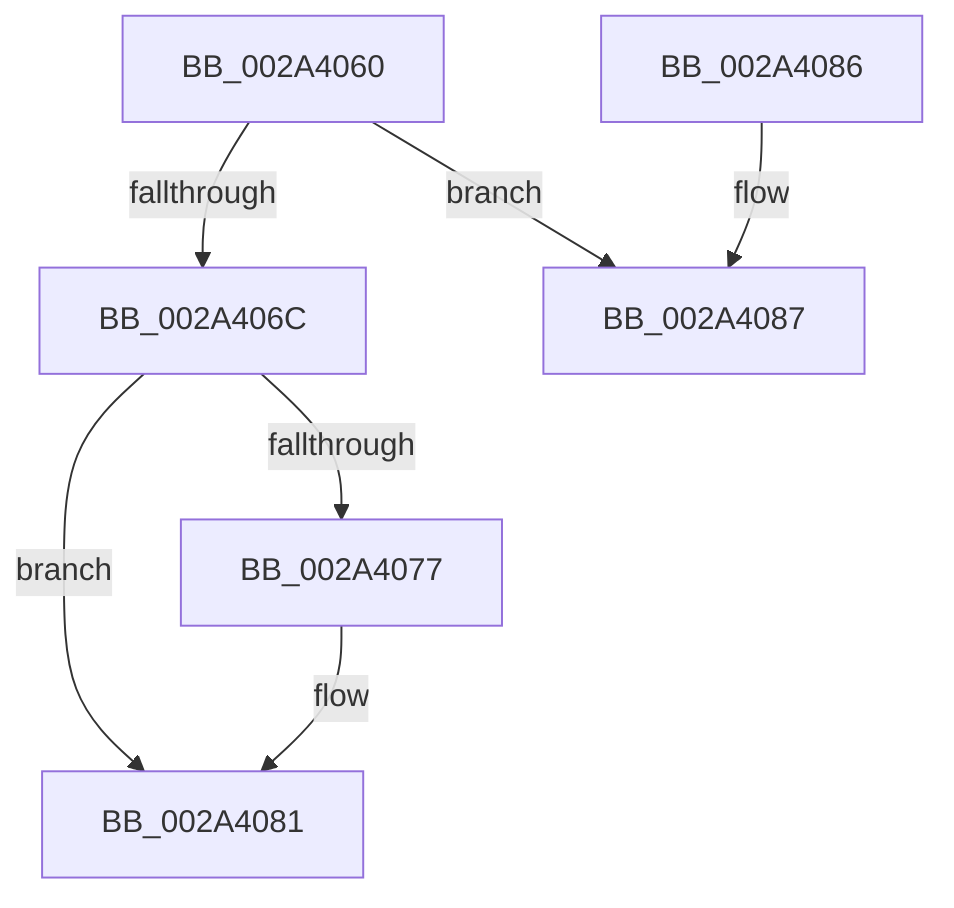

# ExUnblockOnAddressPushLockEx

- RVA: `0x002A4060`–`0x002A40A0` (길이 `64` bytes)
- VA: `0x00000001402A4060`
- 실행 섹션: `.text`
- PDB 이름 있음: `예`; PDB Function 태그: `아니요`
- unwind 정보 RVA: `0x0006886C`
- 디코드: `19`개 명령, `64/64` bytes 표시
- 미해석 바이트: `0` (있으면 어셈블리에 `.byte`로 보존)

> 이 문서는 커널 이미지의 기계어와 PDB 기호를 분석해 생성했습니다. 4번과 5번은 함수 원형과 자료형을 바이너리 사용 방식에서 추정한 C 해석이며 원본 소스 복구 결과는 아닙니다.

## 1. Dependencies

- 직접 호출 지점: **2**; 고유 호출 대상: **2**
- 직접 호출자로 확인된 함수: **0**
- RIP 상대 이미지 참조: **0**

### Outgoing calls
- `0x002A407C` → [ExpUnblockPushLock](ExpUnblockPushLock_function_002A40FC.md) (function, `0x002A40FC`)
- `0x002A409A` → [KeBugCheckEx](../4F/KeBugCheckEx_function_004FD660.md) (function, `0x004FD660`)

### Direct callers
- 이 함수 시작 RVA로 연결되는 직접 call은 확인되지 않았습니다. 간접 호출은 완전히 역산할 수 없습니다.

### Static image references
- 디코드된 RIP-relative 메모리 참조가 없습니다.

## 2. Other-region calls and transfers

- 다른 실행 섹션으로 향하는 call: **0**
- 별도 외부 분기/꼬리 이동을 확인하지 못했습니다.

## 3. Assembly (complete function range)

```asm
002A4060  48 83 EC 38                     sub rsp, 0x38
002A4064  F7 C2 F8 FF FF FF               test edx, 0xfffffff8
002A406A  75 1B                           jne 0x1402a4087
002A406C  F0 83 0C 24 00                  lock or dword ptr [rsp], 0
002A4071  48 83 39 00                     cmp qword ptr [rcx], 0
002A4075  74 0A                           je 0x1402a4081
002A4077  45 33 C0                        xor r8d, r8d
002A407A  33 D2                           xor edx, edx
002A407C  E8 7B 00 00 00                  call 0x1402a40fc
002A4081  48 83 C4 38                     add rsp, 0x38
002A4085  C3                              ret
002A4086  CC                              int3
002A4087  48 83 64 24 20 00               and qword ptr [rsp + 0x20], 0
002A408D  4C 8B C1                        mov r8, rcx
002A4090  B9 52 01 00 00                  mov ecx, 0x152
002A4095  8B D2                           mov edx, edx
002A4097  45 33 C9                        xor r9d, r9d
002A409A  E8 C1 95 25 00                  call 0x1404fd660
002A409F  CC                              int3
```

## 4. C-style interpretation (structured pseudocode)

```c
__int64 __fastcall ExUnblockOnAddressPushLockEx(__int64 a1, int a2, int a3, int a4)
{
    __int64 result;
    __int64 v_rsp;
    unsigned int v_stack_m38;
    unsigned __int64 v_stack_p20;

    v_rsp = (v_rsp) - (56);
    if (((a2) & (0xFFFFFFF8ULL)) != 0) goto loc_002A4087;
    if ((*(unsigned __int64 *)(a1)) != 0) {
        a3 = 0;
        a2 = 0;
        result = ExpUnblockPushLock(a1, a2, a3, a4);
    }
    v_rsp = (v_rsp) + (56);
    return result;
loc_002A4087:
    a4 = 0;
    result = KeBugCheckEx(338, 0, a1, a4);
    return result;
}
```

## 5. (Beta) C Style

```c
int64_t ExUnblockOnAddressPushLockEx(void *Arg1, int32_t Arg2, int32_t Arg3, int32_t Arg4)
{
    uint8_t *arg1 = (uint8_t *)Arg1;

    int64_t result;
    int64_t local_rsp;
    uint32_t v_stack_m38;
    uint64_t v_stack_p20;

    local_rsp = (local_rsp) - (56);
    if (((Arg2) & (0xFFFFFFF8ULL)) != 0) goto loc_002A4087;
    if ((*(uint64_t *)(arg1)) != 0) {
        Arg3 = 0;
        Arg2 = 0;
        result = ExpUnblockPushLock(Arg1, Arg2, Arg3, Arg4);
    }
    local_rsp = (local_rsp) + (56);
    return result;
loc_002A4087:
    Arg4 = 0;
    result = KeBugCheckEx(338, 0, Arg1, Arg4);
    return result;
}
```

### 관측된 메모리 오프셋

구조체 형식이 확인되지 않은 접근은 인자 기준의 오프셋으로만 기록했습니다.

| 기준 인자 | 오프셋 표현 | 폭 (bit) | 접근 |
|---|---:|---:|---|
| `Arg1` | `+ 0x0` | `64` | `R` |

## 6. Execution-region graph

[열기: 2D/3D 그래프와 함수 탐색 컨트롤 패널](../../../control-panel.html?section=text&rva=0x002A4060&view=graph)

- 2D 그래프는 위에서 아래로 흐르고, 3D 그래프는 빈 공간을 드래그해 회전합니다. Shift+드래그는 이동, 휠은 확대·축소, 함수 노드 선택은 대상 보고서 이동입니다.

### Static fallback


