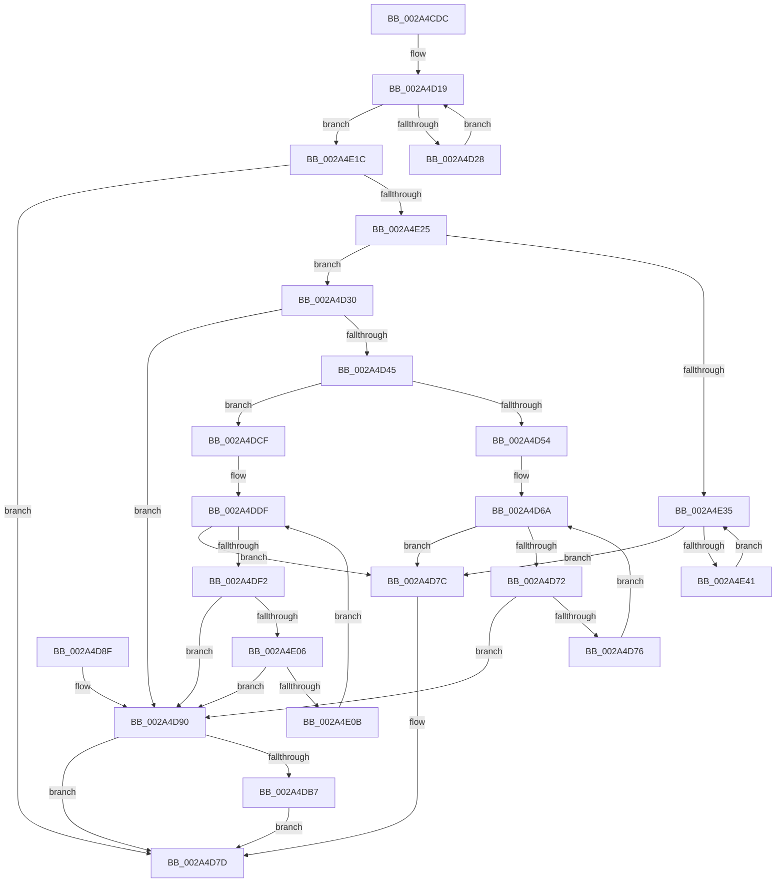

# ExfWaitForRundownProtectionRelease

- RVA: `0x002A4CDC`–`0x002A4E4C` (길이 `368` bytes)
- VA: `0x00000001402A4CDC`
- 실행 섹션: `.text`
- PDB 이름 있음: `예`; PDB Function 태그: `아니요`
- unwind 정보 RVA: `0x00068944`
- 디코드: `107`개 명령, `368/368` bytes 표시
- 미해석 바이트: `0` (있으면 어셈블리에 `.byte`로 보존)

> 이 문서는 커널 이미지의 기계어와 PDB 기호를 분석해 생성했습니다. 4번과 5번은 함수 원형과 자료형을 바이너리 사용 방식에서 추정한 C 해석이며 원본 소스 복구 결과는 아닙니다.

## 1. Dependencies

- 직접 호출 지점: **2**; 고유 호출 대상: **2**
- 직접 호출자로 확인된 함수: **5**
- RIP 상대 이미지 참조: **1**

### Outgoing calls
- `0x002A4DC8` → [KeWaitForSingleObject](../20/KeWaitForSingleObject_function_0020E6B0.md) (function, `0x0020E6B0`)
- `0x002A4E45` → [KeYieldProcessorEx](../3F/KeYieldProcessorEx_function_003FBD00.md) (function, `0x003FBD00`)

### Direct callers
- [ExWaitForRundownProtectionRelease](ExWaitForRundownProtectionRelease_function_002A4CB0.md) at `0x002A4CCF`
- [CmLoadAppKey](../../page/87/CmLoadAppKey_function_00876FFC.md) at `0x00877B7E`
- [PfSnPrefetchSections](../../page/93/PfSnPrefetchSections_function_0093BCF4.md) at `0x0093BF39`
- [PfSnPrefetchSectionsCleanup](../../page/93/PfSnPrefetchSectionsCleanup_function_0093C0B0.md) at `0x0093C1AE`
- [PfSnPrefetchScenario](../../page/96/PfSnPrefetchScenario_function_00961080.md) at `0x0096113C`

### Static image references
- `0x002A4D30` → RVA `0x00E68588` (`.data`; read)

## 2. Other-region calls and transfers

- 다른 실행 섹션으로 향하는 call: **0**
- 별도 외부 분기/꼬리 이동을 확인하지 못했습니다.

## 3. Assembly (complete function range)

```asm
002A4CDC  48 89 5C 24 10                  mov qword ptr [rsp + 0x10], rbx
002A4CE1  48 89 7C 24 18                  mov qword ptr [rsp + 0x18], rdi
002A4CE6  55                              push rbp
002A4CE7  48 8B EC                        mov rbp, rsp
002A4CEA  48 83 EC 60                     sub rsp, 0x60
002A4CEE  45 33 D2                        xor r10d, r10d
002A4CF1  48 C7 45 F0 01 00 00 00         mov qword ptr [rbp - 0x10], 1
002A4CF9  48 8B DA                        mov rbx, rdx
002A4CFC  4C 89 55 E8                     mov qword ptr [rbp - 0x18], r10
002A4D00  0F 57 C0                        xorps xmm0, xmm0
002A4D03  48 D1 EB                        shr rbx, 1
002A4D06  4C 8D 45 D0                     lea r8, [rbp - 0x30]
002A4D0A  48 8B C2                        mov rax, rdx
002A4D0D  41 8D 7A 01                     lea edi, [r10 + 1]
002A4D11  4C 0B C7                        or r8, rdi
002A4D14  F3 0F 7F 45 D8                  movdqu xmmword ptr [rbp - 0x28], xmm0
002A4D19  48 89 5D D0                     mov qword ptr [rbp - 0x30], rbx
002A4D1D  F0 4C 0F B1 01                  lock cmpxchg qword ptr [rcx], r8
002A4D22  0F 84 F4 00 00 00               je 0x1402a4e1c
002A4D28  48 8B D8                        mov rbx, rax
002A4D2B  48 D1 EB                        shr rbx, 1
002A4D2E  EB E9                           jmp 0x1402a4d19
002A4D30  8B 1D 52 38 BC 00               mov ebx, dword ptr [rip + 0xbc3852]
002A4D36  48 B8 6A 03 00 00 80 F7 FF FF   movabs rax, 0xfffff7800000036a
002A4D40  66 39 38                        cmp word ptr [rax], di
002A4D43  76 4B                           jbe 0x1402a4d90
002A4D45  48 B8 97 02 00 00 80 F7 FF FF   movabs rax, 0xfffff78000000297
002A4D4F  44 38 10                        cmp byte ptr [rax], r10b
002A4D52  75 7B                           jne 0x1402a4dcf
002A4D54  48 B8 D6 02 00 00 80 F7 FF FF   movabs rax, 0xfffff780000002d6
002A4D5E  33 D2                           xor edx, edx
002A4D60  0F B7 08                        movzx ecx, word ptr [rax]
002A4D63  8B C3                           mov eax, ebx
002A4D65  F7 F1                           div ecx
002A4D67  41 8B D2                        mov edx, r10d
002A4D6A  8B 4D F0                        mov ecx, dword ptr [rbp - 0x10]
002A4D6D  40 84 CF                        test dil, cl
002A4D70  74 0A                           je 0x1402a4d7c
002A4D72  3B D0                           cmp edx, eax
002A4D74  74 1A                           je 0x1402a4d90
002A4D76  F3 90                           pause
002A4D78  03 D7                           add edx, edi
002A4D7A  EB EE                           jmp 0x1402a4d6a
002A4D7C  90                              nop
002A4D7D  4C 8D 5C 24 60                  lea r11, [rsp + 0x60]
002A4D82  49 8B 5B 18                     mov rbx, qword ptr [r11 + 0x18]
002A4D86  49 8B 7B 20                     mov rdi, qword ptr [r11 + 0x20]
002A4D8A  49 8B E3                        mov rsp, r11
002A4D8D  5D                              pop rbp
002A4D8E  C3                              ret
002A4D8F  CC                              int3
002A4D90  48 8D 45 E0                     lea rax, [rbp - 0x20]
002A4D94  66 89 7D D8                     mov word ptr [rbp - 0x28], di
002A4D98  48 89 45 E8                     mov qword ptr [rbp - 0x18], rax
002A4D9C  48 8D 45 E0                     lea rax, [rbp - 0x20]
002A4DA0  48 89 45 E0                     mov qword ptr [rbp - 0x20], rax
002A4DA4  48 8D 45 F0                     lea rax, [rbp - 0x10]
002A4DA8  C6 45 DA 06                     mov byte ptr [rbp - 0x26], 6
002A4DAC  44 89 55 DC                     mov dword ptr [rbp - 0x24], r10d
002A4DB0  F0 0F BA 30 00                  lock btr dword ptr [rax], 0
002A4DB5  73 C6                           jae 0x1402a4d7d
002A4DB7  45 33 C9                        xor r9d, r9d
002A4DBA  4C 89 54 24 20                  mov qword ptr [rsp + 0x20], r10
002A4DBF  45 33 C0                        xor r8d, r8d
002A4DC2  48 8D 4D D8                     lea rcx, [rbp - 0x28]
002A4DC6  33 D2                           xor edx, edx
002A4DC8  E8 E3 98 F6 FF                  call 0x14020e6b0
002A4DCD  EB AE                           jmp 0x1402a4d7d
002A4DCF  0F 31                           rdtsc
002A4DD1  48 C1 E2 20                     shl rdx, 0x20
002A4DD5  48 0B C2                        or rax, rdx
002A4DD8  4C 8B C0                        mov r8, rax
002A4DDB  4C 8D 0C 18                     lea r9, [rax + rbx]
002A4DDF  33 C9                           xor ecx, ecx
002A4DE1  48 8D 45 F0                     lea rax, [rbp - 0x10]
002A4DE5  33 D2                           xor edx, edx
002A4DE7  0F 01 FA                        monitorx
002A4DEA  8B 4D F0                        mov ecx, dword ptr [rbp - 0x10]
002A4DED  40 84 CF                        test dil, cl
002A4DF0  74 8A                           je 0x1402a4d7c
002A4DF2  49 8B C8                        mov rcx, r8
002A4DF5  0F 31                           rdtsc
002A4DF7  48 C1 E2 20                     shl rdx, 0x20
002A4DFB  48 0B C2                        or rax, rdx
002A4DFE  4C 8B C0                        mov r8, rax
002A4E01  48 3B C1                        cmp rax, rcx
002A4E04  72 8A                           jb 0x1402a4d90
002A4E06  49 3B C1                        cmp rax, r9
002A4E09  73 85                           jae 0x1402a4d90
002A4E0B  41 8B D9                        mov ebx, r9d
002A4E0E  B9 02 00 00 00                  mov ecx, 2
002A4E13  2B D8                           sub ebx, eax
002A4E15  33 C0                           xor eax, eax
002A4E17  0F 01 FB                        mwaitx
002A4E1A  EB C3                           jmp 0x1402a4ddf
002A4E1C  48 85 DB                        test rbx, rbx
002A4E1F  0F 84 58 FF FF FF               je 0x1402a4d7d
002A4E25  44 89 55 10                     mov dword ptr [rbp + 0x10], r10d
002A4E29  44 0F 20 C0                     mov rax, cr8
002A4E2D  3C 02                           cmp al, 2
002A4E2F  0F 82 FB FE FF FF               jb 0x1402a4d30
002A4E35  8B 45 F0                        mov eax, dword ptr [rbp - 0x10]
002A4E38  40 84 C7                        test dil, al
002A4E3B  0F 84 3B FF FF FF               je 0x1402a4d7c
002A4E41  48 8D 4D 10                     lea rcx, [rbp + 0x10]
002A4E45  E8 B6 6E 15 00                  call 0x1403fbd00
002A4E4A  EB E9                           jmp 0x1402a4e35
```

## 4. C-style interpretation (structured pseudocode)

```c
__int64 __fastcall ExfWaitForRundownProtectionRelease(__int64 a1, __int64 a2, __int64 a3, int a4)
{
    __int64 result;
    __int64 v_r10;
    __int64 v_rbx;
    __int64 v_rsp;
    unsigned __int64 v_stack_m18;
    unsigned __int64 v_stack_m20;
    unsigned __int64 v_stack_m28;
    unsigned int v_stack_m2C;
    unsigned __int8 v_stack_m2E;
    unsigned __int64 v_stack_m30;
    unsigned __int64 v_stack_m38;
    unsigned __int64 v_stack_m40;
    unsigned __int64 v_stack_m8;
    unsigned __int64 v_stack_p10;
    unsigned __int64 v_stack_p18;
    unsigned int v_stack_p8;

    v_stack_p10 = v_rbx;
    v_stack_p18 = v_rdi;
    v_rsp = (v_rsp) - (96);
    v_r10 = 0;
    v_stack_m18 = 1;
    v_stack_m20 = 0;
    v_rbx = (a2) >> (1);
    a3 = (v_stack_m38) | (v_r10 + 1);
    v_stack_m30 = v_xmm0;
loc_002A4D19:
    v_stack_m38 = v_rbx;
    if (condition_is_equal) goto loc_002A4E1C;
    v_rbx = (a2) >> (1);
    goto loc_002A4D19;
loc_002A4D30:
    if ((*(unsigned __int16 *)(a2)) <= ((unsigned __int16)(v_r10 + 1))) goto loc_002A4D90;
    if ((*(unsigned __int8 *)(a2)) != 0) goto loc_002A4DCF;
    a2 = 0;
loc_002A4D6A:
    if ((((unsigned __int8)(v_r10 + 1)) & ((unsigned __int8)((unsigned int)(v_stack_m18)))) == 0) goto loc_002A4D7C;
    if (0 == ((unsigned int)((unsigned int)((unsigned int)((unsigned int)(*(unsigned int *)(v_rip + 12335186))))))) goto loc_002A4D90;
    a2 = (unsigned int)((0) + ((unsigned int)(v_r10 + 1)));
    goto loc_002A4D6A;
loc_002A4D7C:
loc_002A4D7D:
    return (unsigned int)((unsigned int)((unsigned int)(*(unsigned int *)(v_rip + 12335186))));
loc_002A4D90:
    v_stack_m30 = (unsigned __int16)(*(unsigned __int64 *)(v_stack_m8 + 32));
    v_stack_m20 = v_stack_m28;
    v_stack_m28 = v_stack_m28;
    v_stack_m2E = 6;
    v_stack_m2C = 0;
    if (condition_is_above_or_equal) goto loc_002A4D7D;
    a4 = 0;
    v_stack_m40 = 0;
    a3 = 0;
    a2 = 0;
    result = KeWaitForSingleObject(v_stack_m30, a2, a3, a4);
    goto loc_002A4D7D;
loc_002A4DCF:
    a2 = (a2) << (32);
    result = (result) | (a2);
loc_002A4DDF:
    a1 = 0;
    a2 = 0;
    if ((((unsigned __int8)(*(unsigned __int64 *)(v_stack_m8 + 32))) & ((unsigned __int8)((unsigned int)(v_stack_m18)))) == 0) goto loc_002A4D7C;
    a2 = (a2) << (32);
    result = (v_stack_m18) | (a2);
    if (result < result) goto loc_002A4D90;
    if (result >= (result + *(unsigned __int64 *)(v_stack_m8 + 24) * 1)) goto loc_002A4D90;
    v_rbx = (unsigned int)(((unsigned int)((unsigned int)(result + *(unsigned __int64 *)(v_stack_m8 + 24) * 1))) - ((unsigned int)(result)));
    result = 0;
    goto loc_002A4DDF;
loc_002A4E1C:
    if (v_rbx == 0) goto loc_002A4D7D;
    v_stack_p8 = 0;
    if (((unsigned __int8)(v_cr8)) < 2) goto loc_002A4D30;
loc_002A4E35:
    if ((((unsigned __int8)(*(unsigned __int64 *)(v_stack_m8 + 32))) & ((unsigned __int8)((unsigned int)(v_stack_m18)))) == 0) goto loc_002A4D7C;
    result = KeYieldProcessorEx(v_stack_p8, a2, result, result + *(unsigned __int64 *)(v_stack_m8 + 24) * 1);
    goto loc_002A4E35;
}
```

## 5. (Beta) C Style

```c
int64_t ExfWaitForRundownProtectionRelease(void *Arg1, int64_t Arg2, int64_t Arg3, int32_t Arg4)
{
    uint8_t *arg1 = (uint8_t *)Arg1;

    int64_t result;
    int64_t local_r10;
    int64_t local_rbx;
    int64_t local_rsp;
    uint64_t v_stack_m18;
    uint64_t v_stack_m20;
    uint64_t v_stack_m28;
    uint32_t v_stack_m2C;
    uint8_t v_stack_m2E;
    uint64_t v_stack_m30;
    uint64_t v_stack_m38;
    uint64_t v_stack_m40;
    uint64_t v_stack_m8;
    uint64_t v_stack_p10;
    uint64_t v_stack_p18;
    uint32_t v_stack_p8;

    v_stack_p10 = local_rbx;
    v_stack_p18 = local_rdi;
    local_rsp = (local_rsp) - (96);
    local_r10 = 0;
    v_stack_m18 = 1;
    v_stack_m20 = 0;
    local_rbx = (Arg2) >> (1);
    Arg3 = (v_stack_m38) | (local_r10 + 1);
    v_stack_m30 = v_xmm0;
loc_002A4D19:
    v_stack_m38 = local_rbx;
    if (condition_is_equal) goto loc_002A4E1C;
    local_rbx = (Arg2) >> (1);
    goto loc_002A4D19;
loc_002A4D30:
    if ((*(uint16_t *)(Arg2)) <= ((uint16_t)(local_r10 + 1))) goto loc_002A4D90;
    if ((*(uint8_t *)(Arg2)) != 0) goto loc_002A4DCF;
    Arg2 = 0;
loc_002A4D6A:
    if ((((uint8_t)(local_r10 + 1)) & ((uint8_t)((uint32_t)(v_stack_m18)))) == 0) goto loc_002A4D7C;
    if (0 == ((uint32_t)((uint32_t)((uint32_t)((uint32_t)(*(uint32_t *)(v_rip + 0xBC3852))))))) goto loc_002A4D90;
    Arg2 = (uint32_t)((0) + ((uint32_t)(local_r10 + 1)));
    goto loc_002A4D6A;
loc_002A4D7C:
loc_002A4D7D:
    return (uint32_t)((uint32_t)((uint32_t)(*(uint32_t *)(v_rip + 0xBC3852))));
loc_002A4D90:
    v_stack_m30 = (uint16_t)(*(uint64_t *)(v_stack_m8 + 0x20));
    v_stack_m20 = v_stack_m28;
    v_stack_m28 = v_stack_m28;
    v_stack_m2E = 6;
    v_stack_m2C = 0;
    if (condition_is_above_or_equal) goto loc_002A4D7D;
    Arg4 = 0;
    v_stack_m40 = 0;
    Arg3 = 0;
    Arg2 = 0;
    result = KeWaitForSingleObject(v_stack_m30, Arg2, Arg3, Arg4);
    goto loc_002A4D7D;
loc_002A4DCF:
    Arg2 = (Arg2) << (32);
    result = (result) | (Arg2);
loc_002A4DDF:
    Arg1 = 0;
    Arg2 = 0;
    if ((((uint8_t)(*(uint64_t *)(v_stack_m8 + 0x20))) & ((uint8_t)((uint32_t)(v_stack_m18)))) == 0) goto loc_002A4D7C;
    Arg2 = (Arg2) << (32);
    result = (v_stack_m18) | (Arg2);
    if (result < result) goto loc_002A4D90;
    if (result >= (result + *(uint64_t *)(v_stack_m8 + 0x18) * 1)) goto loc_002A4D90;
    local_rbx = (uint32_t)(((uint32_t)((uint32_t)(result + *(uint64_t *)(v_stack_m8 + 0x18) * 1))) - ((uint32_t)(result)));
    result = 0;
    goto loc_002A4DDF;
loc_002A4E1C:
    if (local_rbx == 0) goto loc_002A4D7D;
    v_stack_p8 = 0;
    if (((uint8_t)(v_cr8)) < 2) goto loc_002A4D30;
loc_002A4E35:
    if ((((uint8_t)(*(uint64_t *)(v_stack_m8 + 0x20))) & ((uint8_t)((uint32_t)(v_stack_m18)))) == 0) goto loc_002A4D7C;
    result = KeYieldProcessorEx(v_stack_p8, Arg2, result, result + *(uint64_t *)(v_stack_m8 + 0x18) * 1);
    goto loc_002A4E35;
}
```

### 관측된 메모리 오프셋

구조체 형식이 확인되지 않은 접근은 인자 기준의 오프셋으로만 기록했습니다.

| 기준 인자 | 오프셋 표현 | 폭 (bit) | 접근 |
|---|---:|---:|---|
| `Arg1` | `+ 0x0` | `64` | `R` |

## 6. Execution-region graph

[열기: 2D/3D 그래프와 함수 탐색 컨트롤 패널](../../../control-panel.html?section=text&rva=0x002A4CDC&view=graph)

- 2D 그래프는 위에서 아래로 흐르고, 3D 그래프는 빈 공간을 드래그해 회전합니다. Shift+드래그는 이동, 휠은 확대·축소, 함수 노드 선택은 대상 보고서 이동입니다.

### Static fallback


