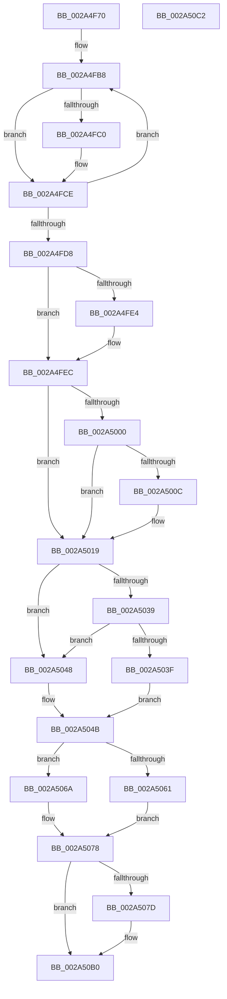

# ExpShutdownWorkerFactory

- RVA: `0x002A4F70`–`0x002A50C3` (길이 `339` bytes)
- VA: `0x00000001402A4F70`
- 실행 섹션: `.text`
- PDB 이름 있음: `예`; PDB Function 태그: `아니요`
- unwind 정보 RVA: `0x000689A0`
- 디코드: `90`개 명령, `339/339` bytes 표시
- 미해석 바이트: `0` (있으면 어셈블리에 `.byte`로 보존)

> 이 문서는 커널 이미지의 기계어와 PDB 기호를 분석해 생성했습니다. 4번과 5번은 함수 원형과 자료형을 바이너리 사용 방식에서 추정한 C 해석이며 원본 소스 복구 결과는 아닙니다.

## 1. Dependencies

- 직접 호출 지점: **10**; 고유 호출 대상: **9**
- 직접 호출자로 확인된 함수: **2**
- RIP 상대 이미지 참조: **0**

### Outgoing calls
- `0x002A4F99` → [KeAcquireInStackQueuedSpinLock](../27/KeAcquireInStackQueuedSpinLock_function_002757A0.md) (function, `0x002757A0`)
- `0x002A4FC5` → [ObfDereferenceObjectWithTag](../2F/ObfDereferenceObjectWithTag_function_002F78E0.md) (function, `0x002F78E0`)
- `0x002A4FE7` → [ExpLeaveWorkerFactoryAwayMode](../34/ExpLeaveWorkerFactoryAwayMode_function_00344350.md) (function, `0x00344350`)
- `0x002A5003` → [KiDeregisterObjectWaitBlock](../39/KiDeregisterObjectWaitBlock_function_00394F3C.md) (function, `0x00394F3C`)
- `0x002A5014` → [ObfDereferenceObjectWithTag](../2F/ObfDereferenceObjectWithTag_function_002F78E0.md) (function, `0x002F78E0`)
- `0x002A5050` → [KeReleaseInStackQueuedSpinLock](../34/KeReleaseInStackQueuedSpinLock_function_00342CE0.md) (function, `0x00342CE0`)
- `0x002A5055` → [Feature_3980109113__private_IsEnabledDeviceUsageNoInline](../65/Feature_3980109113__private_IsEnabledDeviceUsageNoInline_function_0065CE2C.md) (function, `0x0065CE2C`)
- `0x002A5063` → [KeCancelTimer2](../3A/KeCancelTimer2_function_003A01E0.md) (function, `0x003A01E0`)
- `0x002A5073` → [KeDisableTimer2](../39/KeDisableTimer2_function_0039FD58.md) (function, `0x0039FD58`)
- `0x002A50AB` → [IoSetIoCompletionEx3](../24/IoSetIoCompletionEx3_function_0024EEE0.md) (function, `0x0024EEE0`)

### Direct callers
- [NtShutdownWorkerFactory](NtShutdownWorkerFactory_function_002A4E60.md) at `0x002A4EF9`
- [ExpCloseWorkerFactory](../../page/A6/ExpCloseWorkerFactory_function_00A6C4C0.md) at `0x00A6C4CD`

### Static image references
- 디코드된 RIP-relative 메모리 참조가 없습니다.

## 2. Other-region calls and transfers

- 다른 실행 섹션으로 향하는 call: **0**
- 별도 외부 분기/꼬리 이동을 확인하지 못했습니다.

## 3. Assembly (complete function range)

```asm
002A4F70  4C 8B DC                        mov r11, rsp
002A4F73  49 89 5B 08                     mov qword ptr [r11 + 8], rbx
002A4F77  49 89 73 10                     mov qword ptr [r11 + 0x10], rsi
002A4F7B  57                              push rdi
002A4F7C  48 83 EC 70                     sub rsp, 0x70
002A4F80  0F 57 C0                        xorps xmm0, xmm0
002A4F83  49 8D 53 D8                     lea rdx, [r11 - 0x28]
002A4F87  48 8B D9                        mov rbx, rcx
002A4F8A  33 C0                           xor eax, eax
002A4F8C  48 8B 49 10                     mov rcx, qword ptr [rcx + 0x10]
002A4F90  0F 11 44 24 50                  movups xmmword ptr [rsp + 0x50], xmm0
002A4F95  49 89 43 E8                     mov qword ptr [r11 - 0x18], rax
002A4F99  E8 02 08 FD FF                  call 0x1402757a0
002A4F9E  8B 83 98 01 00 00               mov eax, dword ptr [rbx + 0x198]
002A4FA4  48 8D 7B 48                     lea rdi, [rbx + 0x48]
002A4FA8  83 E0 FC                        and eax, 0xfffffffc
002A4FAB  BE 04 00 00 00                  mov esi, 4
002A4FB0  0B C6                           or eax, esi
002A4FB2  89 83 98 01 00 00               mov dword ptr [rbx + 0x198], eax
002A4FB8  48 8B 0F                        mov rcx, qword ptr [rdi]
002A4FBB  48 85 C9                        test rcx, rcx
002A4FBE  74 0E                           je 0x1402a4fce
002A4FC0  BA 44 66 6C 74                  mov edx, 0x746c6644
002A4FC5  E8 16 29 05 00                  call 0x1402f78e0
002A4FCA  48 83 27 00                     and qword ptr [rdi], 0
002A4FCE  48 83 C7 08                     add rdi, 8
002A4FD2  48 83 EE 01                     sub rsi, 1
002A4FD6  75 E0                           jne 0x1402a4fb8
002A4FD8  F7 83 98 01 00 00 00 02 00 00   test dword ptr [rbx + 0x198], 0x200
002A4FE2  74 08                           je 0x1402a4fec
002A4FE4  48 8B CB                        mov rcx, rbx
002A4FE7  E8 64 F3 09 00                  call 0x140344350
002A4FEC  48 8D 93 30 02 00 00            lea rdx, [rbx + 0x230]
002A4FF3  48 8D BB A8 01 00 00            lea rdi, [rbx + 0x1a8]
002A4FFA  48 39 7A 20                     cmp qword ptr [rdx + 0x20], rdi
002A4FFE  75 19                           jne 0x1402a5019
002A5000  48 8B CF                        mov rcx, rdi
002A5003  E8 34 FF 0E 00                  call 0x140394f3c
002A5008  84 C0                           test al, al
002A500A  74 0D                           je 0x1402a5019
002A500C  BA 44 66 6C 74                  mov edx, 0x746c6644
002A5011  48 8B CB                        mov rcx, rbx
002A5014  E8 C7 28 05 00                  call 0x1402f78e0
002A5019  48 8B 43 10                     mov rax, qword ptr [rbx + 0x10]
002A501D  C6 40 21 01                     mov byte ptr [rax + 0x21], 1
002A5021  48 8B 43 10                     mov rax, qword ptr [rbx + 0x10]
002A5025  83 A3 7C 01 00 00 00            and dword ptr [rbx + 0x17c], 0
002A502C  83 A3 78 01 00 00 00            and dword ptr [rbx + 0x178], 0
002A5033  83 78 1C 00                     cmp dword ptr [rax + 0x1c], 0
002A5037  74 0F                           je 0x1402a5048
002A5039  80 78 20 00                     cmp byte ptr [rax + 0x20], 0
002A503D  75 09                           jne 0x1402a5048
002A503F  C6 40 20 01                     mov byte ptr [rax + 0x20], 1
002A5043  40 B6 01                        mov sil, 1
002A5046  EB 03                           jmp 0x1402a504b
002A5048  40 32 F6                        xor sil, sil
002A504B  48 8D 4C 24 50                  lea rcx, [rsp + 0x50]
002A5050  E8 8B DC 09 00                  call 0x140342ce0
002A5055  E8 D2 7D 3B 00                  call 0x14065ce2c
002A505A  48 8B CF                        mov rcx, rdi
002A505D  85 C0                           test eax, eax
002A505F  75 09                           jne 0x1402a506a
002A5061  33 D2                           xor edx, edx
002A5063  E8 78 B1 0F 00                  call 0x1403a01e0
002A5068  EB 0E                           jmp 0x1402a5078
002A506A  41 B0 01                        mov r8b, 1
002A506D  45 33 C9                        xor r9d, r9d
002A5070  41 8A D0                        mov dl, r8b
002A5073  E8 E0 AC 0F 00                  call 0x14039fd58
002A5078  40 84 F6                        test sil, sil
002A507B  74 33                           je 0x1402a50b0
002A507D  48 8B 4B 10                     mov rcx, qword ptr [rbx + 0x10]
002A5081  45 33 C9                        xor r9d, r9d
002A5084  C6 44 24 40 00                  mov byte ptr [rsp + 0x40], 0
002A5089  45 33 C0                        xor r8d, r8d
002A508C  C6 44 24 38 00                  mov byte ptr [rsp + 0x38], 0
002A5091  33 D2                           xor edx, edx
002A5093  48 8B 41 10                     mov rax, qword ptr [rcx + 0x10]
002A5097  48 8B 49 08                     mov rcx, qword ptr [rcx + 8]
002A509B  48 89 44 24 30                  mov qword ptr [rsp + 0x30], rax
002A50A0  C6 44 24 28 00                  mov byte ptr [rsp + 0x28], 0
002A50A5  48 83 64 24 20 00               and qword ptr [rsp + 0x20], 0
002A50AB  E8 30 9E FA FF                  call 0x14024eee0
002A50B0  4C 8D 5C 24 70                  lea r11, [rsp + 0x70]
002A50B5  49 8B 5B 10                     mov rbx, qword ptr [r11 + 0x10]
002A50B9  49 8B 73 18                     mov rsi, qword ptr [r11 + 0x18]
002A50BD  49 8B E3                        mov rsp, r11
002A50C0  5F                              pop rdi
002A50C1  C3                              ret
002A50C2  CC                              int3
```

## 4. C-style interpretation (structured pseudocode)

```c
__int64 __fastcall ExpShutdownWorkerFactory(__int64 a1, __int64 a2, __int64 a3, int a4)
{
    __int64 result;
    __int64 v_rdi;
    __int64 v_rsi;
    __int64 v_rsp;
    unsigned __int64 v_stack_m28;
    unsigned __int8 v_stack_m38;
    unsigned __int8 v_stack_m40;
    unsigned __int64 v_stack_m48;
    unsigned __int8 v_stack_m50;
    unsigned __int64 v_stack_m58;
    unsigned __int64 v_stack_m8;

    *(unsigned __int64 *)(v_rsp + 8) = v_rbx;
    *(unsigned __int64 *)(v_rsp + 16) = v_rsi;
    v_rsp = (v_rsp) - (112);
    result = 0;
    v_stack_m28 = v_xmm0;
    *(unsigned __int64 *)(v_rsp - 24) = 0;
    result = KeAcquireInStackQueuedSpinLock(*(unsigned __int64 *)(a1 + 16), v_rsp - 40, a3, a4);
    result = (unsigned int)(((unsigned int)(*(unsigned int *)(a1 + 408))) & (0xFFFFFFFCULL));
    result = (unsigned int)((result) | (4));
    *(unsigned int *)(a1 + 408) = (unsigned int)(result);
loc_002A4FB8:
    if (*(unsigned __int64 *)(a1 + 72) != 0) {
        a2 = 0x746C6644ULL;
        result = ObfDereferenceObjectWithTag(*(unsigned __int64 *)(a1 + 72), a2, a3, a4);
    }
    v_rdi = (a1 + 72) + (8);
    v_rsi = (4) - (1);
    if (condition_is_not_equal) goto loc_002A4FB8;
    if (((*(unsigned int *)(a1 + 408)) & (512)) != 0) {
        a1 = a1;
        result = ExpLeaveWorkerFactoryAwayMode(a1, a2, a3, a4);
    }
    if ((*(unsigned __int64 *)(a1 + 560 + 32)) != (a1 + 424)) goto loc_002A5019;
    result = KiDeregisterObjectWaitBlock(a1 + 424, a1 + 560, a3, a4);
    if ((unsigned __int8)(result) != 0) {
        a2 = 0x746C6644ULL;
        a1 = a1;
        result = ObfDereferenceObjectWithTag(a1, a2, a3, a4);
    }
    *(unsigned __int8 *)(*(unsigned __int64 *)(a1 + 16) + 33) = 1;
    if ((*(unsigned int *)(*(unsigned __int64 *)(a1 + 16) + 28)) == 0) goto loc_002A5048;
    if ((*(unsigned __int8 *)(*(unsigned __int64 *)(a1 + 16) + 32)) != 0) goto loc_002A5048;
    *(unsigned __int8 *)(*(unsigned __int64 *)(a1 + 16) + 32) = 1;
    goto loc_002A504B;
loc_002A5048:
    v_rsi = 0;
loc_002A504B:
    result = KeReleaseInStackQueuedSpinLock(v_stack_m28, a2, a3, a4);
    result = Feature_3980109113__private_IsEnabledDeviceUsageNoInline(v_stack_m28, a2, a3, a4);
    if ((unsigned int)(result) != 0) goto loc_002A506A;
    a2 = 0;
    result = KeCancelTimer2(a1 + 424, a2, a3, a4);
    goto loc_002A5078;
loc_002A506A:
    a4 = 0;
    result = KeDisableTimer2(a1 + 424, 1, 1, a4);
loc_002A5078:
    if (0 != 0) {
        a1 = *(unsigned __int64 *)(a1 + 16);
        a4 = 0;
        v_stack_m38 = 0;
        a3 = 0;
        v_stack_m40 = 0;
        a2 = 0;
        result = *(unsigned __int64 *)(a1 + 16);
        a1 = *(unsigned __int64 *)(a1 + 8);
        v_stack_m48 = result;
        v_stack_m50 = 0;
        result = IoSetIoCompletionEx3(a1, a2, a3, a4);
    }
    return result;
}
```

## 5. (Beta) C Style

```c
int64_t ExpShutdownWorkerFactory(void *Arg1, int64_t Arg2, int64_t Arg3, int32_t Arg4)
{
    uint8_t *arg1 = (uint8_t *)Arg1;

    int64_t result;
    int64_t local_rdi;
    int64_t local_rsi;
    int64_t local_rsp;
    uint64_t v_stack_m28;
    uint8_t v_stack_m38;
    uint8_t v_stack_m40;
    uint64_t v_stack_m48;
    uint8_t v_stack_m50;
    uint64_t v_stack_m58;
    uint64_t v_stack_m8;

    *(uint64_t *)(local_rsp + 0x8) = local_rbx;
    *(uint64_t *)(local_rsp + 0x10) = local_rsi;
    local_rsp = (local_rsp) - (112);
    result = 0;
    v_stack_m28 = v_xmm0;
    *(uint64_t *)(local_rsp - 0x18) = 0;
    result = KeAcquireInStackQueuedSpinLock(*(uint64_t *)(arg1 + 0x10), local_rsp - 40, Arg3, Arg4);
    result = (uint32_t)(((uint32_t)(*(uint32_t *)(arg1 + 0x198))) & (0xFFFFFFFCULL));
    result = (uint32_t)((result) | (4));
    *(uint32_t *)(arg1 + 0x198) = (uint32_t)(result);
loc_002A4FB8:
    if (*(uint64_t *)(arg1 + 0x48) != 0) {
        Arg2 = 0x746C6644ULL;
        result = ObfDereferenceObjectWithTag(*(uint64_t *)(arg1 + 0x48), Arg2, Arg3, Arg4);
    }
    local_rdi = (Arg1 + 72) + (8);
    local_rsi = (4) - (1);
    if (condition_is_not_equal) goto loc_002A4FB8;
    if (((*(uint32_t *)(arg1 + 0x198)) & (512)) != 0) {
        Arg1 = Arg1;
        result = ExpLeaveWorkerFactoryAwayMode(Arg1, Arg2, Arg3, Arg4);
    }
    if ((*(uint64_t *)(arg1 + 0x230 + 0x20)) != (Arg1 + 424)) goto loc_002A5019;
    result = KiDeregisterObjectWaitBlock(Arg1 + 424, Arg1 + 560, Arg3, Arg4);
    if ((uint8_t)(result) != 0) {
        Arg2 = 0x746C6644ULL;
        Arg1 = Arg1;
        result = ObfDereferenceObjectWithTag(Arg1, Arg2, Arg3, Arg4);
    }
    *(uint8_t *)(*(uint64_t *)(arg1 + 0x10) + 0x21) = 1;
    if ((*(uint32_t *)(*(uint64_t *)(arg1 + 0x10) + 0x1C)) == 0) goto loc_002A5048;
    if ((*(uint8_t *)(*(uint64_t *)(arg1 + 0x10) + 0x20)) != 0) goto loc_002A5048;
    *(uint8_t *)(*(uint64_t *)(arg1 + 0x10) + 0x20) = 1;
    goto loc_002A504B;
loc_002A5048:
    local_rsi = 0;
loc_002A504B:
    result = KeReleaseInStackQueuedSpinLock(v_stack_m28, Arg2, Arg3, Arg4);
    result = Feature_3980109113__private_IsEnabledDeviceUsageNoInline(v_stack_m28, Arg2, Arg3, Arg4);
    if ((uint32_t)(result) != 0) goto loc_002A506A;
    Arg2 = 0;
    result = KeCancelTimer2(Arg1 + 424, Arg2, Arg3, Arg4);
    goto loc_002A5078;
loc_002A506A:
    Arg4 = 0;
    result = KeDisableTimer2(Arg1 + 424, 1, 1, Arg4);
loc_002A5078:
    if (0 != 0) {
        Arg1 = *(uint64_t *)(arg1 + 0x10);
        Arg4 = 0;
        v_stack_m38 = 0;
        Arg3 = 0;
        v_stack_m40 = 0;
        Arg2 = 0;
        result = *(uint64_t *)(arg1 + 0x10);
        Arg1 = *(uint64_t *)(arg1 + 0x8);
        v_stack_m48 = result;
        v_stack_m50 = 0;
        result = IoSetIoCompletionEx3(Arg1, Arg2, Arg3, Arg4);
    }
    return result;
}
```

### 관측된 메모리 오프셋

구조체 형식이 확인되지 않은 접근은 인자 기준의 오프셋으로만 기록했습니다.

| 기준 인자 | 오프셋 표현 | 폭 (bit) | 접근 |
|---|---:|---:|---|
| `Arg1` | `+ 0x0` | `64` | `R` |
| `Arg1` | `+ 0x0` | `64` | `R/W` |
| `Arg1` | `+ 0x10` | `64` | `R` |
| `Arg1` | `+ 0x20` | `64` | `R` |
| `Arg1` | `+ 0x48` | `64` | `R` |
| `Arg1` | `+ 0x178` | `32` | `R/W` |
| `Arg1` | `+ 0x17C` | `32` | `R/W` |
| `Arg1` | `+ 0x198` | `32` | `R` |
| `Arg1` | `+ 0x198` | `32` | `W` |
| `Arg1` | `+ 0x1A8` | `64` | `R` |
| `Arg1` | `+ 0x230` | `64` | `R` |

## 6. Execution-region graph

[열기: 2D/3D 그래프와 함수 탐색 컨트롤 패널](../../../control-panel.html?section=text&rva=0x002A4F70&view=graph)

- 2D 그래프는 위에서 아래로 흐르고, 3D 그래프는 빈 공간을 드래그해 회전합니다. Shift+드래그는 이동, 휠은 확대·축소, 함수 노드 선택은 대상 보고서 이동입니다.

### Static fallback


