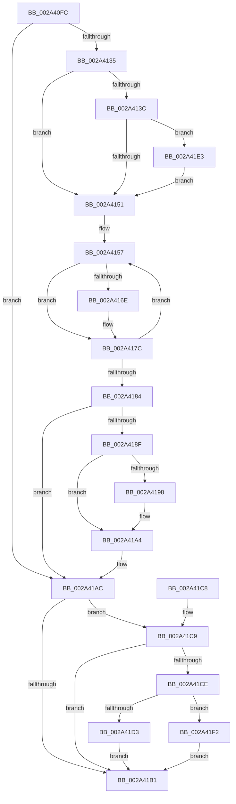

# ExpUnblockPushLock

- RVA: `0x002A40FC`–`0x002A420C` (길이 `272` bytes)
- VA: `0x00000001402A40FC`
- 실행 섹션: `.text`
- PDB 이름 있음: `예`; PDB Function 태그: `아니요`
- unwind 정보 RVA: `0x00068884`
- 디코드: `81`개 명령, `272/272` bytes 표시
- 미해석 바이트: `0` (있으면 어셈블리에 `.byte`로 보존)

> 이 문서는 커널 이미지의 기계어와 PDB 기호를 분석해 생성했습니다. 4번과 5번은 함수 원형과 자료형을 바이너리 사용 방식에서 추정한 C 해석이며 원본 소스 복구 결과는 아닙니다.

## 1. Dependencies

- 직접 호출 지점: **5**; 고유 호출 대상: **5**
- 직접 호출자로 확인된 함수: **13**
- RIP 상대 이미지 참조: **1**

### Outgoing calls
- `0x002A4177` → [KeSetEvent](../33/KeSetEvent_function_0033F310.md) (function, `0x0033F310`)
- `0x002A419F` → [KiLowerIrqlProcessIrqlFlags](../4F/KiLowerIrqlProcessIrqlFlags_function_004F5698.md) (function, `0x004F5698`)
- `0x002A41DC` → [ExTimedWaitForUnblockPushLock](ExTimedWaitForUnblockPushLock_function_002A44B0.md) (function, `0x002A44B0`)
- `0x002A41E8` → [KiRaiseIrqlProcessIrqlFlags](../4F/KiRaiseIrqlProcessIrqlFlags_function_004F56FC.md) (function, `0x004F56FC`)
- `0x002A4205` → [KeWaitForSingleObject](../20/KeWaitForSingleObject_function_0020E6B0.md) (function, `0x0020E6B0`)

### Direct callers
- [MiUnlockImageSection](MiUnlockImageSection_function_002A3AF0.md) at `0x002A3BCE`
- [ExfUnblockPushLock](ExfUnblockPushLock_function_002A3FE0.md) at `0x002A3FE7`
- [PspHandleTableWalker](PspHandleTableWalker_function_002A4000.md) at `0x002A4028`
- [ExUnblockOnAddressPushLockEx](ExUnblockOnAddressPushLockEx_function_002A4060.md) at `0x002A407C`
- [ExUnblockPushLockEx](ExUnblockPushLockEx_function_002A40B0.md) at `0x002A40CC`
- [ExBlockOnAddressPushLock](ExBlockOnAddressPushLock_function_002A43A0.md) at `0x002A4463`
- [ExTimedWaitForUnblockPushLock](ExTimedWaitForUnblockPushLock_function_002A44B0.md) at `0x002A4588`
- [CmpTryToRundownHive](CmpTryToRundownHive_function_002A4A60.md) at `0x002A4B21`
- [CmpTryToRundownHive](CmpTryToRundownHive_function_002A4A60.md) at `0x002A4C9E`
- [CmpDecrementAppHiveUnloadCount](CmpDecrementAppHiveUnloadCount_function_002A5A38.md) at `0x002A5A6E`
- [RtlpCSparseBitmapPageDecommit](../2E/RtlpCSparseBitmapPageDecommit_function_002EFAD4.md) at `0x002EFEF9`
- [RtlpCSparseBitmapWaitOnAddress](../2E/RtlpCSparseBitmapWaitOnAddress_function_002EFF0C.md) at `0x002EFF9B`
- [RtlReleaseSwapReference](../37/RtlReleaseSwapReference_function_0037885C.md) at `0x003788C3`
- [CmpWaitForLateUnloadWorker](../45/CmpWaitForLateUnloadWorker_function_004573F8.md) at `0x0045746C`

### Static image references
- `0x002A4144` → RVA `0x00FC6D20` (`ALMOSTRO`; read)

## 2. Other-region calls and transfers

- 다른 실행 섹션으로 향하는 call: **0**
- 별도 외부 분기/꼬리 이동을 확인하지 못했습니다.

## 3. Assembly (complete function range)

```asm
002A40FC  48 89 5C 24 08                  mov qword ptr [rsp + 8], rbx
002A4101  48 89 6C 24 10                  mov qword ptr [rsp + 0x10], rbp
002A4106  44 88 44 24 18                  mov byte ptr [rsp + 0x18], r8b
002A410B  56                              push rsi
002A410C  57                              push rdi
002A410D  41 54                           push r12
002A410F  41 56                           push r14
002A4111  41 57                           push r15
002A4113  48 83 EC 30                     sub rsp, 0x30
002A4117  33 DB                           xor ebx, ebx
002A4119  40 32 ED                        xor bpl, bpl
002A411C  48 87 19                        xchg qword ptr [rcx], rbx
002A411F  B8 02 00 00 00                  mov eax, 2
002A4124  45 8A E0                        mov r12b, r8b
002A4127  48 8B F2                        mov rsi, rdx
002A412A  4C 8B F9                        mov r15, rcx
002A412D  40 8A F8                        mov dil, al
002A4130  48 85 DB                        test rbx, rbx
002A4133  74 77                           je 0x1402a41ac
002A4135  48 83 7B 18 00                  cmp qword ptr [rbx + 0x18], 0
002A413A  74 15                           je 0x1402a4151
002A413C  44 0F 20 C7                     mov rdi, cr8
002A4140  44 0F 22 C0                     mov cr8, rax
002A4144  83 3D D5 2B D2 00 00            cmp dword ptr [rip + 0xd22bd5], 0
002A414B  0F 85 92 00 00 00               jne 0x1402a41e3
002A4151  41 BC 01 00 00 00               mov r12d, 1
002A4157  4C 8B 73 18                     mov r14, qword ptr [rbx + 0x18]
002A415B  48 3B DE                        cmp rbx, rsi
002A415E  40 0F B6 ED                     movzx ebp, bpl
002A4162  41 0F 44 EC                     cmove ebp, r12d
002A4166  F0 0F BA 73 34 01               lock btr dword ptr [rbx + 0x34], 1
002A416C  72 0E                           jb 0x1402a417c
002A416E  45 33 C0                        xor r8d, r8d
002A4171  41 8B D4                        mov edx, r12d
002A4174  48 8B CB                        mov rcx, rbx
002A4177  E8 94 B1 09 00                  call 0x14033f310
002A417C  49 8B DE                        mov rbx, r14
002A417F  4D 85 F6                        test r14, r14
002A4182  75 D3                           jne 0x1402a4157
002A4184  44 8A 64 24 70                  mov r12b, byte ptr [rsp + 0x70]
002A4189  40 80 FF 02                     cmp dil, 2
002A418D  74 1D                           je 0x1402a41ac
002A418F  44 39 35 8A 2B D2 00            cmp dword ptr [rip + 0xd22b8a], r14d
002A4196  74 0C                           je 0x1402a41a4
002A4198  44 0F 20 C1                     mov rcx, cr8
002A419C  40 8A D7                        mov dl, dil
002A419F  E8 F4 14 25 00                  call 0x1404f5698
002A41A4  40 0F B6 C7                     movzx eax, dil
002A41A8  44 0F 22 C0                     mov cr8, rax
002A41AC  48 85 F6                        test rsi, rsi
002A41AF  75 18                           jne 0x1402a41c9
002A41B1  48 8B 5C 24 60                  mov rbx, qword ptr [rsp + 0x60]
002A41B6  48 8B 6C 24 68                  mov rbp, qword ptr [rsp + 0x68]
002A41BB  48 83 C4 30                     add rsp, 0x30
002A41BF  41 5F                           pop r15
002A41C1  41 5E                           pop r14
002A41C3  41 5C                           pop r12
002A41C5  5F                              pop rdi
002A41C6  5E                              pop rsi
002A41C7  C3                              ret
002A41C8  CC                              int3
002A41C9  40 84 ED                        test bpl, bpl
002A41CC  75 E3                           jne 0x1402a41b1
002A41CE  45 84 E4                        test r12b, r12b
002A41D1  75 1F                           jne 0x1402a41f2
002A41D3  45 33 C0                        xor r8d, r8d
002A41D6  48 8B D6                        mov rdx, rsi
002A41D9  49 8B CF                        mov rcx, r15
002A41DC  E8 CF 02 00 00                  call 0x1402a44b0
002A41E1  EB CE                           jmp 0x1402a41b1
002A41E3  8A D0                           mov dl, al
002A41E5  40 8A CF                        mov cl, dil
002A41E8  E8 0F 15 25 00                  call 0x1404f56fc
002A41ED  E9 5F FF FF FF                  jmp 0x1402a4151
002A41F2  48 83 64 24 20 00               and qword ptr [rsp + 0x20], 0
002A41F8  45 33 C9                        xor r9d, r9d
002A41FB  45 33 C0                        xor r8d, r8d
002A41FE  48 8B CE                        mov rcx, rsi
002A4201  41 8D 51 1C                     lea edx, [r9 + 0x1c]
002A4205  E8 A6 A4 F6 FF                  call 0x14020e6b0
002A420A  EB A5                           jmp 0x1402a41b1
```

## 4. C-style interpretation (structured pseudocode)

```c
__int64 __fastcall ExpUnblockPushLock(__int64 a1, __int64 a2, int a3, int a4)
{
    __int64 result;
    __int64 v_rbp;
    __int64 v_rbx;
    __int64 v_rsp;
    unsigned __int64 v_stack_p10;
    unsigned __int8 v_stack_p18;
    unsigned __int64 v_stack_p20;
    unsigned __int64 v_stack_p8;

    v_stack_p8 = v_rbx;
    v_stack_p10 = v_rbp;
    v_stack_p18 = (unsigned __int8)(a3);
    v_rsp = (v_rsp) - (48);
    v_rbx = 0;
    v_rbp = 0;
    if (0 == 0) goto loc_002A41AC;
    if ((*(unsigned __int64 *)(v_rbx + 24)) == 0) goto loc_002A4151;
    if ((*(unsigned int *)(v_rip + 13773781)) != 0) goto loc_002A41E3;
loc_002A4151:
loc_002A4157:
    v_rbp = 0;
    if (0 == a2) { v_rbp = 1; }
    result = 2;
    if (0 >= a2) {
        a3 = 0;
        a2 = 1;
        a1 = 0;
        result = KeSetEvent(a1, a2, a3, a4);
    }
    if (*(unsigned __int64 *)(v_rbx + 24) != 0) goto loc_002A4157;
    if (((unsigned __int8)(v_cr8)) == 2) goto loc_002A41AC;
    if ((*(unsigned int *)(v_rip + 13773706)) != ((unsigned int)(*(unsigned __int64 *)(v_rbx + 24)))) {
        a1 = 2;
        a2 = (unsigned __int8)(v_cr8);
        result = KiLowerIrqlProcessIrqlFlags(a1, a2, a3, a4);
    }
loc_002A41AC:
    if (a2 != 0) goto loc_002A41C9;
loc_002A41B1:
    v_rsp = (v_rsp) + (48);
    return (unsigned __int8)(v_cr8);
loc_002A41C9:
    if ((unsigned __int8)(v_stack_p10) != 0) goto loc_002A41B1;
    if ((unsigned __int8)(v_stack_p18) != 0) goto loc_002A41F2;
    a3 = 0;
    result = ExTimedWaitForUnblockPushLock(a1, a2, a3, a4);
    goto loc_002A41B1;
loc_002A41E3:
    result = KiRaiseIrqlProcessIrqlFlags((unsigned __int8)(v_cr8), (unsigned __int8)(result), a3, a4);
    goto loc_002A4151;
loc_002A41F2:
    a4 = 0;
    a3 = 0;
    result = KeWaitForSingleObject(a2, a4 + 28, a3, a4);
    goto loc_002A41B1;
}
```

## 5. (Beta) C Style

```c
int64_t ExpUnblockPushLock(void *Arg1, int64_t Arg2, int32_t Arg3, int32_t Arg4)
{
    uint8_t *arg1 = (uint8_t *)Arg1;

    int64_t result;
    int64_t local_rbp;
    int64_t local_rbx;
    int64_t local_rsp;
    uint64_t v_stack_p10;
    uint8_t v_stack_p18;
    uint64_t v_stack_p20;
    uint64_t v_stack_p8;

    v_stack_p8 = local_rbx;
    v_stack_p10 = local_rbp;
    v_stack_p18 = (uint8_t)(Arg3);
    local_rsp = (local_rsp) - (48);
    local_rbx = 0;
    local_rbp = 0;
    if (0 == 0) goto loc_002A41AC;
    if ((*(uint64_t *)(local_rbx + 0x18)) == 0) goto loc_002A4151;
    if ((*(uint32_t *)(v_rip + 0xD22BD5)) != 0) goto loc_002A41E3;
loc_002A4151:
loc_002A4157:
    local_rbp = 0;
    if (0 == Arg2) { local_rbp = 1; }
    result = 2;
    if (0 >= Arg2) {
        Arg3 = 0;
        Arg2 = 1;
        Arg1 = 0;
        result = KeSetEvent(Arg1, Arg2, Arg3, Arg4);
    }
    if (*(uint64_t *)(local_rbx + 0x18) != 0) goto loc_002A4157;
    if (((uint8_t)(v_cr8)) == 2) goto loc_002A41AC;
    if ((*(uint32_t *)(v_rip + 0xD22B8A)) != ((uint32_t)(*(uint64_t *)(local_rbx + 0x18)))) {
        Arg1 = 2;
        Arg2 = (uint8_t)(v_cr8);
        result = KiLowerIrqlProcessIrqlFlags(Arg1, Arg2, Arg3, Arg4);
    }
loc_002A41AC:
    if (Arg2 != 0) goto loc_002A41C9;
loc_002A41B1:
    local_rsp = (local_rsp) + (48);
    return (uint8_t)(v_cr8);
loc_002A41C9:
    if ((uint8_t)(v_stack_p10) != 0) goto loc_002A41B1;
    if ((uint8_t)(v_stack_p18) != 0) goto loc_002A41F2;
    Arg3 = 0;
    result = ExTimedWaitForUnblockPushLock(Arg1, Arg2, Arg3, Arg4);
    goto loc_002A41B1;
loc_002A41E3:
    result = KiRaiseIrqlProcessIrqlFlags((uint8_t)(v_cr8), (uint8_t)(result), Arg3, Arg4);
    goto loc_002A4151;
loc_002A41F2:
    Arg4 = 0;
    Arg3 = 0;
    result = KeWaitForSingleObject(Arg2, Arg4 + 28, Arg3, Arg4);
    goto loc_002A41B1;
}
```

### 관측된 메모리 오프셋

구조체 형식이 확인되지 않은 접근은 인자 기준의 오프셋으로만 기록했습니다.

| 기준 인자 | 오프셋 표현 | 폭 (bit) | 접근 |
|---|---:|---:|---|
| `Arg1` | `+ 0x0` | `64` | `R/W` |

## 6. Execution-region graph

[열기: 2D/3D 그래프와 함수 탐색 컨트롤 패널](../../../control-panel.html?section=text&rva=0x002A40FC&view=graph)

- 2D 그래프는 위에서 아래로 흐르고, 3D 그래프는 빈 공간을 드래그해 회전합니다. Shift+드래그는 이동, 휠은 확대·축소, 함수 노드 선택은 대상 보고서 이동입니다.

### Static fallback


