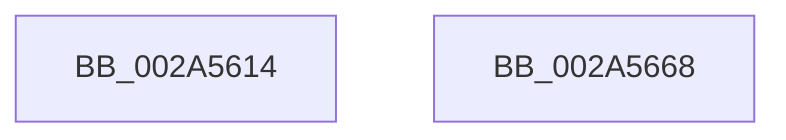

# IoStopDiskIoAttributionForContext

- RVA: `0x002A5614`–`0x002A5669` (길이 `85` bytes)
- VA: `0x00000001402A5614`
- 실행 섹션: `.text`
- PDB 이름 있음: `예`; PDB Function 태그: `아니요`
- unwind 정보 RVA: `0x0005CAAC`
- 디코드: `21`개 명령, `85/85` bytes 표시
- 미해석 바이트: `0` (있으면 어셈블리에 `.byte`로 보존)

> 이 문서는 커널 이미지의 기계어와 PDB 기호를 분석해 생성했습니다. 4번과 5번은 함수 원형과 자료형을 바이너리 사용 방식에서 추정한 C 해석이며 원본 소스 복구 결과는 아닙니다.

## 1. Dependencies

- 직접 호출 지점: **4**; 고유 호출 대상: **4**
- 직접 호출자로 확인된 함수: **3**
- RIP 상대 이미지 참조: **2**

### Outgoing calls
- `0x002A5628` → [ExAcquireSpinLockExclusive](../24/ExAcquireSpinLockExclusive_function_00248690.md) (function, `0x00248690`)
- `0x002A5639` → [RtlRbRemoveNode](../2E/RtlRbRemoveNode_function_002E4C10.md) (function, `0x002E4C10`)
- `0x002A564C` → [ExReleaseSpinLockExclusive](../2C/ExReleaseSpinLockExclusive_function_002C0EF0.md) (function, `0x002C0EF0`)
- `0x002A5658` → [ExWaitForRundownProtectionRelease](ExWaitForRundownProtectionRelease_function_002A4CB0.md) (function, `0x002A4CB0`)

### Direct callers
- [PspIoRateEntryDeactivate](../../page/9F/PspIoRateEntryDeactivate_function_009F7BD4.md) at `0x009F7C04`
- [PspRemoveIoAttribution](../../page/9F/PspRemoveIoAttribution_function_009F8014.md) at `0x009F8032`
- [PspIoRateEntryActivate](../../page/9F/PspIoRateEntryActivate_function_009F8398.md) at `0x009F849D`

### Static image references
- `0x002A5621` → RVA `0x00F8D1E0` (`.data`; read)
- `0x002A5630` → RVA `0x00F8D420` (`.data`; read)

## 2. Other-region calls and transfers

- 다른 실행 섹션으로 향하는 call: **0**
- 별도 외부 분기/꼬리 이동을 확인하지 못했습니다.

## 3. Assembly (complete function range)

```asm
002A5614  48 89 5C 24 08                  mov qword ptr [rsp + 8], rbx
002A5619  57                              push rdi
002A561A  48 83 EC 20                     sub rsp, 0x20
002A561E  48 8B F9                        mov rdi, rcx
002A5621  48 8D 0D B8 7B CE 00            lea rcx, [rip + 0xce7bb8]
002A5628  E8 63 30 FA FF                  call 0x140248690
002A562D  48 8B D7                        mov rdx, rdi
002A5630  48 8D 0D E9 7D CE 00            lea rcx, [rip + 0xce7de9]
002A5637  8A D8                           mov bl, al
002A5639  E8 D2 F5 03 00                  call 0x1402e4c10
002A563E  48 83 4F 10 FF                  or qword ptr [rdi + 0x10], 0xffffffffffffffff
002A5643  48 8D 0D 96 7B CE 00            lea rcx, [rip + 0xce7b96]
002A564A  8A D3                           mov dl, bl
002A564C  E8 9F B8 01 00                  call 0x1402c0ef0
002A5651  48 8D 8F A8 00 00 00            lea rcx, [rdi + 0xa8]
002A5658  E8 53 F6 FF FF                  call 0x1402a4cb0
002A565D  48 8B 5C 24 30                  mov rbx, qword ptr [rsp + 0x30]
002A5662  48 83 C4 20                     add rsp, 0x20
002A5666  5F                              pop rdi
002A5667  C3                              ret
002A5668  CC                              int3
```

## 4. C-style interpretation (structured pseudocode)

```c
__int64 __fastcall IoStopDiskIoAttributionForContext(__int64 a1)
{
    __int64 result;
    __int64 v_rsp;
    unsigned __int64 v_stack_p8;

    v_stack_p8 = v_rbx;
    v_rsp = (v_rsp) - (32);
    result = ExAcquireSpinLockExclusive(v_rip + 13532088, a2, a3, a4);
    result = RtlRbRemoveNode(v_rip + 13532649, a1, a3, a4);
    result = ExReleaseSpinLockExclusive(v_rip + 13532054, (unsigned __int8)((unsigned __int8)(result)), a3, a4);
    result = ExWaitForRundownProtectionRelease(a1 + 168, (unsigned __int8)((unsigned __int8)(result)), a3, a4);
    v_rsp = (v_rsp) + (32);
    return result;
}
```

## 5. (Beta) C Style

```c
int64_t IoStopDiskIoAttributionForContext(void *Arg1)
{
    uint8_t *arg1 = (uint8_t *)Arg1;

    int64_t result;
    int64_t local_rsp;
    uint64_t v_stack_p8;

    v_stack_p8 = local_rbx;
    local_rsp = (local_rsp) - (32);
    result = ExAcquireSpinLockExclusive(v_rip + 13532088, a2, a3, a4);
    result = RtlRbRemoveNode(v_rip + 13532649, Arg1, a3, a4);
    result = ExReleaseSpinLockExclusive(v_rip + 13532054, (uint8_t)((uint8_t)(result)), a3, a4);
    result = ExWaitForRundownProtectionRelease(Arg1 + 168, (uint8_t)((uint8_t)(result)), a3, a4);
    local_rsp = (local_rsp) + (32);
    return result;
}
```

### 관측된 메모리 오프셋

구조체 형식이 확인되지 않은 접근은 인자 기준의 오프셋으로만 기록했습니다.

| 기준 인자 | 오프셋 표현 | 폭 (bit) | 접근 |
|---|---:|---:|---|
| `Arg1` | `+ 0x10` | `64` | `R/W` |
| `Arg1` | `+ 0xA8` | `64` | `R` |

## 6. Execution-region graph

[열기: 2D/3D 그래프와 함수 탐색 컨트롤 패널](../../../control-panel.html?section=text&rva=0x002A5614&view=graph)

- 2D 그래프는 위에서 아래로 흐르고, 3D 그래프는 빈 공간을 드래그해 회전합니다. Shift+드래그는 이동, 휠은 확대·축소, 함수 노드 선택은 대상 보고서 이동입니다.

### Static fallback


