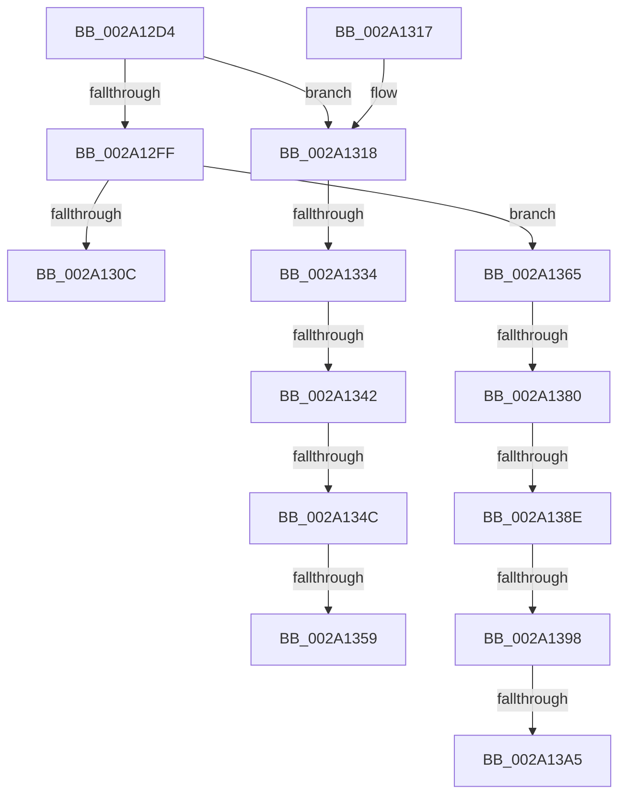

# KeDeleteThread

- RVA: `0x002A12D4`–`0x002A13B1` (길이 `221` bytes)
- VA: `0x00000001402A12D4`
- 실행 섹션: `.text`
- PDB 이름 있음: `예`; PDB Function 태그: `예`
- unwind 정보 RVA: `0x000684B4`
- 디코드: `50`개 명령, `221/221` bytes 표시
- 미해석 바이트: `0` (있으면 어셈블리에 `.byte`로 보존)

> 이 문서는 커널 이미지의 기계어와 PDB 기호를 분석해 생성했습니다. 4번과 5번은 함수 원형과 자료형을 바이너리 사용 방식에서 추정한 C 해석이며 원본 소스 복구 결과는 아닙니다.

## 1. Dependencies

- 직접 호출 지점: **4**; 고유 호출 대상: **3**
- 직접 호출자로 확인된 함수: **1**
- RIP 상대 이미지 참조: **2**

### Outgoing calls
- `0x002A12E1` → [KiWaitForContextSwap](KiWaitForContextSwap_function_002A172C.md) (function, `0x002A172C`)
- `0x002A12ED` → [KiDecrementProcessStackCount](KiDecrementProcessStackCount_function_002A1620.md) (function, `0x002A1620`)
- `0x002A131F` → [KeAcquireSpinLockRaiseToDpc](../20/KeAcquireSpinLockRaiseToDpc_function_00208470.md) (function, `0x00208470`)
- `0x002A136C` → [KeAcquireSpinLockRaiseToDpc](../20/KeAcquireSpinLockRaiseToDpc_function_00208470.md) (function, `0x00208470`)

### Direct callers
- [PspReaper](PspReaper_function_002A1220.md) at `0x002A1247`

### Static image references
- `0x002A1318` → RVA `0x00F22D38` (`.data`; read)
- `0x002A1365` → RVA `0x00F22E58` (`.data`; read)

## 2. Other-region calls and transfers

- 다른 실행 섹션으로 향하는 call: **0**
- call이 아닌 외부 분기/꼬리 이동: **10**
  - `0x002A132E` → [sub_006DAE02](../6D/Unknown_function_006DAE02.md) (`tail-transfer`)
  - `0x002A133C` → [sub_006DAE02](../6D/Unknown_function_006DAE02.md) (`tail-transfer`)
  - `0x002A1346` → [sub_006DAE02 + 0x15](../6D/Unknown_function_006DAE02.md) (`tail-transfer`)
  - `0x002A1353` → [sub_006DAE02 + 0x15](../6D/Unknown_function_006DAE02.md) (`tail-transfer`)
  - `0x002A1360` → [sub_006DAE02](../6D/Unknown_function_006DAE02.md) (`tail-transfer`)
  - `0x002A137A` → [sub_006DAE02 + 0x1C](../6D/Unknown_function_006DAE02.md) (`tail-transfer`)
  - `0x002A1388` → [sub_006DAE02 + 0x1C](../6D/Unknown_function_006DAE02.md) (`tail-transfer`)
  - `0x002A1392` → [sub_006DAE02 + 0x15](../6D/Unknown_function_006DAE02.md) (`tail-transfer`)
  - `0x002A139F` → [sub_006DAE02 + 0x15](../6D/Unknown_function_006DAE02.md) (`tail-transfer`)
  - `0x002A13AC` → [sub_006DAE02 + 0x1C](../6D/Unknown_function_006DAE02.md) (`tail-transfer`)

## 3. Assembly (complete function range)

```asm
002A12D4  48 89 5C 24 08                  mov qword ptr [rsp + 8], rbx
002A12D9  57                              push rdi
002A12DA  48 83 EC 20                     sub rsp, 0x20
002A12DE  48 8B F9                        mov rdi, rcx
002A12E1  E8 46 04 00 00                  call 0x1402a172c
002A12E6  48 8B 8F B8 00 00 00            mov rcx, qword ptr [rdi + 0xb8]
002A12ED  E8 2E 03 00 00                  call 0x1402a1620
002A12F2  48 8D 9F 70 03 00 00            lea rbx, [rdi + 0x370]
002A12F9  48 83 3B 01                     cmp qword ptr [rbx], 1
002A12FD  75 19                           jne 0x1402a1318
002A12FF  48 8D 9F F0 03 00 00            lea rbx, [rdi + 0x3f0]
002A1306  48 83 3B 01                     cmp qword ptr [rbx], 1
002A130A  75 59                           jne 0x1402a1365
002A130C  48 8B 5C 24 30                  mov rbx, qword ptr [rsp + 0x30]
002A1311  48 83 C4 20                     add rsp, 0x20
002A1315  5F                              pop rdi
002A1316  C3                              ret
002A1317  CC                              int3
002A1318  48 8D 0D 19 1A C8 00            lea rcx, [rip + 0xc81a19]
002A131F  E8 4C 71 F6 FF                  call 0x140208470
002A1324  48 8B 13                        mov rdx, qword ptr [rbx]
002A1327  44 8A C0                        mov r8b, al
002A132A  48 83 FA 01                     cmp rdx, 1
002A132E  0F 84 CE 9A 43 00               je 0x1406dae02
002A1334  48 83 BF 78 03 00 00 00         cmp qword ptr [rdi + 0x378], 0
002A133C  0F 84 C0 9A 43 00               je 0x1406dae02
002A1342  48 39 5A 08                     cmp qword ptr [rdx + 8], rbx
002A1346  0F 85 CB 9A 43 00               jne 0x1406dae17
002A134C  48 8B 43 08                     mov rax, qword ptr [rbx + 8]
002A1350  48 39 18                        cmp qword ptr [rax], rbx
002A1353  0F 85 BE 9A 43 00               jne 0x1406dae17
002A1359  48 89 10                        mov qword ptr [rax], rdx
002A135C  48 89 42 08                     mov qword ptr [rdx + 8], rax
002A1360  E9 9D 9A 43 00                  jmp 0x1406dae02
002A1365  48 8D 0D EC 1A C8 00            lea rcx, [rip + 0xc81aec]
002A136C  E8 FF 70 F6 FF                  call 0x140208470
002A1371  48 8B 0B                        mov rcx, qword ptr [rbx]
002A1374  8A D0                           mov dl, al
002A1376  48 83 F9 01                     cmp rcx, 1
002A137A  0F 84 9E 9A 43 00               je 0x1406dae1e
002A1380  48 83 BF F8 03 00 00 00         cmp qword ptr [rdi + 0x3f8], 0
002A1388  0F 84 90 9A 43 00               je 0x1406dae1e
002A138E  48 39 59 08                     cmp qword ptr [rcx + 8], rbx
002A1392  0F 85 7F 9A 43 00               jne 0x1406dae17
002A1398  48 8B 43 08                     mov rax, qword ptr [rbx + 8]
002A139C  48 39 18                        cmp qword ptr [rax], rbx
002A139F  0F 85 72 9A 43 00               jne 0x1406dae17
002A13A5  48 89 08                        mov qword ptr [rax], rcx
002A13A8  48 89 41 08                     mov qword ptr [rcx + 8], rax
002A13AC  E9 6D 9A 43 00                  jmp 0x1406dae1e
```

## 4. C-style interpretation (structured pseudocode)

```c
__int64 __fastcall KeDeleteThread(__int64 a1)
{
    __int64 result;
    __int64 v_rsp;
    unsigned __int64 v_stack_p8;

    v_stack_p8 = v_rbx;
    v_rsp = (v_rsp) - (32);
    result = KiWaitForContextSwap(a1, a2, a3, a4);
    result = KiDecrementProcessStackCount(*(unsigned __int64 *)(a1 + 184), a2, a3, a4);
    if ((*(unsigned __int64 *)(a1 + 880)) != 1) goto loc_002A1318;
    if ((*(unsigned __int64 *)(a1 + 1008)) != 1) goto loc_002A1365;
    v_rsp = (v_rsp) + (32);
    return result;
loc_002A1318:
    result = KeAcquireSpinLockRaiseToDpc(v_rip + 13113881, a2, a3, a4);
    *(unsigned __int64 *)(*(unsigned __int64 *)(v_stack_p8 + 8)) = *(unsigned __int64 *)(v_stack_p8);
    *(unsigned __int64 *)(*(unsigned __int64 *)(v_stack_p8) + 8) = *(unsigned __int64 *)(v_stack_p8 + 8);
loc_002A1365:
    result = KeAcquireSpinLockRaiseToDpc(v_rip + 13114092, *(unsigned __int64 *)(v_stack_p8), (unsigned __int8)(result), a4);
    *(unsigned __int64 *)(*(unsigned __int64 *)(v_stack_p8 + 8)) = *(unsigned __int64 *)(v_stack_p8);
    *(unsigned __int64 *)(*(unsigned __int64 *)(v_stack_p8) + 8) = *(unsigned __int64 *)(v_stack_p8 + 8);
}
```

## 5. (Beta) C Style

```c
int64_t KeDeleteThread(void *Arg1)
{
    uint8_t *arg1 = (uint8_t *)Arg1;

    int64_t result;
    int64_t local_rsp;
    uint64_t v_stack_p8;

    v_stack_p8 = local_rbx;
    local_rsp = (local_rsp) - (32);
    result = KiWaitForContextSwap(Arg1, a2, a3, a4);
    result = KiDecrementProcessStackCount(*(uint64_t *)(arg1 + 0xB8), a2, a3, a4);
    if ((*(uint64_t *)(arg1 + 0x370)) != 1) goto loc_002A1318;
    if ((*(uint64_t *)(arg1 + 0x3F0)) != 1) goto loc_002A1365;
    local_rsp = (local_rsp) + (32);
    return result;
loc_002A1318:
    result = KeAcquireSpinLockRaiseToDpc(v_rip + 13113881, a2, a3, a4);
    *(uint64_t *)(*(uint64_t *)(v_stack_p8 + 0x8)) = *(uint64_t *)(v_stack_p8);
    *(uint64_t *)(*(uint64_t *)(v_stack_p8) + 0x8) = *(uint64_t *)(v_stack_p8 + 0x8);
loc_002A1365:
    result = KeAcquireSpinLockRaiseToDpc(v_rip + 13114092, *(uint64_t *)(v_stack_p8), (uint8_t)(result), a4);
    *(uint64_t *)(*(uint64_t *)(v_stack_p8 + 0x8)) = *(uint64_t *)(v_stack_p8);
    *(uint64_t *)(*(uint64_t *)(v_stack_p8) + 0x8) = *(uint64_t *)(v_stack_p8 + 0x8);
}
```

### 관측된 메모리 오프셋

구조체 형식이 확인되지 않은 접근은 인자 기준의 오프셋으로만 기록했습니다.

| 기준 인자 | 오프셋 표현 | 폭 (bit) | 접근 |
|---|---:|---:|---|
| `Arg1` | `+ 0x0` | `64` | `R` |
| `Arg1` | `+ 0x8` | `64` | `R` |
| `Arg1` | `+ 0xB8` | `64` | `R` |
| `Arg1` | `+ 0x370` | `64` | `R` |
| `Arg1` | `+ 0x378` | `64` | `R` |
| `Arg1` | `+ 0x3F0` | `64` | `R` |
| `Arg1` | `+ 0x3F8` | `64` | `R` |

## 6. Execution-region graph

[열기: 2D/3D 그래프와 함수 탐색 컨트롤 패널](../../../control-panel.html?section=text&rva=0x002A12D4&view=graph)

- 2D 그래프는 위에서 아래로 흐르고, 3D 그래프는 빈 공간을 드래그해 회전합니다. Shift+드래그는 이동, 휠은 확대·축소, 함수 노드 선택은 대상 보고서 이동입니다.

### Static fallback


