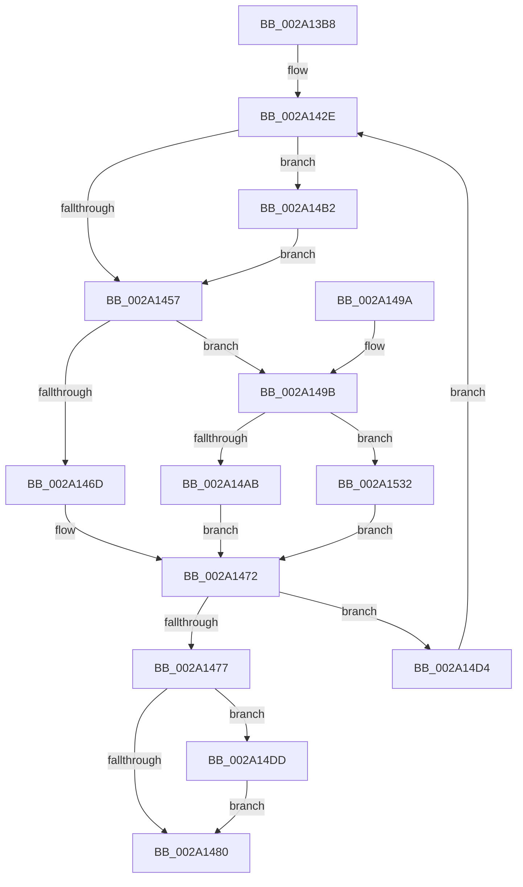

# KeEnumerateKernelStackSegments

- RVA: `0x002A13B8`–`0x002A153F` (길이 `391` bytes)
- VA: `0x00000001402A13B8`
- 실행 섹션: `.text`
- PDB 이름 있음: `예`; PDB Function 태그: `아니요`
- unwind 정보 RVA: `0x000684D4`
- 디코드: `101`개 명령, `391/391` bytes 표시
- 미해석 바이트: `0` (있으면 어셈블리에 `.byte`로 보존)

> 이 문서는 커널 이미지의 기계어와 PDB 기호를 분석해 생성했습니다. 4번과 5번은 함수 원형과 자료형을 바이너리 사용 방식에서 추정한 C 해석이며 원본 소스 복구 결과는 아닙니다.

## 1. Dependencies

- 직접 호출 지점: **5**; 고유 호출 대상: **4**
- 직접 호출자로 확인된 함수: **6**
- RIP 상대 이미지 참조: **5**

### Outgoing calls
- `0x002A146D` → [PspDeleteKernelStack](PspDeleteKernelStack_function_002A1550.md) (function, `0x002A1550`)
- `0x002A1487` → [_security_check_cookie](../6A/_security_check_cookie_function_006AC640.md) (function, `0x006AC640`)
- `0x002A14AB` → [MiOutPageSingleKernelStack](MiOutPageSingleKernelStack_function_002A1790.md) (function, `0x002A1790`)
- `0x002A1528` → [guard_dispatch_icall](../6B/guard_dispatch_icall_function_006BAAD0.md) (function, `0x006BAAD0`)
- `0x002A1535` → [guard_dispatch_icall](../6B/guard_dispatch_icall_function_006BAAD0.md) (function, `0x006BAAD0`)

### Direct callers
- [MmOutPageKernelStack](../29/MmOutPageKernelStack_function_0029FB40.md) at `0x0029FC18`
- [PspReaper](PspReaper_function_002A1220.md) at `0x002A1275`
- [DbgkpLkmdSnapKernelStack](../57/DbgkpLkmdSnapKernelStack_function_0057FED8.md) at `0x0057FF84`
- [IoAddProcessThreadsToDump](../5A/IoAddProcessThreadsToDump_function_005A10AC.md) at `0x005A1117`
- [PspThreadDelete](../../page/A7/PspThreadDelete_function_00A79C20.md) at `0x00A7A07F`
- [PsDereferenceKernelStack](../../page/AA/PsDereferenceKernelStack_function_00AA3630.md) at `0x00AA365A`

### Static image references
- `0x002A13CB` → RVA `0x00E0A740` (`.data`; read)
- `0x002A1457` → RVA `0x002A1550` (`PspDeleteKernelStack`; read)
- `0x002A149B` → RVA `0x002A1790` (`MiOutPageSingleKernelStack`; read)
- `0x002A14E4` → RVA `0x00FC6CF8` (`ALMOSTRO`; read)
- `0x002A14ED` → RVA `0x00FC6C54` (`ALMOSTRO`; read)

## 2. Other-region calls and transfers

- 다른 실행 섹션으로 향하는 call: **0**
- 별도 외부 분기/꼬리 이동을 확인하지 못했습니다.

## 3. Assembly (complete function range)

```asm
002A13B8  40 55                           push rbp
002A13BA  53                              push rbx
002A13BB  56                              push rsi
002A13BC  57                              push rdi
002A13BD  41 56                           push r14
002A13BF  48 8D 6C 24 C9                  lea rbp, [rsp - 0x37]
002A13C4  48 81 EC B0 00 00 00            sub rsp, 0xb0
002A13CB  48 8B 05 6E 93 B6 00            mov rax, qword ptr [rip + 0xb6936e]
002A13D2  48 33 C4                        xor rax, rsp
002A13D5  48 89 45 27                     mov qword ptr [rbp + 0x27], rax
002A13D9  48 8B 41 38                     mov rax, qword ptr [rcx + 0x38]
002A13DD  48 8B D9                        mov rbx, rcx
002A13E0  48 89 45 A7                     mov qword ptr [rbp - 0x59], rax
002A13E4  49 8B F0                        mov rsi, r8
002A13E7  48 8B 41 30                     mov rax, qword ptr [rcx + 0x30]
002A13EB  48 8B FA                        mov rdi, rdx
002A13EE  48 89 45 AF                     mov qword ptr [rbp - 0x51], rax
002A13F2  48 8B 41 58                     mov rax, qword ptr [rcx + 0x58]
002A13F6  48 8B 49 28                     mov rcx, qword ptr [rcx + 0x28]
002A13FA  48 89 45 B7                     mov qword ptr [rbp - 0x49], rax
002A13FE  48 8B 83 18 04 00 00            mov rax, qword ptr [rbx + 0x418]
002A1405  48 89 45 C7                     mov qword ptr [rbp - 0x39], rax
002A1409  48 8B 83 20 04 00 00            mov rax, qword ptr [rbx + 0x420]
002A1410  48 89 45 CF                     mov qword ptr [rbp - 0x31], rax
002A1414  48 8B 83 08 04 00 00            mov rax, qword ptr [rbx + 0x408]
002A141B  48 89 45 D7                     mov qword ptr [rbp - 0x29], rax
002A141F  48 8B 83 10 04 00 00            mov rax, qword ptr [rbx + 0x410]
002A1426  48 89 45 DF                     mov qword ptr [rbp - 0x21], rax
002A142A  48 89 4D BF                     mov qword ptr [rbp - 0x41], rcx
002A142E  0F 28 45 A7                     movaps xmm0, xmmword ptr [rbp - 0x59]
002A1432  0F 28 4D B7                     movaps xmm1, xmmword ptr [rbp - 0x49]
002A1436  0F 29 45 E7                     movaps xmmword ptr [rbp - 0x19], xmm0
002A143A  0F 28 45 C7                     movaps xmm0, xmmword ptr [rbp - 0x39]
002A143E  0F 29 4D F7                     movaps xmmword ptr [rbp - 9], xmm1
002A1442  0F 28 4D D7                     movaps xmm1, xmmword ptr [rbp - 0x29]
002A1446  0F 29 45 07                     movaps xmmword ptr [rbp + 7], xmm0
002A144A  0F 29 4D 17                     movaps xmmword ptr [rbp + 0x17], xmm1
002A144E  4C 8B 71 10                     mov r14, qword ptr [rcx + 0x10]
002A1452  4D 85 F6                        test r14, r14
002A1455  75 5B                           jne 0x1402a14b2
002A1457  48 8D 05 F2 00 00 00            lea rax, [rip + 0xf2]
002A145E  4C 8B C6                        mov r8, rsi
002A1461  48 8D 55 E7                     lea rdx, [rbp - 0x19]
002A1465  48 8B CB                        mov rcx, rbx
002A1468  48 3B F8                        cmp rdi, rax
002A146B  75 2E                           jne 0x1402a149b
002A146D  E8 DE 00 00 00                  call 0x1402a1550
002A1472  4D 85 F6                        test r14, r14
002A1475  75 5D                           jne 0x1402a14d4
002A1477  F7 43 74 00 00 80 00            test dword ptr [rbx + 0x74], 0x800000
002A147E  75 5D                           jne 0x1402a14dd
002A1480  48 8B 4D 27                     mov rcx, qword ptr [rbp + 0x27]
002A1484  48 33 CC                        xor rcx, rsp
002A1487  E8 B4 B1 40 00                  call 0x1406ac640
002A148C  48 81 C4 B0 00 00 00            add rsp, 0xb0
002A1493  41 5E                           pop r14
002A1495  5F                              pop rdi
002A1496  5E                              pop rsi
002A1497  5B                              pop rbx
002A1498  5D                              pop rbp
002A1499  C3                              ret
002A149A  CC                              int3
002A149B  48 8D 05 EE 02 00 00            lea rax, [rip + 0x2ee]
002A14A2  48 3B F8                        cmp rdi, rax
002A14A5  0F 85 87 00 00 00               jne 0x1402a1532
002A14AB  E8 E0 02 00 00                  call 0x1402a1790
002A14B0  EB C0                           jmp 0x1402a1472
002A14B2  0F 10 41 10                     movups xmm0, xmmword ptr [rcx + 0x10]
002A14B6  0F 29 45 A7                     movaps xmmword ptr [rbp - 0x59], xmm0
002A14BA  0F 10 49 20                     movups xmm1, xmmword ptr [rcx + 0x20]
002A14BE  0F 29 4D B7                     movaps xmmword ptr [rbp - 0x49], xmm1
002A14C2  0F 10 41 30                     movups xmm0, xmmword ptr [rcx + 0x30]
002A14C6  0F 29 45 C7                     movaps xmmword ptr [rbp - 0x39], xmm0
002A14CA  0F 10 49 40                     movups xmm1, xmmword ptr [rcx + 0x40]
002A14CE  0F 29 4D D7                     movaps xmmword ptr [rbp - 0x29], xmm1
002A14D2  EB 83                           jmp 0x1402a1457
002A14D4  48 8B 4D BF                     mov rcx, qword ptr [rbp - 0x41]
002A14D8  E9 51 FF FF FF                  jmp 0x1402a142e
002A14DD  4C 8B 53 60                     mov r10, qword ptr [rbx + 0x60]
002A14E1  4C 8B C6                        mov r8, rsi
002A14E4  8B 05 0E 58 D2 00               mov eax, dword ptr [rip + 0xd2580e]
002A14EA  48 8B CB                        mov rcx, rbx
002A14ED  44 8B 0D 60 57 D2 00            mov r9d, dword ptr [rip + 0xd25760]
002A14F4  48 83 65 C7 00                  and qword ptr [rbp - 0x39], 0
002A14F9  4D 03 CA                        add r9, r10
002A14FC  48 83 65 CF 00                  and qword ptr [rbp - 0x31], 0
002A1501  49 8B D1                        mov rdx, r9
002A1504  48 83 65 D7 00                  and qword ptr [rbp - 0x29], 0
002A1509  48 2B D0                        sub rdx, rax
002A150C  48 83 65 DF 00                  and qword ptr [rbp - 0x21], 0
002A1511  48 8B C7                        mov rax, rdi
002A1514  48 89 55 AF                     mov qword ptr [rbp - 0x51], rdx
002A1518  48 8D 55 A7                     lea rdx, [rbp - 0x59]
002A151C  4C 89 4D A7                     mov qword ptr [rbp - 0x59], r9
002A1520  4C 89 55 B7                     mov qword ptr [rbp - 0x49], r10
002A1524  4C 89 4D BF                     mov qword ptr [rbp - 0x41], r9
002A1528  E8 A3 95 41 00                  call 0x1406baad0
002A152D  E9 4E FF FF FF                  jmp 0x1402a1480
002A1532  48 8B C7                        mov rax, rdi
002A1535  E8 96 95 41 00                  call 0x1406baad0
002A153A  E9 33 FF FF FF                  jmp 0x1402a1472
```

## 4. C-style interpretation (structured pseudocode)

```c
__int64 __fastcall KeEnumerateKernelStackSegments(__int64 a1, __int64 a2, __int64 a3)
{
    __int64 result;
    __int64 v_rsp;
    unsigned __int64 v_stack_m38;
    unsigned __int64 v_stack_m48;
    unsigned __int64 v_stack_m58;
    unsigned __int64 v_stack_m5F;
    unsigned __int64 v_stack_m68;
    unsigned __int64 v_stack_m78;
    unsigned __int64 v_stack_m80;
    unsigned __int64 v_stack_m88;
    unsigned __int64 v_stack_m90;
    unsigned __int64 v_stack_m98;
    unsigned __int64 v_stack_mA0;
    unsigned __int64 v_stack_mA8;
    unsigned __int64 v_stack_mB0;
    unsigned __int64 v_stack_mB8;

    v_rsp = (v_rsp) - (176);
    result = (*(unsigned __int64 *)(v_rip + 11965294)) ^ (v_rsp);
    v_stack_m38 = result;
    v_stack_mB8 = *(unsigned __int64 *)(a1 + 56);
    v_stack_mB0 = *(unsigned __int64 *)(a1 + 48);
    v_stack_mA8 = *(unsigned __int64 *)(a1 + 88);
    v_stack_m98 = *(unsigned __int64 *)(a1 + 1048);
    v_stack_m90 = *(unsigned __int64 *)(a1 + 1056);
    v_stack_m88 = *(unsigned __int64 *)(a1 + 1032);
    v_stack_m80 = *(unsigned __int64 *)(a1 + 1040);
    v_stack_mA0 = *(unsigned __int64 *)(a1 + 40);
loc_002A142E:
    v_stack_m78 = v_xmm0;
    v_stack_m68 = v_xmm1;
    v_stack_m58 = v_xmm0;
    v_stack_m48 = v_xmm1;
    if (*(unsigned __int64 *)(*(unsigned __int64 *)(a1 + 40) + 16) != 0) goto loc_002A14B2;
loc_002A1457:
    if (a2 != (v_rip + 242)) goto loc_002A149B;
    result = PspDeleteKernelStack(a1, v_stack_m78, a3, a4);
loc_002A1472:
    if (*(unsigned __int64 *)(*(unsigned __int64 *)(a1 + 40) + 16) != 0) goto loc_002A14D4;
    if (((*(unsigned int *)(a1 + 116)) & (0x800000ULL)) != 0) goto loc_002A14DD;
loc_002A1480:
    a1 = (v_stack_m38) ^ (v_rsp);
    result = _security_check_cookie(a1, v_stack_m78, a3, a4);
    v_rsp = (v_rsp) + (176);
    return result;
loc_002A149B:
    if (a2 != (v_rip + 750)) goto loc_002A1532;
    result = MiOutPageSingleKernelStack(a1, v_stack_m78, a3, a4);
    goto loc_002A1472;
loc_002A14B2:
    v_stack_mB8 = v_xmm0;
    v_stack_mA8 = v_xmm1;
    v_stack_m98 = v_xmm0;
    v_stack_m88 = v_xmm1;
    goto loc_002A1457;
loc_002A14D4:
    goto loc_002A142E;
loc_002A14DD:
    a4 = ((unsigned int)(*(unsigned int *)(v_rip + 13784928))) + (*(unsigned __int64 *)(a1 + 96));
    a2 = (a4) - ((unsigned int)(*(unsigned int *)(v_rip + 13785102)));
    v_stack_mB0 = a2;
    v_stack_mB8 = a4;
    v_stack_mA8 = *(unsigned __int64 *)(a1 + 96);
    v_stack_mA0 = a4;
    result = guard_dispatch_icall(a1, v_stack_mB8, a3, a4);
    goto loc_002A1480;
loc_002A1532:
    result = guard_dispatch_icall(a1, v_stack_mB8, a3, a4);
    goto loc_002A1472;
}
```

## 5. (Beta) C Style

```c
int64_t KeEnumerateKernelStackSegments(void *Arg1, int64_t Arg2, int64_t Arg3)
{
    uint8_t *arg1 = (uint8_t *)Arg1;

    int64_t result;
    int64_t local_rsp;
    uint64_t v_stack_m38;
    uint64_t v_stack_m48;
    uint64_t v_stack_m58;
    uint64_t v_stack_m5F;
    uint64_t v_stack_m68;
    uint64_t v_stack_m78;
    uint64_t v_stack_m80;
    uint64_t v_stack_m88;
    uint64_t v_stack_m90;
    uint64_t v_stack_m98;
    uint64_t v_stack_mA0;
    uint64_t v_stack_mA8;
    uint64_t v_stack_mB0;
    uint64_t v_stack_mB8;

    local_rsp = (local_rsp) - (176);
    result = (*(uint64_t *)(v_rip + 0xB6936E)) ^ (local_rsp);
    v_stack_m38 = result;
    v_stack_mB8 = *(uint64_t *)(arg1 + 0x38);
    v_stack_mB0 = *(uint64_t *)(arg1 + 0x30);
    v_stack_mA8 = *(uint64_t *)(arg1 + 0x58);
    v_stack_m98 = *(uint64_t *)(arg1 + 0x418);
    v_stack_m90 = *(uint64_t *)(arg1 + 0x420);
    v_stack_m88 = *(uint64_t *)(arg1 + 0x408);
    v_stack_m80 = *(uint64_t *)(arg1 + 0x410);
    v_stack_mA0 = *(uint64_t *)(arg1 + 0x28);
loc_002A142E:
    v_stack_m78 = v_xmm0;
    v_stack_m68 = v_xmm1;
    v_stack_m58 = v_xmm0;
    v_stack_m48 = v_xmm1;
    if (*(uint64_t *)(*(uint64_t *)(arg1 + 0x28) + 0x10) != 0) goto loc_002A14B2;
loc_002A1457:
    if (Arg2 != (v_rip + 242)) goto loc_002A149B;
    result = PspDeleteKernelStack(Arg1, v_stack_m78, Arg3, a4);
loc_002A1472:
    if (*(uint64_t *)(*(uint64_t *)(arg1 + 0x28) + 0x10) != 0) goto loc_002A14D4;
    if (((*(uint32_t *)(arg1 + 0x74)) & (0x800000ULL)) != 0) goto loc_002A14DD;
loc_002A1480:
    Arg1 = (v_stack_m38) ^ (local_rsp);
    result = _security_check_cookie(Arg1, v_stack_m78, Arg3, a4);
    local_rsp = (local_rsp) + (176);
    return result;
loc_002A149B:
    if (Arg2 != (v_rip + 750)) goto loc_002A1532;
    result = MiOutPageSingleKernelStack(Arg1, v_stack_m78, Arg3, a4);
    goto loc_002A1472;
loc_002A14B2:
    v_stack_mB8 = v_xmm0;
    v_stack_mA8 = v_xmm1;
    v_stack_m98 = v_xmm0;
    v_stack_m88 = v_xmm1;
    goto loc_002A1457;
loc_002A14D4:
    goto loc_002A142E;
loc_002A14DD:
    a4 = ((uint32_t)(*(uint32_t *)(v_rip + 0xD25760))) + (*(uint64_t *)(arg1 + 0x60));
    Arg2 = (a4) - ((uint32_t)(*(uint32_t *)(v_rip + 0xD2580E)));
    v_stack_mB0 = Arg2;
    v_stack_mB8 = a4;
    v_stack_mA8 = *(uint64_t *)(arg1 + 0x60);
    v_stack_mA0 = a4;
    result = guard_dispatch_icall(Arg1, v_stack_mB8, Arg3, a4);
    goto loc_002A1480;
loc_002A1532:
    result = guard_dispatch_icall(Arg1, v_stack_mB8, Arg3, a4);
    goto loc_002A1472;
}
```

### 관측된 메모리 오프셋

구조체 형식이 확인되지 않은 접근은 인자 기준의 오프셋으로만 기록했습니다.

| 기준 인자 | 오프셋 표현 | 폭 (bit) | 접근 |
|---|---:|---:|---|
| `Arg1` | `+ 0x28` | `64` | `R` |
| `Arg1` | `+ 0x30` | `64` | `R` |
| `Arg1` | `+ 0x38` | `64` | `R` |
| `Arg1` | `+ 0x58` | `64` | `R` |
| `Arg1` | `+ 0x60` | `64` | `R` |
| `Arg1` | `+ 0x74` | `32` | `R` |
| `Arg1` | `+ 0x408` | `64` | `R` |
| `Arg1` | `+ 0x410` | `64` | `R` |
| `Arg1` | `+ 0x418` | `64` | `R` |
| `Arg1` | `+ 0x420` | `64` | `R` |

## 6. Execution-region graph

[열기: 2D/3D 그래프와 함수 탐색 컨트롤 패널](../../../control-panel.html?section=text&rva=0x002A13B8&view=graph)

- 2D 그래프는 위에서 아래로 흐르고, 3D 그래프는 빈 공간을 드래그해 회전합니다. Shift+드래그는 이동, 휠은 확대·축소, 함수 노드 선택은 대상 보고서 이동입니다.

### Static fallback


