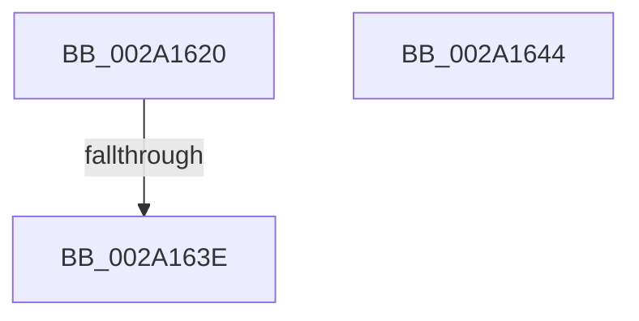

# KiDecrementProcessStackCount

- RVA: `0x002A1620`–`0x002A1645` (길이 `37` bytes)
- VA: `0x00000001402A1620`
- 실행 섹션: `.text`
- PDB 이름 있음: `예`; PDB Function 태그: `아니요`
- unwind 정보 RVA: `0x00068504`
- 디코드: `12`개 명령, `37/37` bytes 표시
- 미해석 바이트: `0` (있으면 어셈블리에 `.byte`로 보존)

> 이 문서는 커널 이미지의 기계어와 PDB 기호를 분석해 생성했습니다. 4번과 5번은 함수 원형과 자료형을 바이너리 사용 방식에서 추정한 C 해석이며 원본 소스 복구 결과는 아닙니다.

## 1. Dependencies

- 직접 호출 지점: **0**; 고유 호출 대상: **0**
- 직접 호출자로 확인된 함수: **4**
- RIP 상대 이미지 참조: **0**

### Outgoing calls
- 직접 디코드된 call 명령이 없습니다.

### Direct callers
- [KiCommitThreadWait](../20/KiCommitThreadWait_function_0020DFE0.md) at `0x0020E45D`
- [KiOutSwapKernelStacks](../29/KiOutSwapKernelStacks_function_0029F628.md) at `0x0029F7E1`
- [KeDeleteThread](KeDeleteThread_function_002A12D4.md) at `0x002A12ED`
- [KiSuspendThread](../46/KiSuspendThread_function_0046B964.md) at `0x0046BBA8`

### Static image references
- 디코드된 RIP-relative 메모리 참조가 없습니다.

## 2. Other-region calls and transfers

- 다른 실행 섹션으로 향하는 call: **0**
- call이 아닌 외부 분기/꼬리 이동: **1**
  - `0x002A163C` → [sub_002A1645](Unknown_function_002A1645.md) (`tail-transfer`)

## 3. Assembly (complete function range)

```asm
002A1620  40 53                           push rbx
002A1622  48 83 EC 20                     sub rsp, 0x20
002A1626  48 8B D9                        mov rbx, rcx
002A1629  B8 F8 FF FF FF                  mov eax, 0xfffffff8
002A162E  F0 0F C1 81 08 01 00 00         lock xadd dword ptr [rcx + 0x108], eax
002A1636  83 E0 F8                        and eax, 0xfffffff8
002A1639  83 F8 08                        cmp eax, 8
002A163C  74 07                           je 0x1402a1645
002A163E  48 83 C4 20                     add rsp, 0x20
002A1642  5B                              pop rbx
002A1643  C3                              ret
002A1644  CC                              int3
```

## 4. C-style interpretation (structured pseudocode)

```c
__int64 __fastcall KiDecrementProcessStackCount(__int64 a1)
{
    __int64 result;
    __int64 v_rsp;

    v_rsp = (v_rsp) - (32);
    result = (unsigned int)(((unsigned int)(0xFFFFFFF8ULL)) & (0xFFFFFFF8ULL));
    v_rsp = (v_rsp) + (32);
    return result;
}
```

## 5. (Beta) C Style

```c
int64_t KiDecrementProcessStackCount(void *Arg1)
{
    uint8_t *arg1 = (uint8_t *)Arg1;

    int64_t result;
    int64_t local_rsp;

    local_rsp = (local_rsp) - (32);
    result = (uint32_t)(((uint32_t)(0xFFFFFFF8ULL)) & (0xFFFFFFF8ULL));
    local_rsp = (local_rsp) + (32);
    return result;
}
```

### 관측된 메모리 오프셋

구조체 형식이 확인되지 않은 접근은 인자 기준의 오프셋으로만 기록했습니다.

| 기준 인자 | 오프셋 표현 | 폭 (bit) | 접근 |
|---|---:|---:|---|
| `Arg1` | `+ 0x108` | `32` | `R/W` |

## 6. Execution-region graph

[열기: 2D/3D 그래프와 함수 탐색 컨트롤 패널](../../../control-panel.html?section=text&rva=0x002A1620&view=graph)

- 2D 그래프는 위에서 아래로 흐르고, 3D 그래프는 빈 공간을 드래그해 회전합니다. Shift+드래그는 이동, 휠은 확대·축소, 함수 노드 선택은 대상 보고서 이동입니다.

### Static fallback


