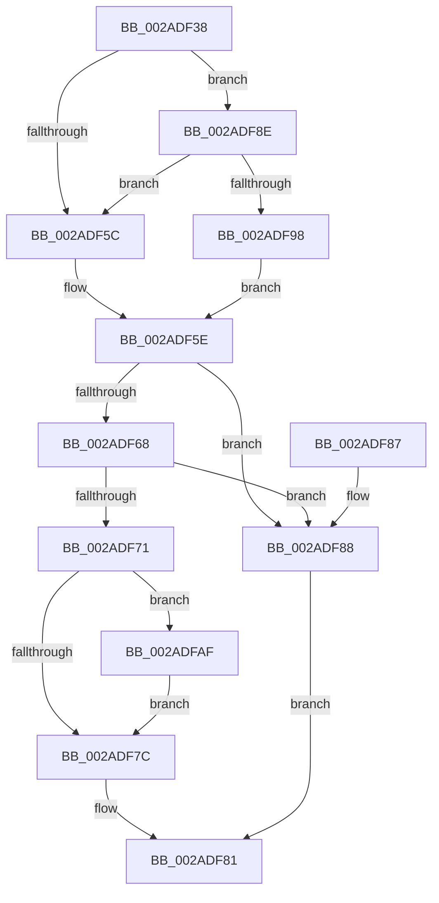

# KiTryToAcquireQueuedSpinLockInstrumented

- RVA: `0x002ADF38`–`0x002ADFD8` (길이 `160` bytes)
- VA: `0x00000001402ADF38`
- 실행 섹션: `.text`
- PDB 이름 있음: `예`; PDB Function 태그: `아니요`
- unwind 정보 RVA: `0x0006D42C`
- 디코드: `49`개 명령, `160/160` bytes 표시
- 미해석 바이트: `0` (있으면 어셈블리에 `.byte`로 보존)

> 이 문서는 커널 이미지의 기계어와 PDB 기호를 분석해 생성했습니다. 4번과 5번은 함수 원형과 자료형을 바이너리 사용 방식에서 추정한 C 해석이며 원본 소스 복구 결과는 아닙니다.

## 1. Dependencies

- 직접 호출 지점: **1**; 고유 호출 대상: **1**
- 직접 호출자로 확인된 함수: **2**
- RIP 상대 이미지 참조: **2**

### Outgoing calls
- `0x002ADFD1` → [PerfLogSpinLockAcquire](../41/PerfLogSpinLockAcquire_function_00414FC4.md) (function, `0x00414FC4`)

### Direct callers
- [KxTryToAcquireQueuedSpinLock](../27/KxTryToAcquireQueuedSpinLock_function_00277388.md) at `0x002773C2`
- [sub_002ADC0C](Unknown_function_002ADC0C.md) at `0x002ADC46`

### Static image references
- `0x002ADF50` → RVA `0x00FC6B06` (`ALMOSTRO`; read)
- `0x002ADF8E` → RVA `0x00F0DE58` (`.data`; read)

## 2. Other-region calls and transfers

- 다른 실행 섹션으로 향하는 call: **0**
- 별도 외부 분기/꼬리 이동을 확인하지 못했습니다.

## 3. Assembly (complete function range)

```asm
002ADF38  40 53                           push rbx
002ADF3A  48 83 EC 30                     sub rsp, 0x30
002ADF3E  65 4C 8B 04 25 20 00 00 00      mov r8, qword ptr gs:[0x20]
002ADF47  45 33 C9                        xor r9d, r9d
002ADF4A  45 33 DB                        xor r11d, r11d
002ADF4D  4C 8B D2                        mov r10, rdx
002ADF50  F6 05 AF 8B D1 00 01            test byte ptr [rip + 0xd18baf], 1
002ADF57  48 8B D9                        mov rbx, rcx
002ADF5A  75 32                           jne 0x1402adf8e
002ADF5C  32 C9                           xor cl, cl
002ADF5E  41 0F 0D 0A                     prefetchw byte ptr [r10]
002ADF62  41 83 3A 00                     cmp dword ptr [r10], 0
002ADF66  75 20                           jne 0x1402adf88
002ADF68  33 C0                           xor eax, eax
002ADF6A  F0 49 0F B1 1A                  lock cmpxchg qword ptr [r10], rbx
002ADF6F  75 17                           jne 0x1402adf88
002ADF71  41 FF 80 C0 8E 00 00            inc dword ptr [r8 + 0x8ec0]
002ADF78  84 C9                           test cl, cl
002ADF7A  75 33                           jne 0x1402adfaf
002ADF7C  B8 01 00 00 00                  mov eax, 1
002ADF81  48 83 C4 30                     add rsp, 0x30
002ADF85  5B                              pop rbx
002ADF86  C3                              ret
002ADF87  CC                              int3
002ADF88  F3 90                           pause
002ADF8A  33 C0                           xor eax, eax
002ADF8C  EB F3                           jmp 0x1402adf81
002ADF8E  8B 05 C4 FE C5 00               mov eax, dword ptr [rip + 0xc5fec4]
002ADF94  85 C0                           test eax, eax
002ADF96  75 C4                           jne 0x1402adf5c
002ADF98  B1 01                           mov cl, 1
002ADF9A  0F 31                           rdtsc
002ADF9C  45 8B 88 40 86 00 00            mov r9d, dword ptr [r8 + 0x8640]
002ADFA3  48 C1 E2 20                     shl rdx, 0x20
002ADFA7  48 0B C2                        or rax, rdx
002ADFAA  4C 8B D8                        mov r11, rax
002ADFAD  EB AF                           jmp 0x1402adf5e
002ADFAF  0F 31                           rdtsc
002ADFB1  48 C1 E2 20                     shl rdx, 0x20
002ADFB5  49 8B CA                        mov rcx, r10
002ADFB8  48 0B C2                        or rax, rdx
002ADFBB  C6 44 24 28 01                  mov byte ptr [rsp + 0x28], 1
002ADFC0  44 8B C0                        mov r8d, eax
002ADFC3  44 89 4C 24 20                  mov dword ptr [rsp + 0x20], r9d
002ADFC8  45 2B C3                        sub r8d, r11d
002ADFCB  45 33 C9                        xor r9d, r9d
002ADFCE  48 8B D0                        mov rdx, rax
002ADFD1  E8 EE 6F 16 00                  call 0x140414fc4
002ADFD6  EB A4                           jmp 0x1402adf7c
```

## 4. C-style interpretation (structured pseudocode)

```c
__int64 __fastcall KiTryToAcquireQueuedSpinLockInstrumented(__int64 a1, __int64 a2, __int64 a3, int a4)
{
    __int64 result;
    __int64 v_r11;
    __int64 v_rsp;
    unsigned int v_stack_p20;
    unsigned __int8 v_stack_p28;

    v_rsp = (v_rsp) - (48);
    a4 = 0;
    v_r11 = 0;
    if (((*(unsigned __int8 *)(v_rip + 13732783)) & (1)) != 0) goto loc_002ADF8E;
loc_002ADF5C:
    a1 = 0;
loc_002ADF5E:
    if ((*(unsigned int *)(a2)) != 0) goto loc_002ADF88;
    result = 0;
    if (condition_is_not_equal) goto loc_002ADF88;
    if (0 != 0) goto loc_002ADFAF;
loc_002ADF7C:
loc_002ADF81:
    v_rsp = (v_rsp) + (48);
    return 1;
loc_002ADF88:
    result = 0;
    goto loc_002ADF81;
loc_002ADF8E:
    if ((unsigned int)((unsigned int)(*(unsigned int *)(v_rip + 12975812))) != 0) goto loc_002ADF5C;
    a2 = (a2) << (32);
    result = ((unsigned int)(*(unsigned int *)(v_rip + 12975812))) | (a2);
    goto loc_002ADF5E;
loc_002ADFAF:
    a2 = (a2) << (32);
    result = (result) | (a2);
    v_stack_p28 = 1;
    v_stack_p20 = (unsigned int)((unsigned int)(*(unsigned int *)(*(unsigned __int64 *)(gs_base + (0 + 32)) + 34368)));
    a3 = (unsigned int)(((unsigned int)((unsigned int)(result))) - ((unsigned int)(result)));
    a4 = 0;
    result = PerfLogSpinLockAcquire(a2, result, a3, a4);
    goto loc_002ADF7C;
}
```

## 5. (Beta) C Style

```c
int64_t KiTryToAcquireQueuedSpinLockInstrumented(int64_t Arg1, void *Arg2, int64_t Arg3, int32_t Arg4)
{
    uint8_t *arg2 = (uint8_t *)Arg2;

    int64_t result;
    int64_t local_r11;
    int64_t local_rsp;
    uint32_t v_stack_p20;
    uint8_t v_stack_p28;

    local_rsp = (local_rsp) - (48);
    Arg4 = 0;
    local_r11 = 0;
    if (((*(uint8_t *)(v_rip + 0xD18BAF)) & (1)) != 0) goto loc_002ADF8E;
loc_002ADF5C:
    Arg1 = 0;
loc_002ADF5E:
    if ((*(uint32_t *)(arg2)) != 0) goto loc_002ADF88;
    result = 0;
    if (condition_is_not_equal) goto loc_002ADF88;
    if (0 != 0) goto loc_002ADFAF;
loc_002ADF7C:
loc_002ADF81:
    local_rsp = (local_rsp) + (48);
    return 1;
loc_002ADF88:
    result = 0;
    goto loc_002ADF81;
loc_002ADF8E:
    if ((uint32_t)((uint32_t)(*(uint32_t *)(v_rip + 0xC5FEC4))) != 0) goto loc_002ADF5C;
    Arg2 = (Arg2) << (32);
    result = ((uint32_t)(*(uint32_t *)(v_rip + 0xC5FEC4))) | (Arg2);
    goto loc_002ADF5E;
loc_002ADFAF:
    Arg2 = (Arg2) << (32);
    result = (result) | (Arg2);
    v_stack_p28 = 1;
    v_stack_p20 = (uint32_t)((uint32_t)(*(uint32_t *)(*(uint64_t *)(gs_base + (0 + 0x20)) + 0x8640)));
    Arg3 = (uint32_t)(((uint32_t)((uint32_t)(result))) - ((uint32_t)(result)));
    Arg4 = 0;
    result = PerfLogSpinLockAcquire(Arg2, result, Arg3, Arg4);
    goto loc_002ADF7C;
}
```

### 관측된 메모리 오프셋

구조체 형식이 확인되지 않은 접근은 인자 기준의 오프셋으로만 기록했습니다.

| 기준 인자 | 오프셋 표현 | 폭 (bit) | 접근 |
|---|---:|---:|---|
| `Arg2` | `+ 0x0` | `8` | `R` |
| `Arg2` | `+ 0x0` | `32` | `R` |
| `Arg2` | `+ 0x0` | `64` | `R` |

## 6. Execution-region graph

[열기: 2D/3D 그래프와 함수 탐색 컨트롤 패널](../../../control-panel.html?section=text&rva=0x002ADF38&view=graph)

- 2D 그래프는 위에서 아래로 흐르고, 3D 그래프는 빈 공간을 드래그해 회전합니다. Shift+드래그는 이동, 휠은 확대·축소, 함수 노드 선택은 대상 보고서 이동입니다.

### Static fallback


