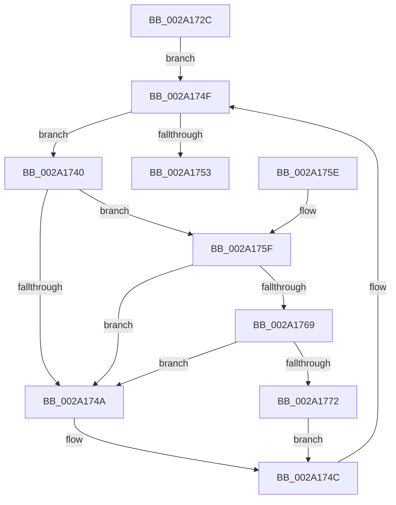

# KiWaitForContextSwap

- RVA: `0x002A172C`–`0x002A177B` (길이 `79` bytes)
- VA: `0x00000001402A172C`
- 실행 섹션: `.text`
- PDB 이름 있음: `예`; PDB Function 태그: `아니요`
- unwind 정보 RVA: `0x0005D394`
- 디코드: `28`개 명령, `79/79` bytes 표시
- 미해석 바이트: `0` (있으면 어셈블리에 `.byte`로 보존)

> 이 문서는 커널 이미지의 기계어와 PDB 기호를 분석해 생성했습니다. 4번과 5번은 함수 원형과 자료형을 바이너리 사용 방식에서 추정한 C 해석이며 원본 소스 복구 결과는 아닙니다.

## 1. Dependencies

- 직접 호출 지점: **2**; 고유 호출 대상: **2**
- 직접 호출자로 확인된 함수: **2**
- RIP 상대 이미지 참조: **2**

### Outgoing calls
- `0x002A1769` → [KiCheckVpBackingLongSpinWaitHypercall](../30/KiCheckVpBackingLongSpinWaitHypercall_function_0030F490.md) (function, `0x0030F490`)
- `0x002A1774` → [HvlNotifyLongSpinWait](../30/HvlNotifyLongSpinWait_function_0030F460.md) (function, `0x0030F460`)

### Direct callers
- [KiOutSwapKernelStacks](../29/KiOutSwapKernelStacks_function_0029F628.md) at `0x0029F7D0`
- [KeDeleteThread](KeDeleteThread_function_002A12D4.md) at `0x002A12E1`

### Static image references
- `0x002A1742` → RVA `0x00FC52AC` (`ALMOSTRO`; reference)
- `0x002A175F` → RVA `0x00FC6AB8` (`ALMOSTRO`; read)

## 2. Other-region calls and transfers

- 다른 실행 섹션으로 향하는 call: **0**
- 별도 외부 분기/꼬리 이동을 확인하지 못했습니다.

## 3. Assembly (complete function range)

```asm
002A172C  48 89 5C 24 08                  mov qword ptr [rsp + 8], rbx
002A1731  57                              push rdi
002A1732  48 83 EC 20                     sub rsp, 0x20
002A1736  8A 41 71                        mov al, byte ptr [rcx + 0x71]
002A1739  48 8B F9                        mov rdi, rcx
002A173C  33 DB                           xor ebx, ebx
002A173E  EB 0F                           jmp 0x1402a174f
002A1740  FF C3                           inc ebx
002A1742  85 1D 64 3B D2 00               test dword ptr [rip + 0xd23b64], ebx
002A1748  74 15                           je 0x1402a175f
002A174A  F3 90                           pause
002A174C  8A 47 71                        mov al, byte ptr [rdi + 0x71]
002A174F  84 C0                           test al, al
002A1751  75 ED                           jne 0x1402a1740
002A1753  48 8B 5C 24 30                  mov rbx, qword ptr [rsp + 0x30]
002A1758  48 83 C4 20                     add rsp, 0x20
002A175C  5F                              pop rdi
002A175D  C3                              ret
002A175E  CC                              int3
002A175F  8B 05 53 53 D2 00               mov eax, dword ptr [rip + 0xd25353]
002A1765  A8 40                           test al, 0x40
002A1767  74 E1                           je 0x1402a174a
002A1769  E8 22 DD 06 00                  call 0x14030f490
002A176E  84 C0                           test al, al
002A1770  74 D8                           je 0x1402a174a
002A1772  8B CB                           mov ecx, ebx
002A1774  E8 E7 DC 06 00                  call 0x14030f460
002A1779  EB D1                           jmp 0x1402a174c
```

## 4. C-style interpretation (structured pseudocode)

```c
__int64 __fastcall KiWaitForContextSwap(__int64 a1)
{
    __int64 result;
    __int64 v_rbx;
    __int64 v_rsp;
    unsigned __int64 v_stack_p8;

    v_stack_p8 = v_rbx;
    v_rsp = (v_rsp) - (32);
    v_rbx = 0;
    goto loc_002A174F;
loc_002A1740:
    v_rbx = (unsigned int)((v_rbx) + 1);
    if (((*(unsigned int *)(v_rip + 13777764)) & ((unsigned int)(v_rbx))) == 0) goto loc_002A175F;
loc_002A174A:
loc_002A174C:
loc_002A174F:
    if ((unsigned __int8)(*(unsigned __int8 *)(a1 + 113)) != 0) goto loc_002A1740;
    v_rsp = (v_rsp) + (32);
    return *(unsigned __int8 *)(a1 + 113);
loc_002A175F:
    if ((((unsigned __int8)((unsigned int)(*(unsigned int *)(v_rip + 13783891)))) & (64)) == 0) goto loc_002A174A;
    result = KiCheckVpBackingLongSpinWaitHypercall(a1, a2, a3, a4);
    if ((unsigned __int8)(result) == 0) goto loc_002A174A;
    result = HvlNotifyLongSpinWait((unsigned int)((unsigned int)(v_stack_p8)), a2, a3, a4);
    goto loc_002A174C;
}
```

## 5. (Beta) C Style

```c
int64_t KiWaitForContextSwap(void *Arg1)
{
    uint8_t *arg1 = (uint8_t *)Arg1;

    int64_t result;
    int64_t local_rbx;
    int64_t local_rsp;
    uint64_t v_stack_p8;

    v_stack_p8 = local_rbx;
    local_rsp = (local_rsp) - (32);
    local_rbx = 0;
    goto loc_002A174F;
loc_002A1740:
    local_rbx = (uint32_t)((local_rbx) + 1);
    if (((*(uint32_t *)(v_rip + 0xD23B64)) & ((uint32_t)(local_rbx))) == 0) goto loc_002A175F;
loc_002A174A:
loc_002A174C:
loc_002A174F:
    if ((uint8_t)(*(uint8_t *)(arg1 + 0x71)) != 0) goto loc_002A1740;
    local_rsp = (local_rsp) + (32);
    return *(uint8_t *)(arg1 + 0x71);
loc_002A175F:
    if ((((uint8_t)((uint32_t)(*(uint32_t *)(v_rip + 0xD25353)))) & (64)) == 0) goto loc_002A174A;
    result = KiCheckVpBackingLongSpinWaitHypercall(Arg1, a2, a3, a4);
    if ((uint8_t)(result) == 0) goto loc_002A174A;
    result = HvlNotifyLongSpinWait((uint32_t)((uint32_t)(v_stack_p8)), a2, a3, a4);
    goto loc_002A174C;
}
```

### 관측된 메모리 오프셋

구조체 형식이 확인되지 않은 접근은 인자 기준의 오프셋으로만 기록했습니다.

| 기준 인자 | 오프셋 표현 | 폭 (bit) | 접근 |
|---|---:|---:|---|
| `Arg1` | `+ 0x71` | `8` | `R` |

## 6. Execution-region graph

[열기: 2D/3D 그래프와 함수 탐색 컨트롤 패널](../../../control-panel.html?section=text&rva=0x002A172C&view=graph)

- 2D 그래프는 위에서 아래로 흐르고, 3D 그래프는 빈 공간을 드래그해 회전합니다. Shift+드래그는 이동, 휠은 확대·축소, 함수 노드 선택은 대상 보고서 이동입니다.

### Static fallback


