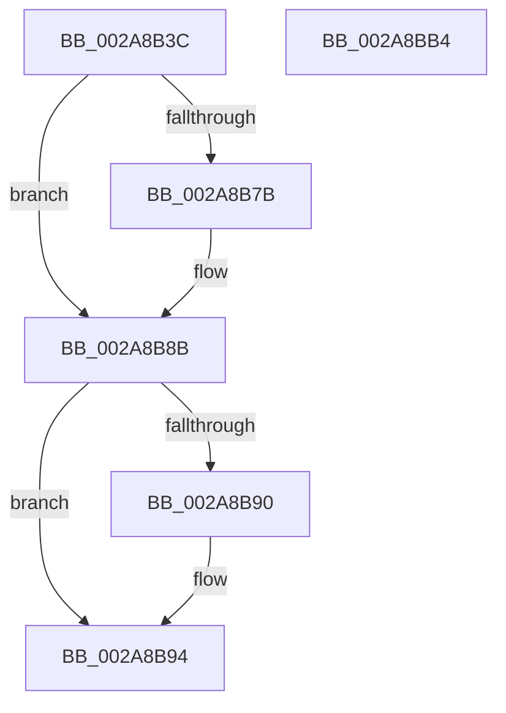

# LOCK_ADDRESS_SPACE_SHARED

- RVA: `0x002A8B3C`–`0x002A8BB5` (길이 `121` bytes)
- VA: `0x00000001402A8B3C`
- 실행 섹션: `.text`
- PDB 이름 있음: `예`; PDB Function 태그: `아니요`
- unwind 정보 RVA: `0x0005FD94`
- 디코드: `35`개 명령, `121/121` bytes 표시
- 미해석 바이트: `0` (있으면 어셈블리에 `.byte`로 보존)

> 이 문서는 커널 이미지의 기계어와 PDB 기호를 분석해 생성했습니다. 4번과 5번은 함수 원형과 자료형을 바이너리 사용 방식에서 추정한 C 해석이며 원본 소스 복구 결과는 아닙니다.

## 1. Dependencies

- 직접 호출 지점: **2**; 고유 호출 대상: **2**
- 직접 호출자로 확인된 함수: **14**
- RIP 상대 이미지 참조: **0**

### Outgoing calls
- `0x002A8B65` → [KeAbPreAcquire](../21/KeAbPreAcquire_function_00210230.md) (function, `0x00210230`)
- `0x002A8B86` → [ExfAcquirePushLockSharedEx](../21/ExfAcquirePushLockSharedEx_function_0021044C.md) (function, `0x0021044C`)

### Direct callers
- [MiEmptyWorkingSetPrivatePagesByVa](MiEmptyWorkingSetPrivatePagesByVa_function_002A6AC0.md) at `0x002A6AF4`
- [MmOutSwapWorkingSet](MmOutSwapWorkingSet_function_002A6BC8.md) at `0x002A6E1B`
- [MmOutSwapVirtualAddresses](MmOutSwapVirtualAddresses_function_002A8C30.md) at `0x002A8DF9`
- [MiHotPatchProcess](../../page/80/MiHotPatchProcess_function_00803B78.md) at `0x00803BB9`
- [MiHotPatchProcess](../../page/80/MiHotPatchProcess_function_00803B78.md) at `0x00803D1C`
- [MmCheckForSafeExecution](../../page/80/MmCheckForSafeExecution_function_008076B0.md) at `0x008076F2`
- [MiAllocateUserPhysicalPages](../../page/80/MiAllocateUserPhysicalPages_function_00809828.md) at `0x00809C1F`
- [MiAllocateUserPhysicalPages](../../page/80/MiAllocateUserPhysicalPages_function_00809828.md) at `0x0080A1B8`
- [MiAllocateUserPhysicalPages](../../page/80/MiAllocateUserPhysicalPages_function_00809828.md) at `0x0080A5C4`
- [MiLockVadRange](../../page/87/MiLockVadRange_function_0087F670.md) at `0x0087F6CA`
- [MiMapAllImageScpPages](../../page/8D/MiMapAllImageScpPages_function_008D0534.md) at `0x008D0563`
- [MiCommitInitialVadMetadataBits](../../page/8D/MiCommitInitialVadMetadataBits_function_008D09CC.md) at `0x008D0A2B`
- [MiCommitInitialVadMetadataBits](../../page/8D/MiCommitInitialVadMetadataBits_function_008D09CC.md) at `0x008D0A94`
- [MmIsFileMapped](../../page/91/MmIsFileMapped_function_0091D8D4.md) at `0x0091D945`
- [MmEnumerateAddressSpaceAndReferenceImages](../../page/97/MmEnumerateAddressSpaceAndReferenceImages_function_0097DD50.md) at `0x0097DDD6`
- [MiFreeLargePageView](../../page/9B/MiFreeLargePageView_function_009BB3B4.md) at `0x009BB415`
- [MmCleanProcessAddressSpace](../../page/A1/MmCleanProcessAddressSpace_function_00A17EC0.md) at `0x00A17F61`
- [MmCleanProcessAddressSpace](../../page/A1/MmCleanProcessAddressSpace_function_00A17EC0.md) at `0x00A17FCE`
- [MiCreateLargePageVad](../../page/A9/MiCreateLargePageVad_function_00A99B50.md) at `0x00A99CA7`

### Static image references
- 디코드된 RIP-relative 메모리 참조가 없습니다.

## 2. Other-region calls and transfers

- 다른 실행 섹션으로 향하는 call: **0**
- 별도 외부 분기/꼬리 이동을 확인하지 못했습니다.

## 3. Assembly (complete function range)

```asm
002A8B3C  48 89 5C 24 10                  mov qword ptr [rsp + 0x10], rbx
002A8B41  48 89 74 24 18                  mov qword ptr [rsp + 0x18], rsi
002A8B46  57                              push rdi
002A8B47  48 83 EC 20                     sub rsp, 0x20
002A8B4B  66 FF 89 E6 01 00 00            dec word ptr [rcx + 0x1e6]
002A8B52  48 8D B2 58 02 00 00            lea rsi, [rdx + 0x258]
002A8B59  48 8B F9                        mov rdi, rcx
002A8B5C  45 33 C0                        xor r8d, r8d
002A8B5F  48 8B CE                        mov rcx, rsi
002A8B62  33 D2                           xor edx, edx
002A8B64  90                              nop
002A8B65  E8 C6 76 F6 FF                  call 0x140210230
002A8B6A  48 8B D8                        mov rbx, rax
002A8B6D  B9 11 00 00 00                  mov ecx, 0x11
002A8B72  33 C0                           xor eax, eax
002A8B74  F0 48 0F B1 0E                  lock cmpxchg qword ptr [rsi], rcx
002A8B79  74 10                           je 0x1402a8b8b
002A8B7B  4C 8B CE                        mov r9, rsi
002A8B7E  4C 8B C3                        mov r8, rbx
002A8B81  33 D2                           xor edx, edx
002A8B83  48 8B CE                        mov rcx, rsi
002A8B86  E8 C1 78 F6 FF                  call 0x14021044c
002A8B8B  48 85 DB                        test rbx, rbx
002A8B8E  74 04                           je 0x1402a8b94
002A8B90  C6 43 0A 01                     mov byte ptr [rbx + 0xa], 1
002A8B94  8B 87 A8 05 00 00               mov eax, dword ptr [rdi + 0x5a8]
002A8B9A  48 8B 5C 24 38                  mov rbx, qword ptr [rsp + 0x38]
002A8B9F  83 C8 02                        or eax, 2
002A8BA2  48 8B 74 24 40                  mov rsi, qword ptr [rsp + 0x40]
002A8BA7  89 87 A8 05 00 00               mov dword ptr [rdi + 0x5a8], eax
002A8BAD  90                              nop
002A8BAE  48 83 C4 20                     add rsp, 0x20
002A8BB2  5F                              pop rdi
002A8BB3  C3                              ret
002A8BB4  CC                              int3
```

## 4. C-style interpretation (structured pseudocode)

```c
__int64 __fastcall LOCK_ADDRESS_SPACE_SHARED(__int64 a1, __int64 a2, int a3)
{
    __int64 result;
    __int64 v_rsp;
    unsigned __int64 v_stack_p10;
    unsigned __int64 v_stack_p18;

    v_stack_p10 = v_rbx;
    v_stack_p18 = v_rsi;
    v_rsp = (v_rsp) - (32);
    a3 = 0;
    a2 = 0;
    result = KeAbPreAcquire(a2 + 600, a2, a3, a4);
    result = 0;
    if (!(condition_is_equal)) {
        a4 = a2 + 600;
        a3 = 0;
        a2 = 0;
        a1 = a2 + 600;
        result = ExfAcquirePushLockSharedEx(a1, a2, a3, a4);
    }
    if (result != 0) {
        *(unsigned __int8 *)(result + 10) = 1;
    }
    result = (unsigned int)(((unsigned int)(*(unsigned int *)(a1 + 1448))) | (2));
    *(unsigned int *)(a1 + 1448) = (unsigned int)(result);
    v_rsp = (v_rsp) + (32);
    return result;
}
```

## 5. (Beta) C Style

```c
int64_t LOCK_ADDRESS_SPACE_SHARED(void *Arg1, void *Arg2, int32_t Arg3)
{
    uint8_t *arg1 = (uint8_t *)Arg1;
    uint8_t *arg2 = (uint8_t *)Arg2;

    int64_t result;
    int64_t local_rsp;
    uint64_t v_stack_p10;
    uint64_t v_stack_p18;

    v_stack_p10 = local_rbx;
    v_stack_p18 = local_rsi;
    local_rsp = (local_rsp) - (32);
    Arg3 = 0;
    Arg2 = 0;
    result = KeAbPreAcquire(Arg2 + 600, Arg2, Arg3, a4);
    result = 0;
    if (!(condition_is_equal)) {
        a4 = Arg2 + 600;
        Arg3 = 0;
        Arg2 = 0;
        Arg1 = Arg2 + 600;
        result = ExfAcquirePushLockSharedEx(Arg1, Arg2, Arg3, a4);
    }
    if (result != 0) {
        *(uint8_t *)(result + 0xA) = 1;
    }
    result = (uint32_t)(((uint32_t)(*(uint32_t *)(arg1 + 0x5A8))) | (2));
    *(uint32_t *)(arg1 + 0x5A8) = (uint32_t)(result);
    local_rsp = (local_rsp) + (32);
    return result;
}
```

### 관측된 메모리 오프셋

구조체 형식이 확인되지 않은 접근은 인자 기준의 오프셋으로만 기록했습니다.

| 기준 인자 | 오프셋 표현 | 폭 (bit) | 접근 |
|---|---:|---:|---|
| `Arg1` | `+ 0x1E6` | `16` | `R/W` |
| `Arg1` | `+ 0x5A8` | `32` | `R` |
| `Arg1` | `+ 0x5A8` | `32` | `W` |
| `Arg2` | `+ 0x0` | `64` | `R` |
| `Arg2` | `+ 0x258` | `64` | `R` |

## 6. Execution-region graph

[열기: 2D/3D 그래프와 함수 탐색 컨트롤 패널](../../../control-panel.html?section=text&rva=0x002A8B3C&view=graph)

- 2D 그래프는 위에서 아래로 흐르고, 3D 그래프는 빈 공간을 드래그해 회전합니다. Shift+드래그는 이동, 휠은 확대·축소, 함수 노드 선택은 대상 보고서 이동입니다.

### Static fallback


