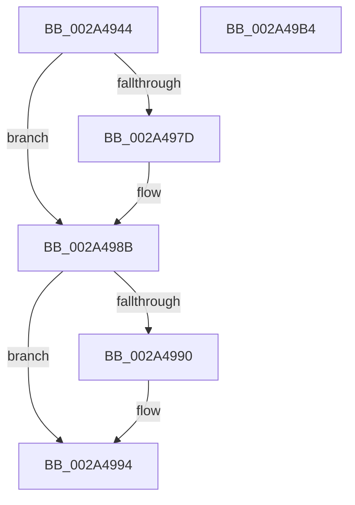

# LOCK_ADDRESS_SPACE

- RVA: `0x002A4944`–`0x002A49B5` (길이 `113` bytes)
- VA: `0x00000001402A4944`
- 실행 섹션: `.text`
- PDB 이름 있음: `예`; PDB Function 태그: `아니요`
- unwind 정보 RVA: `0x00060BC4`
- 디코드: `32`개 명령, `113/113` bytes 표시
- 미해석 바이트: `0` (있으면 어셈블리에 `.byte`로 보존)

> 이 문서는 커널 이미지의 기계어와 PDB 기호를 분석해 생성했습니다. 4번과 5번은 함수 원형과 자료형을 바이너리 사용 방식에서 추정한 C 해석이며 원본 소스 복구 결과는 아닙니다.

## 1. Dependencies

- 직접 호출 지점: **2**; 고유 호출 대상: **2**
- 직접 호출자로 확인된 함수: **22**
- RIP 상대 이미지 참조: **0**

### Outgoing calls
- `0x002A496D` → [KeAbPreAcquire](../21/KeAbPreAcquire_function_00210230.md) (function, `0x00210230`)
- `0x002A4986` → [ExfAcquirePushLockExclusiveEx](../20/ExfAcquirePushLockExclusiveEx_function_0020FC90.md) (function, `0x0020FC90`)

### Direct callers
- [MiWalkVaRange](../24/MiWalkVaRange_function_00243BF0.md) at `0x00244C6D`
- [MiBeginProcessClean](MiBeginProcessClean_function_002A473C.md) at `0x002A4777`
- [MiDeleteEmptyPageTables](MiDeleteEmptyPageTables_function_002A5220.md) at `0x002A52BB`
- [MiLockAddressSpaceToo](MiLockAddressSpaceToo_function_002A5670.md) at `0x002A571D`
- [MiCopyOnWriteCheckConditions](MiCopyOnWriteCheckConditions_function_002A750C.md) at `0x002A75B2`
- [MiReleaseOutSwappedProcessCommit](../3C/MiReleaseOutSwappedProcessCommit_function_003C8320.md) at `0x003C8447`
- [MiDeleteFinalPageTables](../46/MiDeleteFinalPageTables_function_004659AC.md) at `0x00465B5E`
- [MiReleaseCommitForResetPages](../66/MiReleaseCommitForResetPages_function_0066FAF8.md) at `0x0066FB68`
- [MiAllocateEnclaveVad](../../page/80/MiAllocateEnclaveVad_function_008080A4.md) at `0x00808238`
- [MiResizeAweBitMap](../../page/80/MiResizeAweBitMap_function_0080AD00.md) at `0x0080ADAD`
- [NtFreeUserPhysicalPages](../../page/80/NtFreeUserPhysicalPages_function_0080AF30.md) at `0x0080B1F0`
- [MiLockVadRange](../../page/87/MiLockVadRange_function_0087F670.md) at `0x0087F851`
- [MiReserveUserMemory](../../page/88/MiReserveUserMemory_function_00884498.md) at `0x008846B6`
- [sub_00884EE1](../../page/88/Unknown_function_00884EE1.md) at `0x008850B0`
- [MiInitializeVadCellBitMap](../../page/88/MiInitializeVadCellBitMap_function_00887B64.md) at `0x00887BC9`
- [MiInsertProcessVads](../../page/8C/MiInsertProcessVads_function_008CFD08.md) at `0x008CFD3E`
- [MiMapViewOfImageSection](../../page/97/MiMapViewOfImageSection_function_0097E92C.md) at `0x0097ECEA`
- [MiMapViewOfPhysicalSection](../../page/97/MiMapViewOfPhysicalSection_function_0097F984.md) at `0x0097FA66`
- [MiMapLockedPagesInUserSpace](../../page/97/MiMapLockedPagesInUserSpace_function_0097FE04.md) at `0x0097FEFC`
- [MiAllocateFromSubAllocatedRegion](../../page/98/MiAllocateFromSubAllocatedRegion_function_00981C24.md) at `0x00981C8B`
- [MmCleanProcessAddressSpace](../../page/A1/MmCleanProcessAddressSpace_function_00A17EC0.md) at `0x00A1805A`
- [MiInitializeVadBitMap](../../page/A4/MiInitializeVadBitMap_function_00A4869C.md) at `0x00A48726`

### Static image references
- 디코드된 RIP-relative 메모리 참조가 없습니다.

## 2. Other-region calls and transfers

- 다른 실행 섹션으로 향하는 call: **0**
- 별도 외부 분기/꼬리 이동을 확인하지 못했습니다.

## 3. Assembly (complete function range)

```asm
002A4944  48 89 5C 24 08                  mov qword ptr [rsp + 8], rbx
002A4949  48 89 74 24 10                  mov qword ptr [rsp + 0x10], rsi
002A494E  57                              push rdi
002A494F  48 83 EC 20                     sub rsp, 0x20
002A4953  66 FF 89 E6 01 00 00            dec word ptr [rcx + 0x1e6]
002A495A  48 8D BA 58 02 00 00            lea rdi, [rdx + 0x258]
002A4961  48 8B F1                        mov rsi, rcx
002A4964  45 33 C0                        xor r8d, r8d
002A4967  48 8B CF                        mov rcx, rdi
002A496A  33 D2                           xor edx, edx
002A496C  90                              nop
002A496D  E8 BE B8 F6 FF                  call 0x140210230
002A4972  F0 48 0F BA 2F 00               lock bts qword ptr [rdi], 0
002A4978  48 8B D8                        mov rbx, rax
002A497B  73 0E                           jae 0x1402a498b
002A497D  4C 8B C7                        mov r8, rdi
002A4980  48 8B D0                        mov rdx, rax
002A4983  48 8B CF                        mov rcx, rdi
002A4986  E8 05 B3 F6 FF                  call 0x14020fc90
002A498B  48 85 DB                        test rbx, rbx
002A498E  74 04                           je 0x1402a4994
002A4990  C6 43 0A 01                     mov byte ptr [rbx + 0xa], 1
002A4994  8B 86 A8 05 00 00               mov eax, dword ptr [rsi + 0x5a8]
002A499A  48 8B 5C 24 30                  mov rbx, qword ptr [rsp + 0x30]
002A499F  83 C8 01                        or eax, 1
002A49A2  89 86 A8 05 00 00               mov dword ptr [rsi + 0x5a8], eax
002A49A8  90                              nop
002A49A9  48 8B 74 24 38                  mov rsi, qword ptr [rsp + 0x38]
002A49AE  48 83 C4 20                     add rsp, 0x20
002A49B2  5F                              pop rdi
002A49B3  C3                              ret
002A49B4  CC                              int3
```

## 4. C-style interpretation (structured pseudocode)

```c
__int64 __fastcall LOCK_ADDRESS_SPACE(__int64 a1, __int64 a2, int a3)
{
    __int64 result;
    __int64 v_rsp;
    unsigned __int64 v_stack_p10;
    unsigned __int64 v_stack_p8;

    v_stack_p8 = v_rbx;
    v_stack_p10 = v_rsi;
    v_rsp = (v_rsp) - (32);
    a3 = 0;
    a2 = 0;
    result = KeAbPreAcquire(a2 + 600, a2, a3, a4);
    if (!(condition_is_above_or_equal)) {
        a3 = a2 + 600;
        a2 = result;
        a1 = a2 + 600;
        result = ExfAcquirePushLockExclusiveEx(a1, a2, a3, a4);
    }
    if (result != 0) {
        *(unsigned __int8 *)(result + 10) = 1;
    }
    result = (unsigned int)(((unsigned int)(*(unsigned int *)(a1 + 1448))) | (1));
    *(unsigned int *)(a1 + 1448) = (unsigned int)(result);
    v_rsp = (v_rsp) + (32);
    return result;
}
```

## 5. (Beta) C Style

```c
int64_t LOCK_ADDRESS_SPACE(void *Arg1, void *Arg2, int32_t Arg3)
{
    uint8_t *arg1 = (uint8_t *)Arg1;
    uint8_t *arg2 = (uint8_t *)Arg2;

    int64_t result;
    int64_t local_rsp;
    uint64_t v_stack_p10;
    uint64_t v_stack_p8;

    v_stack_p8 = local_rbx;
    v_stack_p10 = local_rsi;
    local_rsp = (local_rsp) - (32);
    Arg3 = 0;
    Arg2 = 0;
    result = KeAbPreAcquire(Arg2 + 600, Arg2, Arg3, a4);
    if (!(condition_is_above_or_equal)) {
        Arg3 = Arg2 + 600;
        Arg2 = result;
        Arg1 = Arg2 + 600;
        result = ExfAcquirePushLockExclusiveEx(Arg1, Arg2, Arg3, a4);
    }
    if (result != 0) {
        *(uint8_t *)(result + 0xA) = 1;
    }
    result = (uint32_t)(((uint32_t)(*(uint32_t *)(arg1 + 0x5A8))) | (1));
    *(uint32_t *)(arg1 + 0x5A8) = (uint32_t)(result);
    local_rsp = (local_rsp) + (32);
    return result;
}
```

### 관측된 메모리 오프셋

구조체 형식이 확인되지 않은 접근은 인자 기준의 오프셋으로만 기록했습니다.

| 기준 인자 | 오프셋 표현 | 폭 (bit) | 접근 |
|---|---:|---:|---|
| `Arg1` | `+ 0x1E6` | `16` | `R/W` |
| `Arg1` | `+ 0x5A8` | `32` | `R` |
| `Arg1` | `+ 0x5A8` | `32` | `W` |
| `Arg2` | `+ 0x0` | `64` | `R/W` |
| `Arg2` | `+ 0x258` | `64` | `R` |

## 6. Execution-region graph

[열기: 2D/3D 그래프와 함수 탐색 컨트롤 패널](../../../control-panel.html?section=text&rva=0x002A4944&view=graph)

- 2D 그래프는 위에서 아래로 흐르고, 3D 그래프는 빈 공간을 드래그해 회전합니다. Shift+드래그는 이동, 휠은 확대·축소, 함수 노드 선택은 대상 보고서 이동입니다.

### Static fallback


