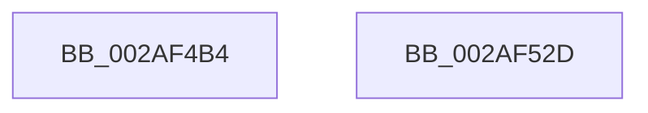

# MI_GET_SLAB_STANDBY_PAGE_SLAB_ENTRY

- RVA: `0x002AF4B4`–`0x002AF52E` (길이 `122` bytes)
- VA: `0x00000001402AF4B4`
- 실행 섹션: `.text`
- PDB 이름 있음: `예`; PDB Function 태그: `아니요`
- unwind 정보 RVA: `0x000DB714`
- 디코드: `29`개 명령, `122/122` bytes 표시
- 미해석 바이트: `0` (있으면 어셈블리에 `.byte`로 보존)

> 이 문서는 커널 이미지의 기계어와 PDB 기호를 분석해 생성했습니다. 4번과 5번은 함수 원형과 자료형을 바이너리 사용 방식에서 추정한 C 해석이며 원본 소스 복구 결과는 아닙니다.

## 1. Dependencies

- 직접 호출 지점: **0**; 고유 호출 대상: **0**
- 직접 호출자로 확인된 함수: **2**
- RIP 상대 이미지 참조: **0**

### Outgoing calls
- 직접 디코드된 call 명령이 없습니다.

### Direct callers
- [sub_00287A62](../28/Unknown_function_00287A62.md) at `0x00287DB7`
- [MiGetSlabAllocatorRepurposedStandbyList](MiGetSlabAllocatorRepurposedStandbyList_function_002AF428.md) at `0x002AF443`

### Static image references
- 디코드된 RIP-relative 메모리 참조가 없습니다.

## 2. Other-region calls and transfers

- 다른 실행 섹션으로 향하는 call: **0**
- 별도 외부 분기/꼬리 이동을 확인하지 못했습니다.

## 3. Assembly (complete function range)

```asm
002AF4B4  48 8B 41 18                     mov rax, qword ptr [rcx + 0x18]
002AF4B8  4C 8B C1                        mov r8, rcx
002AF4BB  8B 51 24                        mov edx, dword ptr [rcx + 0x24]
002AF4BE  48 8B 49 28                     mov rcx, qword ptr [rcx + 0x28]
002AF4C2  81 E2 FF FF 1F 00               and edx, 0x1fffff
002AF4C8  48 C1 E8 28                     shr rax, 0x28
002AF4CC  25 FF FF 07 00                  and eax, 0x7ffff
002AF4D1  48 C1 E2 13                     shl rdx, 0x13
002AF4D5  48 0B D0                        or rdx, rax
002AF4D8  48 B8 00 00 00 00 00 00 80 0F   movabs rax, 0xf80000000000000
002AF4E2  48 23 C8                        and rcx, rax
002AF4E5  48 89 54 24 08                  mov qword ptr [rsp + 8], rdx
002AF4EA  49 8B 00                        mov rax, qword ptr [r8]
002AF4ED  48 BA FF FF FF FF FF 00 00 00   movabs rdx, 0xffffffffff
002AF4F7  48 C1 E8 14                     shr rax, 0x14
002AF4FB  48 0B C8                        or rcx, rax
002AF4FE  41 8B 40 24                     mov eax, dword ptr [r8 + 0x24]
002AF502  48 25 00 00 E0 FF               and rax, 0xffffffffffe00000
002AF508  48 C1 E9 14                     shr rcx, 0x14
002AF50C  48 C1 E0 03                     shl rax, 3
002AF510  48 0B C8                        or rcx, rax
002AF513  48 89 4C 24 18                  mov qword ptr [rsp + 0x18], rcx
002AF518  48 8B 4C 24 08                  mov rcx, qword ptr [rsp + 8]
002AF51D  48 8B 44 24 18                  mov rax, qword ptr [rsp + 0x18]
002AF522  48 23 CA                        and rcx, rdx
002AF525  48 C1 E0 28                     shl rax, 0x28
002AF529  48 0B C1                        or rax, rcx
002AF52C  C3                              ret
002AF52D  CC                              int3
```

## 4. C-style interpretation (structured pseudocode)

```c
__int64 __fastcall MI_GET_SLAB_STANDBY_PAGE_SLAB_ENTRY(__int64 a1)
{
    __int64 result;
    unsigned __int64 v_stack_p18;
    unsigned __int64 v_stack_p8;

    a2 = (unsigned int)(((unsigned int)(*(unsigned int *)(a1 + 36))) & (0x1FFFFFULL));
    result = (*(unsigned __int64 *)(a1 + 24)) >> (40);
    result = (unsigned int)((result) & (0x7FFFFULL));
    a2 = (a2) << (19);
    a2 = (a2) | (result);
    a1 = (*(unsigned __int64 *)(a1 + 40)) & (result);
    v_stack_p8 = a2;
    result = (*(unsigned __int64 *)(a1)) >> (20);
    a1 = (a1) | (result);
    result = ((unsigned int)(*(unsigned int *)(a1 + 36))) & (0xFFFFFFFFFFE00000ULL);
    a1 = (a1) >> (20);
    result = (result) << (3);
    a1 = (a1) | (result);
    v_stack_p18 = a1;
    a1 = (v_stack_p8) & (a2);
    result = (v_stack_p18) << (40);
    result = (result) | (a1);
    return result;
}
```

## 5. (Beta) C Style

```c
int64_t MI_GET_SLAB_STANDBY_PAGE_SLAB_ENTRY(void *Arg1)
{
    uint8_t *arg1 = (uint8_t *)Arg1;

    int64_t result;
    uint64_t v_stack_p18;
    uint64_t v_stack_p8;

    a2 = (uint32_t)(((uint32_t)(*(uint32_t *)(arg1 + 0x24))) & (0x1FFFFFULL));
    result = (*(uint64_t *)(arg1 + 0x18)) >> (40);
    result = (uint32_t)((result) & (0x7FFFFULL));
    a2 = (a2) << (19);
    a2 = (a2) | (result);
    Arg1 = (*(uint64_t *)(arg1 + 0x28)) & (result);
    v_stack_p8 = a2;
    result = (*(uint64_t *)(arg1)) >> (20);
    Arg1 = (Arg1) | (result);
    result = ((uint32_t)(*(uint32_t *)(arg1 + 0x24))) & (0xFFFFFFFFFFE00000ULL);
    Arg1 = (Arg1) >> (20);
    result = (result) << (3);
    Arg1 = (Arg1) | (result);
    v_stack_p18 = Arg1;
    Arg1 = (v_stack_p8) & (a2);
    result = (v_stack_p18) << (40);
    result = (result) | (Arg1);
    return result;
}
```

### 관측된 메모리 오프셋

구조체 형식이 확인되지 않은 접근은 인자 기준의 오프셋으로만 기록했습니다.

| 기준 인자 | 오프셋 표현 | 폭 (bit) | 접근 |
|---|---:|---:|---|
| `Arg1` | `+ 0x0` | `64` | `R` |
| `Arg1` | `+ 0x18` | `64` | `R` |
| `Arg1` | `+ 0x24` | `32` | `R` |
| `Arg1` | `+ 0x28` | `64` | `R` |

## 6. Execution-region graph

[열기: 2D/3D 그래프와 함수 탐색 컨트롤 패널](../../../control-panel.html?section=text&rva=0x002AF4B4&view=graph)

- 2D 그래프는 위에서 아래로 흐르고, 3D 그래프는 빈 공간을 드래그해 회전합니다. Shift+드래그는 이동, 휠은 확대·축소, 함수 노드 선택은 대상 보고서 이동입니다.

### Static fallback


