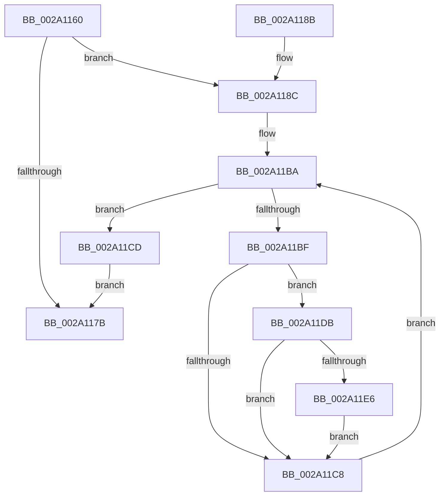

# MiAbortCombineScan

- RVA: `0x002A1160`–`0x002A1218` (길이 `184` bytes)
- VA: `0x00000001402A1160`
- 실행 섹션: `.text`
- PDB 이름 있음: `예`; PDB Function 태그: `아니요`
- unwind 정보 RVA: `0x0006848C`
- 디코드: `47`개 명령, `184/184` bytes 표시
- 미해석 바이트: `0` (있으면 어셈블리에 `.byte`로 보존)

> 이 문서는 커널 이미지의 기계어와 PDB 기호를 분석해 생성했습니다. 4번과 5번은 함수 원형과 자료형을 바이너리 사용 방식에서 추정한 C 해석이며 원본 소스 복구 결과는 아닙니다.

## 1. Dependencies

- 직접 호출 지점: **3**; 고유 호출 대상: **3**
- 직접 호출자로 확인된 함수: **9**
- RIP 상대 이미지 참조: **4**

### Outgoing calls
- `0x002A11AB` → [ExAcquireSpinLockSharedAtDpcLevel](../24/ExAcquireSpinLockSharedAtDpcLevel_function_00248E30.md) (function, `0x00248E30`)
- `0x002A11D4` → [ExReleaseSpinLockSharedFromDpcLevel](../24/ExReleaseSpinLockSharedFromDpcLevel_function_0024A590.md) (function, `0x0024A590`)
- `0x002A1211` → [MiFlushSingleTbEntry](../28/MiFlushSingleTbEntry_function_0028E730.md) (function, `0x0028E730`)

### Direct callers
- [MiChangePageAttributeBatch](MiChangePageAttributeBatch_function_002A06E0.md) at `0x002A077E`
- [MiUpdateSlabPagePlaceholderState](MiUpdateSlabPagePlaceholderState_function_002A0FB0.md) at `0x002A101A`
- [sub_002B1D4E](../2B/Unknown_function_002B1D4E.md) at `0x002B1FEC`
- [MiInitializeMdlPfn](../2C/MiInitializeMdlPfn_function_002C9670.md) at `0x002C9748`
- [MiChangePageAttribute](../33/MiChangePageAttribute_function_00332ECC.md) at `0x00333254`
- [MiCreateSlabEntry](../37/MiCreateSlabEntry_function_00374DEC.md) at `0x003752AE`
- [MiCompleteSecureProcessFault](../46/MiCompleteSecureProcessFault_function_0046710C.md) at `0x004671CB`
- [MiInitializeDynamicPfns](../67/MiInitializeDynamicPfns_function_00672BD0.md) at `0x00673020`
- [sub_006DB64E](../6D/Unknown_function_006DB64E.md) at `0x006DB68B`

### Static image references
- `0x002A116F` → RVA `0x00E2FF04` (`.data`; read)
- `0x002A1190` → RVA `0x00E2FF00` (`.data`; read)
- `0x002A1197` → RVA `0x00E30088` (`.data`; read)
- `0x002A11E6` → RVA `0x00010880` (`.rdata`; read)

## 2. Other-region calls and transfers

- 다른 실행 섹션으로 향하는 call: **0**
- 별도 외부 분기/꼬리 이동을 확인하지 못했습니다.

## 3. Assembly (complete function range)

```asm
002A1160  48 89 5C 24 08                  mov qword ptr [rsp + 8], rbx
002A1165  48 89 74 24 18                  mov qword ptr [rsp + 0x18], rsi
002A116A  57                              push rdi
002A116B  48 83 EC 20                     sub rsp, 0x20
002A116F  83 3D 8E ED B8 00 00            cmp dword ptr [rip + 0xb8ed8e], 0
002A1176  48 8B F1                        mov rsi, rcx
002A1179  75 11                           jne 0x1402a118c
002A117B  48 8B 5C 24 30                  mov rbx, qword ptr [rsp + 0x30]
002A1180  48 8B 74 24 40                  mov rsi, qword ptr [rsp + 0x40]
002A1185  48 83 C4 20                     add rsp, 0x20
002A1189  5F                              pop rdi
002A118A  C3                              ret
002A118B  CC                              int3
002A118C  48 8B 41 28                     mov rax, qword ptr [rcx + 0x28]
002A1190  48 8D 0D 69 ED B8 00            lea rcx, [rip + 0xb8ed69]
002A1197  48 8B 15 EA EE B8 00            mov rdx, qword ptr [rip + 0xb8eeea]
002A119E  48 C1 E8 2B                     shr rax, 0x2b
002A11A2  25 FF 03 00 00                  and eax, 0x3ff
002A11A7  48 8B 3C C2                     mov rdi, qword ptr [rdx + rax*8]
002A11AB  E8 80 7C FA FF                  call 0x140248e30
002A11B0  48 81 C7 60 42 00 00            add rdi, 0x4260
002A11B7  48 8B 1F                        mov rbx, qword ptr [rdi]
002A11BA  48 3B DF                        cmp rbx, rdi
002A11BD  74 0E                           je 0x1402a11cd
002A11BF  48 8B 43 30                     mov rax, qword ptr [rbx + 0x30]
002A11C3  48 3B C6                        cmp rax, rsi
002A11C6  74 13                           je 0x1402a11db
002A11C8  48 8B 1B                        mov rbx, qword ptr [rbx]
002A11CB  EB ED                           jmp 0x1402a11ba
002A11CD  48 8D 0D 2C ED B8 00            lea rcx, [rip + 0xb8ed2c]
002A11D4  E8 B7 93 FA FF                  call 0x14024a590
002A11D9  EB A0                           jmp 0x1402a117b
002A11DB  48 8B 4B 38                     mov rcx, qword ptr [rbx + 0x38]
002A11DF  48 8B 01                        mov rax, qword ptr [rcx]
002A11E2  A8 01                           test al, 1
002A11E4  74 E2                           je 0x1402a11c8
002A11E6  48 8B 05 93 F6 D6 FF            mov rax, qword ptr [rip - 0x29096d]
002A11ED  48 89 01                        mov qword ptr [rcx], rax
002A11F0  48 C1 E1 19                     shl rcx, 0x19
002A11F4  48 B8 00 00 00 00 80 F6 FF FF   movabs rax, 0xfffff68000000000
002A11FE  48 C1 E0 19                     shl rax, 0x19
002A1202  BA 01 00 00 00                  mov edx, 1
002A1207  48 2B C8                        sub rcx, rax
002A120A  44 8B C2                        mov r8d, edx
002A120D  48 C1 F9 10                     sar rcx, 0x10
002A1211  E8 1A D5 FE FF                  call 0x14028e730
002A1216  EB B0                           jmp 0x1402a11c8
```

## 4. C-style interpretation (structured pseudocode)

```c
__int64 __fastcall MiAbortCombineScan(__int64 a1)
{
    __int64 result;
    __int64 v_rdi;
    __int64 v_rsp;
    unsigned __int64 v_stack_p18;
    unsigned __int64 v_stack_p8;

    v_stack_p8 = v_rbx;
    v_stack_p18 = v_rsi;
    v_rsp = (v_rsp) - (32);
    if ((*(unsigned int *)(v_rip + 12119438)) != 0) goto loc_002A118C;
loc_002A117B:
    v_rsp = (v_rsp) + (32);
    return result;
loc_002A118C:
    result = (*(unsigned __int64 *)(a1 + 40)) >> (43);
    result = (unsigned int)((result) & (0x3FFULL));
    result = ExAcquireSpinLockSharedAtDpcLevel(v_rip + 12119401, *(unsigned __int64 *)(v_rip + 12119786), a3, a4);
    v_rdi = (*(unsigned __int64 *)(*(unsigned __int64 *)(v_rip + 12119786) + result * 8)) + (0x4260ULL);
loc_002A11BA:
    if ((*(unsigned __int64 *)(v_rdi)) == v_rdi) goto loc_002A11CD;
    if ((*(unsigned __int64 *)(*(unsigned __int64 *)(v_rdi) + 48)) == v_stack_p18) goto loc_002A11DB;
loc_002A11C8:
    goto loc_002A11BA;
loc_002A11CD:
    result = ExReleaseSpinLockSharedFromDpcLevel(v_rip + 12119340, *(unsigned __int64 *)(v_rip + 12119786), a3, a4);
    goto loc_002A117B;
loc_002A11DB:
    if ((((unsigned __int8)(*(unsigned __int64 *)(*(unsigned __int64 *)(*(unsigned __int64 *)(*(unsigned __int64 *)(v_rdi)) + 56)))) & (1)) == 0) goto loc_002A11C8;
    *(unsigned __int64 *)(*(unsigned __int64 *)(*(unsigned __int64 *)(*(unsigned __int64 *)(v_rdi)) + 56)) = *(unsigned __int64 *)(v_rip - 2689389);
    a1 = (*(unsigned __int64 *)(*(unsigned __int64 *)(*(unsigned __int64 *)(v_rdi)) + 56)) << (25);
    result = (*(unsigned __int64 *)(v_rip - 2689389)) << (25);
    a1 = (a1) - (result);
    a1 = (a1) >> (16);
    result = MiFlushSingleTbEntry(a1, 1, 1, a4);
    goto loc_002A11C8;
}
```

## 5. (Beta) C Style

```c
int64_t MiAbortCombineScan(void *Arg1)
{
    uint8_t *arg1 = (uint8_t *)Arg1;

    int64_t result;
    int64_t local_rdi;
    int64_t local_rsp;
    uint64_t v_stack_p18;
    uint64_t v_stack_p8;

    v_stack_p8 = local_rbx;
    v_stack_p18 = local_rsi;
    local_rsp = (local_rsp) - (32);
    if ((*(uint32_t *)(v_rip + 0xB8ED8E)) != 0) goto loc_002A118C;
loc_002A117B:
    local_rsp = (local_rsp) + (32);
    return result;
loc_002A118C:
    result = (*(uint64_t *)(arg1 + 0x28)) >> (43);
    result = (uint32_t)((result) & (0x3FFULL));
    result = ExAcquireSpinLockSharedAtDpcLevel(v_rip + 12119401, *(uint64_t *)(v_rip + 0xB8EEEA), a3, a4);
    local_rdi = (*(uint64_t *)(*(uint64_t *)(v_rip + 0xB8EEEA) + result * 8)) + (0x4260ULL);
loc_002A11BA:
    if ((*(uint64_t *)(local_rdi)) == local_rdi) goto loc_002A11CD;
    if ((*(uint64_t *)(*(uint64_t *)(local_rdi) + 0x30)) == v_stack_p18) goto loc_002A11DB;
loc_002A11C8:
    goto loc_002A11BA;
loc_002A11CD:
    result = ExReleaseSpinLockSharedFromDpcLevel(v_rip + 12119340, *(uint64_t *)(v_rip + 0xB8EEEA), a3, a4);
    goto loc_002A117B;
loc_002A11DB:
    if ((((uint8_t)(*(uint64_t *)(*(uint64_t *)(*(uint64_t *)(*(uint64_t *)(local_rdi)) + 0x38)))) & (1)) == 0) goto loc_002A11C8;
    *(uint64_t *)(*(uint64_t *)(*(uint64_t *)(*(uint64_t *)(local_rdi)) + 0x38)) = *(uint64_t *)(v_rip - 0x29096D);
    Arg1 = (*(uint64_t *)(*(uint64_t *)(*(uint64_t *)(local_rdi)) + 0x38)) << (25);
    result = (*(uint64_t *)(v_rip - 0x29096D)) << (25);
    Arg1 = (Arg1) - (result);
    Arg1 = (Arg1) >> (16);
    result = MiFlushSingleTbEntry(Arg1, 1, 1, a4);
    goto loc_002A11C8;
}
```

### 관측된 메모리 오프셋

구조체 형식이 확인되지 않은 접근은 인자 기준의 오프셋으로만 기록했습니다.

| 기준 인자 | 오프셋 표현 | 폭 (bit) | 접근 |
|---|---:|---:|---|
| `Arg1` | `+ 0x28` | `64` | `R` |

## 6. Execution-region graph

[열기: 2D/3D 그래프와 함수 탐색 컨트롤 패널](../../../control-panel.html?section=text&rva=0x002A1160&view=graph)

- 2D 그래프는 위에서 아래로 흐르고, 3D 그래프는 빈 공간을 드래그해 회전합니다. Shift+드래그는 이동, 휠은 확대·축소, 함수 노드 선택은 대상 보고서 이동입니다.

### Static fallback


