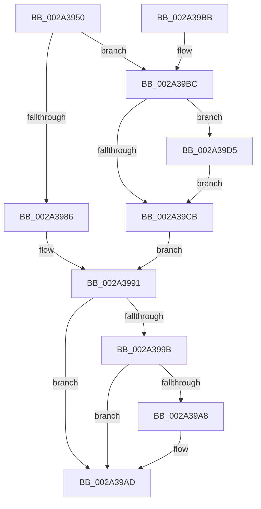

# MiAcquireLoadLock

- RVA: `0x002A3950`–`0x002A39DE` (길이 `142` bytes)
- VA: `0x00000001402A3950`
- 실행 섹션: `.text`
- PDB 이름 있음: `예`; PDB Function 태그: `아니요`
- unwind 정보 RVA: `0x000687A0`
- 디코드: `38`개 명령, `142/142` bytes 표시
- 미해석 바이트: `0` (있으면 어셈블리에 `.byte`로 보존)

> 이 문서는 커널 이미지의 기계어와 PDB 기호를 분석해 생성했습니다. 4번과 5번은 함수 원형과 자료형을 바이너리 사용 방식에서 추정한 C 해석이며 원본 소스 복구 결과는 아닙니다.

## 1. Dependencies

- 직접 호출 지점: **3**; 고유 호출 대상: **3**
- 직접 호출자로 확인된 함수: **18**
- RIP 상대 이미지 참조: **4**

### Outgoing calls
- `0x002A3986` → [ExAcquireResourceSharedLite](../21/ExAcquireResourceSharedLite_function_00211BC0.md) (function, `0x00211BC0`)
- `0x002A39A8` → [KiCheckForKernelApcDelivery](../2E/KiCheckForKernelApcDelivery_function_002E2C80.md) (function, `0x002E2C80`)
- `0x002A39BC` → [ExAcquireResourceExclusiveLite](../21/ExAcquireResourceExclusiveLite_function_00214E20.md) (function, `0x00214E20`)

### Direct callers
- [MmAcquireLoadLockShared](MmAcquireLoadLockShared_function_002A389C.md) at `0x002A38A2`
- [MiLockLoadedDataTableEntry](MiLockLoadedDataTableEntry_function_002A38F4.md) at `0x002A3905`
- [MiEnumerateSystemImages](MiEnumerateSystemImages_function_002A3D40.md) at `0x002A3D7F`
- [MmAcquireLoadLock](../4D/MmAcquireLoadLock_function_004DC2A0.md) at `0x004DC2A9`
- [ViAddVerifierSpecialThunks](../61/ViAddVerifierSpecialThunks_function_0061233C.md) at `0x006123AD`
- [ViAddVerifierThunks](../61/ViAddVerifierThunks_function_0061245C.md) at `0x006124CC`
- [VfDriverRemoveAllDifVerification](../61/VfDriverRemoveAllDifVerification_function_006130E4.md) at `0x00613102`
- [MiProtectDriverSectionPte](../67/MiProtectDriverSectionPte_function_006706C0.md) at `0x006707C4`
- [MiUnloadSystemImage](../../page/AA/MiUnloadSystemImage_function_00AA2FD4.md) at `0x00AA303D`
- [MiProcessKernelCfgAddressTakenImports](../../page/AD/MiProcessKernelCfgAddressTakenImports_function_00AD4384.md) at `0x00AD4396`
- [MiFlushStrongCodeDriverLoadFailures](../../init/C6/MiFlushStrongCodeDriverLoadFailures_function_00C61680.md) at `0x00C616BC`
- [MmReapplyBootPatchImports](../../init/C6/MmReapplyBootPatchImports_function_00C67768.md) at `0x00C677B3`
- [MmRegisterHotPatches](../../init/C6/MmRegisterHotPatches_function_00C678DC.md) at `0x00C6790B`
- [MiBuildImportsForBootDrivers](../../init/C6/MiBuildImportsForBootDrivers_function_00C6B2E8.md) at `0x00C6B312`
- [MiInitializeLoadedModuleList](../../init/C6/MiInitializeLoadedModuleList_function_00C6BCDC.md) at `0x00C6BDBA`
- [MiReloadBootLoadedDrivers](../../init/C6/MiReloadBootLoadedDrivers_function_00C6C3F8.md) at `0x00C6C414`
- [PipInitializeCoreDriversAndElam](../../init/C7/PipInitializeCoreDriversAndElam_function_00C73F84.md) at `0x00C73FB2`
- [PipInitializeDriverDependentDLLs](../../init/C7/PipInitializeDriverDependentDLLs_function_00C74398.md) at `0x00C743E1`

### Static image references
- `0x002A397D` → RVA `0x00EF54E0` (`.data`; read)
- `0x002A39C1` → RVA `0x00E2D918` (`.data`; read)
- `0x002A39CD` → RVA `0x00E2D918` (`.data`; write)
- `0x002A39D5` → RVA `0x00E2D910` (`.data`; write)

## 2. Other-region calls and transfers

- 다른 실행 섹션으로 향하는 call: **0**
- 별도 외부 분기/꼬리 이동을 확인하지 못했습니다.

## 3. Assembly (complete function range)

```asm
002A3950  48 89 5C 24 08                  mov qword ptr [rsp + 8], rbx
002A3955  57                              push rdi
002A3956  48 83 EC 20                     sub rsp, 0x20
002A395A  65 48 8B 1C 25 88 01 00 00      mov rbx, qword ptr gs:[0x188]
002A3963  BF 01 00 00 00                  mov edi, 1
002A3968  40 8A D7                        mov dl, dil
002A396B  66 29 BB E6 01 00 00            sub word ptr [rbx + 0x1e6], di
002A3972  90                              nop
002A3973  66 FF 8B E4 01 00 00            dec word ptr [rbx + 0x1e4]
002A397A  90                              nop
002A397B  85 C9                           test ecx, ecx
002A397D  48 8D 0D 5C 1B C5 00            lea rcx, [rip + 0xc51b5c]
002A3984  75 36                           jne 0x1402a39bc
002A3986  E8 35 E2 F6 FF                  call 0x140211bc0
002A398B  01 BB B0 05 00 00               add dword ptr [rbx + 0x5b0], edi
002A3991  90                              nop
002A3992  66 01 BB E6 01 00 00            add word ptr [rbx + 0x1e6], di
002A3999  75 12                           jne 0x1402a39ad
002A399B  48 8D 8B 98 00 00 00            lea rcx, [rbx + 0x98]
002A39A2  90                              nop
002A39A3  48 39 09                        cmp qword ptr [rcx], rcx
002A39A6  74 05                           je 0x1402a39ad
002A39A8  E8 D3 F2 03 00                  call 0x1402e2c80
002A39AD  48 8B C3                        mov rax, rbx
002A39B0  48 8B 5C 24 30                  mov rbx, qword ptr [rsp + 0x30]
002A39B5  48 83 C4 20                     add rsp, 0x20
002A39B9  5F                              pop rdi
002A39BA  C3                              ret
002A39BB  CC                              int3
002A39BC  E8 5F 14 F7 FF                  call 0x140214e20
002A39C1  8B 05 51 9F B8 00               mov eax, dword ptr [rip + 0xb89f51]
002A39C7  85 C0                           test eax, eax
002A39C9  74 0A                           je 0x1402a39d5
002A39CB  03 C7                           add eax, edi
002A39CD  89 05 45 9F B8 00               mov dword ptr [rip + 0xb89f45], eax
002A39D3  EB BC                           jmp 0x1402a3991
002A39D5  48 89 1D 34 9F B8 00            mov qword ptr [rip + 0xb89f34], rbx
002A39DC  EB ED                           jmp 0x1402a39cb
```

## 4. C-style interpretation (structured pseudocode)

```c
__int64 __fastcall MiAcquireLoadLock(int a1)
{
    __int64 result;
    __int64 v_rsp;
    unsigned __int64 v_stack_p8;

    v_stack_p8 = v_rbx;
    v_rsp = (v_rsp) - (32);
    if (a1 != 0) goto loc_002A39BC;
    result = ExAcquireResourceSharedLite(v_rip + 12917596, 1, a3, a4);
loc_002A3991:
    if (a1 != 0) goto loc_002A39AD;
    if ((*(unsigned __int64 *)(*(unsigned __int64 *)(gs_base + (0 + 392)) + 152)) != (*(unsigned __int64 *)(gs_base + (0 + 392)) + 152)) {
        result = KiCheckForKernelApcDelivery(*(unsigned __int64 *)(gs_base + (0 + 392)) + 152, 1, a3, a4);
    }
    v_rsp = (v_rsp) + (32);
    return *(unsigned __int64 *)(gs_base + (0 + 392));
loc_002A39BC:
    result = ExAcquireResourceExclusiveLite(*(unsigned __int64 *)(gs_base + (0 + 392)) + 152, 1, a3, a4);
    if ((unsigned int)((unsigned int)(*(unsigned int *)(v_rip + 12099409))) == 0) goto loc_002A39D5;
loc_002A39CB:
    result = (unsigned int)(((unsigned int)(*(unsigned int *)(v_rip + 12099409))) + (1));
    *(unsigned int *)(v_rip + 12099397) = (unsigned int)(result);
    goto loc_002A3991;
loc_002A39D5:
    *(unsigned __int64 *)(v_rip + 12099380) = v_stack_p8;
    goto loc_002A39CB;
}
```

## 5. (Beta) C Style

```c
int64_t MiAcquireLoadLock(int32_t Arg1)
{
    int64_t result;
    int64_t local_rsp;
    uint64_t v_stack_p8;

    v_stack_p8 = local_rbx;
    local_rsp = (local_rsp) - (32);
    if (Arg1 != 0) goto loc_002A39BC;
    result = ExAcquireResourceSharedLite(v_rip + 12917596, 1, a3, a4);
loc_002A3991:
    if (Arg1 != 0) goto loc_002A39AD;
    if ((*(uint64_t *)(*(uint64_t *)(gs_base + (0 + 0x188)) + 0x98)) != (*(uint64_t *)(gs_base + (0 + 0x188)) + 152)) {
        result = KiCheckForKernelApcDelivery(*(uint64_t *)(gs_base + (0 + 0x188)) + 152, 1, a3, a4);
    }
    local_rsp = (local_rsp) + (32);
    return *(uint64_t *)(gs_base + (0 + 0x188));
loc_002A39BC:
    result = ExAcquireResourceExclusiveLite(*(uint64_t *)(gs_base + (0 + 0x188)) + 152, 1, a3, a4);
    if ((uint32_t)((uint32_t)(*(uint32_t *)(v_rip + 0xB89F51))) == 0) goto loc_002A39D5;
loc_002A39CB:
    result = (uint32_t)(((uint32_t)(*(uint32_t *)(v_rip + 0xB89F51))) + (1));
    *(uint32_t *)(v_rip + 0xB89F45) = (uint32_t)(result);
    goto loc_002A3991;
loc_002A39D5:
    *(uint64_t *)(v_rip + 0xB89F34) = v_stack_p8;
    goto loc_002A39CB;
}
```

## 6. Execution-region graph

[열기: 2D/3D 그래프와 함수 탐색 컨트롤 패널](../../../control-panel.html?section=text&rva=0x002A3950&view=graph)

- 2D 그래프는 위에서 아래로 흐르고, 3D 그래프는 빈 공간을 드래그해 회전합니다. Shift+드래그는 이동, 휠은 확대·축소, 함수 노드 선택은 대상 보고서 이동입니다.

### Static fallback


