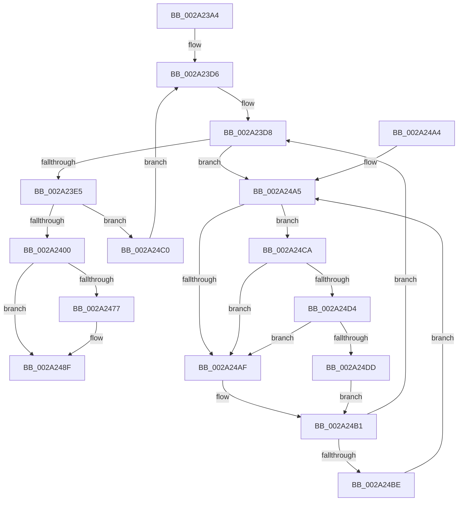

# MiAddSystemPageTableToList

- RVA: `0x002A23A4`–`0x002A24E6` (길이 `322` bytes)
- VA: `0x00000001402A23A4`
- 실행 섹션: `.text`
- PDB 이름 있음: `예`; PDB Function 태그: `아니요`
- unwind 정보 RVA: `0x00068590`
- 디코드: `77`개 명령, `322/322` bytes 표시
- 미해석 바이트: `0` (있으면 어셈블리에 `.byte`로 보존)

> 이 문서는 커널 이미지의 기계어와 PDB 기호를 분석해 생성했습니다. 4번과 5번은 함수 원형과 자료형을 바이너리 사용 방식에서 추정한 C 해석이며 원본 소스 복구 결과는 아닙니다.

## 1. Dependencies

- 직접 호출 지점: **4**; 고유 호출 대상: **4**
- 직접 호출자로 확인된 함수: **1**
- RIP 상대 이미지 참조: **2**

### Outgoing calls
- `0x002A241C` → [MiInsertPageChainHead](MiInsertPageChainHead_function_002A24EC.md) (function, `0x002A24EC`)
- `0x002A248A` → [MiLockAndDecrementShareCount](MiLockAndDecrementShareCount_function_002A2854.md) (function, `0x002A2854`)
- `0x002A24D4` → [KiCheckVpBackingLongSpinWaitHypercall](../30/KiCheckVpBackingLongSpinWaitHypercall_function_0030F490.md) (function, `0x0030F490`)
- `0x002A24DF` → [HvlNotifyLongSpinWait](../30/HvlNotifyLongSpinWait_function_0030F460.md) (function, `0x0030F460`)

### Direct callers
- [MiDeleteSystemPageTable](../49/MiDeleteSystemPageTable_function_004916B0.md) at `0x0049179F`

### Static image references
- `0x002A24A7` → RVA `0x00FC52AC` (`ALMOSTRO`; reference)
- `0x002A24CA` → RVA `0x00FC6AB8` (`ALMOSTRO`; read)

## 2. Other-region calls and transfers

- 다른 실행 섹션으로 향하는 call: **0**
- 별도 외부 분기/꼬리 이동을 확인하지 못했습니다.

## 3. Assembly (complete function range)

```asm
002A23A4  48 89 5C 24 10                  mov qword ptr [rsp + 0x10], rbx
002A23A9  48 89 6C 24 18                  mov qword ptr [rsp + 0x18], rbp
002A23AE  48 89 74 24 20                  mov qword ptr [rsp + 0x20], rsi
002A23B3  57                              push rdi
002A23B4  48 83 EC 20                     sub rsp, 0x20
002A23B8  48 8B 41 20                     mov rax, qword ptr [rcx + 0x20]
002A23BC  48 8B DA                        mov rbx, rdx
002A23BF  48 8B B1 B8 00 00 00            mov rsi, qword ptr [rcx + 0xb8]
002A23C6  48 BD FF FF FF FF FF FF FF 7F   movabs rbp, 0x7fffffffffffffff
002A23D0  8B 80 B8 00 00 00               mov eax, dword ptr [rax + 0xb8]
002A23D6  33 FF                           xor edi, edi
002A23D8  F0 48 0F BA 6B 18 3F            lock bts qword ptr [rbx + 0x18], 0x3f
002A23DF  0F 82 C0 00 00 00               jb 0x1402a24a5
002A23E5  48 8B 43 18                     mov rax, qword ptr [rbx + 0x18]
002A23E9  48 B9 FF FF FF FF FF FF FF 3F   movabs rcx, 0x3fffffffffffffff
002A23F3  48 23 C1                        and rax, rcx
002A23F6  48 83 F8 01                     cmp rax, 1
002A23FA  0F 85 C0 00 00 00               jne 0x1402a24c0
002A2400  48 8B 43 18                     mov rax, qword ptr [rbx + 0x18]
002A2404  48 B9 00 00 00 00 00 00 00 40   movabs rcx, 0x4000000000000000
002A240E  48 0B C1                        or rax, rcx
002A2411  48 8B D3                        mov rdx, rbx
002A2414  48 8D 4E 08                     lea rcx, [rsi + 8]
002A2418  48 89 43 18                     mov qword ptr [rbx + 0x18], rax
002A241C  E8 CB 00 00 00                  call 0x1402a24ec
002A2421  8B 43 20                        mov eax, dword ptr [rbx + 0x20]
002A2424  89 44 24 30                     mov dword ptr [rsp + 0x30], eax
002A2428  C1 E8 10                        shr eax, 0x10
002A242B  24 FD                           and al, 0xfd
002A242D  0C 05                           or al, 5
002A242F  88 44 24 32                     mov byte ptr [rsp + 0x32], al
002A2433  8B 44 24 30                     mov eax, dword ptr [rsp + 0x30]
002A2437  89 43 20                        mov dword ptr [rbx + 0x20], eax
002A243A  48 B8 FF FF FF FF FF 00 00 00   movabs rax, 0xffffffffff
002A2444  48 8B 4B 28                     mov rcx, qword ptr [rbx + 0x28]
002A2448  48 23 C8                        and rcx, rax
002A244B  F0 48 21 6B 18                  lock and qword ptr [rbx + 0x18], rbp
002A2450  48 BA 00 00 00 00 00 DE FF FF   movabs rdx, 0xffffde0000000000
002A245A  48 8B C2                        mov rax, rdx
002A245D  48 2B D8                        sub rbx, rax
002A2460  48 B8 AB AA AA AA AA AA AA AA   movabs rax, 0xaaaaaaaaaaaaaaab
002A246A  48 C1 FB 04                     sar rbx, 4
002A246E  48 0F AF D8                     imul rbx, rax
002A2472  48 3B CB                        cmp rcx, rbx
002A2475  74 18                           je 0x1402a248f
002A2477  48 8D 0C 49                     lea rcx, [rcx + rcx*2]
002A247B  48 C1 E1 04                     shl rcx, 4
002A247F  48 8B C2                        mov rax, rdx
002A2482  48 03 C8                        add rcx, rax
002A2485  BA 02 00 00 00                  mov edx, 2
002A248A  E8 C5 03 00 00                  call 0x1402a2854
002A248F  48 8B 5C 24 38                  mov rbx, qword ptr [rsp + 0x38]
002A2494  48 8B 6C 24 40                  mov rbp, qword ptr [rsp + 0x40]
002A2499  48 8B 74 24 48                  mov rsi, qword ptr [rsp + 0x48]
002A249E  48 83 C4 20                     add rsp, 0x20
002A24A2  5F                              pop rdi
002A24A3  C3                              ret
002A24A4  CC                              int3
002A24A5  FF C7                           inc edi
002A24A7  85 3D FF 2D D2 00               test dword ptr [rip + 0xd22dff], edi
002A24AD  74 1B                           je 0x1402a24ca
002A24AF  F3 90                           pause
002A24B1  48 8B 43 18                     mov rax, qword ptr [rbx + 0x18]
002A24B5  48 85 C0                        test rax, rax
002A24B8  0F 89 1A FF FF FF               jns 0x1402a23d8
002A24BE  EB E5                           jmp 0x1402a24a5
002A24C0  F0 48 21 6B 18                  lock and qword ptr [rbx + 0x18], rbp
002A24C5  E9 0C FF FF FF                  jmp 0x1402a23d6
002A24CA  8B 05 E8 45 D2 00               mov eax, dword ptr [rip + 0xd245e8]
002A24D0  A8 40                           test al, 0x40
002A24D2  74 DB                           je 0x1402a24af
002A24D4  E8 B7 CF 06 00                  call 0x14030f490
002A24D9  84 C0                           test al, al
002A24DB  74 D2                           je 0x1402a24af
002A24DD  8B CF                           mov ecx, edi
002A24DF  E8 7C CF 06 00                  call 0x14030f460
002A24E4  EB CB                           jmp 0x1402a24b1
```

## 4. C-style interpretation (structured pseudocode)

```c
__int64 __fastcall MiAddSystemPageTableToList(__int64 a1, __int64 a2)
{
    __int64 result;
    __int64 v_rbx;
    __int64 v_rdi;
    __int64 v_rsp;
    unsigned __int64 v_stack_p10;
    unsigned __int64 v_stack_p18;
    unsigned __int64 v_stack_p20;
    unsigned int v_stack_p8;
    unsigned __int8 v_stack_pA;

    v_stack_p10 = v_rbx;
    v_stack_p18 = v_rbp;
    v_stack_p20 = v_rsi;
    v_rsp = (v_rsp) - (32);
loc_002A23D6:
    v_rdi = 0;
loc_002A23D8:
    if (condition_is_below) goto loc_002A24A5;
    result = (*(unsigned __int64 *)(a2 + 24)) & (a1);
    if (result != 1) goto loc_002A24C0;
    result = (*(unsigned __int64 *)(a2 + 24)) | (a1);
    *(unsigned __int64 *)(a2 + 24) = result;
    result = MiInsertPageChainHead(*(unsigned __int64 *)(a1 + 184) + 8, a2, a3, a4);
    v_stack_p8 = (unsigned int)((unsigned int)(*(unsigned int *)(a2 + 32)));
    result = (unsigned int)(((unsigned int)(*(unsigned int *)(a2 + 32))) >> (16));
    result = (unsigned __int8)((result) & (253));
    result = (unsigned __int8)((result) | (5));
    v_stack_pA = (unsigned __int8)(result);
    *(unsigned int *)(a2 + 32) = (unsigned int)((unsigned int)(v_stack_p8));
    a1 = (*(unsigned __int64 *)(a2 + 40)) & ((unsigned int)(v_stack_p8));
    v_rbx = (a2) - (a2);
    v_rbx = (v_rbx) >> (4);
    v_rbx = (v_rbx) * (a2);
    result = a2;
    if (a1 != v_rbx) {
        a1 = a1 + a1 * 2;
        a1 = (a1) << (4);
        result = a2;
        a1 = (a1) + (result);
        a2 = 2;
        result = MiLockAndDecrementShareCount(a1, a2, a3, a4);
    }
    v_rsp = (v_rsp) + (32);
    return result;
loc_002A24A5:
    v_rdi = (unsigned int)((v_rdi) + 1);
    if (((*(unsigned int *)(v_rip + 13774335)) & ((unsigned int)(v_rdi))) == 0) goto loc_002A24CA;
loc_002A24AF:
loc_002A24B1:
    if (!sign_flag) goto loc_002A23D8;
    goto loc_002A24A5;
loc_002A24C0:
    goto loc_002A23D6;
loc_002A24CA:
    if ((((unsigned __int8)((unsigned int)(*(unsigned int *)(v_rip + 13780456)))) & (64)) == 0) goto loc_002A24AF;
    result = KiCheckVpBackingLongSpinWaitHypercall(a1, a2, a3, a4);
    if ((unsigned __int8)(result) == 0) goto loc_002A24AF;
    result = HvlNotifyLongSpinWait((unsigned int)((unsigned int)(v_rdi)), a2, a3, a4);
    goto loc_002A24B1;
}
```

## 5. (Beta) C Style

```c
int64_t MiAddSystemPageTableToList(void *Arg1, void *Arg2)
{
    uint8_t *arg1 = (uint8_t *)Arg1;
    uint8_t *arg2 = (uint8_t *)Arg2;

    int64_t result;
    int64_t local_rbx;
    int64_t local_rdi;
    int64_t local_rsp;
    uint64_t v_stack_p10;
    uint64_t v_stack_p18;
    uint64_t v_stack_p20;
    uint32_t v_stack_p8;
    uint8_t v_stack_pA;

    v_stack_p10 = local_rbx;
    v_stack_p18 = local_rbp;
    v_stack_p20 = local_rsi;
    local_rsp = (local_rsp) - (32);
loc_002A23D6:
    local_rdi = 0;
loc_002A23D8:
    if (condition_is_below) goto loc_002A24A5;
    result = (*(uint64_t *)(arg2 + 0x18)) & (Arg1);
    if (result != 1) goto loc_002A24C0;
    result = (*(uint64_t *)(arg2 + 0x18)) | (Arg1);
    *(uint64_t *)(arg2 + 0x18) = result;
    result = MiInsertPageChainHead(*(uint64_t *)(arg1 + 0xB8) + 8, Arg2, a3, a4);
    v_stack_p8 = (uint32_t)((uint32_t)(*(uint32_t *)(arg2 + 0x20)));
    result = (uint32_t)(((uint32_t)(*(uint32_t *)(arg2 + 0x20))) >> (16));
    result = (uint8_t)((result) & (253));
    result = (uint8_t)((result) | (5));
    v_stack_pA = (uint8_t)(result);
    *(uint32_t *)(arg2 + 0x20) = (uint32_t)((uint32_t)(v_stack_p8));
    Arg1 = (*(uint64_t *)(arg2 + 0x28)) & ((uint32_t)(v_stack_p8));
    local_rbx = (Arg2) - (Arg2);
    local_rbx = (local_rbx) >> (4);
    local_rbx = (local_rbx) * (Arg2);
    result = Arg2;
    if (Arg1 != local_rbx) {
        Arg1 = Arg1 + Arg1 * 2;
        Arg1 = (Arg1) << (4);
        result = Arg2;
        Arg1 = (Arg1) + (result);
        Arg2 = 2;
        result = MiLockAndDecrementShareCount(Arg1, Arg2, a3, a4);
    }
    local_rsp = (local_rsp) + (32);
    return result;
loc_002A24A5:
    local_rdi = (uint32_t)((local_rdi) + 1);
    if (((*(uint32_t *)(v_rip + 0xD22DFF)) & ((uint32_t)(local_rdi))) == 0) goto loc_002A24CA;
loc_002A24AF:
loc_002A24B1:
    if (!sign_flag) goto loc_002A23D8;
    goto loc_002A24A5;
loc_002A24C0:
    goto loc_002A23D6;
loc_002A24CA:
    if ((((uint8_t)((uint32_t)(*(uint32_t *)(v_rip + 0xD245E8)))) & (64)) == 0) goto loc_002A24AF;
    result = KiCheckVpBackingLongSpinWaitHypercall(Arg1, Arg2, a3, a4);
    if ((uint8_t)(result) == 0) goto loc_002A24AF;
    result = HvlNotifyLongSpinWait((uint32_t)((uint32_t)(local_rdi)), Arg2, a3, a4);
    goto loc_002A24B1;
}
```

### 관측된 메모리 오프셋

구조체 형식이 확인되지 않은 접근은 인자 기준의 오프셋으로만 기록했습니다.

| 기준 인자 | 오프셋 표현 | 폭 (bit) | 접근 |
|---|---:|---:|---|
| `Arg1` | `+ 0x20` | `64` | `R` |
| `Arg1` | `+ 0xB8` | `64` | `R` |
| `Arg2` | `+ 0x18` | `64` | `R` |
| `Arg2` | `+ 0x18` | `64` | `R/W` |
| `Arg2` | `+ 0x18` | `64` | `W` |
| `Arg2` | `+ 0x20` | `32` | `R` |
| `Arg2` | `+ 0x20` | `32` | `W` |
| `Arg2` | `+ 0x28` | `64` | `R` |

## 6. Execution-region graph

[열기: 2D/3D 그래프와 함수 탐색 컨트롤 패널](../../../control-panel.html?section=text&rva=0x002A23A4&view=graph)

- 2D 그래프는 위에서 아래로 흐르고, 3D 그래프는 빈 공간을 드래그해 회전합니다. Shift+드래그는 이동, 휠은 확대·축소, 함수 노드 선택은 대상 보고서 이동입니다.

### Static fallback


