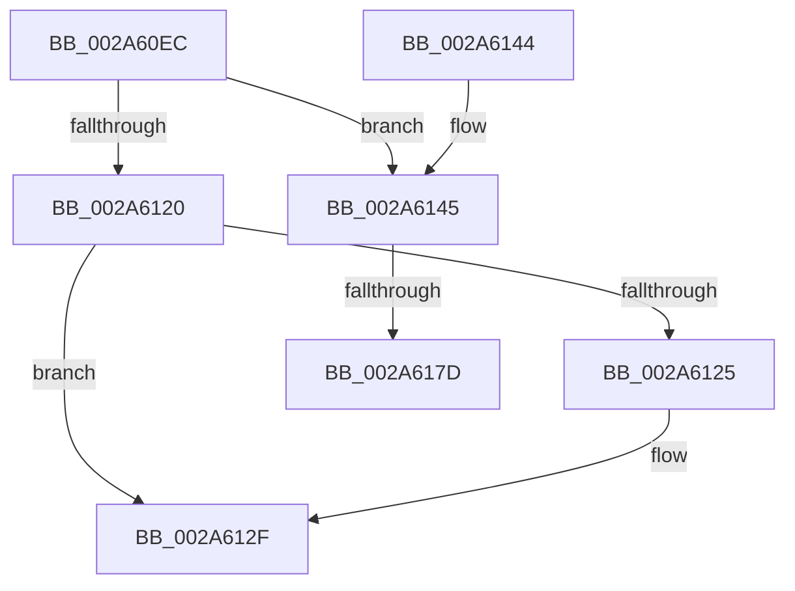

# MiAdvanceVadView

- RVA: `0x002A60EC`–`0x002A618E` (길이 `162` bytes)
- VA: `0x00000001402A60EC`
- 실행 섹션: `.text`
- PDB 이름 있음: `예`; PDB Function 태그: `예`
- unwind 정보 RVA: `0x00068A34`
- 디코드: `45`개 명령, `162/162` bytes 표시
- 미해석 바이트: `0` (있으면 어셈블리에 `.byte`로 보존)

> 이 문서는 커널 이미지의 기계어와 PDB 기호를 분석해 생성했습니다. 4번과 5번은 함수 원형과 자료형을 바이너리 사용 방식에서 추정한 C 해석이며 원본 소스 복구 결과는 아닙니다.

## 1. Dependencies

- 직접 호출 지점: **2**; 고유 호출 대상: **2**
- 직접 호출자로 확인된 함수: **2**
- RIP 상대 이미지 참조: **0**

### Outgoing calls
- `0x002A6154` → [MiStartingOffset](../34/MiStartingOffset_function_003482E0.md) (function, `0x003482E0`)
- `0x002A6183` → [MiLocateSubsectionNode](../2B/MiLocateSubsectionNode_function_002BBEE0.md) (function, `0x002BBEE0`)

### Direct callers
- [MiPerformVadSplitting](MiPerformVadSplitting_function_002A5A80.md) at `0x002A5C20`
- [MiInitializePartialVad](../../page/88/MiInitializePartialVad_function_00887954.md) at `0x00887A72`

### Static image references
- 디코드된 RIP-relative 메모리 참조가 없습니다.

## 2. Other-region calls and transfers

- 다른 실행 섹션으로 향하는 call: **0**
- call이 아닌 외부 분기/꼬리 이동: **2**
  - `0x002A6177` → [sub_006DAEBA](../6D/Unknown_function_006DAEBA.md) (`tail-transfer`)
  - `0x002A6189` → [sub_006DAEBA + 0x11](../6D/Unknown_function_006DAEBA.md) (`tail-transfer`)

## 3. Assembly (complete function range)

```asm
002A60EC  48 89 5C 24 10                  mov qword ptr [rsp + 0x10], rbx
002A60F1  48 89 6C 24 18                  mov qword ptr [rsp + 0x18], rbp
002A60F6  48 89 74 24 20                  mov qword ptr [rsp + 0x20], rsi
002A60FB  57                              push rdi
002A60FC  48 83 EC 20                     sub rsp, 0x20
002A6100  0F B6 59 20                     movzx ebx, byte ptr [rcx + 0x20]
002A6104  48 8B F2                        mov rsi, rdx
002A6107  8B 41 18                        mov eax, dword ptr [rcx + 0x18]
002A610A  48 8B F9                        mov rdi, rcx
002A610D  48 C1 E3 20                     shl rbx, 0x20
002A6111  48 0B D8                        or rbx, rax
002A6114  48 03 DA                        add rbx, rdx
002A6117  F7 41 30 00 00 20 00            test dword ptr [rcx + 0x30], 0x200000
002A611E  74 25                           je 0x1402a6145
002A6120  48 85 F6                        test rsi, rsi
002A6123  74 0A                           je 0x1402a612f
002A6125  89 5F 18                        mov dword ptr [rdi + 0x18], ebx
002A6128  48 C1 EB 20                     shr rbx, 0x20
002A612C  88 5F 20                        mov byte ptr [rdi + 0x20], bl
002A612F  48 8B 5C 24 38                  mov rbx, qword ptr [rsp + 0x38]
002A6134  48 8B 6C 24 40                  mov rbp, qword ptr [rsp + 0x40]
002A6139  48 8B 74 24 48                  mov rsi, qword ptr [rsp + 0x48]
002A613E  48 83 C4 20                     add rsp, 0x20
002A6142  5F                              pop rdi
002A6143  C3                              ret
002A6144  CC                              int3
002A6145  48 8B 49 48                     mov rcx, qword ptr [rcx + 0x48]
002A6149  41 83 C8 FF                     or r8d, 0xffffffff
002A614D  48 8B 57 50                     mov rdx, qword ptr [rdi + 0x50]
002A6151  48 8B 29                        mov rbp, qword ptr [rcx]
002A6154  E8 87 21 0A 00                  call 0x1403482e0
002A6159  48 8B D0                        mov rdx, rax
002A615C  48 8B C6                        mov rax, rsi
002A615F  48 C1 E0 0C                     shl rax, 0xc
002A6163  48 03 D0                        add rdx, rax
002A6166  48 8B C2                        mov rax, rdx
002A6169  48 C1 E8 0C                     shr rax, 0xc
002A616D  48 83 7D 40 00                  cmp qword ptr [rbp + 0x40], 0
002A6172  48 89 44 24 30                  mov qword ptr [rsp + 0x30], rax
002A6177  0F 84 3D 4D 43 00               je 0x1406daeba
002A617D  45 33 C0                        xor r8d, r8d
002A6180  48 8B CD                        mov rcx, rbp
002A6183  E8 58 5D 01 00                  call 0x1402bbee0
002A6188  90                              nop
002A6189  E9 3D 4D 43 00                  jmp 0x1406daecb
```

## 4. C-style interpretation (structured pseudocode)

```c
__int64 __fastcall MiAdvanceVadView(__int64 a1, __int64 a2, int a3)
{
    __int64 result;
    __int64 v_rbx;
    __int64 v_rsp;
    unsigned __int64 v_stack_p10;
    unsigned __int64 v_stack_p18;
    unsigned __int64 v_stack_p20;
    unsigned __int64 v_stack_p30;

    v_stack_p10 = v_rbx;
    v_stack_p18 = v_rbp;
    v_stack_p20 = v_rsi;
    v_rsp = (v_rsp) - (32);
    v_rbx = (*(unsigned __int8 *)(a1 + 32)) << (32);
    v_rbx = (v_rbx) | ((unsigned int)(*(unsigned int *)(a1 + 24)));
    v_rbx = (v_rbx) + (a2);
    if (((*(unsigned int *)(a1 + 48)) & (0x200000ULL)) == 0) goto loc_002A6145;
    if (a2 != 0) {
        *(unsigned int *)(a1 + 24) = (unsigned int)(v_rbx);
        v_rbx = (v_rbx) >> (32);
        *(unsigned __int8 *)(a1 + 32) = (unsigned __int8)(v_rbx);
    }
    v_rsp = (v_rsp) + (32);
    return (unsigned int)(*(unsigned int *)(a1 + 24));
loc_002A6145:
    a3 = (unsigned int)((a3) | (0xFFFFFFFFULL));
    result = MiStartingOffset(*(unsigned __int64 *)(a1 + 72), *(unsigned __int64 *)(a1 + 80), a3, a4);
    result = (v_stack_p20) << (12);
    a2 = (result) + (result);
    result = (a2) >> (12);
    v_stack_p30 = result;
    a3 = 0;
    result = MiLocateSubsectionNode(*(unsigned __int64 *)(*(unsigned __int64 *)(a1 + 72)), a2, a3, a4);
}
```

## 5. (Beta) C Style

```c
int64_t MiAdvanceVadView(void *Arg1, int64_t Arg2, int32_t Arg3)
{
    uint8_t *arg1 = (uint8_t *)Arg1;

    int64_t result;
    int64_t local_rbx;
    int64_t local_rsp;
    uint64_t v_stack_p10;
    uint64_t v_stack_p18;
    uint64_t v_stack_p20;
    uint64_t v_stack_p30;

    v_stack_p10 = local_rbx;
    v_stack_p18 = local_rbp;
    v_stack_p20 = local_rsi;
    local_rsp = (local_rsp) - (32);
    local_rbx = (*(uint8_t *)(arg1 + 0x20)) << (32);
    local_rbx = (local_rbx) | ((uint32_t)(*(uint32_t *)(arg1 + 0x18)));
    local_rbx = (local_rbx) + (Arg2);
    if (((*(uint32_t *)(arg1 + 0x30)) & (0x200000ULL)) == 0) goto loc_002A6145;
    if (Arg2 != 0) {
        *(uint32_t *)(arg1 + 0x18) = (uint32_t)(local_rbx);
        local_rbx = (local_rbx) >> (32);
        *(uint8_t *)(arg1 + 0x20) = (uint8_t)(local_rbx);
    }
    local_rsp = (local_rsp) + (32);
    return (uint32_t)(*(uint32_t *)(arg1 + 0x18));
loc_002A6145:
    Arg3 = (uint32_t)((Arg3) | (0xFFFFFFFFULL));
    result = MiStartingOffset(*(uint64_t *)(arg1 + 0x48), *(uint64_t *)(arg1 + 0x50), Arg3, a4);
    result = (v_stack_p20) << (12);
    Arg2 = (result) + (result);
    result = (Arg2) >> (12);
    v_stack_p30 = result;
    Arg3 = 0;
    result = MiLocateSubsectionNode(*(uint64_t *)(*(uint64_t *)(arg1 + 0x48)), Arg2, Arg3, a4);
}
```

### 관측된 메모리 오프셋

구조체 형식이 확인되지 않은 접근은 인자 기준의 오프셋으로만 기록했습니다.

| 기준 인자 | 오프셋 표현 | 폭 (bit) | 접근 |
|---|---:|---:|---|
| `Arg1` | `+ 0x18` | `32` | `R` |
| `Arg1` | `+ 0x18` | `32` | `W` |
| `Arg1` | `+ 0x20` | `8` | `R` |
| `Arg1` | `+ 0x20` | `8` | `W` |
| `Arg1` | `+ 0x30` | `32` | `R` |
| `Arg1` | `+ 0x48` | `64` | `R` |
| `Arg1` | `+ 0x50` | `64` | `R` |

## 6. Execution-region graph

[열기: 2D/3D 그래프와 함수 탐색 컨트롤 패널](../../../control-panel.html?section=text&rva=0x002A60EC&view=graph)

- 2D 그래프는 위에서 아래로 흐르고, 3D 그래프는 빈 공간을 드래그해 회전합니다. Shift+드래그는 이동, 휠은 확대·축소, 함수 노드 선택은 대상 보고서 이동입니다.

### Static fallback


