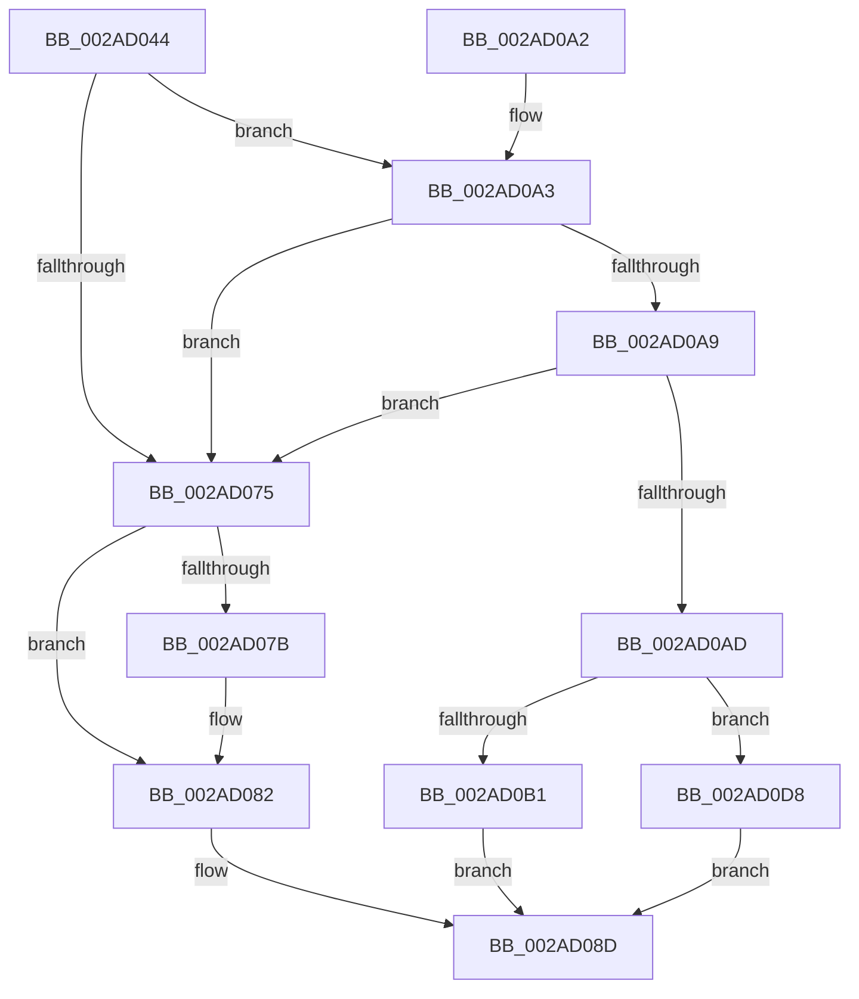

# MiAttemptSectionDelete

- RVA: `0x002AD044`–`0x002AD12C` (길이 `232` bytes)
- VA: `0x00000001402AD044`
- 실행 섹션: `.text`
- PDB 이름 있음: `예`; PDB Function 태그: `아니요`
- unwind 정보 RVA: `0x0006D284`
- 디코드: `65`개 명령, `232/232` bytes 표시
- 미해석 바이트: `0` (있으면 어셈블리에 `.byte`로 보존)

> 이 문서는 커널 이미지의 기계어와 PDB 기호를 분석해 생성했습니다. 4번과 5번은 함수 원형과 자료형을 바이너리 사용 방식에서 추정한 C 해석이며 원본 소스 복구 결과는 아닙니다.

## 1. Dependencies

- 직접 호출 지점: **5**; 고유 호출 대상: **4**
- 직접 호출자로 확인된 함수: **3**
- RIP 상대 이미지 참조: **0**

### Outgoing calls
- `0x002AD086` → [MiReleaseSpinLockExclusive](../24/MiReleaseSpinLockExclusive_function_002482C0.md) (function, `0x002482C0`)
- `0x002AD0B4` → [MiRemoveUnusedSegment](../2B/MiRemoveUnusedSegment_function_002BBE74.md) (function, `0x002BBE74`)
- `0x002AD0D1` → [MiCleanSection](../46/MiCleanSection_function_00462E1C.md) (function, `0x00462E1C`)
- `0x002AD110` → [MiReleaseSpinLockExclusive](../24/MiReleaseSpinLockExclusive_function_002482C0.md) (function, `0x002482C0`)
- `0x002AD120` → [KeWaitForGate](../2C/KeWaitForGate_function_002CA794.md) (function, `0x002CA794`)

### Direct callers
- [MmFlushImageSection](MmFlushImageSection_function_002AB930.md) at `0x002ABA0B`
- [MiCanFileBeTruncatedInternal](MiCanFileBeTruncatedInternal_function_002ACCB4.md) at `0x002ACE51`
- [MiForceSectionClosed](MiForceSectionClosed_function_002ACFD4.md) at `0x002AD00D`

### Static image references
- 디코드된 RIP-relative 메모리 참조가 없습니다.

## 2. Other-region calls and transfers

- 다른 실행 섹션으로 향하는 call: **0**
- 별도 외부 분기/꼬리 이동을 확인하지 못했습니다.

## 3. Assembly (complete function range)

```asm
002AD044  48 89 5C 24 08                  mov qword ptr [rsp + 8], rbx
002AD049  48 89 74 24 10                  mov qword ptr [rsp + 0x10], rsi
002AD04E  48 89 7C 24 18                  mov qword ptr [rsp + 0x18], rdi
002AD053  55                              push rbp
002AD054  48 8B EC                        mov rbp, rsp
002AD057  48 83 EC 50                     sub rsp, 0x50
002AD05B  48 8B D9                        mov rbx, rcx
002AD05E  41 8B F8                        mov edi, r8d
002AD061  33 C9                           xor ecx, ecx
002AD063  40 8A F2                        mov sil, dl
002AD066  89 4D DC                        mov dword ptr [rbp - 0x24], ecx
002AD069  88 4D E3                        mov byte ptr [rbp - 0x1d], cl
002AD06C  8B 43 38                        mov eax, dword ptr [rbx + 0x38]
002AD06F  48 39 4B 18                     cmp qword ptr [rbx + 0x18], rcx
002AD073  74 2E                           je 0x1402ad0a3
002AD075  40 F6 C7 04                     test dil, 4
002AD079  74 07                           je 0x1402ad082
002AD07B  0F BA E8 12                     bts eax, 0x12
002AD07F  89 43 38                        mov dword ptr [rbx + 0x38], eax
002AD082  48 8D 4B 48                     lea rcx, [rbx + 0x48]
002AD086  E8 35 B2 F9 FF                  call 0x1402482c0
002AD08B  32 C0                           xor al, al
002AD08D  48 8B 5C 24 60                  mov rbx, qword ptr [rsp + 0x60]
002AD092  48 8B 74 24 68                  mov rsi, qword ptr [rsp + 0x68]
002AD097  48 8B 7C 24 70                  mov rdi, qword ptr [rsp + 0x70]
002AD09C  48 83 C4 50                     add rsp, 0x50
002AD0A0  5D                              pop rbp
002AD0A1  C3                              ret
002AD0A2  CC                              int3
002AD0A3  48 39 4B 28                     cmp qword ptr [rbx + 0x28], rcx
002AD0A7  75 CC                           jne 0x1402ad075
002AD0A9  A8 02                           test al, 2
002AD0AB  75 C8                           jne 0x1402ad075
002AD0AD  A8 01                           test al, 1
002AD0AF  75 27                           jne 0x1402ad0d8
002AD0B1  48 8B CB                        mov rcx, rbx
002AD0B4  E8 BB ED 00 00                  call 0x1402bbe74
002AD0B9  C1 EF 02                        shr edi, 2
002AD0BC  40 8A D6                        mov dl, sil
002AD0BF  40 80 E7 01                     and dil, 1
002AD0C3  48 C7 43 28 01 00 00 00         mov qword ptr [rbx + 0x28], 1
002AD0CB  44 8A C7                        mov r8b, dil
002AD0CE  48 8B CB                        mov rcx, rbx
002AD0D1  E8 46 5D 1B 00                  call 0x140462e1c
002AD0D6  EB B5                           jmp 0x1402ad08d
002AD0D8  89 4D E4                        mov dword ptr [rbp - 0x1c], ecx
002AD0DB  48 8D 45 E8                     lea rax, [rbp - 0x18]
002AD0DF  48 8D 4D E8                     lea rcx, [rbp - 0x18]
002AD0E3  C7 45 D8 01 00 00 00            mov dword ptr [rbp - 0x28], 1
002AD0EA  48 89 4D E8                     mov qword ptr [rbp - 0x18], rcx
002AD0EE  48 8B 4B 50                     mov rcx, qword ptr [rbx + 0x50]
002AD0F2  48 89 4D D0                     mov qword ptr [rbp - 0x30], rcx
002AD0F6  48 8D 4D D0                     lea rcx, [rbp - 0x30]
002AD0FA  48 89 4B 50                     mov qword ptr [rbx + 0x50], rcx
002AD0FE  48 8D 4B 48                     lea rcx, [rbx + 0x48]
002AD102  66 C7 45 E0 07 01               mov word ptr [rbp - 0x20], 0x107
002AD108  C6 45 E2 06                     mov byte ptr [rbp - 0x1e], 6
002AD10C  48 89 45 F0                     mov qword ptr [rbp - 0x10], rax
002AD110  E8 AB B1 F9 FF                  call 0x1402482c0
002AD115  45 33 C0                        xor r8d, r8d
002AD118  48 8D 4D E0                     lea rcx, [rbp - 0x20]
002AD11C  41 8D 50 13                     lea edx, [r8 + 0x13]
002AD120  E8 6F D6 01 00                  call 0x1402ca794
002AD125  B0 01                           mov al, 1
002AD127  E9 61 FF FF FF                  jmp 0x1402ad08d
```

## 4. C-style interpretation (structured pseudocode)

```c
__int64 __fastcall MiAttemptSectionDelete(__int64 a1, unsigned __int8 a2, int a3)
{
    __int64 result;
    __int64 v_rdi;
    __int64 v_rsp;
    unsigned __int64 v_stack_m18;
    unsigned __int64 v_stack_m20;
    unsigned int v_stack_m24;
    unsigned __int8 v_stack_m25;
    unsigned __int8 v_stack_m26;
    unsigned __int16 v_stack_m28;
    unsigned int v_stack_m2C;
    unsigned int v_stack_m30;
    unsigned __int64 v_stack_m38;
    unsigned __int64 v_stack_p10;
    unsigned __int64 v_stack_p18;
    unsigned __int64 v_stack_p8;

    v_stack_p8 = v_rbx;
    v_stack_p10 = v_rsi;
    v_stack_p18 = v_rdi;
    v_rsp = (v_rsp) - (80);
    a1 = 0;
    v_stack_m2C = 0;
    v_stack_m25 = 0;
    if ((*(unsigned __int64 *)(a1 + 24)) == 0) goto loc_002AD0A3;
loc_002AD075:
    if ((((unsigned __int8)((unsigned int)(a3))) & (4)) != 0) {
        *(unsigned int *)(a1 + 56) = (unsigned int)((unsigned int)(*(unsigned int *)(a1 + 56)));
    }
    result = MiReleaseSpinLockExclusive(a1 + 72, a2, a3, a4);
    result = 0;
loc_002AD08D:
    v_rsp = (v_rsp) + (80);
    return result;
loc_002AD0A3:
    if ((*(unsigned __int64 *)(v_stack_p8 + 40)) != (a1 + 72)) goto loc_002AD075;
    if (((0) & (2)) != 0) goto loc_002AD075;
    if (((0) & (1)) != 0) goto loc_002AD0D8;
    result = MiRemoveUnusedSegment(v_stack_p8, a2, a3, a4);
    v_rdi = (unsigned int)((v_stack_p18) >> (2));
    v_rdi = (unsigned __int8)((v_rdi) & (1));
    *(unsigned __int64 *)(v_stack_p8 + 40) = 1;
    result = MiCleanSection(v_stack_p8, (unsigned __int8)(v_stack_p10), (unsigned __int8)(v_rdi), a4);
    goto loc_002AD08D;
loc_002AD0D8:
    v_stack_m24 = (unsigned int)(v_stack_p8);
    v_stack_m30 = 1;
    v_stack_m20 = v_stack_m20;
    v_stack_m38 = *(unsigned __int64 *)(v_stack_p8 + 80);
    *(unsigned __int64 *)(v_stack_p8 + 80) = v_stack_m38;
    v_stack_m28 = 263;
    v_stack_m26 = 6;
    v_stack_m18 = v_stack_m20;
    result = MiReleaseSpinLockExclusive(v_stack_p8 + 72, (unsigned __int8)(v_stack_p10), (unsigned __int8)(v_rdi), a4);
    a3 = 0;
    result = KeWaitForGate(v_stack_m28, a3 + 19, a3, a4);
    goto loc_002AD08D;
}
```

## 5. (Beta) C Style

```c
int64_t MiAttemptSectionDelete(void *Arg1, uint8_t Arg2, int32_t Arg3)
{
    uint8_t *arg1 = (uint8_t *)Arg1;

    int64_t result;
    int64_t local_rdi;
    int64_t local_rsp;
    uint64_t v_stack_m18;
    uint64_t v_stack_m20;
    uint32_t v_stack_m24;
    uint8_t v_stack_m25;
    uint8_t v_stack_m26;
    uint16_t v_stack_m28;
    uint32_t v_stack_m2C;
    uint32_t v_stack_m30;
    uint64_t v_stack_m38;
    uint64_t v_stack_p10;
    uint64_t v_stack_p18;
    uint64_t v_stack_p8;

    v_stack_p8 = local_rbx;
    v_stack_p10 = local_rsi;
    v_stack_p18 = local_rdi;
    local_rsp = (local_rsp) - (80);
    Arg1 = 0;
    v_stack_m2C = 0;
    v_stack_m25 = 0;
    if ((*(uint64_t *)(arg1 + 0x18)) == 0) goto loc_002AD0A3;
loc_002AD075:
    if ((((uint8_t)((uint32_t)(Arg3))) & (4)) != 0) {
        *(uint32_t *)(arg1 + 0x38) = (uint32_t)((uint32_t)(*(uint32_t *)(arg1 + 0x38)));
    }
    result = MiReleaseSpinLockExclusive(Arg1 + 72, Arg2, Arg3, a4);
    result = 0;
loc_002AD08D:
    local_rsp = (local_rsp) + (80);
    return result;
loc_002AD0A3:
    if ((*(uint64_t *)(v_stack_p8 + 0x28)) != (Arg1 + 72)) goto loc_002AD075;
    if (((0) & (2)) != 0) goto loc_002AD075;
    if (((0) & (1)) != 0) goto loc_002AD0D8;
    result = MiRemoveUnusedSegment(v_stack_p8, Arg2, Arg3, a4);
    local_rdi = (uint32_t)((v_stack_p18) >> (2));
    local_rdi = (uint8_t)((local_rdi) & (1));
    *(uint64_t *)(v_stack_p8 + 0x28) = 1;
    result = MiCleanSection(v_stack_p8, (uint8_t)(v_stack_p10), (uint8_t)(local_rdi), a4);
    goto loc_002AD08D;
loc_002AD0D8:
    v_stack_m24 = (uint32_t)(v_stack_p8);
    v_stack_m30 = 1;
    v_stack_m20 = v_stack_m20;
    v_stack_m38 = *(uint64_t *)(v_stack_p8 + 0x50);
    *(uint64_t *)(v_stack_p8 + 0x50) = v_stack_m38;
    v_stack_m28 = 263;
    v_stack_m26 = 6;
    v_stack_m18 = v_stack_m20;
    result = MiReleaseSpinLockExclusive(v_stack_p8 + 72, (uint8_t)(v_stack_p10), (uint8_t)(local_rdi), a4);
    Arg3 = 0;
    result = KeWaitForGate(v_stack_m28, Arg3 + 19, Arg3, a4);
    goto loc_002AD08D;
}
```

### 관측된 메모리 오프셋

구조체 형식이 확인되지 않은 접근은 인자 기준의 오프셋으로만 기록했습니다.

| 기준 인자 | 오프셋 표현 | 폭 (bit) | 접근 |
|---|---:|---:|---|
| `Arg1` | `+ 0x18` | `64` | `R` |
| `Arg1` | `+ 0x28` | `64` | `R` |
| `Arg1` | `+ 0x28` | `64` | `W` |
| `Arg1` | `+ 0x38` | `32` | `R` |
| `Arg1` | `+ 0x38` | `32` | `W` |
| `Arg1` | `+ 0x48` | `64` | `R` |
| `Arg1` | `+ 0x50` | `64` | `R` |
| `Arg1` | `+ 0x50` | `64` | `W` |

## 6. Execution-region graph

[열기: 2D/3D 그래프와 함수 탐색 컨트롤 패널](../../../control-panel.html?section=text&rva=0x002AD044&view=graph)

- 2D 그래프는 위에서 아래로 흐르고, 3D 그래프는 빈 공간을 드래그해 회전합니다. Shift+드래그는 이동, 휠은 확대·축소, 함수 노드 선택은 대상 보고서 이동입니다.

### Static fallback


