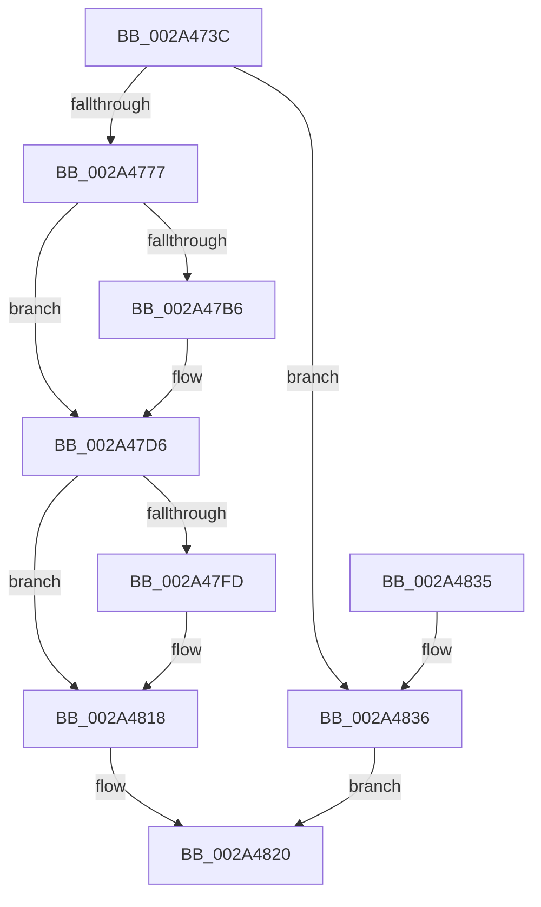

# MiBeginProcessClean

- RVA: `0x002A473C`–`0x002A483D` (길이 `257` bytes)
- VA: `0x00000001402A473C`
- 실행 섹션: `.text`
- PDB 이름 있음: `예`; PDB Function 태그: `아니요`
- unwind 정보 RVA: `0x00064A38`
- 디코드: `64`개 명령, `257/257` bytes 표시
- 미해석 바이트: `0` (있으면 어셈블리에 `.byte`로 보존)

> 이 문서는 커널 이미지의 기계어와 PDB 기호를 분석해 생성했습니다. 4번과 5번은 함수 원형과 자료형을 바이너리 사용 방식에서 추정한 C 해석이며 원본 소스 복구 결과는 아닙니다.

## 1. Dependencies

- 직접 호출 지점: **8**; 고유 호출 대상: **8**
- 직접 호출자로 확인된 함수: **2**
- RIP 상대 이미지 참조: **1**

### Outgoing calls
- `0x002A4777` → [LOCK_ADDRESS_SPACE](LOCK_ADDRESS_SPACE_function_002A4944.md) (function, `0x002A4944`)
- `0x002A477F` → [MiLockWorkingSetExclusive](../32/MiLockWorkingSetExclusive_function_003238A0.md) (function, `0x003238A0`)
- `0x002A478C` → [MiLockVadTree](../27/MiLockVadTree_function_0027C0F0.md) (function, `0x0027C0F0`)
- `0x002A47A0` → [MiUnlockVadTree](../29/MiUnlockVadTree_function_00297020.md) (function, `0x00297020`)
- `0x002A47DC` → [MiUnlockWorkingSetExclusive](../27/MiUnlockWorkingSetExclusive_function_0027EC70.md) (function, `0x0027EC70`)
- `0x002A47E7` → [UNLOCK_ADDRESS_SPACE](UNLOCK_ADDRESS_SPACE_function_002A4844.md) (function, `0x002A4844`)
- `0x002A47EF` → [MiOutlawInswaps](MiOutlawInswaps_function_002A48B8.md) (function, `0x002A48B8`)
- `0x002A4813` → [MiFreeWorkingSetSwapContext](../../page/A4/MiFreeWorkingSetSwapContext_function_00A4AABC.md) (function, `0x00A4AABC`)

### Direct callers
- [MiReAcquireOutSwappedProcessCommit](../66/MiReAcquireOutSwappedProcessCommit_function_0066F598.md) at `0x0066F6B4`
- [MmCleanProcessAddressSpace](../../page/A1/MmCleanProcessAddressSpace_function_00A17EC0.md) at `0x00A17F3A`

### Static image references
- `0x002A4808` → RVA `0x00E30088` (`.data`; read)

## 2. Other-region calls and transfers

- 다른 실행 섹션으로 향하는 call: **1**
  - `0x002A4813` → [MiFreeWorkingSetSwapContext](../../page/A4/MiFreeWorkingSetSwapContext_function_00A4AABC.md) (`.text` → `PAGE`)
- 별도 외부 분기/꼬리 이동을 확인하지 못했습니다.

## 3. Assembly (complete function range)

```asm
002A473C  48 89 5C 24 08                  mov qword ptr [rsp + 8], rbx
002A4741  48 89 6C 24 18                  mov qword ptr [rsp + 0x18], rbp
002A4746  48 89 74 24 20                  mov qword ptr [rsp + 0x20], rsi
002A474B  57                              push rdi
002A474C  48 83 EC 20                     sub rsp, 0x20
002A4750  48 8D BA 00 04 00 00            lea rdi, [rdx + 0x400]
002A4757  48 8B DA                        mov rbx, rdx
002A475A  8B 87 B8 00 00 00               mov eax, dword ptr [rdi + 0xb8]
002A4760  48 8B F1                        mov rsi, rcx
002A4763  8B 87 B8 00 00 00               mov eax, dword ptr [rdi + 0xb8]
002A4769  8B 82 F4 01 00 00               mov eax, dword ptr [rdx + 0x1f4]
002A476F  A8 20                           test al, 0x20
002A4771  0F 85 BF 00 00 00               jne 0x1402a4836
002A4777  E8 C8 01 00 00                  call 0x1402a4944
002A477C  48 8B CF                        mov rcx, rdi
002A477F  E8 1C F1 07 00                  call 0x1403238a0
002A4784  B9 03 00 00 00                  mov ecx, 3
002A4789  40 8A E8                        mov bpl, al
002A478C  E8 5F 79 FD FF                  call 0x14027c0f0
002A4791  F0 83 8B F4 01 00 00 20         lock or dword ptr [rbx + 0x1f4], 0x20
002A4799  B2 11                           mov dl, 0x11
002A479B  B9 03 00 00 00                  mov ecx, 3
002A47A0  E8 7B 28 FF FF                  call 0x140297020
002A47A5  8B 8F B8 00 00 00               mov ecx, dword ptr [rdi + 0xb8]
002A47AB  C1 E9 18                        shr ecx, 0x18
002A47AE  80 E1 30                        and cl, 0x30
002A47B1  80 F9 30                        cmp cl, 0x30
002A47B4  74 20                           je 0x1402a47d6
002A47B6  8B 87 B8 00 00 00               mov eax, dword ptr [rdi + 0xb8]
002A47BC  89 44 24 38                     mov dword ptr [rsp + 0x38], eax
002A47C0  C1 E8 18                        shr eax, 0x18
002A47C3  24 CF                           and al, 0xcf
002A47C5  88 44 24 3B                     mov byte ptr [rsp + 0x3b], al
002A47C9  8B 44 24 38                     mov eax, dword ptr [rsp + 0x38]
002A47CD  C1 E8 18                        shr eax, 0x18
002A47D0  88 87 BB 00 00 00               mov byte ptr [rdi + 0xbb], al
002A47D6  40 8A D5                        mov dl, bpl
002A47D9  48 8B CF                        mov rcx, rdi
002A47DC  E8 8F A4 FD FF                  call 0x14027ec70
002A47E1  48 8B D3                        mov rdx, rbx
002A47E4  48 8B CE                        mov rcx, rsi
002A47E7  E8 58 00 00 00                  call 0x1402a4844
002A47EC  48 8B CB                        mov rcx, rbx
002A47EF  E8 C4 00 00 00                  call 0x1402a48b8
002A47F4  48 8B F8                        mov rdi, rax
002A47F7  48 83 F8 02                     cmp rax, 2
002A47FB  76 1B                           jbe 0x1402a4818
002A47FD  44 0F B7 83 AE 04 00 00         movzx r8d, word ptr [rbx + 0x4ae]
002A4805  48 8B D0                        mov rdx, rax
002A4808  48 8B 0D 79 B8 B8 00            mov rcx, qword ptr [rip + 0xb8b879]
002A480F  4A 8B 0C C1                     mov rcx, qword ptr [rcx + r8*8]
002A4813  E8 A4 62 7A 00                  call 0x140a4aabc
002A4818  33 C0                           xor eax, eax
002A481A  48 85 FF                        test rdi, rdi
002A481D  0F 95 C0                        setne al
002A4820  48 8B 5C 24 30                  mov rbx, qword ptr [rsp + 0x30]
002A4825  48 8B 6C 24 40                  mov rbp, qword ptr [rsp + 0x40]
002A482A  48 8B 74 24 48                  mov rsi, qword ptr [rsp + 0x48]
002A482F  48 83 C4 20                     add rsp, 0x20
002A4833  5F                              pop rdi
002A4834  C3                              ret
002A4835  CC                              int3
002A4836  B8 01 00 00 00                  mov eax, 1
002A483B  EB E3                           jmp 0x1402a4820
```

## 4. C-style interpretation (structured pseudocode)

```c
__int64 __fastcall MiBeginProcessClean(__int64 a1, __int64 a2)
{
    __int64 result;
    __int64 v_rsp;
    unsigned int v_stack_p10;
    unsigned __int8 v_stack_p13;
    unsigned __int64 v_stack_p18;
    unsigned __int64 v_stack_p20;
    unsigned __int64 v_stack_p8;

    v_stack_p8 = v_rbx;
    v_stack_p18 = v_rbp;
    v_stack_p20 = v_rsi;
    v_rsp = (v_rsp) - (32);
    if ((((unsigned __int8)((unsigned int)(*(unsigned int *)(a2 + 500)))) & (32)) != 0) goto loc_002A4836;
    result = LOCK_ADDRESS_SPACE(a1, a2, a3, a4);
    result = MiLockWorkingSetExclusive(a2 + 1024, a2, a3, a4);
    result = MiLockVadTree(3, a2, a3, a4);
    result = MiUnlockVadTree(3, 17, a3, a4);
    a1 = (unsigned int)(((unsigned int)(*(unsigned int *)(a2 + 1024 + 184))) >> (24));
    a1 = (unsigned __int8)((a1) & (48));
    if (((unsigned __int8)(a1)) != 48) {
        result = *(unsigned int *)(a2 + 1024 + 184);
        v_stack_p10 = (unsigned int)(result);
        result = (unsigned int)((result) >> (24));
        result = (unsigned __int8)((result) & (207));
        v_stack_p13 = (unsigned __int8)(result);
        result = v_stack_p10;
        result = (unsigned int)((result) >> (24));
        *(unsigned __int8 *)(a2 + 1024 + 187) = (unsigned __int8)(result);
    }
    result = MiUnlockWorkingSetExclusive(a2 + 1024, (unsigned __int8)((unsigned __int8)(result)), a3, a4);
    result = UNLOCK_ADDRESS_SPACE(a1, a2, a3, a4);
    result = MiOutlawInswaps(a2, a2, a3, a4);
    if (result >= = 2) {
        a3 = *(unsigned __int16 *)(a2 + 1198);
        a2 = result;
        a1 = *(unsigned __int64 *)(v_rip + 12105849);
        a1 = *(unsigned __int64 *)(a1 + a3 * 8);
        result = MiFreeWorkingSetSwapContext(a1, a2, a3, a4);
    }
    result = 0;
    result = (0 != 0) ? 1 : 0;
loc_002A4820:
    v_rsp = (v_rsp) + (32);
    return result;
loc_002A4836:
    goto loc_002A4820;
}
```

## 5. (Beta) C Style

```c
int64_t MiBeginProcessClean(int64_t Arg1, void *Arg2)
{
    uint8_t *arg2 = (uint8_t *)Arg2;

    int64_t result;
    int64_t local_rsp;
    uint32_t v_stack_p10;
    uint8_t v_stack_p13;
    uint64_t v_stack_p18;
    uint64_t v_stack_p20;
    uint64_t v_stack_p8;

    v_stack_p8 = local_rbx;
    v_stack_p18 = local_rbp;
    v_stack_p20 = local_rsi;
    local_rsp = (local_rsp) - (32);
    if ((((uint8_t)((uint32_t)(*(uint32_t *)(arg2 + 0x1F4)))) & (32)) != 0) goto loc_002A4836;
    result = LOCK_ADDRESS_SPACE(Arg1, Arg2, a3, a4);
    result = MiLockWorkingSetExclusive(Arg2 + 1024, Arg2, a3, a4);
    result = MiLockVadTree(3, Arg2, a3, a4);
    result = MiUnlockVadTree(3, 17, a3, a4);
    Arg1 = (uint32_t)(((uint32_t)(*(uint32_t *)(arg2 + 0x400 + 0xB8))) >> (24));
    Arg1 = (uint8_t)((Arg1) & (48));
    if (((uint8_t)(Arg1)) != 48) {
        result = *(uint32_t *)(arg2 + 0x400 + 0xB8);
        v_stack_p10 = (uint32_t)(result);
        result = (uint32_t)((result) >> (24));
        result = (uint8_t)((result) & (207));
        v_stack_p13 = (uint8_t)(result);
        result = v_stack_p10;
        result = (uint32_t)((result) >> (24));
        *(uint8_t *)(arg2 + 0x400 + 0xBB) = (uint8_t)(result);
    }
    result = MiUnlockWorkingSetExclusive(Arg2 + 1024, (uint8_t)((uint8_t)(result)), a3, a4);
    result = UNLOCK_ADDRESS_SPACE(Arg1, Arg2, a3, a4);
    result = MiOutlawInswaps(Arg2, Arg2, a3, a4);
    if (result >= = 2) {
        a3 = *(uint16_t *)(arg2 + 0x4AE);
        Arg2 = result;
        Arg1 = *(uint64_t *)(v_rip + 0xB8B879);
        Arg1 = *(uint64_t *)(Arg1 + a3 * 8);
        result = MiFreeWorkingSetSwapContext(Arg1, Arg2, a3, a4);
    }
    result = 0;
    result = (0 != 0) ? 1 : 0;
loc_002A4820:
    local_rsp = (local_rsp) + (32);
    return result;
loc_002A4836:
    goto loc_002A4820;
}
```

### 관측된 메모리 오프셋

구조체 형식이 확인되지 않은 접근은 인자 기준의 오프셋으로만 기록했습니다.

| 기준 인자 | 오프셋 표현 | 폭 (bit) | 접근 |
|---|---:|---:|---|
| `Arg2` | `+ 0xB8` | `32` | `R` |
| `Arg2` | `+ 0xBB` | `8` | `W` |
| `Arg2` | `+ 0x1F4` | `32` | `R` |
| `Arg2` | `+ 0x1F4` | `32` | `R/W` |
| `Arg2` | `+ 0x400` | `64` | `R` |
| `Arg2` | `+ 0x4AE` | `16` | `R` |

## 6. Execution-region graph

[열기: 2D/3D 그래프와 함수 탐색 컨트롤 패널](../../../control-panel.html?section=text&rva=0x002A473C&view=graph)

- 2D 그래프는 위에서 아래로 흐르고, 3D 그래프는 빈 공간을 드래그해 회전합니다. Shift+드래그는 이동, 휠은 확대·축소, 함수 노드 선택은 대상 보고서 이동입니다.

### Static fallback


