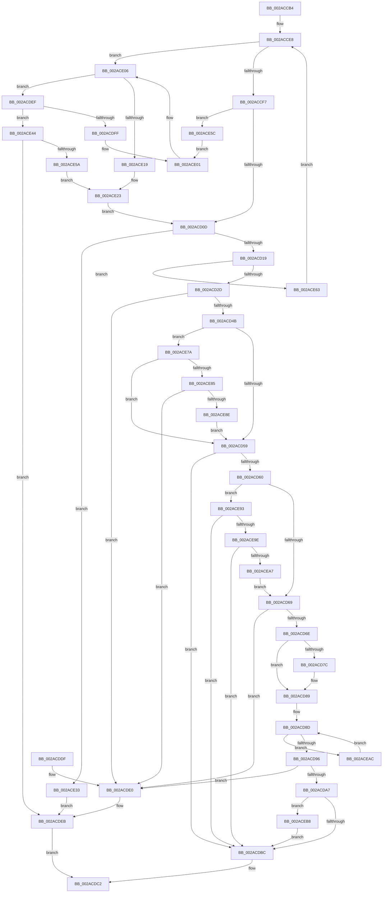

# MiCanFileBeTruncatedInternal

- RVA: `0x002ACCB4`–`0x002ACEC1` (길이 `525` bytes)
- VA: `0x00000001402ACCB4`
- 실행 섹션: `.text`
- PDB 이름 있음: `예`; PDB Function 태그: `아니요`
- unwind 정보 RVA: `0x0006D240`
- 디코드: `141`개 명령, `525/525` bytes 표시
- 미해석 바이트: `0` (있으면 어셈블리에 `.byte`로 보존)

> 이 문서는 커널 이미지의 기계어와 PDB 기호를 분석해 생성했습니다. 4번과 5번은 함수 원형과 자료형을 바이너리 사용 방식에서 추정한 C 해석이며 원본 소스 복구 결과는 아닙니다.

## 1. Dependencies

- 직접 호출 지점: **15**; 고유 호출 대상: **7**
- 직접 호출자로 확인된 함수: **2**
- RIP 상대 이미지 참조: **1**

### Outgoing calls
- `0x002ACCFA` → [ExAcquireSpinLockExclusive](../24/ExAcquireSpinLockExclusive_function_00248690.md) (function, `0x00248690`)
- `0x002ACD20` → [ExTryAcquireSpinLockExclusiveAtDpcLevel](../2B/ExTryAcquireSpinLockExclusiveAtDpcLevel_function_002BB800.md) (function, `0x002BB800`)
- `0x002ACD34` → [ExReleaseSpinLockExclusiveFromDpcLevel](../24/ExReleaseSpinLockExclusiveFromDpcLevel_function_002497E0.md) (function, `0x002497E0`)
- `0x002ACD84` → [MiFindLastSubsection](MiFindLastSubsection_function_002ACF20.md) (function, `0x002ACF20`)
- `0x002ACD99` → [MiEndingOffset](MiEndingOffset_function_002ACEC8.md) (function, `0x002ACEC8`)
- `0x002ACDE6` → [MiReleaseSpinLockExclusive](../24/MiReleaseSpinLockExclusive_function_002482C0.md) (function, `0x002482C0`)
- `0x002ACDF3` → [ExTryAcquireSpinLockExclusiveAtDpcLevel](../2B/ExTryAcquireSpinLockExclusiveAtDpcLevel_function_002BB800.md) (function, `0x002BB800`)
- `0x002ACE01` → [MiReleaseSpinLockExclusive](../24/MiReleaseSpinLockExclusive_function_002482C0.md) (function, `0x002482C0`)
- `0x002ACE09` → [ExAcquireSpinLockExclusive](../24/ExAcquireSpinLockExclusive_function_00248690.md) (function, `0x00248690`)
- `0x002ACE1E` → [MiReleaseSpinLockExclusive](../24/MiReleaseSpinLockExclusive_function_002482C0.md) (function, `0x002482C0`)
- `0x002ACE26` → [ExAcquireSpinLockExclusive](../24/ExAcquireSpinLockExclusive_function_00248690.md) (function, `0x00248690`)
- `0x002ACE39` → [MiReleaseSpinLockExclusive](../24/MiReleaseSpinLockExclusive_function_002482C0.md) (function, `0x002482C0`)
- `0x002ACE44` → [ExReleaseSpinLockExclusiveFromDpcLevel](../24/ExReleaseSpinLockExclusiveFromDpcLevel_function_002497E0.md) (function, `0x002497E0`)
- `0x002ACE51` → [MiAttemptSectionDelete](MiAttemptSectionDelete_function_002AD044.md) (function, `0x002AD044`)
- `0x002ACE70` → [MiReleaseSpinLockExclusive](../24/MiReleaseSpinLockExclusive_function_002482C0.md) (function, `0x002482C0`)

### Direct callers
- [MmCanFileBeTruncated](MmCanFileBeTruncated_function_002ACC50.md) at `0x002ACC81`
- [MmPurgeSection](../38/MmPurgeSection_function_0038B450.md) at `0x0038B4E7`

### Static image references
- `0x002ACCD5` → RVA `0x00E2CD00` (`.data`; read)

## 2. Other-region calls and transfers

- 다른 실행 섹션으로 향하는 call: **0**
- 별도 외부 분기/꼬리 이동을 확인하지 못했습니다.

## 3. Assembly (complete function range)

```asm
002ACCB4  48 89 5C 24 08                  mov qword ptr [rsp + 8], rbx
002ACCB9  48 89 6C 24 10                  mov qword ptr [rsp + 0x10], rbp
002ACCBE  48 89 74 24 18                  mov qword ptr [rsp + 0x18], rsi
002ACCC3  57                              push rdi
002ACCC4  41 54                           push r12
002ACCC6  41 55                           push r13
002ACCC8  41 56                           push r14
002ACCCA  41 57                           push r15
002ACCCC  48 83 EC 20                     sub rsp, 0x20
002ACCD0  4C 8B 7C 24 70                  mov r15, qword ptr [rsp + 0x70]
002ACCD5  48 8D 35 24 00 B8 00            lea rsi, [rip + 0xb80024]
002ACCDC  45 8B E1                        mov r12d, r9d
002ACCDF  45 8B E8                        mov r13d, r8d
002ACCE2  48 8B EA                        mov rbp, rdx
002ACCE5  4C 8B F1                        mov r14, rcx
002ACCE8  49 83 7E 10 00                  cmp qword ptr [r14 + 0x10], 0
002ACCED  41 C6 07 11                     mov byte ptr [r15], 0x11
002ACCF1  0F 85 0F 01 00 00               jne 0x1402ace06
002ACCF7  48 8B CE                        mov rcx, rsi
002ACCFA  E8 91 B9 F9 FF                  call 0x140248690
002ACCFF  49 83 7E 10 00                  cmp qword ptr [r14 + 0x10], 0
002ACD04  40 8A F8                        mov dil, al
002ACD07  0F 85 4F 01 00 00               jne 0x1402ace5c
002ACD0D  49 8B 1E                        mov rbx, qword ptr [r14]
002ACD10  48 85 DB                        test rbx, rbx
002ACD13  0F 84 1A 01 00 00               je 0x1402ace33
002ACD19  48 8D 73 48                     lea rsi, [rbx + 0x48]
002ACD1D  48 8B CE                        mov rcx, rsi
002ACD20  E8 DB EA 00 00                  call 0x1402bb800
002ACD25  85 C0                           test eax, eax
002ACD27  0F 84 36 01 00 00               je 0x1402ace63
002ACD2D  48 8D 0D CC FF B7 00            lea rcx, [rip + 0xb7ffcc]
002ACD34  E8 A7 CA F9 FF                  call 0x1402497e0
002ACD39  8B 43 38                        mov eax, dword ptr [rbx + 0x38]
002ACD3C  8B D0                           mov edx, eax
002ACD3E  D1 EA                           shr edx, 1
002ACD40  0B D0                           or edx, eax
002ACD42  F6 C2 01                        test dl, 1
002ACD45  0F 85 95 00 00 00               jne 0x1402acde0
002ACD4B  48 8B 43 70                     mov rax, qword ptr [rbx + 0x70]
002ACD4F  48 83 F8 01                     cmp rax, 1
002ACD53  0F 87 21 01 00 00               ja 0x1402ace7a
002ACD59  48 83 7B 30 00                  cmp qword ptr [rbx + 0x30], 0
002ACD5E  74 5C                           je 0x1402acdbc
002ACD60  45 85 ED                        test r13d, r13d
002ACD63  0F 85 2A 01 00 00               jne 0x1402ace93
002ACD69  48 85 ED                        test rbp, rbp
002ACD6C  74 72                           je 0x1402acde0
002ACD6E  48 83 7B 40 00                  cmp qword ptr [rbx + 0x40], 0
002ACD73  48 8D 83 80 00 00 00            lea rax, [rbx + 0x80]
002ACD7A  74 0D                           je 0x1402acd89
002ACD7C  BA 01 00 00 00                  mov edx, 1
002ACD81  48 8B CB                        mov rcx, rbx
002ACD84  E8 97 01 00 00                  call 0x1402acf20
002ACD89  48 8B 48 10                     mov rcx, qword ptr [rax + 0x10]
002ACD8D  48 85 C9                        test rcx, rcx
002ACD90  0F 85 16 01 00 00               jne 0x1402aceac
002ACD96  48 8B C8                        mov rcx, rax
002ACD99  E8 2A 01 00 00                  call 0x1402acec8
002ACD9E  48 8B 4D 00                     mov rcx, qword ptr [rbp]
002ACDA2  48 3B C8                        cmp rcx, rax
002ACDA5  72 39                           jb 0x1402acde0
002ACDA7  48 05 FF 0F 00 00               add rax, 0xfff
002ACDAD  48 25 00 F0 FF FF               and rax, 0xfffffffffffff000
002ACDB3  48 3B C8                        cmp rcx, rax
002ACDB6  0F 82 FC 00 00 00               jb 0x1402aceb8
002ACDBC  41 88 3F                        mov byte ptr [r15], dil
002ACDBF  48 8B C3                        mov rax, rbx
002ACDC2  48 8B 5C 24 50                  mov rbx, qword ptr [rsp + 0x50]
002ACDC7  48 8B 6C 24 58                  mov rbp, qword ptr [rsp + 0x58]
002ACDCC  48 8B 74 24 60                  mov rsi, qword ptr [rsp + 0x60]
002ACDD1  48 83 C4 20                     add rsp, 0x20
002ACDD5  41 5F                           pop r15
002ACDD7  41 5E                           pop r14
002ACDD9  41 5D                           pop r13
002ACDDB  41 5C                           pop r12
002ACDDD  5F                              pop rdi
002ACDDE  C3                              ret
002ACDDF  CC                              int3
002ACDE0  40 8A D7                        mov dl, dil
002ACDE3  48 8B CE                        mov rcx, rsi
002ACDE6  E8 D5 B4 F9 FF                  call 0x1402482c0
002ACDEB  33 C0                           xor eax, eax
002ACDED  EB D3                           jmp 0x1402acdc2
002ACDEF  48 8D 4F 48                     lea rcx, [rdi + 0x48]
002ACDF3  E8 08 EA 00 00                  call 0x1402bb800
002ACDF8  48 8B CE                        mov rcx, rsi
002ACDFB  85 C0                           test eax, eax
002ACDFD  75 45                           jne 0x1402ace44
002ACDFF  8A D3                           mov dl, bl
002ACE01  E8 BA B4 F9 FF                  call 0x1402482c0
002ACE06  48 8B CE                        mov rcx, rsi
002ACE09  E8 82 B8 F9 FF                  call 0x140248690
002ACE0E  49 8B 7E 10                     mov rdi, qword ptr [r14 + 0x10]
002ACE12  8A D8                           mov bl, al
002ACE14  48 85 FF                        test rdi, rdi
002ACE17  75 D6                           jne 0x1402acdef
002ACE19  8A D0                           mov dl, al
002ACE1B  48 8B CE                        mov rcx, rsi
002ACE1E  E8 9D B4 F9 FF                  call 0x1402482c0
002ACE23  48 8B CE                        mov rcx, rsi
002ACE26  E8 65 B8 F9 FF                  call 0x140248690
002ACE2B  40 8A F8                        mov dil, al
002ACE2E  E9 DA FE FF FF                  jmp 0x1402acd0d
002ACE33  40 8A D7                        mov dl, dil
002ACE36  48 8B CE                        mov rcx, rsi
002ACE39  E8 82 B4 F9 FF                  call 0x1402482c0
002ACE3E  41 C6 07 00                     mov byte ptr [r15], 0
002ACE42  EB A7                           jmp 0x1402acdeb
002ACE44  E8 97 C9 F9 FF                  call 0x1402497e0
002ACE49  45 33 C0                        xor r8d, r8d
002ACE4C  8A D3                           mov dl, bl
002ACE4E  48 8B CF                        mov rcx, rdi
002ACE51  E8 EE 01 00 00                  call 0x1402ad044
002ACE56  84 C0                           test al, al
002ACE58  74 91                           je 0x1402acdeb
002ACE5A  EB C7                           jmp 0x1402ace23
002ACE5C  8A D0                           mov dl, al
002ACE5E  48 8B CE                        mov rcx, rsi
002ACE61  EB 9E                           jmp 0x1402ace01
002ACE63  48 8D 35 96 FE B7 00            lea rsi, [rip + 0xb7fe96]
002ACE6A  40 8A D7                        mov dl, dil
002ACE6D  48 8B CE                        mov rcx, rsi
002ACE70  E8 4B B4 F9 FF                  call 0x1402482c0
002ACE75  E9 6E FE FF FF                  jmp 0x1402acce8
002ACE7A  8B 43 38                        mov eax, dword ptr [rbx + 0x38]
002ACE7D  A8 08                           test al, 8
002ACE7F  0F 85 D4 FE FF FF               jne 0x1402acd59
002ACE85  45 85 E4                        test r12d, r12d
002ACE88  0F 84 52 FF FF FF               je 0x1402acde0
002ACE8E  E9 C6 FE FF FF                  jmp 0x1402acd59
002ACE93  48 83 7B 28 00                  cmp qword ptr [rbx + 0x28], 0
002ACE98  0F 84 1E FF FF FF               je 0x1402acdbc
002ACE9E  45 85 E4                        test r12d, r12d
002ACEA1  0F 85 15 FF FF FF               jne 0x1402acdbc
002ACEA7  E9 BD FE FF FF                  jmp 0x1402acd69
002ACEAC  48 8B C1                        mov rax, rcx
002ACEAF  48 8B 49 10                     mov rcx, qword ptr [rcx + 0x10]
002ACEB3  E9 D5 FE FF FF                  jmp 0x1402acd8d
002ACEB8  48 89 45 00                     mov qword ptr [rbp], rax
002ACEBC  E9 FB FE FF FF                  jmp 0x1402acdbc
```

## 4. C-style interpretation (structured pseudocode)

```c
__int64 __fastcall MiCanFileBeTruncatedInternal(__int64 a1, __int64 a2, int a3, int a4, __int64 a5)
{
    __int64 result;
    __int64 v_rsp;
    unsigned __int64 v_stack_p10;
    unsigned __int64 v_stack_p18;
    unsigned __int64 v_stack_p8;

    v_stack_p8 = v_rbx;
    v_stack_p10 = v_rbp;
    v_stack_p18 = v_rsi;
    v_rsp = (v_rsp) - (32);
loc_002ACCE8:
    *(unsigned __int8 *)(a5) = 17;
    if ((*(unsigned __int64 *)(a1 + 16)) != 0) goto loc_002ACE06;
    result = ExAcquireSpinLockExclusive(v_rip + 12058660, a2, a3, a4);
    if ((*(unsigned __int64 *)(a1 + 16)) != 0) goto loc_002ACE5C;
loc_002ACD0D:
    if (*(unsigned __int64 *)(a1) == 0) goto loc_002ACE33;
    result = ExTryAcquireSpinLockExclusiveAtDpcLevel(*(unsigned __int64 *)(a1) + 72, a2, a3, a4);
    if ((unsigned int)(result) == 0) goto loc_002ACE63;
    result = ExReleaseSpinLockExclusiveFromDpcLevel(v_rip + 12058572, a2, a3, a4);
    a2 = (unsigned int)(((unsigned int)((unsigned int)((unsigned int)(*(unsigned int *)(*(unsigned __int64 *)(a1) + 56))))) >> (1));
    a2 = (unsigned int)((a2) | ((unsigned int)((unsigned int)(*(unsigned int *)(*(unsigned __int64 *)(a1) + 56)))));
    if ((((unsigned __int8)(a2)) & (1)) != 0) goto loc_002ACDE0;
    if ((*(unsigned __int64 *)(*(unsigned __int64 *)(a1) + 112)) > 1) goto loc_002ACE7A;
loc_002ACD59:
    if ((*(unsigned __int64 *)(*(unsigned __int64 *)(a1) + 48)) == 0) goto loc_002ACDBC;
    if ((unsigned int)((unsigned int)(a3)) != 0) goto loc_002ACE93;
loc_002ACD69:
    if (a2 == 0) goto loc_002ACDE0;
    result = *(unsigned __int64 *)(a1) + 128;
    if ((*(unsigned __int64 *)(*(unsigned __int64 *)(a1) + 64)) != 0) {
        a2 = 1;
        a1 = *(unsigned __int64 *)(a1);
        result = MiFindLastSubsection(a1, a2, a3, a4);
    }
loc_002ACD8D:
    if (*(unsigned __int64 *)(result + 16) != 0) goto loc_002ACEAC;
    result = MiEndingOffset(result, a2, a3, a4);
    if ((*(unsigned __int64 *)(a2)) < result) goto loc_002ACDE0;
    result = (result) + (0xFFFULL);
    result = (result) & (0xFFFFFFFFFFFFF000ULL);
    if ((*(unsigned __int64 *)(a2)) < result) goto loc_002ACEB8;
loc_002ACDBC:
    *(unsigned __int8 *)(a5) = (unsigned __int8)((unsigned __int8)(result));
loc_002ACDC2:
    v_rsp = (v_rsp) + (32);
    return *(unsigned __int64 *)(a1);
loc_002ACDE0:
    result = MiReleaseSpinLockExclusive(v_stack_p18, (unsigned __int8)((unsigned __int8)(result)), a3, a4);
loc_002ACDEB:
    result = 0;
    goto loc_002ACDC2;
loc_002ACDEF:
    result = ExTryAcquireSpinLockExclusiveAtDpcLevel((unsigned __int8)(result) + 72, (unsigned __int8)((unsigned __int8)(result)), a3, a4);
    if ((unsigned int)(result) != 0) goto loc_002ACE44;
loc_002ACE01:
    result = MiReleaseSpinLockExclusive(v_stack_p18, (unsigned __int8)(v_stack_p8), a3, a4);
loc_002ACE06:
    result = ExAcquireSpinLockExclusive(v_stack_p18, (unsigned __int8)(v_stack_p8), a3, a4);
    if (*(unsigned __int64 *)(a1 + 16) != 0) goto loc_002ACDEF;
    result = MiReleaseSpinLockExclusive(v_stack_p18, (unsigned __int8)(result), a3, a4);
loc_002ACE23:
    result = ExAcquireSpinLockExclusive(v_stack_p18, (unsigned __int8)(result), a3, a4);
    goto loc_002ACD0D;
loc_002ACE33:
    result = MiReleaseSpinLockExclusive(v_stack_p18, (unsigned __int8)((unsigned __int8)(result)), a3, a4);
    *(unsigned __int8 *)(a5) = 0;
    goto loc_002ACDEB;
loc_002ACE44:
    result = ExReleaseSpinLockExclusiveFromDpcLevel(v_stack_p18, (unsigned __int8)((unsigned __int8)(result)), a3, a4);
    a3 = 0;
    result = MiAttemptSectionDelete((unsigned __int8)(result), (unsigned __int8)((unsigned __int8)(result)), a3, a4);
    if ((unsigned __int8)(result) == 0) goto loc_002ACDEB;
    goto loc_002ACE23;
loc_002ACE5C:
    goto loc_002ACE01;
loc_002ACE63:
    result = MiReleaseSpinLockExclusive(v_rip + 12058262, (unsigned __int8)((unsigned __int8)(result)), a3, a4);
    goto loc_002ACCE8;
loc_002ACE7A:
    if ((((unsigned __int8)((unsigned int)(*(unsigned int *)((unsigned __int8)(result) + 56)))) & (8)) != 0) goto loc_002ACD59;
    if ((unsigned int)((unsigned int)(a4)) == 0) goto loc_002ACDE0;
    goto loc_002ACD59;
loc_002ACE93:
    if ((*(unsigned __int64 *)((unsigned __int8)(result) + 40)) == 0) goto loc_002ACDBC;
    if ((unsigned int)((unsigned int)(a4)) != 0) goto loc_002ACDBC;
    goto loc_002ACD69;
loc_002ACEAC:
    goto loc_002ACD8D;
loc_002ACEB8:
    *(unsigned __int64 *)(v_stack_p10) = v_rip + 12058262;
    goto loc_002ACDBC;
}
```

## 5. (Beta) C Style

```c
int64_t MiCanFileBeTruncatedInternal(void *Arg1, int64_t Arg2, int32_t Arg3, int32_t Arg4, void *Arg5)
{
    uint8_t *arg1 = (uint8_t *)Arg1;
    uint8_t *arg5 = (uint8_t *)Arg5;

    int64_t result;
    int64_t local_rsp;
    uint64_t v_stack_p10;
    uint64_t v_stack_p18;
    uint64_t v_stack_p8;

    v_stack_p8 = local_rbx;
    v_stack_p10 = local_rbp;
    v_stack_p18 = local_rsi;
    local_rsp = (local_rsp) - (32);
loc_002ACCE8:
    *(uint8_t *)(arg5) = 17;
    if ((*(uint64_t *)(arg1 + 0x10)) != 0) goto loc_002ACE06;
    result = ExAcquireSpinLockExclusive(v_rip + 12058660, Arg2, Arg3, Arg4);
    if ((*(uint64_t *)(arg1 + 0x10)) != 0) goto loc_002ACE5C;
loc_002ACD0D:
    if (*(uint64_t *)(arg1) == 0) goto loc_002ACE33;
    result = ExTryAcquireSpinLockExclusiveAtDpcLevel(*(uint64_t *)(arg1) + 72, Arg2, Arg3, Arg4);
    if ((uint32_t)(result) == 0) goto loc_002ACE63;
    result = ExReleaseSpinLockExclusiveFromDpcLevel(v_rip + 12058572, Arg2, Arg3, Arg4);
    Arg2 = (uint32_t)(((uint32_t)((uint32_t)((uint32_t)(*(uint32_t *)(*(uint64_t *)(arg1) + 0x38))))) >> (1));
    Arg2 = (uint32_t)((Arg2) | ((uint32_t)((uint32_t)(*(uint32_t *)(*(uint64_t *)(arg1) + 0x38)))));
    if ((((uint8_t)(Arg2)) & (1)) != 0) goto loc_002ACDE0;
    if ((*(uint64_t *)(*(uint64_t *)(arg1) + 0x70)) > 1) goto loc_002ACE7A;
loc_002ACD59:
    if ((*(uint64_t *)(*(uint64_t *)(arg1) + 0x30)) == 0) goto loc_002ACDBC;
    if ((uint32_t)((uint32_t)(Arg3)) != 0) goto loc_002ACE93;
loc_002ACD69:
    if (Arg2 == 0) goto loc_002ACDE0;
    result = *(uint64_t *)(arg1) + 128;
    if ((*(uint64_t *)(*(uint64_t *)(arg1) + 0x40)) != 0) {
        Arg2 = 1;
        Arg1 = *(uint64_t *)(arg1);
        result = MiFindLastSubsection(Arg1, Arg2, Arg3, Arg4);
    }
loc_002ACD8D:
    if (*(uint64_t *)(result + 0x10) != 0) goto loc_002ACEAC;
    result = MiEndingOffset(result, Arg2, Arg3, Arg4);
    if ((*(uint64_t *)(Arg2)) < result) goto loc_002ACDE0;
    result = (result) + (0xFFFULL);
    result = (result) & (0xFFFFFFFFFFFFF000ULL);
    if ((*(uint64_t *)(Arg2)) < result) goto loc_002ACEB8;
loc_002ACDBC:
    *(uint8_t *)(arg5) = (uint8_t)((uint8_t)(result));
loc_002ACDC2:
    local_rsp = (local_rsp) + (32);
    return *(uint64_t *)(arg1);
loc_002ACDE0:
    result = MiReleaseSpinLockExclusive(v_stack_p18, (uint8_t)((uint8_t)(result)), Arg3, Arg4);
loc_002ACDEB:
    result = 0;
    goto loc_002ACDC2;
loc_002ACDEF:
    result = ExTryAcquireSpinLockExclusiveAtDpcLevel((uint8_t)(result) + 72, (uint8_t)((uint8_t)(result)), Arg3, Arg4);
    if ((uint32_t)(result) != 0) goto loc_002ACE44;
loc_002ACE01:
    result = MiReleaseSpinLockExclusive(v_stack_p18, (uint8_t)(v_stack_p8), Arg3, Arg4);
loc_002ACE06:
    result = ExAcquireSpinLockExclusive(v_stack_p18, (uint8_t)(v_stack_p8), Arg3, Arg4);
    if (*(uint64_t *)(arg1 + 0x10) != 0) goto loc_002ACDEF;
    result = MiReleaseSpinLockExclusive(v_stack_p18, (uint8_t)(result), Arg3, Arg4);
loc_002ACE23:
    result = ExAcquireSpinLockExclusive(v_stack_p18, (uint8_t)(result), Arg3, Arg4);
    goto loc_002ACD0D;
loc_002ACE33:
    result = MiReleaseSpinLockExclusive(v_stack_p18, (uint8_t)((uint8_t)(result)), Arg3, Arg4);
    *(uint8_t *)(arg5) = 0;
    goto loc_002ACDEB;
loc_002ACE44:
    result = ExReleaseSpinLockExclusiveFromDpcLevel(v_stack_p18, (uint8_t)((uint8_t)(result)), Arg3, Arg4);
    Arg3 = 0;
    result = MiAttemptSectionDelete((uint8_t)(result), (uint8_t)((uint8_t)(result)), Arg3, Arg4);
    if ((uint8_t)(result) == 0) goto loc_002ACDEB;
    goto loc_002ACE23;
loc_002ACE5C:
    goto loc_002ACE01;
loc_002ACE63:
    result = MiReleaseSpinLockExclusive(v_rip + 12058262, (uint8_t)((uint8_t)(result)), Arg3, Arg4);
    goto loc_002ACCE8;
loc_002ACE7A:
    if ((((uint8_t)((uint32_t)(*(uint32_t *)((uint8_t)(result) + 0x38)))) & (8)) != 0) goto loc_002ACD59;
    if ((uint32_t)((uint32_t)(Arg4)) == 0) goto loc_002ACDE0;
    goto loc_002ACD59;
loc_002ACE93:
    if ((*(uint64_t *)((uint8_t)(result) + 0x28)) == 0) goto loc_002ACDBC;
    if ((uint32_t)((uint32_t)(Arg4)) != 0) goto loc_002ACDBC;
    goto loc_002ACD69;
loc_002ACEAC:
    goto loc_002ACD8D;
loc_002ACEB8:
    *(uint64_t *)(v_stack_p10) = v_rip + 12058262;
    goto loc_002ACDBC;
}
```

### 관측된 메모리 오프셋

구조체 형식이 확인되지 않은 접근은 인자 기준의 오프셋으로만 기록했습니다.

| 기준 인자 | 오프셋 표현 | 폭 (bit) | 접근 |
|---|---:|---:|---|
| `Arg1` | `+ 0x0` | `64` | `R` |
| `Arg1` | `+ 0x10` | `64` | `R` |
| `Arg5` | `+ 0x0` | `8` | `W` |

## 6. Execution-region graph

[열기: 2D/3D 그래프와 함수 탐색 컨트롤 패널](../../../control-panel.html?section=text&rva=0x002ACCB4&view=graph)

- 2D 그래프는 위에서 아래로 흐르고, 3D 그래프는 빈 공간을 드래그해 회전합니다. Shift+드래그는 이동, 휠은 확대·축소, 함수 노드 선택은 대상 보고서 이동입니다.

### Static fallback


